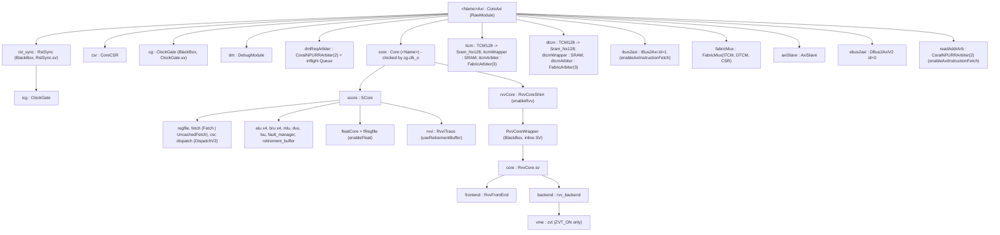
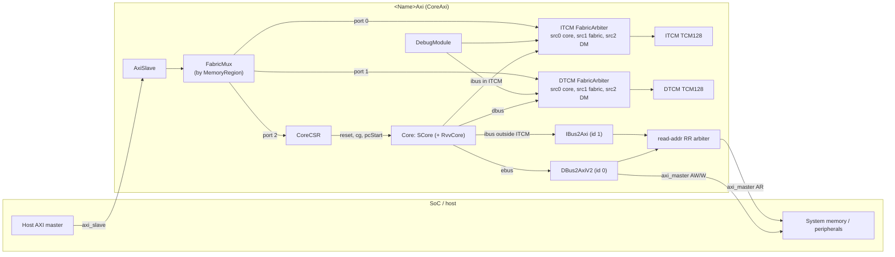
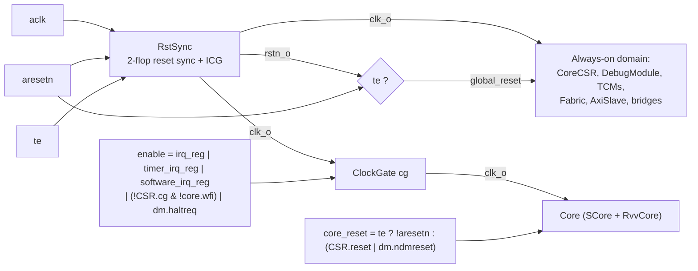

# 1. Top-Level Architecture & Configuration

This chapter describes how the CoralNPU core is put together at the top level: the generated
wrapper modules (`CoreMiniAxi`, `RvvCoreMiniAxi`, `VmeCoreMiniAxi`, `*Tlul`), the `Parameters`
configuration object, how Bazel turns that configuration into SystemVerilog variants, the
top-level ports, the core-control CSR block, clocking/reset, the memory map, and the boot flow.

Subsystems are covered in later chapters: [Scalar core](02-scalar-core.md),
[Memory / LSU](03-memory-subsystem.md), [FPU + RVV Chisel bridge](04-floating-point-and-vector-frontend.md),
[SV vector backend + VME](05-vector-backend-and-matrix-engine.md),
[SoC / bus / peripherals / DMA](06-soc-interconnect-and-peripherals.md), and
[Software / toolchain / verification](07-software-toolchain-and-verification.md).

All paths are relative to the repository root. Citations use `path:line`.

## Contents

1. [Module hierarchy](#11-module-hierarchy)
2. [Top-level block diagram](#12-top-level-block-diagram)
3. [The `Parameters` object](#13-the-parameters-object)
4. [Generator (`EmitCore`) and Bazel build variants](#14-generator-emitcore-and-bazel-build-variants)
5. [Top-level ports](#15-top-level-ports)
6. [Core-control CSR block](#16-core-control-csr-block)
7. [Clock gating and reset synchronization](#17-clock-gating-and-reset-synchronization)
8. [Memory map](#18-memory-map)
9. [Boot flow](#19-boot-flow)
10. [Notes on existing docs](#110-notes-on-existing-docs)

---

## 1.1 Module hierarchy

There are three Chisel wrappers that `EmitCore` can elaborate as the top module
(`hdl/chisel/src/coralnpu/Core.scala:166-178`):

| Generator flag | Top Chisel class | SV top name | Memory layout used |
|---|---|---|---|
| `--useAxi` | `CoreAxi` (`RawModule`) | `<moduleName>Axi` (`CoreAxi.scala:24`) | `MemoryRegions.default` or `.highmem(...)` |
| `--useTlul` | `CoreTlul` (`RawModule`), which wraps a `CoreAxi` | `<moduleName>Tlul` (`CoreTlul.scala:21`) | same as AXI |
| neither | `Core` (`Module with RequireAsyncReset`) | `<moduleName>` | "Matcha" layout: one 4 MB DMEM region at 0x0 (`Core.scala:173-176`) |

`<moduleName>` gets a suffix when the TCM sizes are not the default 8 KB/32 KB
(`Core.scala:142-153`). 1024 KB/1024 KB adds `Highmem`, and any other pair adds
`_ITCM<n>KB_DTCM<m>KB`. For example, `--moduleName=CoreMini --useAxi --itcmSizeKBytes=1024
--dtcmSizeKBytes=1024` produces the top `CoreMiniHighmemAxi`, which contains an inner `Core`
named `CoreMiniHighmem`.

### Hierarchy tree (AXI wrapper)



Sources:
- Wrapper instances: `hdl/chisel/src/coralnpu/CoreAxi.scala:49-102` (reset sync, CSR, clock gate, debug module, core), `:156-166` (ITCM), `:182` (IBus2Axi), `:214-224` (DTCM), `:239` (FabricMux), `:251` (AxiSlave), `:263` (DBus2Axi), `:275-278` (read-address arbiter).
- `Core` instantiates `SCore` and, only when `enableRvv` is set, `RvvCore` (`Core.scala:58-62`).
- `SCore` submodules: `scalar/SCore.scala:52-61`, `:118-121`, `:340-344`, and `RvviTrace` at `:644-648`. `enableFetchL0` selects `Fetch` (with an L0 cache) or `UncachedFetch` (`:53-54`). The ROB is built with `mini = !p.useRetirementBuffer` (`:61`). See [Scalar core](02-scalar-core.md).
- RVV chain: `RvvCore.apply` returns an `RvvCoreShim` (`rvv/RvvCore.scala:21-24`), which instantiates the `RvvCoreWrapper` BlackBox (`:964`). That BlackBox instantiates the SV `RvvCore` (`hdl/verilog/rvv/design/RvvCore.sv:15`), which contains `RvvFrontEnd` (`:132`) and `rvv_backend` (`:296`). The VME `zvt vme` instance exists only under `` `ifdef ZVT_ON `` (`hdl/verilog/rvv/design/rvv_backend.sv:1056-1059`). See [FPU + RVV bridge](04-floating-point-and-vector-frontend.md) and [Vector backend + VME](05-vector-backend-and-matrix-engine.md).
- `L1ICache`, `L1DCache`, `BankedItcm`, and `BankedDtcm` are in the `coralnpu` library and have their own standalone emitters (`BUILD:908-970`), but none of the core wrappers instantiates them.

### TL-UL wrapper

`CoreTlul` (`CoreTlul.scala:20-89`) contains one `CoreAxi` (`:45`) and two bridges:

- `hostBridge : Axi2TLUL` converts `CoreAxi.axi_master` into the TL-UL `tl_host` port (`:46-54`, `:80`, `:84-85`).
- `deviceBridge : TLUL2Axi` converts the TL-UL `tl_device` port into `CoreAxi.axi_slave` (`:55-66`, `:81`, `:87-88`).

The bridges are reset directly by `!rst_ni` with no synchronizer. `CoreTlul` does not expose `CoreAxi`'s optional `debug` bundle.

The SoC subsystem instantiates `CoreTlul` with parameters taken from `CoreTlulParameters`
(`hdl/chisel/src/soc/CoralNPUChiselSubsystem.scala:193-206`, `hdl/chisel/src/soc/SoCChiselConfig.scala:44-54`). See [SoC](06-soc-interconnect-and-peripherals.md).

### Standalone CSR wrappers

`CoreAxiCSR` (`CoreAxiCSR.scala:198-235`) puts an `AxiSlave` in front of `CoreCSR`.
`CoreTlulAxiCSR` (`CoreTlulCSR.scala:236-278`) uses AXI→TL-UL converters, a `TlulArbiter`, and
`CoreTlulCSR`. Only unit tests instantiate these two wrappers (`CoreAxiCSRTest.scala:21-28`).
The production wrapper `CoreAxi` builds `CoreCSR` directly behind its fabric mux.

---

## 1.2 Top-level block diagram



Key points, all from `CoreAxi.scala`:

- **TCM arbitration.** Each TCM has a 3-port `FabricArbiter` (`tcmPortCount = 3`, `:149`). Source 0 is the core's ibus or dbus, source 1 is the AXI slave fabric (through `FabricMux`), and source 2 is the debug module (`:173-180`, `:225-235`, `:240-248`). The arbiter uses fixed priority, lowest index first, so the core wins over the host and the host wins over the DM (`Fabric.scala:34-41`). The core's `dbus.ready` is tied to `true.B` (`CoreAxi.scala:236`).
- **ibus routing.** When `enableAxiInstructionFetch` is set, fetches inside the ITCM region go to the ITCM and all other fetches go to `IBus2Axi` (`:170-199`). A registered `inItcmReg` steers the return data (`:192-198`). When the flag is clear, a fetch outside the ITCM raises an ibus fault (`:200-207`).
- **AXI master.** Only the ebus uses the write channel (`:269-271`). With AXI instruction fetch, the read channel is round-robin arbitrated between ebus (ID 0) and ibus (ID 1). Read data is demultiplexed by `id` (`:273-294`). All master channels have 2-deep queues.
- **AXI gating after reset.** Both AXI ports are gated by `axiEnable`, a register that becomes 1 one cycle after reset (`:252-260`, `GateDecoupled` in `Library.scala:374-382`). The DM request path is gated the same way by `dmEnable` (`CoreAxi.scala:69-73`).
- **Address stripping.** `FabricMux` routes by `MemoryRegion.contains(addr)` and clears the region base bits before forwarding (`addr & ~memStart`, `Fabric.scala:86-112`). `CoreCSR` therefore decodes offsets, not absolute addresses.

Details of the TCMs, fabric, and bus bridges are in [Memory / LSU](03-memory-subsystem.md).

---

## 1.3 The `Parameters` object

`class Parameters(var m: Seq[MemoryRegion] = Seq(), val hartId: Int = 0, var xlen: Int = 32)`
(`hdl/chisel/src/coralnpu/Parameters.scala:71`). It is a mutable Scala object. `EmitCore`
overwrites the `var` fields from command-line flags (`Core.scala:96-138`). The SoC overwrites
them from `CoreTlulParameters` (`CoralNPUChiselSubsystem.scala:194-205`).

### 1.3.1 Feature flags (settable by `EmitCore` flags)

| Field (`Parameters.scala` line) | Default | `EmitCore` flag | Meaning | Main consumers |
|---|---|---|---|---|
| `xlen` (:71) | 32 | `--xlen=` | Integer register and address width. `require`d to be 32 or 64 (:72). Drives `programCounterBits`, all `axi*AddrBits`, CSR widths. | everywhere; `RvvCore.scala:31-36` emits `` `define XLEN_64 `` |
| `enableVerification` (:80) | false | `--enableVerification=` | Turns on the full retirement buffer (`useRetirementBuffer`, :112), RVVI trace, extra verification-only bundle fields, and implies debug ports. | `SCore.scala:61,644`; `Interfaces.scala:204-207,312-313` |
| `rawExposeDebugPorts` (:93) | false | `--exposeDebugPorts=` | Exposes the `debug : DebugIO` port without enabling the full ROB. Deliberately decoupled from verification because full-ROB mode hangs in some Float-only configs (comment :82-91). | `shouldExposeDebugPorts` (:96) → `Core.scala:55`, `CoreAxi.scala:43`, `SCore.scala:48` |
| `enableRvv` (:99) | false | `--enableRvv=` | Instantiates the RVV 1.0 core (`RvvCoreShim`) and the `rvvcore` interface in `SCore`. Adds `VLEN_128`, `TB_SUPPORT` (and `ZVE32F_ON` if float is on) to `filelist.f`. | `Core.scala:59-62,283-289`; `SCore.scala:46` |
| `enableVme` (:108) | false | `--enableVme=` | VME/Zvt (matrix) state and `mset*` instructions. `EmitCore` requires `enableRvv` (`Core.scala:140`). Adds `+define+ZVT_ON`. | `Core.scala:290-292`; `RvvCore.scala:34`; `Interfaces.scala:227-233`; `scalar/Csr.scala:29` |
| `enableFloat` (:115) | false | `--enableFloat=` | Scalar F extension: `FloatCore`, `FRegfile`, DM float register access, float debug fields. | `SCore.scala:340-345`; `CoreAxi.scala:142-145`; `Interfaces.scala:274,363-364` |
| `enableZfbfmin` (:116) | false | `--enableZfbfmin=` | Scalar BF16 conversions. Selects the fpnew `THMULTI` division/sqrt implementation and adds the BF16 format to the FPU format mask. | `float/FloatCore.scala:172-178` |
| `enableVectorBf16` (:117) | false | `--enableVectorBf16=` | Vector BF16 widening MAC. Emits `` `define ZVFBFWMA_ON `` in the generated `rvv_backend_config.svh`. | `rvv/RvvCore.scala:669-673`; `rvv/RvvDecode.scala` |
| `enableFetchL0` (:140) | **true** | `--enableFetchL0=` | `Fetch` with an L0 I-cache (`fetchCacheBytes`) when true, otherwise `UncachedFetch`. Every `*Mini*` target sets it to False. | `SCore.scala:53-54` |
| `enableAxiInstructionFetch` (:144) | **true** | `--enableAxiInstructionFetch=` | Instantiates `IBus2Axi` so code outside the ITCM can be fetched over `axi_master` with ID 1. When false, such fetches fault. | `CoreAxi.scala:174,182-207,273-302` |
| `fetchDataBits` (:148) | 256 | `--fetchDataBits=` | ibus data width. All mini targets use 128. Also sets `axi0DataBits` (:175). | `Interfaces.scala:57`; `UncachedFetch` via `fetchInstrSlots` |
| `lsuDataBits` (:158) | 256 | `--lsuDataBits=` | dbus/ebus data width. Also sets `axi2DataBits` (:187), which is the width of the external AXI/TL-UL ports, the fabric, and `CoreCSR` read lanes. `CoreAxi`'s `TCM128` is hard-coded to 128 bits (`TCM.scala:27`), so AXI targets use 128. | `Interfaces.scala:145-148`; `CoreAxi.scala:31-32` |
| `itcmSizeKBytes` (:167) | 8 | `--itcmSizeKBytes=` | ITCM size. Also selects the memory map and the module-name suffix. | `CoreAxi.scala:152`; `Core.scala:142-162` |
| `dtcmSizeKBytes` (:168) | 32 | `--dtcmSizeKBytes=` | DTCM size (same role as the ITCM size). | `CoreAxi.scala:210` |
| `axi2IdBits` (:185) | 6 | — (SoC may override) | ID width of the external AXI ports and TL-UL source width (`toTLUL`, :197-203). | `CoreAxi.scala:31-32` |
| `m` (:71) | `Seq()` | set by `EmitCore`/SoC | Memory regions. Index 0 must be IMEM and index 1 DMEM (`CoreAxi.scala:169,214`). | `FabricMux`, `Lsu`, `DebugModule`, `CoreTlulCSR.scala:47` |

Other generator flags: `--moduleName=`, `--useAxi`, `--useTlul`, and `--target-dir=`. Any
unrecognised argument is passed through to Chisel (`Core.scala:129-137`). `--useAxi` and
`--useTlul` are mutually exclusive (`:139`).

### 1.3.2 Fixed or derived parameters

| Field | Value | Meaning / where used |
|---|---|---|
| `programCounterBits` / `fetchAddrBits` / `lsuAddrBits` | `xlen` | PC, ibus, and dbus address widths (:75, :147, :157) |
| `instructionBits` | 32 | instruction width (:76) |
| `instructionLanes` | 4 | Fetch/decode/dispatch width. Gives 4 ALUs and 4 BRUs (`SCore.scala:118-119`) and the debug/regfile vector widths. |
| `rvvVlen` / `rvvVlenb` | 128 / 16 | vector register length in bits and bytes (:100-101) |
| `rvvByteIndexWidth` | log2(16)=4 | byte index in a vector register (:103) |
| `rvvRetireLanes` | `instructionLanes + 2` = 6 | RVV retire lanes: 4 from the ROB plus 2 from decode (:105) |
| `vmeTeRatio` / `vmeTe` | 8 / `128/8` = 16 | VME tile element dimension. Tile write is `(vmeTe²/16)` × 128-bit words (`Interfaces.scala:196-199`). |
| `useRetirementBuffer` | `enableVerification` | full (non-mini) ROB plus RVVI (:112) |
| `floatPulpDivsqrt` | 0 | 0 selects the E906 (or THMULTI with Zfbfmin) div/sqrt. Non-zero selects PULP. (:120, `FloatCore.scala:172,228`) |
| `scalarRegCount` / `floatRegCount` / `rvvRegCount` | 32 / 32 / 32 | register file sizes (:122-129) |
| `floatRegfileBaseAddr` / `rvvRegfileBaseAddr` | 32 / 64 | unified ROB register index space (:125, :127; `RvviTrace.scala:264,277`) |
| `retirementBufferSize` | 16 | ROB entries (:130) |
| `retirementLanes` | 8 | ROB debug and RVVI retire lanes (:131) |
| `retirementBufferIdxWidth` | log2(32 + (32 if float) + 32 + 2) | ROB register index width. The +2 covers the "no write" and "store" pseudo-registers (:132-137). |
| `fetchCacheBytes` | 1024 | L0 I-cache size, only used by `Fetch` (:141) |
| `fetchInstrSlots` | `fetchDataBits/32` | instructions per fetch beat (:149-154) |
| `lsuDataBytes`, `lsuStrictWindowBytes`, `dbusSize`, `dbusOffsetBits`, `dbusRowAddrBits` | derived from `lsuDataBits` | LSU bus geometry (:159-164) |
| `l1islots`, `l1iassoc`, `axi0IdBits`/`AddrBits`/`DataBits` | 256, 4, 4/xlen/fetchDataBits | `L1ICache` only. Not in any wrapper. (:171-175) |
| `l1dslots`, `l1dassoc`, `axi1IdBits`/`AddrBits`/`DataBits` | 256, 4, 4/xlen/lsuDataBits | `L1DCache` only. Not in any wrapper. (:178-182) |
| `axi2AddrBits` / `axi2DataBits` / `axi2DataBytes` | xlen / lsuDataBits / /8 | external bus geometry (:186-188) |
| `itcmMemoryFile` | `""` | Declared as "Only used by CoreAxi" (:190-192). No code reads it. |
| `csrInCount` / `csrOutCount` | 13 / 9 | width of the `CsrInOutIO` vectors (:194-195, `Interfaces.scala:21-32`) |
| `hartId` | 0 | reset value of `mhartid` (`scalar/Csr.scala:326`) |

`Parameters.augmentId(extraBits)` (:205-221) clones the object with a wider `axi2IdBits`.
Only `BankedItcm`/`BankedDtcm` and a test use it. The clone does not copy `enableVme`.

### 1.3.3 Not-in-`Parameters` configuration: RVV backend defines

The vector backend is configured by SV macros, not Chisel parameters:

| Macro | Source | Effect |
|---|---|---|
| `DISPATCH3` (hard-coded; `DISPATCH2` commented out) | generated `rvv_backend_config.svh` (`rvv/RvvCore.scala:657-685`, inlined at `:783`) | DISPATCH3 sets `NUM_DE_UOP=6`, `NUM_DP_UOP=3`, `NUM_DP_VRF=6`, `UQ_DEPTH=16`, `ROB_DEPTH=16`. DISPATCH2 would set 4/2/4. (`hdl/verilog/rvv/inc/rvv_backend_define.svh:39-71`) |
| `ZVFBFWMA_ON` | same file, when `enableVectorBf16` (`RvvCore.scala:669-673`) | vector BF16 widening MAC |
| `UNMK_USCS_LOAD_NOHANDSHAKE`, `ARBITER_ON` | same file, always (`:675-679`) | LSU handshake / arbiter options |
| `VLEN_128`, `TB_SUPPORT`, `ZVE32F_ON`, `ZVT_ON`, `USE_GENERIC` | `filelist.f` (`Core.scala:281-292`) and Verilator `vopts` (`flags.bzl:32-68`) | see §1.4.3 |
| `ZVTBF16FMM_ON` | **only** Verilator `VME_CORE_MINI_AXI_VOPTS` (`flags.bzl:65-68`) | enables BF16 matrix FMM in `Zvt/zvt_pe_*.sv` |

---

## 1.4 Generator (`EmitCore`) and Bazel build variants

### 1.4.1 What `EmitCore` produces

`object EmitCore extends App` (`Core.scala:89-342`) does the following:

1. Parses flags into a fresh `Parameters` (`:90-138`).
2. Picks the module name and memory regions (`:142-162`), then elaborates `CoreAxi`, `CoreTlul`, or `Core` (`:166-178`).
3. Runs firtool with `--lowering-options=disallowLocalVariables,locationInfoStyle=none` and `-enable-layers=Verification` (`:180-185`), then removes the trailing CIRCT black-box file list (`:188-190`).
4. Writes these files into `--target-dir`:
   - **`<Top>.zip`**: one `.sv` file per Chisel module (each prefixed with the common header), the embedded black-box resources (files under `verification/` are wrapped in `` `ifndef SYNTHESIS ``), and a `filelist.f`. The filelist is ordered `+incdir+.`, defines, packages, headers, Chisel modules, other modules (`:216-304`).
   - **`V<Top>_parameters.h`**: a C header with `#define KP_<field> <value>` for every `Int`/`Boolean` `val`/`var` (found by reflection), plus derived values such as `KP_exposeDebugPorts` and `KP_retirementBufferIdxWidth` (`Parameters.scala:224-272`, written at `Core.scala:323-328`). Testbenches use it, for example `KP_itcmSizeKBytes` and `KP_exposeDebugPorts` in `tests/verilator_sim/coralnpu/core_mini_axi_tb.cc:121,333-335`.
   - **`<Top>.sv`**: monolithic SV with verification-layer blocks wrapped in `` `ifndef SYNTHESIS `` (`:312-336`).

### 1.4.2 Bazel macro expansion

`chisel_cc_library(name, chisel_lib, emit_class, module_name, gen_flags, vopts, extra_outs, verilog_file_path)`
(`rules/chisel.bzl:149-210`) expands to:

| Generated target | Kind | Purpose |
|---|---|---|
| `<name>_emit_verilog_binary` | `chisel_binary` | runs `emit_class` (`coralnpu.EmitCore`) |
| `<name>_emit_verilog` | `genrule` | outputs `<module_name>.sv` plus `extra_outs` (`.zip`, `_parameters.h`). Run with `--target-dir=$(RULEDIR)`. |
| `<name>_verilog` | `verilog_library` | wraps the `.sv` |
| `<name>` | `verilator_cc_library` (SystemC) | Verilated model with `--pins-bv 2` |
| `<name>_cc` | `verilator_cc_library` (C++) | plain C++ Verilated model |

Because the `.zip` and `.sv` files are declared genrule outputs, they can be built by file label,
for example `bazel build //hdl/chisel/src/coralnpu:CoreMiniAxi.zip`.

### 1.4.3 Variants

Common flag sets (`hdl/chisel/src/coralnpu/flags.bzl:17-30`):

- `RVV_CORE_MINI_AXI_COMMON_GEN_FLAGS` = `--enableFetchL0=False --fetchDataBits=128 --lsuDataBits=128 --enableRvv=True --enableFloat=True --enableZfbfmin=True --enableVectorBf16=True --useAxi`
- `VME_CORE_MINI_AXI_COMMON_GEN_FLAGS` = the RVV set plus `--enableVme=True`

Simulation and development targets in `//hdl/chisel/src/coralnpu` (`BUILD`):

| Target (`BUILD` line) | SV top | Key flags (beyond defaults) |
|---|---|---|
| `core_cc_library` (:556) | `Core` | none: L0 fetch, 256-bit buses, Matcha layout, no float |
| `core_scalar_cc_library` (:566) | `CoreScalar` | `--moduleName=CoreScalar` |
| `core_mini_cc_library` (:580) | `CoreMini` | no L0, 128-bit fetch/LSU, raw `Core` (no AXI) |
| `core_mini_axi_cc_library` (:600) | `CoreMiniAxi` | no L0, 128/128, Float, Zfbfmin, `--useAxi`, **`--exposeDebugPorts=True`** |
| `core_mini_verification_axi_cc_library` (:618) | `CoreMiniVerificationAxi` | as above but `--enableVerification=True` |
| `core_mini_highmem_axi_cc_library` (:642) | `CoreMiniHighmemAxi` | 1024 KB / 1024 KB |
| `core_mini_itcm512kb_dtcm512kb_axi_cc_library` (:665) | `CoreMini_ITCM512KB_DTCM512KBAxi` | 512 KB / 512 KB |
| `rvv_core_mini_tlul_cc_library` (:733) | `RvvCoreMiniTlul` | no L0, 128/128, RVV, Float, `--useTlul` (no Zfbfmin or VectorBf16) |
| `rvv_core_mini_axi_cc_library` (:750) | `RvvCoreMiniAxi` | RVV common, explicit 8/32 |
| `rvv_core_mini_verification_axi_cc_library` (:763) | `RvvCoreMiniVerificationAxi` | RVV common plus verification |
| `rvv_core_mini_highmem_axi_cc_library` (:775) | `RvvCoreMiniHighmemAxi` | RVV common, 1024/1024 |
| `rvv_core_mini_itcm512kb_dtcm512kb_axi_cc_library` (:788) | `RvvCoreMini_ITCM512KB_DTCM512KBAxi` | RVV common, 512/512 |
| `vme_core_mini_axi_cc_library` (:823) | `VmeCoreMiniAxi` | VME common, 8/32 |
| `vme_core_mini_verification_axi_cc_library` (:836) | `VmeCoreMiniVerificationAxi` | VME common plus verification |
| `vme_core_mini_highmem_axi_cc_library` (:848) | `VmeCoreMiniHighmemAxi` | VME common, 1024/1024 |
| `vme_core_mini_verification_highmem_axi_cc_library` (:860) | `VmeCoreMiniVerificationHighmemAxi` | VME common plus verification, 1024/1024 |

Production targets in `//hdl/chisel/src/coralnpu/prod` (`prod/BUILD`) have verification off
and keep the same SV module names. They live in a separate package so that LEC and power flows
see the names they expect (`prod/BUILD:15-21`):

| Target | SV top | Notes |
|---|---|---|
| `core_mini_axi_prod_cc_library` (:39) | `CoreMiniAxi` | Same as sim **without** `--exposeDebugPorts`. AXI instruction fetch stays on (default). |
| `rvv_core_mini_axi_prod_cc_library` (:65) | `RvvCoreMiniAxi` | RVV common plus **`--enableAxiInstructionFetch=False`** |
| `vme_core_mini_axi_prod_cc_library` (:83) | `VmeCoreMiniAxi` | VME common plus `--enableAxiInstructionFetch=False` |
| `vme_core_mini_itcm8kb_dtcm128kb_axi_prod_cc_library` (:101) | `VmeCoreMini_ITCM8KB_DTCM128KBAxi` | VME common, 8 KB/128 KB, so the highmem address layout applies. AXI instruction fetch is left **on**. |

Verilator options (`flags.bzl:32-68`):

- `CORE_MINI_AXI_VOPTS`: `-DUSE_GENERIC` plus fpnew warning waivers.
- `RVV_CORE_MINI_AXI_VOPTS`: adds `-DTB_SUPPORT -DVLEN_128 -DZVE32F_ON` and an include path for fpnew common cells.
- `VME_CORE_MINI_AXI_VOPTS`: adds `-DZVT_ON -DZVTBF16FMM_ON`.

`vcstatic_lint` targets run on `CoreMiniAxi`, `RvvCoreMiniAxi`, and `VmeCoreMiniAxi`
(`BUILD:702-728,886-894`). The black-box list there names the TSMC/GF clock-gate and SRAM macros.

Toolchain context (`MODULE.bazel`): Scala 2.13.18 and Chisel `7.0.0-RC1` from Maven
(`MODULE.bazel:27-30,57-58`). firtool comes from `//third_party/llvm-firtool` (`rules/chisel.bzl:173-177`).

---

## 1.5 Top-level ports

Chisel adds the `io_` prefix to SV port names, so `aclk` becomes `io_aclk` and
`axi_slave.read.addr.valid` becomes `io_axi_slave_read_addr_valid`. The testbench binds them
by these names, for example `core_->io_aresetn` and `core_->io_boot_addr`
(`core_mini_axi_tb.cc:111,119`).

### 1.5.1 `CoreAxi` (`<Name>Axi`) ports (`CoreAxi.scala:26-46`)

| Port | Dir | Width / type | Description |
|---|---|---|---|
| `aclk` | in | clock | Single clock for the AXI ports and the core. |
| `aresetn` | in | async reset, active low | Goes through `RstSync` (§1.7). |
| `axi_slave` | slave | AXI4, addr `xlen`, data `lsuDataBits` (128 on mini targets), id `axi2IdBits` (6) | Host access to ITCM, DTCM, and the CSR block, routed by `FabricMux`. Unmapped accesses and failed writes return `SLVERR` (`AxiSlave.scala:90-95,131-135`). |
| `axi_master` | master | same geometry | Core access to the system: ebus loads and stores (ID 0) and, if enabled, instruction fetch outside the ITCM (ID 1). AW/W/B channels are ebus only. |
| `halted` | out | 1 | Core halted. Also `STATUS[0]`. |
| `fault` | out | 1 | Core faulted. Also `STATUS[1]`. |
| `wfi` | out | 1 | Core is in WFI. Gates the core clock (§1.7). |
| `irq` | in | 1, **active high** | External interrupt. Registered once at the boundary (`:105`). |
| `timer_irq` | in | 1 | Machine timer interrupt (registered, `:106`). |
| `software_irq` | in | 1 | Machine software interrupt (registered, `:107`). |
| `boot_addr` | in | `xlen` | Reset PC. `CoreCSR` captures it into `PC_START` on the first clock after reset (§1.6). |
| `debug` | out | `DebugIO`, optional | Present only if `shouldExposeDebugPorts` (`:43`). Carries fetch lanes (`en`, `addr`, `inst`), `cycles`, dbus snoop, dispatch lanes, regfile and float write-backs, and the retirement-buffer view `rb` (`Interfaces.scala:240-288`). |
| `dm` | slave | `DebugModuleIO` | Direct access to the RISC-V debug module. `req` is Decoupled {`address`[31:0], `data`[31:0], `op` NOP=0/READ=1/WRITE=2}. `rsp` is Decoupled {`data`[31:0], `op` SUCCESS=0/FAILED=2/BUSY=3} (`scalar/Debug.scala:21-31,53-92`). It is round-robin arbitrated with the CSR-mailbox path (`CoreAxi.scala:71-98`). |
| `te` | in | 1 | Scan/test enable. Forces clock gates open and bypasses the reset synchronizer (§1.7). |

All of `io` is marked `dontTouch` (`:47`).

### 1.5.2 `CoreTlul` (`<Name>Tlul`) ports (`CoreTlul.scala:24-42`)

| Port | Description |
|---|---|
| `clk`, `rst_ni` | Clock and active-low async reset. They drive `CoreAxi.aclk/aresetn` directly (`:68-69`). |
| `tl_host` | `OpenTitanTileLink.Host2Device`: the core's TL-UL **host** (master) port, from `Axi2TLUL(axi_master)`. Uses `toTLUL()` geometry: data `axi2DataBits`, address `xlen`, source `axi2IdBits`. |
| `tl_device` | `OpenTitanTileLink.Device2Host`: TL-UL **device** port that reaches ITCM, DTCM, and CSRs through `TLUL2Axi → axi_slave`. |
| `halted`, `fault`, `wfi`, `irq`, `boot_addr`, `timer_irq`, `software_irq`, `te`, `dm` | Same as `CoreAxi` (`:70-79`). |

`CoreTlul` has no `debug` port.

### 1.5.3 Raw `Core` ports (`Core.scala:37-56`)

These ports are visible only when no wrapper flag is given (for example `CoreMini`):
`csr : CsrInOutIO` (13 inputs, 9 outputs), `halted`, `fault`, `wfi`, `irq`, `timer_irq`,
`software_irq`, `debug_req`, `dm : CoreDMIO`, `ibus : IBusIO`, `dbus : DBusIO`,
`ebus : EBusIO`, and the optional `debug`. Bundles are defined in `Interfaces.scala:21-62,136-177,352-366`.

`Core.io.debug_req` is declared (`Core.scala:45`) and driven `true.B` by `CoreAxi`
(`CoreAxi.scala:120`), but `Core` never reads it. Debug halt requests reach the core through
`dm.debug_req`, which is driven by `dm.io.haltreq(0)` (`CoreAxi.scala:131`). The CSR input
vector sets only element 0 (= `pcStart`). Elements 1..12 are tied to 0 (`CoreAxi.scala:121-124`),
and `SCore` overrides element 12 internally with the fetch PC (`SCore.scala:212`).

### 1.5.4 RVVI trace

RVVI is **not** a top-level port. When `useRetirementBuffer` (= `enableVerification`) is set,
`SCore` instantiates `RvviTrace` (`SCore.scala:644-648`). `RvviTrace` builds an inline
`RvviTraceBlackBox` that instantiates the standard `rvviTrace` interface
(`external/RVVI/source/host/rvvi/rvviTrace.sv`) with `ILEN=XLEN=FLEN=32`, `VLEN=128`,
`MTE=vmeTe`, `NHART=1`, and `RETIRE=retirementLanes` (= 8) (`RvviTrace.scala:20-80,168-197`).

For each retire lane it drives `valid`, `order` (a running 64-bit retired count), `insn`,
`trap`, `pc_rdata`, and X/F/V register write-backs from the ROB debug bundle. It also drives
tile write-backs (`t_wdata`/`t_wb`, VME only) and CSR write-backs, including a synthesized
`mtype` (CSR 0xC23) for VME (`RvviTrace.scala:200-315`). The UVM co-simulation testbench
reads it by hierarchical reference. See [Verification](07-software-toolchain-and-verification.md).

---

## 1.6 Core-control CSR block

`CoreCSR` (`CoreAxiCSR.scala:31-196`) is the memory-mapped control block at the
`Peripheral` region (port 2 of the `FabricMux`). These registers are distinct from RISC-V
Zicsr CSRs. Offsets are relative to the CSR base: **0x30000** for the default map,
**0x200000** for the highmem map.

### 1.6.1 Register map

| Offset | Name | Access | Reset | Fields |
|---|---|---|---|---|
| 0x000 | `RESET_CONTROL` | R/W | `0x3` | bit 0 `RESET`: 1 holds the core in reset (`io.reset`). bit 1 `CLOCK_GATE`: 1 gates the core clock (`io.cg`). The register is `fetchAddrBits` wide and a write stores all of `wdata[31:0]` (`:50,151-152,157`). |
| 0x004 | `PC_START` | R/W | captures `boot_addr` | Start PC fed to `Core.io.csr.in.value(0)` (`CoreAxi.scala:121`). On the first clock after reset `bootAddrCapture=1`, so `pcStartReg` loads `boot_addr` and `pcStart` combinationally equals `boot_addr`. Host writes take effect after that cycle (`:52-53,153,158-163`). Fetch aligns it to 4 bytes (`scalar/UncachedFetch.scala:508`, `scalar/Fetch.scala:445`). |
| 0x008 | `STATUS` | RO | 0 | bit 0 `HALTED`, bit 1 `FAULT` (`statusReg := Cat(fault, halted)`, `:154`). Writes are not acknowledged, so AXI returns SLVERR. |
| 0x100 + 4·i, i=0..8 | Core CSR mirror | RO | — | `Core.io.csr.out.value(i)` (`:107-111`). The values are 0 = current fetch PC, 1 = `mepc`, 2 = `mtval`, 3 = `mcause`, 4/5 = `mcycle` lo/hi, 6/7 = `minstret` lo/hi, 8 = `mcontext0` (`scalar/Csr.scala:853-861`). |
| 0x800 | `DBG_REQ_ADDR` | R/W | 0 | Debug-module request address, which is a DM register index such as `dmcontrol` = 0x10 or `command` = 0x17 (`scalar/Debug.scala:33-42`). |
| 0x804 | `DBG_REQ_DATA` | R/W | 0 | Request data. |
| 0x808 | `DBG_REQ_OP` | R/W | NOP | 0 NOP, 1 READ, 2 WRITE. A write issues a one-cycle `req.valid` pulse to the DM arbiter, but only if the DM request port was ready in the cycle of the write (`:70-80`). |
| 0x80C | `DBG_RSP_DATA` | RO | — | Head of the 1-entry response queue. |
| 0x810 | `DBG_RSP_OP` | RO | — | 0 SUCCESS, 2 FAILED, 3 BUSY. |
| 0x814 | `DBG_STATUS` | R/W | — | Read: bit 0 = DM request ready, bit 1 = response valid (`:114`). Any write pops the response queue (`:83-84`). |

Decode and bus details:

- **Byte lanes.** Reads are aligned to the `axi2DataBytes` bus (16 B). Each 32-bit register is placed in lane `(offset % 16)/4` (`:86-140`). Writes take data from the matching lane, hard-coded per register: `[31:0]` for 0x0 and 0x800, `[63:32]` for 0x4 and 0x804, `[95:64]` for 0x808 (`:157-178`). A narrow AXI write at the register's own address works without software adjustment.
- **Valid addresses.** A read is valid only for exact register offsets (`:143-145`). Read data is delayed one cycle with `Pipe` (`:148`). Valid write addresses are 0x0, 0x4, 0x800, 0x804, 0x808, and 0x814 (`:181-195`).
- **Internal writes.** `io.internal` blocks writes that originate inside CoralNPU. `CoreAxi` ties it to false (`CoreAxi.scala:59`).
- **TL-UL variant.** `CoreTlulCSR` has the same register map but decodes **absolute** addresses (`csrBase + offset`, where `csrBase` is the `Peripheral` region's start). It answers on a TL-UL D channel with `error` for unmapped addresses (`CoreTlulCSR.scala:47-48,112-233`).

### 1.6.2 Debug mailbox path

Debug-module requests come from two sources: the external `dm` port (arbiter input 0) and the
CSR mailbox (input 1). A 1-entry `inflight` queue records which input issued each request, so
the response is routed back to the right requester (`CoreAxi.scala:71-98`). The DM also has
fabric masters on both TCM arbiters for abstract memory access (`:247-248`). Its `ndmreset`
output resets the core but not the CSR block or the DM itself (`:100-101`). See
[Scalar core](02-scalar-core.md) for debug-mode behaviour.

---

## 1.7 Clock gating and reset synchronization



**`RstSync`** (BlackBox `RstSync.scala:20-31`, RTL `hdl/verilog/RstSync.sv:19-63`):
- A shift register with `RST_DELAY=2` and `CLK_DELAY=2` is cleared asynchronously by `rstn_i` and fills with 1s on each `clk_i` edge (`:36-43`).
- `rstn_o = rst_delay_reg[1]`, so reset deasserts 2 clocks after `aresetn` rises (`:45`).
- The output clock is gated by an internal `ClockGate` whose enable is `clk_en & rst_delay_reg[3]`. The clock therefore starts 4 edges after release, which is 2 edges after reset deassertion (`:47-55`). `CoreAxi` ties `clk_en` to 1 (`CoreAxi.scala:52`).

**Wrapper reset.** `global_reset = !(te ? aresetn : rst_sync.rstn_o)`, applied as an async
reset to everything inside `withClockAndReset(rst_sync.clk_o, global_reset)`
(`CoreAxi.scala:55-56`).

**Core clock/reset** (`CoreAxi.scala:63-65,100-102,109-110`):
- `core_reset` is `!aresetn` in test mode. Otherwise it is `CSR.reset | dm.ndmreset`, which is registered state in the synchronized domain.
- The core clock enable is `irq_reg || timer_irq_reg || software_irq_reg || (!csr.cg && !core.wfi) || dm.haltreq(0)`.
- So the core clock runs when software has cleared `CLOCK_GATE` and the core is not in WFI, or whenever an interrupt or debug halt request is pending. The pending interrupt wakes a WFI core.
- `Core` itself `extends Module with RequireAsyncReset` (`Core.scala:35`), so its registers use async reset.

**`ClockGate`** (BlackBox `ClockGate.scala:20-28`, RTL `hdl/verilog/ClockGate.sv:20-84`):
- `enable=1` passes the clock and `te` forces it on.
- The cell is selected by define: `USE_TSMC12FFC` uses `CKLNQD10BWP6T20P96CPDLVT` (`:30-37`), `USE_GF12LPP` uses a user-supplied `` `ICG_CELL `` (`:38-46`), `USE_GF22_116A` uses `UDBSLT20_CKGTPLT_V5_8` (`:47-54`), `USE_GF22` uses `SC7P5T_CKGPRELATNX8_CSC36L` (`:55-62`), and `FPGA_XILINX` uses `BUFGCE` with `CE = enable | te` (`:64-72`).
- Without any of these defines, a generic latch-based ICG is used (`en_latch` captured while `clk_i` is low, `clk_o = en_latch & clk_i`, `:73-81`).

**Interrupt inputs** are each registered once (`CoreAxi.scala:104-107`) to break timing paths
to the ibus. `core.io.irq` is `irq_reg || dm.haltreq(0)` (`:114`).

---

## 1.8 Memory map

Regions are defined in `MemoryRegions` (`Parameters.scala:43-56`). Each `MemoryRegion` has a
start address, a size, and a type (IMEM/DMEM/Peripheral/External). It decodes addresses as
`start <= addr < start+size` (`:30-41`).

| Region | Default (8 KB / 32 KB) | Highmem layout (any non-default size) | Type |
|---|---|---|---|
| ITCM | `0x0000_0000` – `0x0000_1FFF` (8 KB) | `0x0000_0000`, size `itcmSizeKBytes`·1024 | IMEM |
| DTCM | `0x0001_0000` – `0x0001_7FFF` (32 KB) | `0x0010_0000`, size `dtcmSizeKBytes`·1024 | DMEM |
| CSR | `0x0003_0000` – `0x0003_0FFF` (4 KB) | `0x0020_0000` – `0x0020_0FFF` (4 KB) | Peripheral |
| Everything else | → `axi_master` (ebus; ibus if enabled) | same | — |

- `EmitCore` uses `default` only for exactly 8/32. Every other size pair, including 512/512 and 8/128, uses `highmem(itcm, dtcm)` (`Core.scala:155-162`).
- The highmem bases are spaced 1 MB apart so the sizes can vary up to 1 MB without moving the bases (`Parameters.scala:50-51`). No code checks the upper limit.
- `Parameters` defines the highmem constants as `itcmSizeKBytesHighmem = dtcmSizeKBytesHighmem = 1024` (`:61-62`).
- The raw `Core` target uses a single 4 MB DMEM region at 0 (`Core.scala:173-176`).
- In the SoC, the regions come from the SoC configuration (`CoralNPUChiselSubsystem.scala:195`). See [SoC](06-soc-interconnect-and-peripherals.md).

The Verilator testbench reflects the same layout. It uses `csr_addr_ = 0x200000` under
`HIGHMEM_RTL` and `0x30000` otherwise (`tests/verilator_sim/coralnpu/core_mini_axi_tb.h:270-274`).
It also derives the DTCM base from `KP_itcmSizeKBytes`/`KP_dtcmSizeKBytes`
(`core_mini_axi_tb.cc:333-336`).

---

## 1.9 Boot flow

```mermaid
sequenceDiagram
  participant H as Host (AXI master)
  participant W as CoreAxi wrapper
  participant C as Core
  Note over W: aresetn low -> RstSync clears; CSR RESET_CONTROL=0x3
  H->>W: release aresetn
  Note over W: +2 clk reset deasserts, +4 clk clock runs<br/>cycle 1: PC_START <- boot_addr, axiEnable <- 1
  H->>W: AXI writes to ITCM (0x0...) and DTCM (0x10000 / 0x100000)
  H->>W: optional write PC_START (CSR+0x4) = entry point
  H->>W: write RESET_CONTROL = 1 (ungate clock, keep reset)
  H->>W: write RESET_CONTROL = 0 (release reset)
  W->>C: core_reset low, clock enabled
  C->>C: fetch from PC_START (4-byte aligned)
  C-->>W: halted / fault (pins and STATUS)
  H->>W: poll STATUS (CSR+0x8): bit0 halted, bit1 fault
```

Step by step, as implemented:

1. **Power-on reset.** `aresetn` is asserted. When it is released, `RstSync` deasserts the wrapper reset 2 cycles later and enables the clock 4 cycles later (§1.7). `RESET_CONTROL` resets to 0x3, so the core is held in reset with its clock gated (`CoreAxiCSR.scala:47-50`).
2. **Boot address capture.** On the first clock after reset, `PC_START` loads `boot_addr` (`:51-53,158-163`). One cycle after reset, `axiEnable` and `dmEnable` open the AXI and DM paths (`CoreAxi.scala:69-70,252-253`).
3. **Load TCMs.** The host writes code and data through `axi_slave` (or `tl_device`) to the ITCM and DTCM addresses (§1.8). The debug module can also write memory through its TCM fabric ports. A core that is still in reset does not compete for the arbiters.
4. **Program the start PC** (optional) by writing the entry point to `CSR+0x4`. This overrides the captured `boot_addr`.
5. **Ungate the clock** by writing `RESET_CONTROL = 1`. The core clock now runs while the core is still in reset.
6. **Release reset** by writing `RESET_CONTROL = 0`. Fetch starts at `pcStart` (`UncachedFetch.scala:508`).
7. **Completion.** Watch the `halted`/`fault` pins or poll `STATUS`.

The Verilator testbench follows this sequence:
- `LoadElfSync` issues AXI writes, with read-back checks, for every ELF segment, then writes the entry point to `csr_addr_+0x4` (`core_mini_axi_tb.cc:328-355`). TCM segments can be backdoor-loaded instead.
- `ClockGateSync(false)` writes 1 and `ResetAsync(false)` writes 0 to `RESET_CONTROL` (`:392-421`, called at `core_mini_axi_sim.cc:66-68`).
- `CheckStatus` expects `STATUS == 1`, which means halted with no fault (`core_mini_axi_tb.cc:430-436`).

---

## 1.10 Notes on existing docs

Where `doc/` text disagrees with the code, this chapter follows the code.

1. **Port names and polarity** (`doc/integration_guide.md:21-31`). The guide lists `clk`, `reset`, `s_axi`, `m_axi`, and an active-low `irqn`. The code has `aclk`, `aresetn`, `axi_slave`, `axi_master`, and an **active-high** `irq`, plus `timer_irq`, `software_irq`, `boot_addr`, `dm`, and `te`, which the guide omits (`CoreAxi.scala:26-46`). The guide also does not say that `debug` exists only when `exposeDebugPorts` or `enableVerification` is set.
2. **AXI master ID "always 0"** (`integration_guide.md:41,55,71`). When `enableAxiInstructionFetch` is on (the default, and on in `CoreMiniAxi`), instruction fetches use ID 1 and read data is routed by ID (`CoreAxi.scala:182,273-294`, `IBus2Axi.scala:56`).
3. **"Synchronous reset strategy"** (`integration_guide.md:165`). The design uses async resets: `AsyncReset` ports, `Core` with `RequireAsyncReset`, and a 2-flop `RstSync` deassertion synchronizer (`CoreAxi.scala:29,55`, `Core.scala:35`, `RstSync.sv:40-45`).
4. **`PC_START` reset value 0** (`integration_guide.md:244`). On the first clock after reset it captures the `boot_addr` input (`CoreAxiCSR.scala:51-53,158-163`).
5. **`RESET_CONTROL[31:2]` "writes ignored, reads return 0"** (`integration_guide.md:235`). The register stores and returns all 32 written bits (`CoreAxiCSR.scala:50,157`).
6. **CSR region size "TBD"** (`integration_guide.md:161`). It is 4 KB (0x1000) at 0x30000, or at 0x200000 in the highmem layout. The guide also omits the CSR mirror at 0x100 and the debug mailbox at 0x800–0x814.
7. **Banked TCMs** (`doc/overview.md:167-168,186`). The overview describes a "Banked ITCM (4x 32b banks)" and a multi-banked DTCM crossbar (`BankedDtcm.scala`). The core wrappers instantiate a single 128-bit `TCM128` per memory behind a 3-port fixed-priority `FabricArbiter` (`CoreAxi.scala:149-166,214-224`). `BankedItcm`/`BankedDtcm` are only emitted as standalone libraries (`BUILD:908-926`).
8. **TL-UL variants** (`doc/overview.md:51`). The overview lists `CoreMiniTlul`, plus a TL-UL VME variant. The only TL-UL Bazel target is `rvv_core_mini_tlul_cc_library` → `RvvCoreMiniTlul` (`BUILD:733-749`). `EmitCore --useTlul` could produce the others, but no target does.
9. **Sim vs prod flag differences.** The sim `CoreMiniAxi` has `--exposeDebugPorts=True` and the prod one does not. Sim `RvvCoreMiniAxi`/`VmeCoreMiniAxi` keep AXI instruction fetch on, while prod turns it off. Prod `VmeCoreMini_ITCM8KB_DTCM128KBAxi` leaves it on (`BUILD:600-616,750-762,823-835`; `prod/BUILD:47-56,73-76,91-94,109-113`). Despite the same module name, sim and prod RTL are not interchangeable.
10. **`ZVTBF16FMM_ON` missing from `filelist.f`.** VME Verilator builds define `ZVTBF16FMM_ON` (`flags.bzl:65-68`). The `filelist.f` inside the emitted `.zip` adds only `ZVT_ON` (`Core.scala:290-292`). Integrators using the zip must add `+define+ZVTBF16FMM_ON` themselves to match the simulated BF16 matrix behaviour.
11. **Minor code notes.** `Parameters.itcmMemoryFile` is documented as used by `CoreAxi`, but nothing reads it. `Parameters.augmentId` does not copy `enableVme`. `Core.io.debug_req` is unused.
