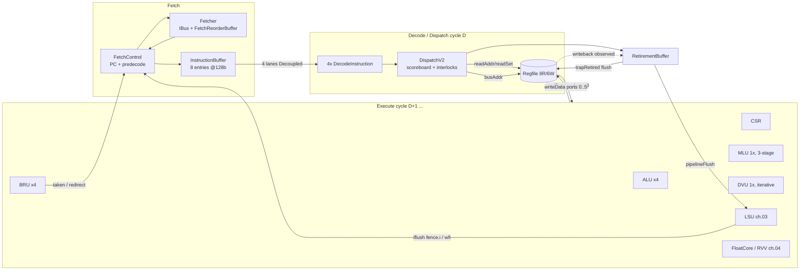
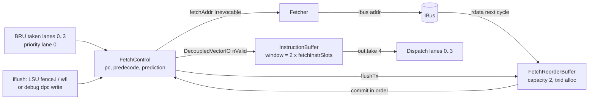
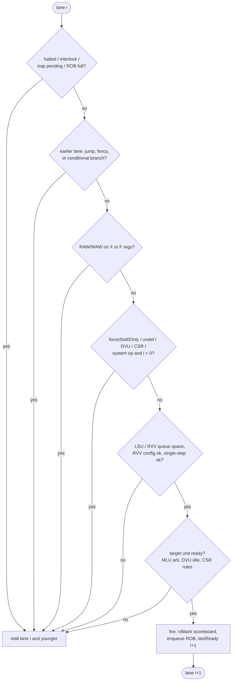
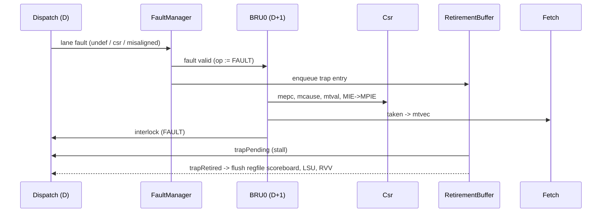

# 2. Scalar Core Pipeline

This chapter describes the CoralNPU scalar core (`SCore`): instruction fetch,
decode/dispatch, the integer register file, the scalar execution units (ALU,
BRU, MLU, DVU), the CSR file, trap/fault handling, the debug module and the
retirement buffer. Load/store execution is covered in
[03 – LSU & memory](03-memory-subsystem.md); the FPU and RVV Chisel bridge in
[04 – FPU + RVV bridge](04-floating-point-and-vector-frontend.md); the SystemVerilog vector backend
and VME in [05 – Vector backend](05-vector-backend-and-matrix-engine.md); bus/SoC integration in
[06 – SoC & bus](06-soc-interconnect-and-peripherals.md); software and verification flows in
[07 – Software & verification](07-software-toolchain-and-verification.md). Top-level
parameters are described in [01 – Top level](01-top-level-and-configuration.md).

All claims below were checked against the Chisel source. Citations are
`path:line` relative to the repository root.

**Contents**

1. [Overview and parameters](#21-overview-and-parameters)
2. [Pipeline stages and timing](#22-pipeline-stages-and-timing)
3. [Instruction fetch](#23-instruction-fetch)
4. [Decode and supported ISA](#24-decode-and-supported-isa)
5. [Dispatch rules](#25-dispatch-rules)
6. [Register file, forwarding and writeback](#26-register-file-forwarding-and-writeback)
7. [Execution units](#27-execution-units)
8. [CSR file](#28-csr-file)
9. [Exceptions, interrupts and the FaultManager](#29-exceptions-interrupts-and-the-faultmanager)
10. [WFI, halt and fault signalling](#210-wfi-halt-and-fault-signalling)
11. [Debug support](#211-debug-support)
12. [Retirement buffer and RVVI trace](#212-retirement-buffer-and-rvvi-trace)
13. [Notes on existing docs](#213-notes-on-existing-docs)
14. [Implementation observations](#214-implementation-observations)

---

## 2.1 Overview and parameters

`SCore` (`hdl/chisel/src/coralnpu/scalar/SCore.scala:31`) is an in-order core
that decodes and dispatches up to four instructions per cycle. It instantiates
the following units:

| Unit | Instance | Source |
|---|---|---|
| Integer register file | `Regfile(p)` | `hdl/chisel/src/coralnpu/scalar/SCore.scala:52` |
| Fetch | `Fetch` (L0 cache) if `enableFetchL0`, else `UncachedFetch` | `hdl/chisel/src/coralnpu/scalar/SCore.scala:53-54` |
| CSR file | `Csr(p)` | `hdl/chisel/src/coralnpu/scalar/SCore.scala:56` |
| Decode/dispatch | `DispatchV2` | `hdl/chisel/src/coralnpu/scalar/SCore.scala:57` |
| LSU | `Lsu(p)` (see ch. 03) | `hdl/chisel/src/coralnpu/scalar/SCore.scala:59` |
| FaultManager | `FaultManager` | `hdl/chisel/src/coralnpu/scalar/SCore.scala:60` |
| Retirement buffer | `RetirementBuffer(p, mini = !p.useRetirementBuffer)` | `hdl/chisel/src/coralnpu/scalar/SCore.scala:61` |
| ALU ×4, BRU ×4 | one per lane; only BRU 0 is `first` | `hdl/chisel/src/coralnpu/scalar/SCore.scala:118-119` |
| MLU ×1, DVU ×1 | shared | `hdl/chisel/src/coralnpu/scalar/SCore.scala:120-121` |
| FloatCore + FRegfile | optional (`enableFloat`) | `hdl/chisel/src/coralnpu/scalar/SCore.scala:340-344` |

Key parameters (`hdl/chisel/src/coralnpu/Parameters.scala`):

| Parameter | Default | Line | Notes |
|---|---|---|---|
| `xlen` | 32 | 71 | 64 is accepted; RV64 decode entries are added when `xlen == 64` |
| `instructionLanes` | 4 | 77 | decode/dispatch width |
| `scalarRegCount` | 32 | 122 | |
| `retirementBufferSize` | 16 | 130 | ROB entries |
| `retirementLanes` | 8 | 131 | max retires per cycle |
| `enableFetchL0` | `true` | 140 | **all shipped build targets pass `--enableFetchL0=False`** (`hdl/chisel/src/coralnpu/flags.bzl:18`, `hdl/chisel/src/coralnpu/BUILD:588`, `hdl/chisel/src/soc/SoCChiselConfig.scala:149`) |
| `fetchCacheBytes` | 1024 | 141 | L0 only |
| `fetchDataBits` | 256 | 148 | shipped targets use 128 (`hdl/chisel/src/coralnpu/flags.bzl:19`) |
| `enableVerification` | `false` | 80 | selects full retirement buffer (`useRetirementBuffer`, line 112) |
| `rawExposeDebugPorts` | `false` | 93 | `shouldExposeDebugPorts = raw || enableVerification` (line 96) |

So in the production configurations the core uses **`UncachedFetch` with a
128-bit fetch bus**, i.e. `fetchInstrSlots = 4` instructions per fetch line
(`hdl/chisel/src/coralnpu/Parameters.scala:149-154`).

## 2.2 Pipeline stages and timing

Conceptually the core has three stages — Fetch, Decode/Dispatch, Execute/Writeback —
but fetch itself is multi-cycle and some execute units are multi-cycle.



**Cycle-level contract.** In the dispatch cycle *D* the dispatcher drives the
register file read addresses (`hdl/chisel/src/coralnpu/scalar/Decode.scala:1043-1055`)
and the unit command `valid` signals. The register file registers its read data
(`hdl/chisel/src/coralnpu/scalar/Regfile.scala:201-212`), so every unit sees its
operands in cycle *D+1*. ALU, BRU and CSR each register their command at the end
of *D* (`hdl/chisel/src/coralnpu/scalar/Alu.scala:95-103`,
`hdl/chisel/src/coralnpu/scalar/Bru.scala:154-156`,
`hdl/chisel/src/coralnpu/scalar/Csr.scala:278-279`) and produce results in *D+1*.
Write ports update the architectural registers at the end of the cycle in which
`writeData.valid` is high (`hdl/chisel/src/coralnpu/scalar/Regfile.scala:172-176`).

| Class | Result written (end of cycle) | Earliest dependent dispatch | Notes |
|---|---|---|---|
| ALU | D+1 | D+1 (forwarded) | back-to-back dependent ALU ops are possible |
| BRU link (`jal/jalr rd`) | D+1 | D+1 | redirect visible to fetch in D+1 |
| CSR | D+1 | D+1 | only dispatched when ROB empty (§2.5) |
| MLU | D+2 | D+2 | |
| DVU | D+34−c (c = normalisation shift, 0…30) | after writeback | §2.7.4 |
| LSU | see [ch. 03](03-memory-subsystem.md) | | |
| Base address of load/store/`jalr` | — | needs value already in the register array | uses the non-forwarded scoreboard (`regd`) |

The "earliest dependent dispatch" column follows from the two scoreboard views
described in §2.6: the combinational view (`comb`) clears a bit in the same cycle
the result is on a write port and the read port forwards that data
(`hdl/chisel/src/coralnpu/scalar/Regfile.scala:132-133,189-198`).

## 2.3 Instruction fetch

### 2.3.1 IBus protocol

```scala
class IBusIO(p: Parameters) extends Bundle {   // hdl/chisel/src/coralnpu/Interfaces.scala:51
  val valid = Output(Bool()); val ready = Input(Bool()); val addr = Output(UInt(p.fetchAddrBits.W))
  val rdata = Input(UInt(p.fetchDataBits.W))
  val fault = Input(Valid(new FaultInfo(p)))
}
```

* Control phase: `valid/ready/addr`; `addr` must be held until `ready`
  (`hdl/chisel/src/coralnpu/Interfaces.scala:49-50`).
* Read phase: `rdata` is consumed the cycle after the address handshake — the
  Fetcher captures `rdata` with `busResp.valid := RegNext(ibusAddrFire)`
  (`hdl/chisel/src/coralnpu/scalar/UncachedFetch.scala:364-367`). The fault
  flag is sampled in the address cycle and registered alongside.
* Addresses are line-aligned (`addr[lsb-1:0] = 0`, `lsb = log2(fetchDataBits/8)`)
  (`hdl/chisel/src/coralnpu/scalar/UncachedFetch.scala:332,354`).
* The IBus is **shared with the LSU** (LSU loads from ITCM). LSU has priority:
  `io.ibus.valid/addr` are muxed toward the LSU whenever `lsu.io.ibus.valid`,
  and fetch sees `ready = false` in that cycle
  (`hdl/chisel/src/coralnpu/scalar/SCore.scala:566-576`). Fetch faults are
  suppressed while the LSU owns the bus (line 573).

### 2.3.2 UncachedFetch (production path)

`UncachedFetch` (`hdl/chisel/src/coralnpu/scalar/UncachedFetch.scala:541`) is
built from three blocks:



**FetchControl** (`hdl/chisel/src/coralnpu/scalar/UncachedFetch.scala:384-539`)

* Leaving reset, `pc` is loaded from `csr.value(0)` (the boot/start PC) with the
  low two bits cleared (line 508).
* Next-PC priority (lines 505-515): reset → `iflush` → BRU `branch` →
  predicted jump in the line just written → sequential next line
  (`pc[31:lsb] + 1`) once the current line has been requested (`pcFetched`).
* A new fetch is blocked while still in reset, in the cycle a branch/flush
  arrives, while an earlier address is still waiting for `ready`
  (`ongoingFetch`), or after a fetch fault (lines 489-492). Thus the cycle that
  receives a redirect never issues a request; the redirected fetch is issued the
  next cycle.
* Responses that arrive after a branch/flush (current or past) are discarded
  until a new fetch is initiated (`pastBranchOrFlush`, lines 463-465, 479,
  527-530). The same applies after a predicted jump (`pendingJump`, lines
  532-535). `flushTx` cancels outstanding bus transactions in the reorder
  buffer (line 538).
* A fetch response is accepted only if the instruction buffer can take all of
  its valid instructions (`nReady >= count`, line 474) — all-or-nothing.

**Static branch prediction** (`PredictJump`, lines 400-413; `Predecode`,
lines 415-457):

* `jal` is always predicted taken.
* Conditional branches are predicted taken only when backward
  (`inst[31] = 1`, i.e. negative offset) and `funct3[2:1] != 01` (excludes the
  reserved funct3 010/011).
* `jalr` is **not** predicted (always resolved by the BRU).
* The fetch line is shifted so the first instruction is at `addr`
  (`startElem`), instructions after the first predicted-taken jump are dropped,
  and the predicted instruction is tagged `brchFwd = 1`; the next fetch PC
  becomes the predicted target (lines 422-439).

**Fetcher** (`hdl/chisel/src/coralnpu/scalar/UncachedFetch.scala:324-382`):
issues line-aligned requests with up to `maxConcurrentTx = 2` outstanding
transactions, tracked by an `IndexAllocatorShifting` and a
`FetchReorderBuffer` with `flowResponse = false`, which adds one register
stage between `rdata` and commit to break the rdata→addr loop (lines 338-349).

**FetchReorderBuffer** (`hdl/chisel/src/coralnpu/scalar/UncachedFetch.scala:39-318`)
is written as a sequence of state transforms per cycle: save the bus response
into the entry with the matching txid (stage 1), commit the head entry if it has
a response and no cancelled entries are pending (stage 2), mark all entries
cancelled on `flush` and trim cancelled entries without responses (stage 3),
discard a cancelled head entry that has a response (stage 4), and enqueue a
new transaction (stage 5). Freed txids are returned to the allocator (lines
308-317). Extensive preconditions are asserted at each stage.

**InstructionBuffer** (`hdl/chisel/src/common/InstructionBuffer.scala:36-76`)
wraps `CircularBufferMulti` (`hdl/chisel/src/common/CircularBufferMulti.scala:20-76`)
with `n = fetchInstrSlots` and `window = 2 × fetchInstrSlots`
(`hdl/chisel/src/coralnpu/scalar/UncachedFetch.scala:570-573`). It enqueues up
to *n* and dequeues up to *n* entries per cycle; only the first four outputs are
connected to dispatch (line 575). Dequeue must be a contiguous prefix
(asserted, `InstructionBuffer.scala:67-70`). An enqueued instruction is visible
one cycle later (`InstructionBuffer.scala:34`). `flush` (iflush, BRU branch or
debug PC) resets the pointers and masks `valid` combinationally in the same
cycle (`InstructionBuffer.scala:62`, `UncachedFetch.scala:576`).

`io.pc` reports the address of the instruction at the head of the buffer
(`UncachedFetch.scala:578-580`); `SCore` feeds it to CSR input 12, which `Csr`
re-exports as `csr.out.value(0)` (`SCore.scala:212`, `Csr.scala:853`).

**Redirect cost (derived).** A branch dispatched in cycle D resolves in D+1; the
instruction buffer is flushed in D+1, FetchControl issues the target fetch in
D+2 (assuming `ibus.ready`), `rdata` arrives D+3, the reorder buffer commits and
the buffer is written in D+4, and the target instruction can dispatch in D+5.

### 2.3.3 Fetch (L0 cache variant)

`Fetch` (`hdl/chisel/src/coralnpu/scalar/Fetch.scala:33`) is selected when
`enableFetchL0 = true`. It is not used by the shipped build targets (§2.1).

* Direct-mapped L0 with `fetchCacheBytes * 8 / fetchDataBits` lines (32 lines of
  256 bits by default; lines 55-71). Tags/valid/request-pending bits per line
  (lines 77-80). All lines are invalidated on `iflush` (lines 193-197).
* Four registered output lanes (`instValid/instAddr/instBits`, lines 83-85).
* Line requests are funnelled through one `Slice` register, prioritised: BRU
  redirect targets (lowest lane first), predicted-jump target, current line,
  next line (lines 141-162).
* Predecode at the output (`PredecodeDe`, lines 356-369) predicts `jal`,
  backward conditional branches and `ret` (`jalr x0, 0(x1)`), using the
  register file *link port* (x1 value, valid when x1 has no pending write;
  `hdl/chisel/src/coralnpu/scalar/Regfile.scala:235-236`).
* Unlike `UncachedFetch`, this unit ignores `debug_pc` and does not report
  `io.pc`/`io.fault` (both stubbed, lines 35-36).

## 2.4 Decode and supported ISA

### 2.4.1 Decoded instruction bundle

Each lane runs `DecodeInstruction(p, lane, addr, inst, csrFrm)`
(`hdl/chisel/src/coralnpu/scalar/Decode.scala:1278-1361`). It produces a
`DecodedInstruction` (lines 28-301) with:

* Immediates `imm12`, `imm20`, `immjal`, `immbr`, `immcsr` (zimm), `immst`
  (lines 1290-1296).
* One `Bool` per table entry, set by exact `BitPat` match (lines 1298-1309).
* `float` (`FloatInstruction.decode`, gated by `validate_csrfrm`) when
  `enableFloat` (lines 1311-1315), and `rvv` (`RvvCompressedInstruction.from_uncompressed`)
  when `enableRvv` (lines 1346-1348).
* `undef` = no table entry, no float and no RVV decode matched (lines 1350-1358).

Helper classes (lines 155-300): `isAluImm/isAluReg/isAlu1Bit/isAlu2Bit`,
`isCsr`, `isCondBr`, `isScalarLoad/Store`, `isLsu` (includes float and RVV
loads/stores), `isMul`, `isDvu`, `isFency` (`fence.i`, `ebreak`, `wfi`,
`mpause`), `isJump` (`jal`, `jalr`, `ebreak`, `ecall`, `mpause`, `mret`),
`forceSlot0Only` (`isFency || isCsr || isFloat || rvvReadsFloatRs1 || rvvWritesFrd`).

**Lane stubbing.** For lanes > 0, the decoder forces CSR, DVU, `ebreak`,
`ecall`, `mpause`, `mret`, `wfi`, `fence`, `fence.i` and all float decodes to
false (lines 1317-1344). These instructions therefore decode as `undef` in
lanes 1–3, and `undefInterlock` (below) prevents them from dispatching there —
they simply wait until they reach lane 0. Only lane 0 can raise an
illegal-instruction fault (`io.undefFault`, lines 676-679).

### 2.4.2 Decode table and ISA coverage

The table is `DecodeInstruction.table` (`hdl/chisel/src/coralnpu/scalar/Decode.scala:1138-1276`).

| Group | Instructions | Lines | Unit |
|---|---|---|---|
| RV32I | `lui auipc jal jalr beq bne blt bge bltu bgeu lb lh lw lbu lhu sb sh sw addi slti sltiu xori ori andi slli srli srai add sub slt sltu xor or and sll srl sra` | 1140-1185 | ALU/BRU/LSU |
| RV32I `fence` | only `fm=0000`, `rs1=rd=0` (pred/succ free) | 1162 | dispatched as a slot-0 no-op |
| Zicsr | `csrrw csrrs csrrc` and immediate forms (funct3 `?01/?10/?11`) | 1151-1153 | CSR (lane 0) |
| Zifencei | `fence.i` (all other fields zero) | 1271-1273 | LSU `FENCEI` |
| M | `mul mulh mulhsu mulhu div divu rem remu` | 1212-1221 | MLU / DVU |
| Zbb | `andn orn xnor clz ctz cpop max maxu min minu sext.b sext.h rol ror rori orc.b rev8 zext.h` | 1224-1246 | ALU |
| System | `ecall ebreak mret wfi` | 1262-1268 | BRU (lane 0) |
| Custom | `mpause` = `0x08000073` (funct12 `0x080`) | 1265 | BRU (lane 0) |
| RV64I / RV64M / Zbb-W | `ld sd lwu addiw … sraw mulw divw divuw remw remuw clzw ctzw cpopw rolw rorw roriw` | 1188-1209, 1249-1259 | only when `xlen == 64` |
| F (+Zfbfmin) | decoded by `FloatInstruction.decode` when `enableFloat`; BF16 converts/`fmv.h` gated by `enableZfbfmin` (`hdl/chisel/src/coralnpu/float/FloatCoreInterface.scala:163-167`) | — | FloatCore / LSU, see ch. 04 |
| V (RVV 1.0), Zvt (VME) | decoded by `RvvCompressedInstruction` when `enableRvv`/`enableVme` | — | RVV core / LSU, see ch. 04/05 |

Not supported (decode as `undef` → illegal instruction): **C** (all
instructions are 32-bit, `Parameters.scala:76`), **Zba**, **Zbs**, `fence.tso`
and any `fence` with nonzero `fm`/`rs1`/`rd`, `sfence`/`sret`/`uret`, and the
Zicntr user counters — `cycle`/`time`/`instret` (`0xC00-0xC02`) are not in the
CSR address map (§2.8), so `rdcycle` traps as an illegal CSR access.

### 2.4.3 Illegal-instruction detection

An instruction raises an illegal-instruction trap (mcause 2) when, in lane 0
and otherwise dispatchable:

* `undef` is set (`hdl/chisel/src/coralnpu/scalar/Decode.scala:676-679`), or
* it is a CSR op whose 12-bit address is not a member of `CsrAddress`, or which
  writes a read-only CSR (address bits `[11:10] == 3`). A "write" is any
  `csrrw*`, or `csrrs*/csrrc*` with `rs1 != 0`
  (lines 943-947, 962), or
* (RVV) `vstart != 0` for an instruction requiring zero vstart, `vill` set for a
  non-whole-register vector load/store, VME tile ops with `mstatus.MS == Off`,
  or `vtdiscard` with `vill` set (lines 1005-1041).

## 2.5 Dispatch rules

### 2.5.1 Lane/unit capabilities

| Unit | Lanes | Per-cycle limit | Source |
|---|---|---|---|
| ALU | 0–3 | one per lane | `Decode.scala:692-743` |
| BRU (`jal`, `jalr`, `b*`) | 0–3 | one per lane | `Decode.scala:747-786` |
| BRU (`ecall`, `ebreak`, `mret`, `wfi`, `mpause`) | 0 | — | stubbed for lanes > 0 (`Decode.scala:1332-1336`), asserted in `Bru.scala:173-183` |
| CSR | 0 | 1 | `Decode.scala:933-965` |
| MLU | 0–3 | 1 (fixed-priority arbiter, lowest lane wins) | `Mlu.scala:68-76` |
| DVU | 0 | 1, blocks while busy | `SCore.scala:280-288`, `Dvu.scala:130` |
| LSU | 0–3 | limited by LSU queue space | `Decode.scala:606-611`, `Lsu.scala:1974-1977` |
| FloatCore (non-load/store) | 0 | 1 | `Decode.scala:976-980` |
| RVV | 0–3 | limited by `rvvQueueCapacity` | `Decode.scala:597-604, 969-972` |
| `fence` | 0 | — | `Decode.scala:988-989` |

### 2.5.2 Hazard checks (`canDispatch`)

For each lane *i*, `canDispatch(i)` (`hdl/chisel/src/coralnpu/scalar/Decode.scala:647-674`)
is the AND of:

| Term | Meaning | Lines |
|---|---|---|
| `!io.halted` | not halted / in WFI / in or entering debug mode | `SCore.scala:147` |
| `!io.interlock` | BRU 0 executing `ebreak/ecall/mpause/mret/FAULT`, or LSU flush (fence.i/wfi) pending | `SCore.scala:153`, `Bru.scala:249-250` |
| `io.inst(i).valid` | instruction present | |
| `!jumped(i)` | no `isJump()` or `isFency()` instruction in an earlier lane | 406-411 |
| `!readAfterWrite(i)` | RAW vs. scoreboard and earlier lanes | 455-458 |
| `!writeAfterWrite(i)` | WAW vs. scoreboard and earlier lanes | 459-460 |
| `!floatReadAfterWrite/WriteAfterWrite` | same for FP registers | 463-492 |
| `!branchInterlock(i)` | no conditional branch in an earlier lane | 417-420 |
| `!fence(i)` | `fence.i/ebreak/wfi/mpause` wait for LSU idle | 500 |
| `slot0Interlock(i)` | lane > 0 blocked if lane 0 or lane *i* is `forceSlot0Only` | 504-510 |
| RVV config/vstart/vill/VME interlocks | see ch. 04 | 515-594 |
| `lsuInterlock(i)` | count of LSU ops in lanes 0..i < LSU queue capacity | 608-611 |
| `rvvInterlock(i)` | count of RVV ops < RVV queue capacity | 598-604 |
| `!undefInterlock(i)` | undefined (incl. stubbed) instructions only in lane 0 | 616-619 |
| `i < retirement_buffer_nSpace` | ROB has room for this lane | 668 |
| `!retirement_buffer_trap_pending` | no trap waiting to retire | 669 |
| CSR ⇒ `retirement_buffer_empty` | CSR ops wait for all older instructions to retire | 670-671 |
| `singleStepInterlock(i)` | single-step/trigger mode: lane 0 only and core idle | 636-637 |
| `mpauseInterlock(i)` | `mpause` only in lane 0 with core idle | 641-642 |

"Core idle" means scalar and FP scoreboards empty, RVV idle and LSU inactive
(lines 626-632).

**Scoreboard construction.** The decoder conservatively treats bits 11:7 of
every instruction that is neither a scalar store nor a conditional branch as a
destination (`writesRd`, lines 425-429) and ORs these one-hot vectors across
earlier lanes (`scoreboardScan`, line 434). RAW uses two views (lines 437-458):

* `regd` (registered scoreboard, no forwarding) for operands consumed in the
  dispatch cycle — `jalr` base and all LSU base/store-data operands, because the
  address/target is computed from the raw register array via the bus port
  (`Regfile.scala:214-230`).
* `comb` (scoreboard minus registers being written this cycle) for operands read
  through the registered read ports with forwarding.

WAR hazards cannot occur because operands are read no later than the cycle
after dispatch, in order.

### 2.5.3 In-order try-dispatch loop and back-pressure

`lastReady(0) = true`; for each lane, `tryDispatch = lastReady(i) && canDispatch(i)`
and `lastReady(i+1)` is true only if the instruction actually fired into some
unit (lines 684-998). `io.inst(i).ready := lastReady(i+1)` (line 1001). Hence
any back-pressure (MLU arbiter loss, DVU busy, LSU/RVV/Float not ready, CSR
blocked on RVV idle/float ready) stops lane *i* and all younger lanes.



### 2.5.4 Serialisation summary

| Instruction | Lane | Younger lanes same cycle | Extra waits |
|---|---|---|---|
| `jal`, `jalr` | any | blocked (`isJump`) | `jalr` base uses `regd` |
| `beq…bgeu` | any | blocked (`branchInterlock`) | |
| `ecall`, `mret` | 0 | blocked; BRU interlock next cycle | |
| `ebreak`, `mpause` | 0 | blocked | LSU idle; `mpause` also core idle |
| `wfi` | 0 | blocked | LSU idle; dispatched to **both** BRU (`WFI`) and LSU (`FENCEI`) (`Decode.scala:762, 841`) |
| `fence.i` | 0 | blocked | LSU idle; LSU issues an `iflush` to `pc+4` (`Lsu.scala:440-445, 2049-2056`) |
| `csrr*` | 0 | blocked (`forceSlot0Only`) | ROB empty; FloatCore ready; RVV idle for `vxsat`/`vcsr`/`mtype` reads (`Decode.scala:948-957`) |
| `fence` | 0 | **not** blocked | none — treated as a no-op |
| `div*`, `rem*` | 0 | allowed | DVU idle |
| FP ops, RVV ops reading/writing FP regs | 0 | blocked | |

After `fence.i`/`wfi`, the LSU raises `flush` with `pcNext = pc + 4`; SCore
forwards it to fetch as `iflush` and holds dispatch via `interlock` until fetch
accepts it (`SCore.scala:128-131, 153`).

### 2.5.5 Dispatch outputs to other units

* `rdMark(i)` marks the scalar scoreboard for ALU/MLU/DVU/scalar-load/CSR/RVV-rd
  /float-scalar-rd and linking `jal/jalr` with `rd != 0` (lines 1063-1074);
  `rdMark_flt` and `rvvRdMark` similarly (lines 1077-1105).
* `busRead(i)` provides the LSU address immediate (store vs. load immediate
  selected by opcode; zero for RVV) (lines 1109-1118).
* `rvv(i)` (Decoupled `RvvCompressedInstruction` + ROB tag computed in
  `SCore.scala:486-495`), `float` (Decoupled, lane 0), `lsu(i)` (Decoupled
  `LsuCmd`). Their internals are in chapters 03 and 04.

## 2.6 Register file, forwarding and writeback

`Regfile` (`hdl/chisel/src/coralnpu/scalar/Regfile.scala:52-261`):

* 32 × `xlen` registers; x0 hard-wired (write to index 0 ignored, lines 153-154).
* **8 read ports** (2 per lane). Port `2i` = rs1, `2i+1` = rs2 of lane *i*
  (`SCore.scala:293-299`). Each read port can instead be loaded with an
  immediate via `readSet` (PC for `auipc`, zimm for CSR-immediate on rs1;
  `imm12`/`imm20` on rs2; `Decode.scala:1052-1055`). Read data is registered.
* **Write forwarding**: a read in the same cycle as a write to the same
  register returns the write data (`rwdata`, lines 189-198).
* **Bus ports**: per lane `busAddr = rdata[2i] + imm` (non-forwarded), used as
  LSU address, store data (`rdata[2i+1]`) and `jalr` target (lines 214-230).
* **Link port**: x1 value and `!scoreboard(1)` (lines 235-236), used by the L0
  fetch for `ret` prediction.
* **Debug bus port**: combinational read of any register for the debug module
  (line 199).
* **6 write ports** (`instructionLanes + 2`, lines 56, 74-80); at most one
  writer per register per cycle is asserted (lines 245-254).

| Port | Sources | Source line |
|---|---|---|
| 0 | CSR rd, ALU0, BRU0 link, RVV rd(0) (mutually exclusive, asserted) | `SCore.scala:301-336` |
| 1–3 | ALUi, BRUi link, RVV rd(i) | same |
| 4 | `Arbiter`: MLU > DVU > RVV `async_rd` > FloatCore `scalar_rd` > DM `scalar_rd` | `SCore.scala:452-465` |
| 5 | LSU rd (masked when the LSU reports a fault) | `SCore.scala:467-471` |

Lane ports *i* are masked when a BRU in an earlier lane signals `taken`
(`writeMask = scan(taken)`, `SCore.scala:473-476`). The MLU never stalls (it is
arbiter input 0); the DVU waits whenever the MLU writes
(`dvu.io.rd.ready := !mlu.io.rd.valid`, `SCore.scala:283`).

**Scoreboard** (lines 96-133): set by `writeAddr` (dispatch `rdMark`), cleared
by any `writeData`. `regd` = scoreboard register; `comb` = scoreboard with this
cycle's writes removed. On `pipelineFlush` (ROB `trapRetired`) the scoreboard is
reloaded with only the newly set bits and the old bits are moved into
`flushed_scoreboard`, which only serves the "clear without set" assertion
(lines 112-117, 256-260).

## 2.7 Execution units

### 2.7.1 ALU

`Alu` (`hdl/chisel/src/coralnpu/scalar/Alu.scala:80-188`) registers `{op, rd}`
on dispatch and computes in the next cycle; `rd.valid` is the registered
dispatch valid (line 96). Operations (`AluOp`, lines 30-73; datapath 126-170):

| Op | Result | Op | Result |
|---|---|---|---|
| ADD | rs1+rs2 (also `addi`, `auipc` with rs1=PC) | ANDN / ORN / XNOR | rs1&~rs2 / rs1\|~rs2 / ~(rs1^rs2) |
| SUB | rs1−rs2 | CLZ / CTZ / CPOP | count on rs1 |
| SLT / SLTU | signed / unsigned compare | MAX / MAXU / MIN / MINU | signed / unsigned select |
| XOR / OR / AND | bitwise | SEXTB / SEXTH / ZEXTH | sign/zero extend |
| SLL / SRL / SRA | shift by rs2[log2(xlen)-1:0] | ROL / ROR (also `rori`) | rotate |
| LUI | rs2 (imm20 via readSet) | ORCB / REV8 | byte OR-combine / byte reverse |
| ADDW…SRAW, CLZW…RORW | RV64 word forms | | |

### 2.7.2 BRU

One `Bru` per lane (`hdl/chisel/src/coralnpu/scalar/Bru.scala:88-320`); only
BRU 0 (`first = true`) has the CSR interface, fault-manager input, interrupt
logic and `interlock` output.

`BruOp`: `JAL, JALR, BEQ, BNE, BLT, BGE, BLTU, BGEU, EBREAK, ECALL, MPAUSE,
MRET, WFI, FAULT` (lines 27-42). In the dispatch cycle the command is latched
into `stateReg` with a pre-computed redirect target (lines 116-156):

| Situation | Redirect target |
|---|---|
| FaultManager reports a fault (BRU 0 only) | `mtvec` (op becomes `FAULT`) |
| Fetch predicted taken (`fwd`) | `pc + 4` (used if the prediction was wrong) |
| `JALR` | `(rs1 + imm) & ~1` from the bus port |
| `ECALL` | `mtvec` |
| `MRET` | `mepc` (forwarded if a CSR write to `mepc` is in flight, `Csr.scala:835`) |
| `WFI` | `pc + 4` |
| otherwise | `pc + imm` (`jal`/branch target computed in dispatch, `Decode.scala:766`) |

`taken.valid` (the redirect to fetch) is `actualTaken XOR fwd` for jumps and
branches, always for `ECALL/MRET/WFI/FAULT`, and never for `EBREAK/MPAUSE`
(lines 191-229). `taken.value` is `mtvec` when an interrupt is taken (line 242).
Link writes (`rd = pc+4` for `jal/jalr` with `rd != 0`) go out on the lane write
port (lines 118-119, 244-246).

BRU 0 trap side effects (lines 248-304):

| Event | mepc | mcause | mtval | Other |
|---|---|---|---|---|
| `ecall` | pc | 11 | — | redirect to `mtvec` |
| `ebreak` | — | 25 (`0x19`, custom "usage fault") | pc | `fault := 1`, `halt := 1` |
| `mpause` | — | — | — | `halt := 1` |
| `mret` | — | — | — | `mode := Machine`, redirect to `mepc` |
| `wfi` | — | — | — | `wfi := 1`, redirect to `pc+4` |
| FaultManager fault | FM mepc | FM mcause | FM mtval | redirect to `mtvec` |
| interrupt taken | pc of the BRU instruction | `0x8000000B/3/7` | — | redirect to `mtvec` |

**Misaligned targets** are checked at dispatch (`Decode.scala:774-786`): `jal`
and conditional-branch targets with `target[1:0] != 0`, and `jalr` targets with
bit 1 set, raise an instruction-address-misaligned fault and the BRU command is
suppressed.

### 2.7.3 MLU

`Mlu` (`hdl/chisel/src/coralnpu/scalar/Mlu.scala:56-132`), one instance shared
by all lanes:

1. **Dispatch (D)**: a fixed-priority `Arbiter` selects the lowest lane with a
   multiply; the winner's `{rd, op, lane one-hot}` is written into a 1-entry
   pipe queue (lines 68-77).
2. **Multiply (D+1)**: operands are taken from the selected lane's read ports;
   a 33×33 signed multiply implements `MUL/MULH/MULHSU/MULHU` (and `MULW`)
   via sign-extension controls (lines 85-95); product registered (line 104).
3. **Writeback (D+2)**: low or high half selected; output on write port 4
   (lines 109-125).

Throughput is one multiply per cycle; latency 2 cycles.

### 2.7.4 DVU

`Dvu` (`hdl/chisel/src/coralnpu/scalar/Dvu.scala:44-204`) is a non-pipelined
radix-2 restoring divider with early termination, fed from lane 0 only
(`SCore.scala:280-288`).

* D+1 (`active && !compute`): latch operands, take absolute values for signed
  ops, compute `c = Clz1(|rs1|)` (leading zeros minus one; 0 if the dividend MSB
  is set or the divisor is zero), pre-shift the dividend by `c`, set
  `count = c` (lines 165-181).
* D+2 onward: one quotient bit per cycle (`Divide`, lines 58-74) until
  `count == xlen` (lines 182-186).
* Result valid while `count[log2 xlen]` is set; sign fix-up of quotient and
  remainder (lines 191-203). Divide-by-zero yields quotient all-ones and
  remainder = dividend; `INT_MIN / -1` yields `INT_MIN`, remainder 0, as
  required by the M extension.
* `req.ready` only when fully idle (line 130).

Latency for xlen = 32: writeback at the end of cycle **D + 34 − c**, i.e.
between 4 (dividend 0/1) and 34 cycles (dividend MSB set, negative signed
dividend, or divide by zero), plus any cycles lost to MLU write-port priority.
`common/IDiv.scala` contains an alternate 4-bits-per-cycle multi-lane divider
("to be fused with fdiv", `hdl/chisel/src/common/IDiv.scala:21`) that is not
instantiated by the scalar core.

## 2.8 CSR file

`Csr` (`hdl/chisel/src/coralnpu/scalar/Csr.scala:218-911`). The request from
dispatch (lane 0) or from the debug module is arbitrated with dispatch first
(`SCore.scala:214-222`) and registered; read, modify and write happen in the
next cycle, with the old value written to `rd` via lane-0 port
(`Csr.scala:864-866`). `rs1` comes from read port 0 when the request came from
dispatch, otherwise from the debug module (`SCore.scala:227`).

**Privilege.** Only Machine (0) and Debug (2) modes exist (`CsrMode`, lines
103-106). There is no U or S mode; `mstatus.MPP` reads as 3. Debug-mode CSRs are
not access-protected from M-mode.

### 2.8.1 CSR map

| Addr | Name | Access | Implementation |
|---|---|---|---|
| 0x001 | fflags | RW | 5 bits; also OR-accumulated from FPU and RVV (lines 788-803) |
| 0x002 | frm | RW | 3 bits; bypassed to FPU/RVV in the write cycle (lines 838-851) |
| 0x003 | fcsr | RW | `{frm, fflags}` |
| 0x008 | vstart | RW | RVV only; forwarded to RVV core |
| 0x009 | vxsat | RW | RVV only; reads stall until RVV idle |
| 0x00A | vxrm | RW | RVV only |
| 0x300 | mstatus | RW | MIE[3], MPIE[7], VS[10:9], MPP[12:11]=3, FS[14:13], MS[30:29] (VME), SD[31] (lines 467-486) |
| 0x301 | misa | RW (writes ignored) | `0x40801100` = MXL 1, I, M, X; +F (bit 5) when float (lines 333-337) |
| 0x304 | mie | RW | mask `0x888` (MSIE, MTIE, MEIE) (line 646) |
| 0x305 | mtvec | RW | direct mode only, bits[1:0] forced 0 (line 593) |
| 0x310 | mstatush | RO 0 | xlen = 32 only (line 549) |
| 0x340 | mscratch | RW | |
| 0x341 | mepc | RW | bits[1:0] forced 0 (lines 495-496) |
| 0x342 | mcause | RW | |
| 0x343 | mtval | RW | |
| 0x344 | mip | RW (writes ignored) | MEIP[11]=`irq`, MTIP[7]=`timer_irq`, MSIP[3]=`software_irq` (lines 498-506) |
| 0x7A0 | tselect | RW (always 0) | single trigger |
| 0x7A1 | tdata1 | RW | legalised to type 6 (mcontrol6): dmode, action[0], m, execute only (lines 262-275) |
| 0x7A2 | tdata2 | RW | trigger PC |
| 0x7A4 | tinfo | RO | `0x01000040` (version 1, type 6) |
| 0x7B0 | dcsr | RW | debug control/status (lines 109-160) |
| 0x7B1 | dpc | RW | write in debug mode also redirects fetch (lines 763-768) |
| 0x7B2/0x7B3 | dscratch0/1 | RW | |
| 0x7C0–0x7C7 | mcontext0–7 | RW | custom general storage; mcontext0 exported (`csr.out.value(8)`) |
| 0x7E0 | mpc | RW | custom storage |
| 0x7E1 | msp | RW | custom storage |
| 0xB00 / 0xB80 | mcycle / mcycleh | RW | 64-bit, increments every cycle (lines 678-688) |
| 0xB02 / 0xB82 | minstret / minstreth | RW | 64-bit, += ROB `nRetired` (lines 690-714) |
| 0xC20 | vl | RO | RVV only |
| 0xC21 | vtype | RO | RVV only |
| 0xC22 | vlenb | RO | 16 (RVV only) |
| 0xC23 | mtype | RO | VME only; reads stall until RVV idle |
| 0xF11 | mvendorid | RO | `0x426` (Google) |
| 0xF12 / 0xF13 | marchid / mimpid | RO | 0 |
| 0xF14 | mhartid | RO | `p.hartId` |
| 0xFC0 | kisa | RO | 0 (CoralNPU ISA register) |
| 0xFC4–0xFD4 | kscm0–4 | RO | 160-bit SCM revision |

Note that `CsrAddress` membership alone decides legality: CSRs whose feature is
disabled (e.g. `vl` with RVV off, `fflags` with float off) are still legal and
read 0 or retain plain register state.

**Counters.** `mcycle` counts every clock (no `mcountinhibit`, no
`dcsr.stopcount` effect). `minstret` adds the ROB's registered retire count
minus retired `ecall`s (`RetirementBuffer.scala:741-751`), and suppresses the
increment in the cycle after a software write to keep the written value exact
(`Csr.scala:696-704`). Reads of `minstret` include the in-flight increment
(`minstret_val`, line 331).

**FS/VS/MS.** FS and VS reset to 1 (Initial), cannot be written to 0 (Off →
legalised to 3), and become 3 (Dirty) on any FP/RVV register or CSR write
(lines 462-464, 598-622). MS (VME) resets to 1, can be written to 0, goes to 1
on `vtdiscard` and 3 on tile writes (lines 624-631).

**Trap entry/exit.** Any `mcause` write from the BRU (ecall, ebreak, fault,
interrupt) sets `MPIE := MIE, MIE := 0`; `mret` sets `MIE := MPIE, MPIE := 1`
(lines 820-831).

**External CSR I/O.** `csr.in.value(0)` is the reset PC; `csr.out.value(0..8)`
export `{pc, mepc, mtval, mcause, mcycle lo/hi, minstret lo/hi, mcontext0}`
(lines 853-861) to the CoreAxi CSR block (ch. 06).

**Trace.** `io.trace` reports every CSR write to a writable CSR with the
post-legalisation value for RVVI (lines 868-907).

## 2.9 Exceptions, interrupts and the FaultManager

### 2.9.1 FaultManager

`FaultManager` (`hdl/chisel/src/coralnpu/scalar/FaultManager.scala:21-169`) is
combinational. It collects per-lane decode-time faults from dispatch, the LSU
memory fault, the RVV trap and the fetch fault, and outputs one
`Valid(FaultManagerOutput{mepc, mcause, mtval, decode, ...})` to BRU 0 and the
retirement buffer (`SCore.scala:155-182`).

| Source | mcause | mtval | mepc | Priority |
|---|---|---|---|---|
| LSU load fault | 5 | fault address | LSU epc | 1 (highest) |
| LSU store fault | 7 | fault address | LSU epc | 2 |
| RVV trap | 2 (set in `SCore.scala:174`) | original encoding | RVV pc | 3 |
| Illegal CSR access (lane) | 2 | instruction bits | lane pc | 4, first faulting lane |
| `jal` misaligned | 0 | target | lane pc | 4 |
| `jalr` misaligned | 0 | target & ~1 | lane pc | 4 |
| branch misaligned | 0 | **0** | lane pc | 4 |
| Undefined instruction | 2 | instruction bits | lane pc | 4 |
| RVV dispatch fault (vstart/vill/MS) | 2 | instruction bits | lane pc | 4 |
| Fetch fault | 1 | 0 | fetch address | 5 (lowest) |

Fetch faults are only forwarded when the machine is fully drained and no branch
is in flight — no fetched instructions, empty scalar/FP scoreboards, RVV idle,
LSU idle (`SCore.scala:550-561`) — so they are precise.

### 2.9.2 Trap flow



### 2.9.3 Interrupts

Pending interrupts are `mip & mie` for MEI, MSI, MTI; an interrupt is offered
to the BRU when any is pending, `mstatus.MIE` is set and the core is not in
debug mode (`Csr.scala:436-438, 806-818`). Cause priority is MEI (11) > MSI (3)
> MTI (7), with bit `xlen-1` set.

The interrupt is **taken only by BRU 0 while it executes an interruptible BRU
op** — any `jal/jalr/b*`, `wfi` or `mpause` in lane 0, but not `ecall`, `mret`,
`ebreak` or a fault (`Bru.scala:186-189`). The interrupted instruction's PC is
saved in `mepc`, fetch is redirected to `mtvec` instead of the instruction's own
target, and `mret` therefore re-executes that control-flow instruction. Code that
never executes a control-flow instruction in lane 0 does not take interrupts.

## 2.10 WFI, halt and fault signalling

| Output | Set by | Cleared by | Effect |
|---|---|---|---|
| `wfi` | BRU0 executing `wfi` (`Bru.scala:303`) | `(mie & mip) != 0` (ignores `mstatus.MIE`) or `debug_req` (`Csr.scala:439`) | dispatch stalled (`SCore.scala:147`); CoreAxi gates the clock (ch. 06) |
| `halted` | `mpause`, or `ebreak` (via `fault`) (`Bru.scala:297-298`, `Csr.scala:428-430`) | reset only | dispatch stalled permanently |
| `fault` | `ebreak` (usage fault) (`Bru.scala:302`, `Csr.scala:432-434`) | reset only | asserted together with `halted` |

`wfi` is also issued to the LSU as `FENCEI`, so it waits for outstanding memory
operations and re-fetches from `pc + 4` (§2.5.4). Because BRU0 already
redirected to `pc + 4`, execution resumes at the next instruction after wake-up;
the pending interrupt is then taken at the next lane-0 control-flow instruction
(§2.9.3).

`mpause` additionally waits for the whole core to be idle before dispatching
(`Decode.scala:641-642`), so `halted` is only asserted after all earlier work
has completed.

## 2.11 Debug support

### 2.11.1 Core-side debug (in `Csr` and `SCore`)

* **Halt request.** `dm.debug_req` (from the DM `haltreq`), a trigger match, or a
  single-step completion sets `entering_debug_mode`, which blocks dispatch
  combinationally; `mode` becomes Debug in the next cycle (`Csr.scala:716-732`,
  `SCore.scala:147`). On entry `dcsr.cause` is set (haltreq 3, trigger 2,
  step 4), `dcsr.prv := 3`, and `dpc` is the PC of the instruction at lane 0
  (`current_pc`) or, for step, `next_pc` (lines 733-762).
* **Resume.** `dm.resume_req` while in Debug returns to Machine mode (line 720).
  Writing `dpc` in debug mode emits `debug_pc`, which `UncachedFetch` treats as an
  iflush to that address (`Csr.scala:763-768`, `UncachedFetch.scala:551-559`);
  otherwise execution continues with the instruction that was blocked in lane 0.
* **Single step.** With `dcsr.step` set, dispatch is restricted to lane 0 when the
  core is idle (`Decode.scala:636-637`); the cycle after lane 0 fires, a debug
  request is generated (`SCore.scala:239-242`), and `dpc` = next PC
  (`SCore.scala:229-237`).
* **Breakpoint trigger.** One mcontrol6 execute trigger: when `tdata1` is type 6
  with `m = 1`, a match of `tdata2` against the lane-0 PC enters debug mode
  before that instruction executes. While a trigger is enabled the core runs in
  single-issue/idle mode (`io.dm.single_step := trigger_enabled`,
  `Csr.scala:716-717, 771`). The `action` field is stored but entry to debug mode
  is unconditional.
* `ebreak` does not enter debug mode (`dcsr.ebreakm` is stored but unused); it
  always produces the halting usage fault (§2.7.2).
* Interrupts are masked in debug mode (`Csr.scala:807`).

### 2.11.2 Debug Module

`DebugModule` (`hdl/chisel/src/coralnpu/scalar/Debug.scala:94-461`) implements a
subset of the RISC-V Debug Specification for one hart. It is instantiated
outside `SCore` (e.g. `hdl/chisel/src/coralnpu/CoreAxi.scala:67-136`) and talks
to an external agent through a simple `{address, data, op}` request /
`{data, op}` response protocol (`DmReqOp` NOP/READ/WRITE, `DmRspOp`
SUCCESS/FAILED/BUSY, lines 21-31).

| DM addr | Register | Implemented fields |
|---|---|---|
| 0x04 | data0 | RW; result of register/memory reads |
| 0x05 | data1 | RW; address for Access Memory (auto-increment) |
| 0x10 | dmcontrol | haltreq[31] (level), resumereq[30] (pulse until ack), hartsel (legalised ≤ 1), ndmreset[1], dmactive[0]; reset value 1 (lines 128-175) |
| 0x11 | dmstatus | allresumeack[17], anyresumeack[16], allrunning[11], anyrunning[10], allhalted[9], anyhalted[8], authenticated[7]=1, version[3:0]=3 (lines 177-190) |
| 0x12 | hartinfo | nscratch=2, dataaccess=0, datasize=0, dataaddr=0x7B4 (lines 192-200) |
| 0x16 | abstractcs | progbufsize=0, busy[12], cmderr[10:8] (W1C), datacount=1 (lines 264-289) |
| 0x17 | command | Access Register / Access Memory (below) |
| 0x38 | sbcs | reads 0 |

**Abstract commands** (require the hart halted, otherwise `cmderr = 4`):

* *Access Register* (`cmdtype = 0`, `aarsize` must be 2 for xlen 32 or
  `cmderr = 2`):
  `regno 0x0000–0x0FFF` → CSR via the core CSR port (`CSRRW` for write,
  `CSRRC` with `rs1 = 0` for read); `0x1000–0x101F` → GPR (read via the regfile
  debug port, write via write-port 4 at lowest priority); `0x1020–0x103F` → FPR
  (when float enabled). Other regnos complete with response FAILED
  (lines 202-321).
* *Access Memory* (`cmdtype = 2`): read/write ITCM or DTCM at `data1`, sizes
  8/16/32 bits via byte strobes, optional post-increment of `data1`; addresses
  outside ITCM/DTCM set `cmderr = 5` (lines 216-231, 323-460).

No program buffer, no system bus access, no `quickaccess`.

In `CoreAxi`, `halted = core.dm.debug_mode`, `running = !debug_mode`,
`resumeack` is the falling edge of `debug_mode`, and `ndmreset` resets the core
(`hdl/chisel/src/coralnpu/CoreAxi.scala:98-136`); the request port is
arbitrated between an external DM port and the memory-mapped CSR mailbox at
offsets 0x800–0x814 of the core CSR block (`hdl/chisel/src/coralnpu/CoreAxiCSR.scala:22-29`).

## 2.12 Retirement buffer and RVVI trace

### 2.12.1 Role

Despite its verification heritage, the `RetirementBuffer`
(`hdl/chisel/src/coralnpu/RetirementBuffer.scala:65-811`) is **always
instantiated** and is architecturally significant:

* it limits in-flight instructions (`nSpace` gates dispatch per lane);
* it detects retiring traps and produces `trapRetired`, which flushes the
  register-file scoreboards, the LSU (`pipelineFlush`) and (registered) the RVV
  core (`SCore.scala:74-78, 259, 478-479, 540`);
* it provides `empty` (CSR serialisation), `trapPending` (dispatch stall),
  `nRetired` (`minstret`), `enqPtr` (RVV ROB tags), and `clearVstart`.

### 2.12.2 Operation

* **Enqueue.** Every dispatched lane is enqueued in order into a 16-entry
  `CircularBufferMulti` (lines 94-100, 339-346) with its PC, destination index
  (scalar 1–31, float +32, vector +64, a "store" pseudo-index, or "no write"),
  and control-flow/branch/vector/tile flags (lines 136-207). A decode fault in
  lane 0 that did not fire is enqueued as a separate trap entry (lines 109-114,
  340-342).
* **Completion** (lines 405-651). An entry is done when a write port carrying
  its destination index is observed, when the LSU reports `storeComplete` for its
  PC (stores), immediately for non-writing instructions, or when its trap is
  known. Vector entries complete on the last uop identified by ROB tag. Control
  flow entries additionally wait until the next instruction's PC is known and
  check continuity (`linkOk`: next PC equals the computed target, or `pc+4` for
  branches); a mismatch marks the entry as a trap (line 605-607).
* **Retire.** Up to `retirementLanes = 8` completed entries retire per cycle in
  order; retirement stops after a trap entry (lines 655-668). A retiring trap
  asserts `trapRetired`, flushes the buffer and pointers (lines 670-692, 734-738).
* `trapPending` is a registered "trap seen but not retired" (line 752).

### 2.12.3 Mini vs. verification mode

`SCore` instantiates `RetirementBuffer(p, mini = !p.useRetirementBuffer)`, and
`useRetirementBuffer = enableVerification` (`Parameters.scala:112`).

| Aspect | mini (`enableVerification = false`) | full (`enableVerification = true`) |
|---|---|---|
| Instruction bits stored | no (0-bit field, line 72) | yes |
| Result data stored | no (`dataWidth = 0`, line 366) | 32 bits, or `lsuDataBits` with RVV |
| Vector write accumulators | no | 8 × VLEN per entry (lines 372-399) |
| Tile write accumulators | no | with VME (lines 387-399) |
| Trap / flush / nRetired logic | yes | yes |
| `debug` port | if `rawExposeDebugPorts` (pc, idx, trap only) | yes |
| RVVI trace module | no | `RvviTrace` instantiated (`SCore.scala:644-647`) |

The comment at `Parameters.scala:82-92` records that the full mode is known to
hang in some RVV-disabled/float-enabled configurations, which is why debug-port
exposure was decoupled from `enableVerification`.

### 2.12.4 RVVI trace and debug port

`RvviTrace` (`hdl/chisel/src/coralnpu/RvviTrace.scala`) generates an inline
`RvviTraceBlackBox` that instantiates the standard `rvviTrace` interface with
`ILEN = XLEN = FLEN = 32`, `VLEN = 128`, `NHART = 1`, `RETIRE = 8`
(lines 67-79). Per retire lane it drives `valid`, `order` (running counter),
`insn`, `trap`, `pc_rdata`, GPR/FPR/VR/tile write-back vectors and the CSR write
from `Csr.io.trace` (lines 248-313). `debug_mode` and `halt` are tied to 0
(lines 263-268, 159). Verification usage is described in
[ch. 07](07-software-toolchain-and-verification.md).

The SCore `debug` port (when exposed) also carries per-lane fetch/dispatch
snapshots, regfile write addresses/data, float writes, `mcycle`, and the dbus
request (`SCore.scala:592-643`).

## 2.13 Notes on existing docs

Where `doc/microarch/*` disagrees with the code, the code is described above.

1. **`microarch.md` – pipeline.** Describes a three-stage pipeline. Fetch is
   itself multi-cycle (FetchControl → IBus → reorder buffer → instruction
   buffer); a redirect costs about four bubble cycles (§2.3.2). The latency table
   (ALU/CSR/BRU 1, MLU 2, DVU variable) matches the code; the DVU range is
   4–34 cycles.
2. **`dispatch.md` – memory.** "Memory today is limited to dispatching one
   instruction per cycle" is out of date: several LSU ops can dispatch per
   cycle, limited by LSU queue space (`Decode.scala:606-611`,
   `Lsu.scala:1974-1977`).
3. **`dispatch.md` – control flow.** The list `jal, jalr, ebreak, ecall, mret,
   wfi` omits `mpause` and `fence.i`. It also omits that **conditional branches**
   block all younger lanes (`branchInterlock`). The code comment at
   `Decode.scala:415-416` ("Alu and Bru can be dispatched after a branch")
   doesn't match the code either: nothing is dispatched after a branch in the same cycle.
4. **`dispatch.md` – special instructions.** Slot-0-only also covers `mpause`,
   DVU ops, FP ops and RVV ops that read or write FP registers. Plain `fence`
   is slot-0-only but does **not** block younger lanes or wait for the LSU.
5. **`dispatch.md` – WAR.** Correct, but note that `jalr` and load/store base
   and store data are read in the dispatch cycle via the bus port, without
   forwarding (`regd` scoreboard).
6. **`mlu.md`.** Matches the code (one MLU, lowest-lane arbitration, 3 stages).
   `MULW` exists only for xlen 64.
7. **`debug.md` – mailbox addresses.** The procedure uses `0x31000–0x31014`, and
   the table uses `0x30800–0x30814`. The code uses offsets `0x800–0x814` in the
   core CSR block (`CoreAxiCSR.scala:22-29`), whose default base is `0x30000`
   (`Parameters.scala:46`), so the table is correct and the procedure is wrong.
8. **`debug.md` – registers.** `dmstatus` also implements
   `allresumeack/anyresumeack` [17:16] and `authenticated` [7] = 1 (the doc
   marks 7:4 reserved). `abstractcs.datacount` = 1. `data1`, `hartinfo` fields,
   `sbcs` (reads 0) and the **Access Memory** abstract command (cmdtype 2,
   ITCM/DTCM only) are undocumented. `ndmreset` resets the core, not the debug
   module. Rows ≥ 0x1040 complete with response FAILED.
9. **`debug.md` – interface table.** `float_rs.valid/addr` are driven by the DM
   (outputs), not inputs.

## 2.14 Implementation observations

These come from reading the code and were not confirmed in simulation. They are
recorded for designers and verification engineers.

* **Conservative in-group destination check.** `writesRd` treats bits 11:7 of
  any non-store, non-branch instruction as a destination, including `rd = x0`
  and vector `vd` fields (`Decode.scala:425-434`). Two `nop`s
  (`addi x0,x0,0`) therefore cannot dispatch in the same cycle (WAW on x0).
  An instruction that reads `x0` cannot dispatch after an x0-writing
  instruction in the same group (RAW on bit 0). The same applies to FP
  stores, whose `imm[4:0]` is treated as an FP destination (lines 465-468).
* **Branch misalignment is checked whether or not the branch is taken**
  (`Decode.scala:779-781`). The ISA only requires the check for taken branches.
  Branch-misaligned faults report `mtval = 0` rather than the target
  (`FaultManager.scala:147`).
* **Interrupt latency** depends on lane-0 control-flow instructions (§2.9.3).
* **`dcsr` writes** use `wdata.asTypeOf(new Dcsr)` (`Csr.scala:752`). The bundle
  is 26 bits wide and lacks the reserved gaps that `asWord` inserts, so fields
  above `ebreaks` (bit 13) appear misaligned between write and readback
  (e.g. `ebreakm` written at bit 15 lands in `ebreakvu`). `dcsr.debugver`
  resets to 0.
* **`misa`** reports I, M, X (and F) but not V or B, even when RVV/Zbb are present.
* **RV64.** `xlen = 64` adds RV64 decode and datapaths, but `RvviTrace` is
  hard-coded to XLEN 32. Only the 32-bit configuration is built by the shipped
  targets.
* **L0 fetch** ignores `debug_pc`, so a `dpc` write in debug mode does not
  redirect fetch when `enableFetchL0 = true` (`Fetch.scala:33-36`).
