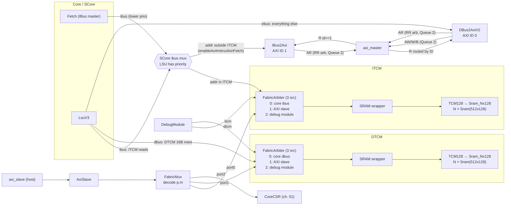
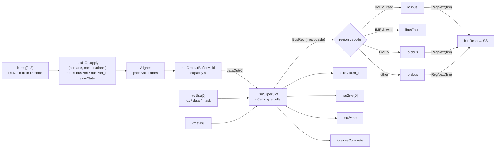
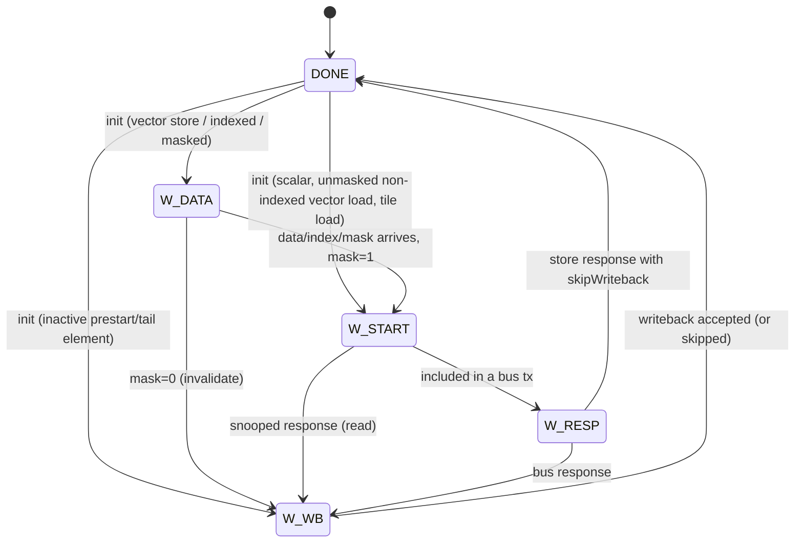
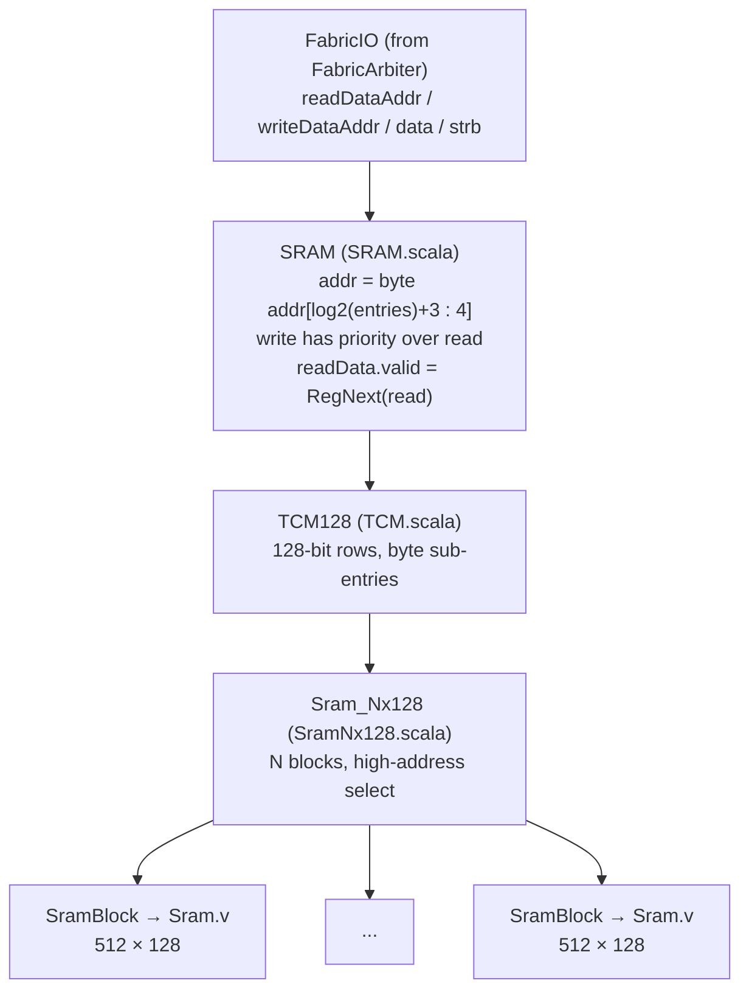
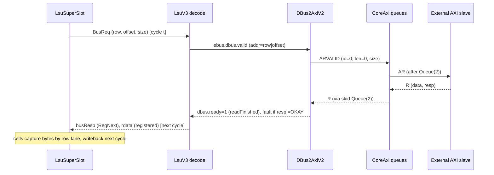

# 3. Load/Store Unit & Memory Subsystem

This chapter covers everything between the dispatch of a memory instruction and the SRAM bit-cell or AXI beat that serves it: the LSU (`LsuV3`), the core-local buses (IBus / DBus / EBus), the TCMs and SRAM macros, the internal fabric that lets the external AXI slave port and the debug module reach the TCMs, and the AXI master bridges used for out-of-TCM traffic.

Related chapters: [Top level, configuration & CSR block](01-top-level-and-configuration.md) · [Scalar core](02-scalar-core.md) · [FPU & RVV Chisel bridge](04-floating-point-and-vector-frontend.md) · [SV vector backend & VME](05-vector-backend-and-matrix-engine.md) · [SoC, TL-UL, peripherals & DMA](06-soc-interconnect-and-peripherals.md) · [Software & verification](07-software-toolchain-and-verification.md)

All citations are `path:line` relative to the repository root. Where a statement is a derived property (e.g. a cycle count) rather than something literally written in one line of code, this is said explicitly.

**Contents**

1. [Configuration parameters that shape the memory system](#31-configuration-parameters)
2. [Memory topology and hardware memory map](#32-memory-topology-and-hardware-memory-map)
3. [LSU microarchitecture](#33-lsu-microarchitecture)
4. [Vector and matrix (tile) memory operations](#34-vector-and-matrix-tile-memory-operations)
5. [Fences, flushes and faults](#35-fences-flushes-and-faults)
6. [Core-local buses: IBus, DBus, EBus](#36-core-local-buses-ibus-dbus-ebus)
7. [TCMs, SRAM wrappers and macros](#37-tcms-sram-wrappers-and-macros)
8. [Internal fabric and the AXI slave path](#38-internal-fabric-and-the-axi-slave-path)
9. [AXI master path: DBus2Axi and IBus2Axi](#39-axi-master-path-dbus2axi-and-ibus2axi)
10. [Banked TL-UL TCMs, L1 caches and helper libraries](#310-banked-tl-ul-tcms-l1-caches-and-helper-libraries)
11. [Latency and throughput summary](#311-latency-and-throughput-summary)
12. [Notes on existing docs](#312-notes-on-existing-docs)

---

## 3.1 Configuration parameters

| Parameter | Default in `Parameters` | Value in every shipped build target | Meaning | Source |
|---|---|---|---|---|
| `lsuDataBits` | 256 | **128** (`--lsuDataBits=128`) | LSU bus row width; also `axi2DataBits` (AXI data width) | `hdl/chisel/src/coralnpu/Parameters.scala:158`, `:187`; `hdl/chisel/src/coralnpu/flags.bzl:20`; `hdl/chisel/src/coralnpu/BUILD:590` |
| `fetchDataBits` | 256 | **128** | IBus width (fetch line) | `Parameters.scala:148`; `flags.bzl:19` |
| `lsuDataBytes` / `dbusOffsetBits` / `dbusRowAddrBits` | derived | 16 / 4 / 28 | row size, offset bits, row-address bits | `Parameters.scala:159-164` |
| `dbusSize` | derived | `log2Ceil(16+1)` = 5 bits | width of the one-hot-ish byte-count field on DBus | `Parameters.scala:162` |
| `lsuStrictWindowBytes` | `lsuDataBytes` | 16 | strict-mode window cap | `Parameters.scala:161` |
| `itcmSizeKBytes` / `dtcmSizeKBytes` | 8 / 32 | 8/32, 512/512, 1024/1024 | TCM sizes | `Parameters.scala:59-62`, `:167-168`; `BUILD:643-688` (highmem and 512 KiB targets) |
| `axi2IdBits` | 6 | 6 | AXI ID width on both AXI ports | `Parameters.scala:185` |
| `enableAxiInstructionFetch` | `true` | `true` unless overridden | allow fetch outside ITCM via AXI | `Parameters.scala:144` |
| `rvvVlen` | 128 | 128 | VLEN; `rvvVlenb` = 16 | `Parameters.scala:100-101` |
| `vmeTe` | `rvvVlen/8` = 16 | 16 | tile edge (elements) for VME tile loads/stores | `Parameters.scala:109-110` |
| `instructionLanes` | 4 | 4 | dispatch lanes feeding the LSU | `Parameters.scala:77` |

Because every build target passes `--lsuDataBits=128`, the rest of this chapter assumes **16-byte rows** unless stated otherwise. The 256-bit default in `Parameters.scala` is effectively unused by the AXI/TL-UL cores; `TCM128` is hard-wired to 128 bits (`hdl/chisel/src/coralnpu/TCM.scala:27`), so a 256-bit build would not elaborate `CoreAxi` correctly.

---

## 3.2 Memory topology and hardware memory map

### 3.2.1 Topology (CoreAxi)

`CoreAxi` (`hdl/chisel/src/coralnpu/CoreAxi.scala`) is the wrapper that every AXI and TL-UL product core uses (`CoreTlul` instantiates `CoreAxi` and bridges its AXI ports to TL-UL, `hdl/chisel/src/coralnpu/CoreTlul.scala:45`).

Key wiring facts, all from `CoreAxi.scala`:

* Each TCM has a 3-source `FabricArbiter` (`tcmPortCount = 3`, `CoreAxi.scala:149`, `:165`, `:223`). Source 0 is the core, source 1 is the `FabricMux` port coming from the AXI slave, source 2 is the debug module (`CoreAxi.scala:240-248`).
* The core's DBus is wired straight to DTCM arbiter source 0 and `core.io.dbus.ready := true.B` — the core can always access DTCM (`CoreAxi.scala:225-236`).
* The core's IBus (shared by fetch and the LSU, see 3.6.1) feeds ITCM arbiter source 0; ITCM source 0 never writes (`CoreAxi.scala:173-180`).
* The LSU's EBus goes to `DBus2Axi` (AXI ID 0) and out the `axi_master` port (`CoreAxi.scala:263-271`). With `enableAxiInstructionFetch`, `IBus2Axi` (AXI ID 1) shares the AR channel through a round-robin arbiter, and R beats are routed back by ID (`CoreAxi.scala:273-294`).
* All AXI channels are gated by `axiEnable`, a register that becomes true one cycle after reset (`CoreAxi.scala:252-253`).

### 3.2.2 Memory map as decoded in hardware

`p.m` is set by `EmitCore` (`hdl/chisel/src/coralnpu/Core.scala:154-176`):

| Region | Type | Default map (`MemoryRegions.default`) | Highmem / custom (`MemoryRegions.highmem`) | Source |
|---|---|---|---|---|
| ITCM | `IMEM` | `0x0000_0000` – `0x0000_1FFF` (8 KiB) | `0x0000_0000`, size = `itcmSizeKBytes` | `Parameters.scala:44-55` |
| DTCM | `DMEM` | `0x0001_0000` – `0x0001_7FFF` (32 KiB) | `0x0010_0000`, size = `dtcmSizeKBytes` | `Parameters.scala:46`, `:53` |
| CSR | `Peripheral` | `0x0003_0000` – `0x0003_0FFF` | `0x0020_0000` – `0x0020_0FFF` | `Parameters.scala:47`, `:54` |
| everything else | — | external (AXI master) | external | — |

The non-AXI `Core` ("Matcha" layout) uses a single `DMEM` region `0x0`–`0x3F_FFFF` and exposes raw ibus/dbus/ebus ports (`Core.scala:172-175`).

`MemoryRegion.contains` is a simple `[start, start+size)` compare (`Parameters.scala:35-38`). The same `p.m` is decoded in four places, each with different behaviour for an address it does not own:

| Decoder | ITCM hit | DTCM hit | CSR (`Peripheral`) hit | Miss | Source |
|---|---|---|---|---|---|
| LSU (`LsuV3`) | IBus (reads); **write → store access fault** | DBus | **EBus → AXI master** (`ebus.internal=1`, unused by `CoreAxi`) | EBus → AXI master | `scalar/Lsu.scala:2008-2023`, `:2025-2031`, `:2073-2083` |
| Fetch (in `CoreAxi`) | ITCM | — | — | `IBus2Axi` if `enableAxiInstructionFetch`, else instruction access fault | `CoreAxi.scala:170-207` |
| AXI slave (`FabricMux`) | ITCM port 0 | DTCM port 1 | CSR port 2 | no port selected → `SLVERR` | `Fabric.scala:88-94`; `AxiSlave.scala:91-95`, `:131-135` |
| Debug module | `io.itcm` | `io.dtcm` | — | abstract-command error | `scalar/Debug.scala:216-231`, `:273` |

Note the LSU decode: `dtcm` defaults to `true.B` when there is no `DMEM` region (`Lsu.scala:2014-2018`), and the region check is performed on the **row** address (`addr = rowAddr ++ 0000`, `Lsu.scala:2008`). Because a CSR-region access is routed to the EBus and `CoreAxi` ignores `ebus.internal`, **the core cannot reach its own CSR block through loads/stores**; such accesses leave on `axi_master` (the core's own CSRs are only reachable through `axi_slave`).

`FabricMux` strips the region base with a bit-mask (`addr & ~memStart`, `Fabric.scala:107-110`), which is correct only because all region bases are aligned to a power of two larger than the region size.

---

## 3.3 LSU microarchitecture

### 3.3.1 Overview

`Lsu.apply` instantiates `LsuV3` (`Lsu.scala:60-64`). `LsuV3` is an in-order, **single-instruction-in-flight** engine:

| Stage | What happens | Source |
|---|---|---|
| Accept | Lane *i* is ready iff the prefix count of valid lanes before it `< rs.nSpace` and no `FENCE.I` flush is pending | `Lsu.scala:1975-1978` |
| UOp build | `LsuUOp.apply` captures base address (`sbus.addr(i)`), store data (`sbus.data` or `fbus.data` for `FLOAT`/`FLOAT_H`), RVV config, cell bounds, stride info | `Lsu.scala:212-434` |
| Queue | `Aligner` compacts lanes, `CircularBufferMulti(capacity = max(4, lanes) = 4)` holds UOps; `FENCEI` is not enqueued | `Lsu.scala:1967-1990` |
| Execute | `LsuSuperSlot` accepts the head UOp only when the previous instruction is completely done (`io.uop.ready := stateFromAction.isDone`) | `Lsu.scala:1903-1904`, `:1995-1997` |
| Bus | One `BusReq` per cycle max, routed to IBus/DBus/EBus by region | `Lsu.scala:2059-2105` |
| Writeback | Scalar int / float writeback, vector writeback stream, VME writeback stream | `Lsu.scala:1840-1867`, `:2107-2116` |

`io.queueCapacity` (= `rs.nSpace`) feeds the decode LSU interlock (`scalar/Decode.scala:611-614`), so Decode never offers more LSU instructions than there is space for.

### 3.3.2 Operation types

`LsuOp` (`Lsu.scala:66-126`):

| Group | Ops | Decoded from | Notes |
|---|---|---|---|
| Scalar int | `LB LH LW LBU LHU SB SH SW` | `scalar/Decode.scala:827-842` | sign/zero extension by `LsuScalarWritebackMode` |
| RV64 | `LD SD LWU` | `Decode.scala:833-838` | **no writeback mode and no tx plan in LsuV3** (`Lsu.scala:1518-1551`); xlen=64 memory ops are not functional |
| Float | `FLOAT` (32-bit), `FLOAT_H` (16-bit, selected when `rm == 001`) | `Decode.scala:843-852` | `FLOAT_H` loads are NaN-boxed (`0xFFFF` upper half, `Lsu.scala:958-961`) |
| Fence | `FENCEI` (also used for **WFI**) | `Decode.scala:841-842` | handled outside the slot (3.5.1) |
| RVV | `VLOAD/VSTORE_{UNIT, STRIDED, OINDEXED, UINDEXED}` | `Decode.scala:854-893` | mask (`umop=01011`) and whole-register (`umop=01000`) are sub-cases of `*_UNIT` (`Lsu.scala:144-160`) |
| VME | `VTLOAD VTSTORE` | `Decode.scala:896-913` | only when `enableVme` |

`LsuCmd.store` is simply instruction bit 5 (`Decode.scala:919`).

### 3.3.3 The cell array

`LsuSuperSlot` models one instruction as an array of **byte cells**: `nCells = 8 × VLENB = 128` with RVV, or `4` for scalar-only cores (`Lsu.scala:638`). Each `LsuCell` holds `state`, an 8-bit `data`, a `rowAddr` (address ≫ 4) and a one-hot `mask` giving the byte lane inside the 16-byte row (`Lsu.scala:476-480`). Cell *k* always represents the *k*-th byte in **memory order** of the access (element-major, then field, then byte).

Transition rules and assertions are in `LsuCell.next` (`Lsu.scala:486-578`); the init state is computed in `fromUop` (`Lsu.scala:1393-1438`):

* Cells `≥ unreachableCell` → `DONE`.
* Prestart (`< startCell`) and tail (`≥ endCell`) cells → `W_WB` (they still participate in register writeback so the vector register is written whole), except tile stores → `DONE`, and masked vector ops → `W_DATA` (they must see their mask bit) (`Lsu.scala:1394-1408`).
* Active cells → `W_START` for scalar ops and plain vector loads; `W_DATA` for every vector store and for indexed or masked vector loads (`Lsu.scala:1410-1418`).

### 3.3.4 Address generation

Two address modes are computed in parallel at UOp acceptance (`Lsu.scala:1440-1496`):

1. **Continuous** (scalar, unit-stride, mask, whole-register, tile): `byteSum(i) = baseOffset + i`, row = `rowTable(byteSum ≫ 4)` where `rowTable` holds `baseRow + k` for `k < maxConsecutiveRows` (= 9 for 128 cells), mask = `UIntToOH(byteSum[3:0])` (`Lsu.scala:1442-1454`, `:641`).
2. **Strided / indexed** (`initAsConstStride = isStrided || isIndexed`, `Lsu.scala:355`): `offset(i) = (i / S) × stride + (i % S)` where `S = bytesPerSegment = (NF+1) × elemBytes`. Since `S` is a run-time value, the divisor/remainder for all 16 legal sizes `{1,2,3,4,5,6,7,8,10,12,14,16,20,24,28,32}` are precomputed constants and selected by `MuxLookup` (`Lsu.scala:1458-1478`). For indexed ops the stride is forced to 0, so every segment starts at the base address (`Lsu.scala:1458`).

For **indexed** ops, the per-element index arrives later on `rvv2lsu.idx`; `applyVectorIndex` adds it to the cell's row/mask with carry (`Lsu.scala:580-598`). The index slice for each data byte is selected by the one-hot `IndexSliceSel` (14 data-EEW × index-EEW × phase combinations, `Lsu.scala:667-731`, `:1112-1150`).

### 3.3.5 Misaligned access and transaction planning

There is **no address-misaligned exception** anywhere in the LSU: misaligned scalar accesses are executed in hardware. At UOp acceptance `computeScalarTxPlan` (`Lsu.scala:1355-1382`) precomputes two power-of-two transfer sizes:

| Case | `tx1Size` | `tx2Size` |
|---|---|---|
| byte op | 1 | 1 |
| halfword/word within one row, naturally aligned | 2 / 4 | — |
| halfword within a row, misaligned | `2 << ctz(~offset)` (smallest aligned block that contains it: 4, 8 or 16) | — |
| word within a row, misaligned | `8 << ctz(~offset[3:2])` (8 or 16) | — |
| access crossing the 16 B row boundary | bytes left in row 1 (3 → rounded to 4) | bytes in row 2 (3 → 4) |

The first transaction uses `tx1Size` at offset `OHToUInt(cells(0).mask) & ~(tx1Size-1)`; later ones use `tx2Size` at offset 0 (`Lsu.scala:915-919`). For vector ops both sizes are 16 (full row, `Lsu.scala:1536-1551`). The size/offset matter only on the EBus (DBus always transfers a whole row with a byte mask, `Lsu.scala:2068`); on AXI this means a misaligned word can become an 8- or 16-byte beat, and a 3-byte residue becomes a 4-byte beat that **reads** one extra byte (writes are still masked by `wstrb`).

### 3.3.6 Request bundling (coalescing)

Every cycle `maybeStart` (`Lsu.scala:788-937`) looks at a window that starts at `leadIndex` and builds at most one row transaction:

* **Normal mode** (`windowSizeNormal = min(nCells, 16)`): all window cells in `W_START` whose `rowAddr` equals the slot's current `rowAddr` are merged; per byte lane the lowest cell wins (`PriorityEncoderOH`), `wmask` is the OR of their masks (`Lsu.scala:813-846`). For **reads**, every cell in the *whole slot* targeting that row is marked started (row is always read whole); for writes only cells whose byte is in `wmask` (`Lsu.scala:828-836`).
* **Strict mode** (`windowSizeStrict = min(16, lsuStrictWindowBytes)`): a cell joins only if all earlier window cells joined and its byte lane does not collide with any earlier cell, so element order is preserved (`Lsu.scala:849-895`). Strict mode is selected for ordered-indexed ops and for strided ops whose `rs2 ≠ x0` but whose value is 0 (`Lsu.scala:349-353`, `:1559`).
* With RVV enabled a request is held back while any later window cell is still `W_DATA`, purely to improve bundling (`Lsu.scala:801-810`).
* `leadIndex` advances to the first window cell that stops the scan; the next `rowAddr` is pre-computed from the window (`Lsu.scala:1253-1288`).

The resulting `BusReq` is made irrevocable: if the target is not ready the request is parked in `txPending` and re-presented unchanged (`Lsu.scala:1809-1826`).

### 3.3.7 Responses, snooping and writeback

* The response for a request accepted in cycle *t* is expected in cycle *t+1*: `busResp.valid = RegNext(ibus.fire) | RegNext(dbus.valid&&ready) | RegNext(ebus.valid&&ready)` (`Lsu.scala:2061`, `:2071`, `:2084-2094`). The slot never back-pressures responses (`Lsu.scala:1786`).
* Response row address and started-cell mask are the registered copies of the outgoing request (`Lsu.scala:1830-1836`). In normal-mode reads every cell in `W_START`/`W_RESP` with a matching row captures data (**response snooping**), so repeated reads of a row are served by one bus access; in strict mode or for writes only the cells that were part of the transaction respond (`Lsu.scala:1152-1163`).
* **Scalar writeback** happens when cells 0..N-1 are all `W_WB`; data is assembled from cells 0–3 and sign/zero/NaN-boxed per `LsuScalarWritebackMode` (`Lsu.scala:939-963`). Integer and float writebacks share the same cells; `float.writeback` selects which port fires (`Lsu.scala:976-986`).
* **Stores** set `skipWriteback`, so cells go to `DONE` on the bus response (`Lsu.scala:1164`, `:1561-1562`), and `storeComplete` pulses with the PC once all cells are `DONE` (`Lsu.scala:1917-1922`, `:2123`); this feeds the ROB (`scalar/SCore.scala:112`).
* The slot is idle when all cells are `DONE`. (The slot's `io.active` is actually *idle-high*; `LsuV3` inverts it: `io.active := rs.nEnqueued > 0 || !slot.io.active || flushCmd.valid`, `Lsu.scala:1914-1916`, `:2122`.)

### 3.3.8 Ordering

Because the super-slot executes one instruction at a time and the queue is FIFO, all LSU accesses (scalar, float, vector, tile) are performed in program order, and only one bus transaction can be in flight per cycle (with at most one outstanding to EBus, see 3.9). Decode treats plain `FENCE` as a lane-0 NOP (`Decode.scala:987-994`).

---

## 3.4 Vector and matrix (tile) memory operations

The LSU executes all RVV memory instructions itself; the vector backend (chapters 04/05) only supplies store data, indices and masks over `rvv2lsu` and consumes loaded registers over `lsu2rvv`. Only port 0 of each 2-wide interface is used: `rvv2lsu(1).ready := false`, `lsu2rvv(1)` is tied off (`Lsu.scala:1998-2001`, `:2109-2113`).

| Bundle | Fields | Source |
|---|---|---|
| `Rvv2Lsu` | `idx: Valid{addr, data[127:0]}`, `vregfile: Valid{addr, data[127:0]}`, `mask: Valid[15:0]` | `hdl/chisel/src/coralnpu/rvv/RvvInterface.scala:64-74` |
| `Lsu2Rvv` | `addr` (vreg), `data[127:0]`, `last`, `ff_tail_index` | `RvvInterface.scala:57-62` |
| `Vme2Lsu` / `Lsu2Vme` | `data[127:0]` | `RvvInterface.scala:76-82` |

### 3.4.1 Cell bounds per instruction class

Computed in `LsuUOp.apply` (`Lsu.scala:242-426`):

| Class | `startCell` | `endCell` | `unreachableCell` | EMUL used |
|---|---|---|---|---|
| unit-stride / strided load | `vstart·(NF+1)·EEW` | `vl·(NF+1)·EEW` | `(NF+1)·EMUL·VLENB` | `EMUL = EEW/SEW·LMUL` |
| unit-stride / strided store | 0 | = unreachable | `(NF+1)·EMUL·VLENB` | same |
| mask load/store (`vlm/vsm`) | `vstart` | `ceil(vl/8)` | `VLENB` | forced 1 |
| whole-register (`vl<n>r`) | `vstart·EEW` | `n·VLENB` | `n·VLENB` | `n = NF+1 ∈ {1,2,4,8}` |
| indexed (ordered/unordered) | 0 | `(NF+1)·LMUL·VLENB` | same | data uses SEW, LMUL |
| tile (`VTLOAD/VTSTORE`) | `vstart·EEW` | `min(vl, vmeTe)·EEW` | `EMUL·VLENB` | `EEW ∈ {8,16,32}` from `nfields` |

`vstartCleared` from Decode forces `vstart = 0` (`Lsu.scala:254`). Vector stores and indexed ops initialise all active-register cells to `W_DATA` because every register beat must be handshaked with the vector core even for inactive elements (`Lsu.scala:402-418`, `:1398-1402`).

### 3.4.2 Data phase (store data, indices, masks)

The vector core streams one 128-bit register per `rvv2lsu` beat. The LSU maintains three looping counters — `dataSubvector` (index sub-slices when the index EEW is wider than the data EEW), `dataSegment` (field 0..NF), `dataEmul` (register within the group) — and a vector `dataActiveCells` holding, for each of the 16 bytes in the beat, which cell it lands in (`Lsu.scala:761-780`, `:1295-1326`). Initial positions interleave fields (`i·(NF+1)` for e8, etc., `Lsu.scala:1713-1734`); each segment step adds `elemBytes`, each EMUL step adds `emulStep` (`Lsu.scala:1666-1677`). So **segment loads/stores** are handled by laying out the whole segment group in memory order in the cell array and scattering/gathering register bytes into it.

Per cell the beat may deliver store data, an index, or a mask bit (`Lsu.scala:1181-1244`); a mask bit of 0 moves the cell straight to `W_WB` (element skipped, no bus access). VME data is taken from `vme2lsu` with the mask treated as all ones (`Lsu.scala:1058-1083`, `:1224-1230`). `rvv2lsu.ready` / `vme2lsu.ready` are high while any cell is in `W_DATA` and the op type matches (`Lsu.scala:1925-1932`).

### 3.4.3 Writeback phase

Writeback mirrors the data phase using `writebackSegment`, `writebackEmul` and `writebackActiveCells` (`Lsu.scala:777-779`, `:1327-1349`). A register beat is emitted once all 16 of its cells are `W_WB` or `DONE` (`Lsu.scala:987-998`), with `addr = rd + segment·(vectorsPerSeg) + emulIndex` (`Lsu.scala:1022`). For stores the same stream is used as a per-register completion acknowledgement (`last := write`, `Lsu.scala:1026`). VME instructions write back via `lsu2vme` instead of `lsu2rvv` (`Lsu.scala:1850-1867`). Tile stores have no writeback (`Lsu.scala:1693-1696`).

### 3.4.4 Strided and indexed specifics

* `rs2 = x0` strided ops (effective stride 0) are allowed to coalesce in normal mode; `rs2 ≠ x0` with value 0 forces strict mode (`Lsu.scala:349-353`).
* Unordered indexed ops use normal mode (coalescing + snooping); ordered indexed ops use strict mode (`Lsu.scala:1390-1391`, `:1559`).
* Supported index/data EEW pairs are e8/e16/e32 × ei8/ei16/ei32 (`Lsu.scala:1607-1640`, `:1114-1149`).

### 3.4.5 Fault-only-first

The LSU has no instruction-specific fault-only-first logic. On every vector writeback it reports `ff_tail_index` = number of bytes in the beat whose cell index is below `faultingCell` (after a fault) or `endCell` (otherwise) (`Lsu.scala:1850-1862`). The RVV ROB uses this to build a byte strobe (`hdl/verilog/rvv/design/rvv_backend_rob.sv:279-287`). The fault itself is still reported on `io.fault` for any faulting element (3.5.3); suppressing the trap for `element > 0` and trimming `vl` is outside the LSU (see [chapter 05](05-vector-backend-and-matrix-engine.md)).

### 3.4.6 Matrix tile loads/stores (VME)

`VTLOAD`/`VTSTORE` are produced only when `enableVme` and `isVmeLdSt()` (`Decode.scala:896-913`; `hdl/chisel/src/coralnpu/rvv/RvvDecode.scala:208-210`). In the LSU they behave like unit-stride, contiguous, unmasked ops with `NF = 0`, `vl = min(vl, vmeTe)` and an element width encoded in `nfields` (`000`→8 b, `001`→16 b, `010`→32 b) (`Lsu.scala:257-268`, `:318-319`, `:344`). Each LSU tile op therefore moves one contiguous row of at most 16 elements; sequencing of rows into a 2-D tile is done by the VME (chapter 05).

---

## 3.5 Fences, flushes and faults

### 3.5.1 FENCE, FENCE.I and WFI

| Instruction | Mechanism | Source |
|---|---|---|
| `FENCE` | Dispatched on lane 0 as a no-op (`fenceValid`); no LSU involvement | `Decode.scala:987-994` |
| `FENCE.I`, `WFI` | `isFency()`; forced to slot 0 and **not dispatched while `lsuActive`** (drain happens here) | `Decode.scala:191`, `:195-197`, `:500`, `:657` |
| | Dispatched to the LSU as `LsuOp.FENCEI` on lane 0; sets `flushCmd{pcNext = pc+4}`; further LSU requests are refused while pending | `Lsu.scala:1977`, `:2049-2057`, `:436-446` |
| | `io.flush` drives `fetch.io.iflush`; handshake completes when fetch is ready | `scalar/SCore.scala:128-131`; `Lsu.scala:2125-2126` |
| | Interlocks Decode while `lsu.io.flush.valid` | `SCore.scala:153` |

`flushCmd` is cancelled by `pipelineFlush` (trap retired) or an LSU fault (`Lsu.scala:2049-2053`).

### 3.5.2 Pipeline flush

`io.pipelineFlush` (= `rob_io.trapRetired`, `SCore.scala:259`) or a registered LSU fault flushes the reservation station (`Lsu.scala:2046-2047`). The instruction already in the super-slot is not cancelled; it drains (with fault responses if faulted).

### 3.5.3 Fault generation

Only two fault sources exist (`Lsu.scala:2025-2044`):

| Fault | Condition | `addr` reported | Source |
|---|---|---|---|
| ITCM write | LSU write request to an `IMEM` region; the request is accepted locally (`ready` forced) | **row address** (`rowAddr`, i.e. byte address ≫ 4) | `Lsu.scala:2025-2031`, `:2101` |
| EBus error | `DBus2Axi` sees `BRESP/RRESP ≠ OKAY` | `ebus.dbus.addr` (row ++ tx offset) | `DBus2Axi.scala:146-157` |

There is **no DTCM fault** (any address in the DTCM region is valid) and no misalignment fault. `faultReg` is `RegNext(rawFault)` and is presented together with the bus response (`slot.io.busResp.bits.fault := faultReg.valid`, `Lsu.scala:2095`). Inside the slot:

1. `faulted` is latched; new transactions are suppressed and `txPending` is cleared (`Lsu.scala:1812-1826`, `:1281`).
2. Any transaction that was being issued in the faulting cycle receives a fake response (`faultRespValid`) so its cells retire (`Lsu.scala:1837`, `:1881`).
3. For vectors `faultingCell = busRespCellIndex` (the lead cell of the faulting tx) and `faultingVstart = faultingCell / (NF+1) ≫ log2(elemBytes)` (`Lsu.scala:1294`, `:1934-1962`).

`io.fault` (`LsuFaultInfo{write, addr, epc, vstart}`) goes to the FaultManager, which reports `mcause = 5` (load access fault) or `7` (store/AMO access fault), `mepc = epc`, `mtval = addr`, plus `vstart` (`scalar/FaultManager.scala:101-102`, `:123-127`, `:138-142`, `:167`). The LSU's scalar regfile write port is masked while `lsu.io.fault.valid` (`SCore.scala:471`).

---

## 3.6 Core-local buses: IBus, DBus, EBus

### 3.6.1 IBus

`IBusIO` = `valid, ready, addr[31:0], rdata[fetchDataBits], fault` (`hdl/chisel/src/coralnpu/Interfaces.scala:51-62`). Read-only, one line per request, data in the cycle after `valid && ready`.

The single core IBus is shared by fetch and the LSU in `SCore` with **LSU priority**: when `lsu.io.ibus.valid`, the LSU owns the bus and fetch sees `ready = 0`; `rdata` is broadcast (`SCore.scala:566-579`). The LSU only issues IBus reads for full 16-byte rows in ITCM (`Lsu.scala:2059-2060`).

In `CoreAxi`, with AXI fetch enabled, `ready = inItcm ? RegNext(inItcm) : ibus2axi.ready`, and `rdata` is muxed by the registered `inItcm` (`CoreAxi.scala:192-199`). The first ITCM access after an off-ITCM fetch therefore waits one cycle. Without AXI fetch, `ready = 1` and any fetch outside ITCM raises an immediate fetch fault (`CoreAxi.scala:200-207`).

### 3.6.2 DBus

`DBusIO` = `valid, ready, write, pc, addr, adrx, size, wdata[lsuDataBits], wmask[lsuDataBytes], rdata` (`Interfaces.scala:136-149`). Protocol: request accepted on `valid && ready`; **read data is presented exactly one cycle later** with no response handshake; writes have no response. From the LSU, DBus requests are always full-row (`size = 16`, `addr` row-aligned) with per-byte `wmask` (`Lsu.scala:2063-2070`). In `CoreAxi` DBus `ready` is constant 1 (`CoreAxi.scala:236`).

`DBus2IO` (decoupled ctrl/resp) is defined (`Interfaces.scala:158-171`) but only `DBus2Resp` is used inside the LSU.

### 3.6.3 EBus

`EBusIO` = a `DBusIO` + `internal` (address is in a `Peripheral` region) + an input `fault` (`Interfaces.scala:173-177`). Differences from DBus as driven by the LSU (`Lsu.scala:2075-2084`):

* `addr = rowAddr ++ offset` (not row-aligned); `size` = planned transfer size (1, 2, 4, 8 or 16 bytes); `wdata`/`wmask` are still row-positioned (byte lanes = address bits [3:0]).
* `ready` comes back only when the whole transaction completes (see 3.9.1), so the LSU has at most one EBus transaction outstanding.

---

## 3.7 TCMs, SRAM wrappers and macros

### 3.7.1 Stack

| Layer | Behaviour | Source |
|---|---|---|
| `SRAM` wrapper | Address = row index taken from the byte address (base bits above the row field are ignored); `enable` on read or write; if both read and write are valid, the write is performed and no read data is returned; `writeResp` is always 1 | `hdl/chisel/src/coralnpu/SRAM.scala:37-62` |
| `TCM128` | Fixed 128-bit width, 8-bit sub-entries (byte-write granularity) | `TCM.scala:21-46` |
| `Sram_Nx128` | Picks the **largest** block size in `availableBlockSizes = (512, 128)` that divides the entry count; blocks are selected by the **upper** row-address bits (contiguous partitioning, not interleaving); only the selected block is enabled; read mux uses the registered select | `SramNx128.scala:37-82` |
| `SramBlock` | BlackBox named `Sram` with `NUM_ENTRIES`, `GLOBAL_BASE_ADDR` params | `SramBlock.scala:19-24`; `Interfaces.scala:88-106` |

### 3.7.2 Sizes per configuration

| Build | ITCM | DTCM | Rows (16 B) | Blocks (`Sram` 512×128) | Source |
|---|---|---|---|---|---|
| `CoreMiniAxi`, `RvvCoreMiniAxi`, VME, TL-UL variants | 8 KiB | 32 KiB | 512 / 2048 | 1 / 4 | `Parameters.scala:59-60`; `BUILD:750-758` |
| `CoreMini_ITCM512KB_DTCM512KBAxi` | 512 KiB | 512 KiB | 32768 / 32768 | 64 / 64 | `BUILD:666-688` |
| `CoreMiniHighmemAxi` | 1 MiB | 1 MiB | 65536 / 65536 | 128 / 128 | `BUILD:643-664` |

Even the 2048-row DTCM is built from four 512-row blocks, because `Sram_Nx128` prefers 512 over 2048 (2048 is not in the default list), although `Sram.v` has 2048-entry macro bindings.

### 3.7.3 Physical macros (`hdl/verilog/Sram.v`)

| Define | 512 × 128 | 2048 × 128 | Write mask | Source |
|---|---|---|---|---|
| `USE_TSMC12FFC` | `TS1N12FFCLLSBLVTD512X128M4SWBSHO` | `TS1N12FFCLLMBLVTD2048X128M4SWBSHO` | active-low bit mask (`BWEB`) expanded from byte mask | `Sram.v:33-112` |
| `USE_GF12LPP` | `` `MEM_TCM512 `` | 2 × `` `MEM_TCM2048 `` (64-bit halves) | active-low `WEN` | `Sram.v:114-185` |
| `USE_GF22` | `sasdulssd8LOW1p512x128m4b1w0c0p0d0l0rm3sdrw01` | `sasdulssd8LOW1p2048x128m4b2w0c0p0d0l0rm3sdrw01` | active-high `WEM` | `Sram.v:187-247` |
| generic + `SYNTHESIS` | inferred array, registered read address | same | per-byte | `Sram.v:261-280` |
| generic simulation (Verilator/VCS) | DPI backdoor storage (`sram_init/read/write`) | same | per-byte | `Sram.v:282-328` |

All variants have **1-cycle read latency** (registered address or registered output) and drive `rvalid = RegNext(enable)`. There is **no ECC or parity** on TCMs: the data path is exactly 128 bits with byte write-enables.

### 3.7.4 Simulation backdoor

Each simulated `Sram` registers itself with `sram_init(GLOBAL_BASE_ADDR, NUM_ENTRIES*16, 16)` and is **filled with random bytes** at registration (`hdl/verilog/sram_backdoor.cc`, `RegisterSram`). `GLOBAL_BASE_ADDR` per block is `memStart + blockIndex·512·16` (`SramNx128.scala:53-56`), so the C++ side can load by global address: `SramBackdoorLoad`, `sram_load_elf` (PT_LOAD by `p_paddr`), `sram_clear`, `sram_backdoor_apply_patch`, `sram_backdoor_dump_memory` (`hdl/verilog/sram_backdoor.h:22-49`). These are used by the test harnesses in [chapter 07](07-software-toolchain-and-verification.md).

---

## 3.8 Internal fabric and the AXI slave path

### 3.8.1 FabricIO

`FabricIO` is a simple, unhandshaked command interface: `readDataAddr: Valid`, `readData: Valid` (one cycle later), `writeDataAddr: Valid`, `writeDataBits`, `writeDataStrb`, `writeResp` (same cycle) (`Interfaces.scala:318-325`). Back-pressure is provided out-of-band by `fabricBusy`/`periBusy`.

### 3.8.2 FabricArbiter (per TCM)

* **Fixed priority, lowest index wins** (`Fabric.scala:22-53`): core (0) > AXI slave (1) > debug module (2).
* `fabricBusy(i)` = any higher-priority source valid (`Fabric.scala:34-36`).
* `readData`/`writeResp` are broadcast to all sources; each source must know whether the access it issued was granted (`Fabric.scala:55-59`).
* Only `fabricBusy(1)` is consumed (by `FabricMux` → `AxiSlave`, `CoreAxi.scala:241-245`). The debug module's port is bulk-connected without a busy signal (`CoreAxi.scala:247-248`), so a DM access that collides with a core access in the same cycle is not granted and nothing tells the DM (observation from wiring; DM behaviour is out of scope here).

Consequences: the core never waits for the TCMs, but a fetch stream on the ITCM or a DTCM-heavy loop can **starve the AXI slave** indefinitely; host loading of ITCM is expected to happen while the core is held in reset/halted.

### 3.8.3 FabricMux

Routes the single AXI-slave fabric command to ITCM, DTCM or CSR by `p.m` (`Fabric.scala:63-147`). A port is selected only if the address is in its region **and** that port is not busy; if the address hits a busy port, `fabricBusy` is returned to the AXI slave so it retries (`Fabric.scala:96-103`). Read data is selected one cycle later using a registered port index (`Fabric.scala:132-146`). Port 2 (CSR) never reports busy (`CoreAxi.scala:245`).

### 3.8.4 AxiSlave

`AxiSlave` (`hdl/chisel/src/coralnpu/AxiSlave.scala`) converts AXI4 into fabric commands:

| Aspect | Behaviour | Source |
|---|---|---|
| Address channels | AR and AW each buffered in `Queue(2)`, then **round-robin** arbitrated; the winner goes into a 1-entry pipe queue (`axiAddrCmd`) → **one burst at a time**, reads and writes never overlap | `AxiSlave.scala:53-66` |
| Burst types | FIXED, INCR, WRAP; per-beat address in `cmdAddr`, advanced only when the beat is granted (`!periBusy`); invalid burst type holds the address | `AxiSlave.scala:141-176` |
| Burst length | up to 256 beats (`len` 8 bits) | `AxiSlave.scala:106-115` |
| Write | `W` buffered in `Queue(3)`; a beat is issued when `W` valid and the B queue can accept; accepted only if not busy; B is generated on the `WLAST` beat with `OKAY` if the target asserted `writeResp`, else `SLVERR` | `AxiSlave.scala:70-95` |
| Read | Beat issued when ≥ 2 free entries in the 3-entry R queue and not busy; R `resp = OKAY` if the fabric returned valid data, else `SLVERR`; `RLAST` on the `len`-th beat | `AxiSlave.scala:97-139` |
| ID | `BID`/`RID` echo the command's ID | `AxiSlave.scala:90`, `:117`, `:130` |
| Narrow transfers | Address increments by `1 << size`; data/strobe are passed through on their natural byte lanes; the SRAM wrapper ignores address bits [3:0] | `AxiSlave.scala:152-153`; `SRAM.scala:38-45` |
| Error mapping | Unmapped address → no port selected → `writeResp=0`/`readData.valid=0` → `SLVERR` (not `DECERR`); CSR writes to read-only/unknown registers → `SLVERR` per `CoreCSR.writeResp` | `Fabric.scala:125-146`; `CoreAxiCSR.scala:193` |

---

## 3.9 AXI master path: DBus2Axi and IBus2Axi

### 3.9.1 DBus2AxiV2 (LSU EBus → AXI)

`DBus2Axi.apply` builds `DBus2AxiV2` with `id = 0` (`DBus2Axi.scala:26-30`; `CoreAxi.scala:263`).

| Item | Behaviour | Source |
|---|---|---|
| Transfer shape | Single beat: `len = 0`, `burst = INCR`, `size = ctz(dbus.size)`, `prot = 3'b010`, `cache = 0`, `lock/qos/region = 0`; `dbus.size` must be a power of two (assertion) | `DBus2Axi.scala:52-62`, `:104-108`; `hdl/chisel/src/bus/Axi.scala:61-70` |
| Write | AW and W (via an internal `Queue(2)`) issued independently; `WLAST = 1`, `WSTRB = wmask`; transaction finishes when AW, W and B have all fired; `dbus.ready = writeFinished` | `DBus2Axi.scala:56-98`, `:142` |
| Read | AR issued once; R captured; `dbus.ready = readFinished`; `rdata` is re-registered so it appears the cycle after `ready` (DBus timing) | `DBus2Axi.scala:102-138` |
| Outstanding | **One transaction**; the next LSU request cannot be accepted before completion | derived from `dbus.ready` definition, `DBus2Axi.scala:142` |
| Errors | `fault.valid` when B or R arrives with `resp ≠ OKAY` (SLVERR and DECERR alike); `addr = dbus.addr`, `epc = dbus.pc` | `DBus2Axi.scala:146-157` |

In `CoreAxi` the AW, W and AR channels pass through additional `Queue(2)` stages, and B/R pass through `Queue(2)` skid buffers (`CoreAxi.scala:269-271`, `:281-284`, `:296-298`).

### 3.9.2 IBus2Axi (fetch outside ITCM)

Instantiated only when `enableAxiInstructionFetch` (`CoreAxi.scala:182`), with `id = 1`.

| Item | Behaviour | Source |
|---|---|---|
| Transfer | Single 16-byte line, line-aligned address, `size = log2(16)`, `len = 0`, `prot = 2` | `IBus2Axi.scala:33-57`; `Axi.scala:61-70` |
| Buffering | One-line buffer (`saddrReg`, `sdata`); a hit on the buffered line is served without a new AR | `IBus2Axi.scala:37-68` |
| Outstanding | One AR at a time (`canStartNext = !sraddrActive && ...`) | `IBus2Axi.scala:53-54` |
| Ready / data | `ready` when R arrives (or buffer valid) **and** the requested line still matches; data appears the next cycle | `IBus2Axi.scala:48-49` |
| Errors | `fault.valid` when `RRESP ≠ 0` → instruction access fault (`mcause 1`) | `IBus2Axi.scala:76-83`; `FaultManager.scala:135` |

### 3.9.3 Read-channel sharing and ID routing

With AXI fetch enabled, AR from EBus (in 0) and IBus (in 1) go through `CoralNPURRArbiter` → `Queue(2)` → `axi_master.ar`; R beats go through a 2-entry skid queue and are steered **by `RID == 1`** to `IBus2Axi`, else to `DBus2Axi` (`CoreAxi.scala:273-294`). The external slave must therefore return the AR ID faithfully. Writes come only from the EBus. Without AXI fetch all R beats go to `DBus2Axi` (`CoreAxi.scala:295-302`). Since each bridge has at most one transaction outstanding, at most two reads (one per ID) and one write can be in flight on `axi_master`.

### 3.9.4 Request flow example

---

## 3.10 Banked TL-UL TCMs, L1 caches and helper libraries

### 3.10.1 BankedDtcm / BankedItcm

`BankedDtcm` (8 banks) and `BankedItcm` (2 banks) wrap `RawTlulSram` banks behind a `TlulLocalXbar` with 3 TL-UL hosts (host IDs widened by `log2Ceil(numHosts)` bits) (`BankedDtcm.scala:25-55`; `BankedItcm.scala:25-55`). The emitters split the region into **contiguous** banks (`bank_sel = offset[log2(size)-1 : log2(bankSize)]`) plus an error route for out-of-range addresses (`BankedDtcm.scala:91-100`; `BankedItcm.scala:95-104`). Different banks can be accessed concurrently; two hosts on the same bank are serialised by the crossbar (chapter 06).

These modules are emitted as standalone libraries (`BUILD:908-926`) and exercised by cocotb (`tests/cocotb/tlul/BUILD:679-707`); **they are not instantiated by `CoreAxi`/`CoreTlul` or any other Chisel/SV design in the repository** — the product cores use the single-ported `TCM128` described in 3.7.

### 3.10.2 L1ICache / L1DCache

`L1ICache` (256 slots, 4-way, uses `Sram_1rw_256x256`) and `L1DCache` (two banks of 256 slots, 4-way, write-back with per-byte dirty bits stored as the 9th bit of each byte in `Sram_1rwm_256x288`) exist (`L1ICache.scala:30-86`; `L1DCache.scala:38-55`, `:289-377`, `:308-338`; `Parameters.scala:170-182`). The 9th bit is a byte-valid/strobe bit for write-back, **not ECC**. They are only emitted as standalone libraries and tested by Verilator testbenches (`BUILD:943-966`; `tests/verilator_sim/coralnpu/l1icache_tb.cc`, `l1dcache_tb.cc`); **no core configuration instantiates them**. `Sram_1rw_256x256.v` / `Sram_1rwm_256x288.v` (generic arrays, or GF22 `MBH_ZSNL_*` macros under `GF22_ML_CACHE`) serve only these caches.

### 3.10.3 Helper libraries

| Library | Use in the memory system | Source |
|---|---|---|
| `Aligner` | BlackBox around `hdl/verilog/rvv/design/Aligner.sv`; compacts valid lanes to the front (used for LSU queue enqueue) | `hdl/chisel/src/common/Aligner.scala:89-113`; `Lsu.scala:1987` |
| `Scatter` / `Gather` | Generic scatter/gather helpers; **not used by LsuV3** (only by their specs) | `hdl/chisel/src/common/ScatterGather.scala` |
| `Router` | One-hot Decoupled demux; used by the TL-UL router/xbar (`TlulLocalXbar`, `TlulRouter`) and hence by the banked TCMs | `hdl/chisel/src/common/Router.scala:19-50` |
| `AxiAddressGenerator` | Expands an AXI burst address into single-beat addresses (arbiter + 1-entry pipe queue, zero-bubble); not used by `CoreAxi` (`AxiSlave` has its own `cmdAddr` stepping) | `hdl/chisel/src/bus/AxiAddressGenerator.scala:23-49` |
| `CircularBufferMulti` | LSU reservation station | `hdl/chisel/src/common/CircularBufferMulti.scala:20-77` |

---

## 3.11 Latency and throughput summary

All numbers below are **derived by counting register stages in the RTL** (no contention, `CoreAxi`, 128-bit rows); they were not measured in simulation. Cycle *D* is the cycle the instruction is accepted by `io.req`.

| Access | Path | Event timeline | LSU occupancy / throughput |
|---|---|---|---|
| Scalar load, DTCM, within one row | rs → slot → DBus → SRAM | *D*: enqueue; *D+1*: slot accepts UOp; *D+2*: DBus request (SRAM enable); *D+3*: response captured; *D+4*: `io.rd` valid | 3 cycles per load back-to-back (next UOp accepted in the writeback cycle) |
| Scalar store, DTCM | same | request *D+2*, response *D+3*, `storeComplete` *D+3* | 2 cycles per store |
| Scalar load/store crossing a row | two transactions | +1 cycle | — |
| Scalar load, ITCM (data in ITCM) | slot → IBus (priority over fetch) | same as DTCM; +1 cycle if the previous IBus access was an AXI fetch (`inItcmReg`) | stalls fetch for those cycles |
| Store to ITCM | — | fault, no SRAM access | — |
| Unit-stride vector load, LMUL = *m*, aligned | 1 row tx per cycle | first tx *D+2*, last response *D+2+m*, per-register writebacks as rows complete (subject to `lsu2rvv.ready`) | ~*m*+2 cycles; misaligned adds one row |
| Vector store | needs `rvv2lsu` beats first | bus txs start once a window has no `W_DATA` cells | bounded by vector core data rate |
| Strided / indexed vector | one tx per distinct row in window order (strict mode: no merging of same-lane elements) | up to one row per element | — |
| EBus (AXI master) read | `DBus2Axi` + CoreAxi queues | ≈ *L*slave + 3 cycles more than a DTCM access (AR queue, R skid, response register) | 1 outstanding; serialises the instruction |
| EBus write | AW/W queues, B skid | ≈ *L*slave + 3 | 1 outstanding |
| Instruction fetch outside ITCM | `IBus2Axi` | ≈ *L*slave + 3, one 16-byte line per AR, no prefetch | 1 outstanding |
| Host AXI read of TCM (single beat, idle core) | `AxiSlave` → `FabricMux` → arbiter → SRAM | AR at *t* → R valid ≈ *t+4*; subsequent burst beats 1/cycle | starved while the core uses that TCM |
| Host AXI write of TCM (single beat) | | AW+W at *t* → B valid ≈ *t+3* | one burst at a time |
| SRAM macro | `Sram.v` | 1-cycle read | 1 access/cycle, single port |

---

## 3.12 Notes on existing docs

The following statements in `doc/` disagree with the RTL; this chapter follows the code.

| Doc statement | What the code does | Evidence |
|---|---|---|
| `doc/microarch/lsu.md`: rows are "16-byte (`p.lsuDataBytes`)" | True for all build targets, but the `Parameters` default is `lsuDataBits = 256` (32-byte rows); every target overrides it to 128 | `Parameters.scala:158`; `flags.bzl:20` |
| `lsu.md` Fault Reporting: faults include "DTCM access violation" | No DTCM fault exists; only ITCM-write and EBus (AXI error) faults | `Lsu.scala:2025-2039` |
| `lsu.md`: ITCM write fault (implied byte address) | `ibusFault.addr` is the **row address** (`rowAddr`, not shifted), so `mtval` is the byte address ÷ 16 | `Lsu.scala:2029` |
| `lsu.md` FENCE.I: "Awaits complete drainage of all in-flight store transactions in `LsuSuperSlot`" | The drain is enforced by Decode (`isFency && lsuActive` blocks dispatch); the LSU raises the flush as soon as the `FENCEI` request is accepted. `WFI` also uses `LsuOp.FENCEI` | `Decode.scala:191`, `:500`, `:841`; `Lsu.scala:2049-2057` |
| `lsu.md` interface table: `io.rvv2lsu[2]` / `io.lsu2rvv[2]` streams | Only index 0 is used; `rvv2lsu(1).ready = 0`, `lsu2rvv(1)` tied off | `Lsu.scala:1998-2001`, `:2109-2113` |
| `lsu.md`: `io.ebus` "Supports sub-row transaction sizes" (scalar only) | Correct, but sizes can be 8 or 16 bytes for misaligned words (no misaligned trap), and 3-byte residues read 4 bytes | `Lsu.scala:1355-1382` |
| `doc/overview.md`: "Banked ITCM (4x 32b banks)", "Banked DTCM (4x 32b banks)" | Product cores use a single 128-bit-wide `TCM128` built from 512×128 blocks selected by upper address bits; no 32-bit banking | `CoreAxi.scala:156`, `:214`; `SramNx128.scala:37-80` |
| `overview.md`: DTCM "multi-banked SRAM array with local crossbar (`BankedDtcm.scala`) supporting concurrent accesses ... without bank conflicts" | `BankedDtcm` is not instantiated by any core; the DTCM is single-ported with a fixed-priority arbiter (core > AXI slave > debug) | `CoreAxi.scala:223-248`; `Fabric.scala:22-60` |
| `overview.md`: LSU "2+ cycles" latency, "1 / cycle" throughput | One instruction in the slot at a time: ≈4 cycles dispatch→writeback for a DTCM load, 3 cycles/load and 2 cycles/store back-to-back (derived) | `Lsu.scala:1903`, see 3.11 |
| `overview.md`: "full support ... fault-only-first (`vle8ff.v`)" | The LSU has no FF-specific logic: any faulting element raises `io.fault`; it only supplies `ff_tail_index`. FF semantics depend on the vector backend (not verified here) | `Lsu.scala:1850-1862`, `:2041-2044` |
| `doc/integration_guide.md` AXI master: "id: Always 0", R "id ... should be 0" | EBus uses ID 0, but `IBus2Axi` uses **ID 1** (enabled by default) and R beats are routed by ID | `CoreAxi.scala:182`, `:263`, `:284-291` |
| `integration_guide.md` AXI master: "size: 1, 2, or 4"; "len: (beats) − 1" | Sizes 1, 2, 4, 8, 16 bytes occur (vector rows, fetch lines, misaligned words); `len` is always 0 (single beat) | `DBus2Axi.scala:60`, `:106`; `Axi.scala:61-63` |
| `integration_guide.md` CSR range "0x30000 – TBD" | Default CSR region is `0x30000–0x30FFF`; highmem cores place it at `0x200000` and the DTCM at `0x100000` | `Parameters.scala:47`, `:53-54` |
