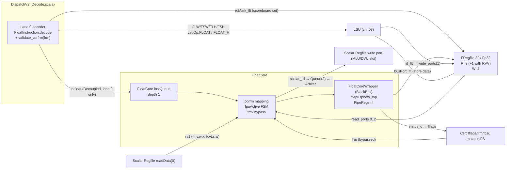
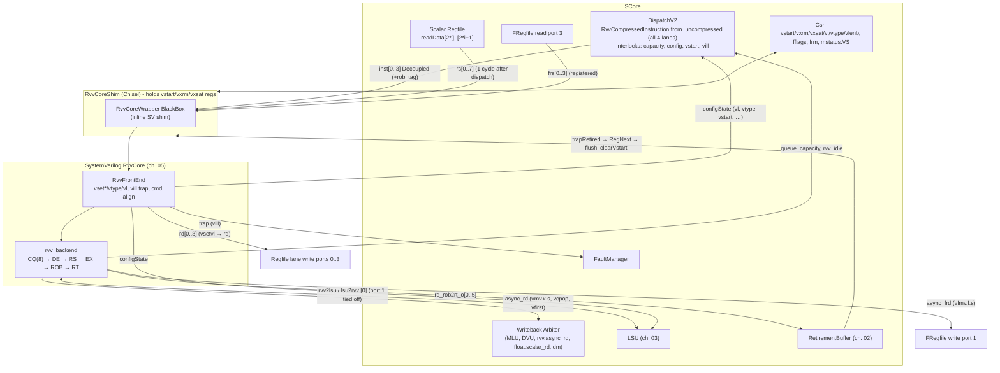
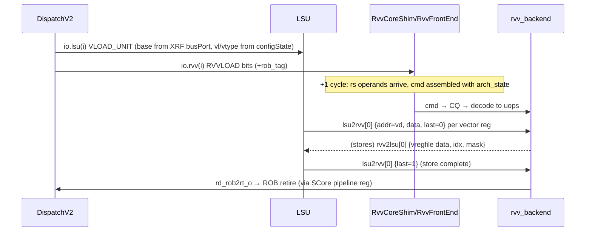

# 4. Floating Point & Vector Frontend

This chapter covers two extensions to the scalar core:

- **Scalar floating point.** This is RV32F plus Zfbfmin. The main pieces are `FloatCore`, the float register file (`FRegfile`) and how CSRs are handled.
- **The Chisel side of the RISC-V Vector extension (RVV 1.0).** This covers decode, dispatch, operand delivery, writeback, CSR state, LSU coordination and traps. It ends at the boundary of the SystemVerilog backend.

Related chapters: **01** top level and configurations, **02** scalar pipeline (dispatch, scoreboards, retirement buffer), **03** LSU/memory, **05** SV vector backend internals and VME, **06** SoC, **07** software.

All citations are `path:line` against the repository root. Where code and existing prose docs disagree, this chapter follows the code. See [§4.13](#413-notes-on-existing-docs).

## Contents

- [4.1 Configuration knobs](#41-configuration-knobs)
- [4.2 Scalar FP architecture overview](#42-scalar-fp-architecture-overview)
- [4.3 FP decode and supported instructions](#43-fp-decode-and-supported-instructions)
- [4.4 FloatCore execution (cvfpu wrapper)](#44-floatcore-execution-cvfpu-wrapper)
- [4.5 Rounding modes, fflags / frm / fcsr, mstatus.FS](#45-rounding-modes-fflags--frm--fcsr-mstatusfs)
- [4.6 NaN boxing and BF16 (Zfbfmin)](#46-nan-boxing-and-bf16-zfbfmin)
- [4.7 FP register file, ports and scoreboarding](#47-fp-register-file-ports-and-scoreboarding)
- [4.8 In-house `Fpu` / `Fma` / `Fp32` library](#48-in-house-fpu--fma--fp32-library)
- [4.9 RVV integration overview](#49-rvv-integration-overview)
- [4.10 Vector decode and dispatch from the scalar core](#410-vector-decode-and-dispatch-from-the-scalar-core)
- [4.11 Vector CSRs, operands, writebacks, LSU and traps](#411-vector-csrs-operands-writebacks-lsu-and-traps)
- [4.12 Chisel ↔ SystemVerilog boundary (`RvvCoreShim` / `RvvCoreWrapper`)](#412-chisel--systemverilog-boundary-rvvcoreshim--rvvcorewrapper)
- [4.13 Notes on existing docs](#413-notes-on-existing-docs)

---

## 4.1 Configuration knobs

| Parameter | Default | Meaning | Source |
|---|---|---|---|
| `enableFloat` | `false` | Instantiate `FloatCore` and `FRegfile` (RV32F) | `hdl/chisel/src/coralnpu/Parameters.scala:115` |
| `enableZfbfmin` | `false` | Allow `fmt=2` BF16 moves and conversions; selects the C910 div/sqrt | `hdl/chisel/src/coralnpu/Parameters.scala:116` |
| `enableVectorBf16` | `false` | Allow `vfwmaccbf16`, `vfwcvtbf16`, `vfncvtbf16`; emits `` `define ZVFBFWMA_ON `` | `hdl/chisel/src/coralnpu/Parameters.scala:117`, `hdl/chisel/src/coralnpu/rvv/RvvCore.scala:669-673` |
| `floatPulpDivsqrt` | `0` (a `val`, not overridable) | If non-zero, use the PULP `fpu_div_sqrt_mvp` div/sqrt instead of the T-Head one | `hdl/chisel/src/coralnpu/Parameters.scala:118-120` |
| `enableRvv` | `false` | Instantiate the RVV core (`RvvCoreShim`) | `hdl/chisel/src/coralnpu/Parameters.scala:99` |
| `rvvVlen` | `128` (a `val`) | VLEN. `rvvVlenb = 16` | `hdl/chisel/src/coralnpu/Parameters.scala:100-101` |
| `rvvRetireLanes` | `instructionLanes + 2` = 6 | Number of ROB→retire lanes from the vector unit | `hdl/chisel/src/coralnpu/Parameters.scala:105` |
| `instructionLanes` | `4` | Width of scalar dispatch, and therefore the number of RVV instruction lanes | `hdl/chisel/src/coralnpu/Parameters.scala:77` |
| `enableVme` | `false` | Zvt matrix extension. Requires RVV (see chapter 05) | `hdl/chisel/src/coralnpu/Core.scala:140` |

Each flag is set from the generator command line (`hdl/chisel/src/coralnpu/Core.scala:107-116`).

The shipped build configurations are:

- **`CoreMini*`** uses `--enableFloat=True --enableZfbfmin=True` (`hdl/chisel/src/coralnpu/BUILD:609-610`).
- **`RvvCoreMiniAxi*` and `VmeCoreMini*`** add `--enableRvv=True --enableVectorBf16=True` (`hdl/chisel/src/coralnpu/flags.bzl:17-30`).
- **`RvvCoreMiniTlul`** sets only `--enableRvv=True --enableFloat=True`. It has **no** Zfbfmin and **no** vector BF16 (`hdl/chisel/src/coralnpu/BUILD:739-747`).

When RVV and float are both enabled, the generated filelist adds `+define+ZVE32F_ON` (`hdl/chisel/src/coralnpu/Core.scala:283-287`). The Verilator options for the RVV cores also pass `-DZVE32F_ON` (`hdl/chisel/src/coralnpu/flags.bzl:48`).

---

## 4.2 Scalar FP architecture overview



Key structural facts:

- **Only `FloatCore` executes FP arithmetic.** It is instantiated once, in `SCore` (`hdl/chisel/src/coralnpu/scalar/SCore.scala:340`). The in-house `Fpu`/`Fma` Chisel modules are not instantiated anywhere in the core (§4.8).
- **FP loads and stores never go through `FloatCore`.** Dispatch routes them to the LSU as `LsuOp.FLOAT` (32-bit) or `LsuOp.FLOAT_H` (16-bit, `rm/width == 001`) (`hdl/chisel/src/coralnpu/scalar/Decode.scala:844-852`). `io.float.valid` explicitly excludes them (`hdl/chisel/src/coralnpu/scalar/Decode.scala:976-980`).
- **FP instructions dispatch from slot 0 only, and alone.** `forceSlot0Only()` includes `isFloat()`, `rvvReadsFloatRs1()` and `rvvWritesFrd()` (`hdl/chisel/src/coralnpu/scalar/Decode.scala:195-197`). The FP decoder also exists only in lane 0: lanes >0 stub `d.float` to invalid (`hdl/chisel/src/coralnpu/scalar/Decode.scala:1341-1343`).

---

## 4.3 FP decode and supported instructions

### 4.3.1 Decode path

`FloatInstruction.decode` (`hdl/chisel/src/coralnpu/float/FloatCoreInterface.scala:129-235`) maps `inst[6:2]` to a `FloatOpcode` (LOADFP/STOREFP/OPFP/MADD/MSUB/NMSUB/NMADD) and extracts these fields:

| Field | Bits |
|---|---|
| `funct5` | `[31:27]` |
| `fmt` | `[26:25]` |
| `rs3` | `[31:27]` |
| `rs2` | `[24:20]` |
| `rs1` | `[19:15]` |
| `rm` | `[14:12]` |
| `rd` | `[11:7]` |

The validity rules are:

- **LOAD-FP and STORE-FP** are valid only for `width ∈ {001, 010}` (FLH/FSH and FLW/FSW). Other widths are left to the V extension (`hdl/chisel/src/coralnpu/float/FloatCoreInterface.scala:140-154`).
- **Non-load/store** instructions must have `fmt == 0` (FP32), or be one of the Zfbfmin forms when `enableZfbfmin` is set (`hdl/chisel/src/coralnpu/float/FloatCoreInterface.scala:216-217`).
- **`DispatchV2` ANDs in `validate_csrfrm(csrFrm)`** (`hdl/chisel/src/coralnpu/scalar/Decode.scala:1311-1315`). An instruction with an unusable rounding mode therefore decodes as *not float*. If nothing else matches, it raises `undef`, an illegal-instruction trap (`hdl/chisel/src/coralnpu/scalar/Decode.scala:1350-1358`).

Side-band flags are computed for dispatch and scoreboarding:

| Flag | Meaning | Set for | Source |
|---|---|---|---|
| `scalar_rd` | Result goes to the integer regfile | funct5 `11100` (FMV.X.W/FCLASS), `10100` (FEQ/FLT/FLE), `11000` (FCVT.W[U].S); OPFP only | `FloatCoreInterface.scala:171-178` |
| `scalar_rs1` | rs1 is an integer register | funct5 `11110` (FMV.W.X), `11010` (FCVT.S.W[U]) | `FloatCoreInterface.scala:180-185` |
| `float_rs1` | rs1 is an FP register | everything except loads, stores and `scalar_rs1` | `FloatCoreInterface.scala:207-208` |
| `uses_rs2` | rs2 is an FP register | stores, FMA, and OPFP except FMV/FCLASS/FCVT/FSQRT/BF16-cvt | `FloatCoreInterface.scala:189-206` |
| `uses_rs3` | rs3 is an FP register | MADD/MSUB/NMADD/NMSUB | `FloatCoreInterface.scala:187-188` |

### 4.3.2 Instruction classes and execution mapping

`FloatCore` turns the decoded instruction into an fpnew `op_i` / `op_mod_i` pair (`hdl/chisel/src/coralnpu/float/FloatCore.scala:315-361`):

| Class | Instructions | fpnew op / op_mod | Operand ports (op0/op1/op2) | Result to | Uses frm? |
|---|---|---|---|---|---|
| Add/Sub | `fadd.s`, `fsub.s` | `ADD`, mod 0/1 | –/rs1/rs2 | FRF | yes |
| Mul | `fmul.s` | `MUL` | rs1/rs2/– | FRF | yes |
| Div | `fdiv.s` | `DIV` | rs1/rs2/– | FRF | yes |
| Sqrt | `fsqrt.s` | `SQRT` (funct5 `01011`) | rs1/–/– | FRF | yes (see caveat) |
| Fused | `fmadd.s`, `fmsub.s`, `fnmsub.s`, `fnmadd.s` | `FMADD` m0 / `FMADD` m1 / `FNMSUB` m0 / `FNMSUB` m1 | rs1/rs2/rs3 | FRF | yes |
| Sign-inject | `fsgnj[n,x].s` | `SGNJ`, mod 1 ("Nan-Boxing" per code comment); sub-op in `rm` | rs1/rs2/– | FRF | no (`rm` = funct3) |
| Min/Max | `fmin.s`, `fmax.s` | `MINMAX`; sub-op in `rm` | rs1/rs2/– | FRF | no |
| Compare | `feq.s`, `flt.s`, `fle.s` | `CMP`; sub-op in `rm` | rs1/rs2/– | XRF | no |
| Classify | `fclass.s` | `CLASSIFY` | rs1/–/– | XRF | no |
| F→I | `fcvt.w.s`, `fcvt.wu.s` | `F2I`, mod = `rs2[0]` (unsigned); `int_fmt = {1, rs2[1]}` → INT32 | rs1/–/– | XRF (sign-extended for 32-bit) | yes |
| I→F | `fcvt.s.w`, `fcvt.s.wu` | `I2F`, mod = `rs2[0]`; op0 = integer `rs1` | xrs1/–/– | FRF | yes |
| F→F (BF16) | `fcvt.s.bf16`, `fcvt.bf16.s` | `F2F`, src/dst fmt FP16ALT↔FP32 | rs1/–/– | FRF | yes in hardware (see caveat) |
| Moves | `fmv.x.w`, `fmv.w.x`, `fmv.x.h`, `fmv.h.x` | **Bypass. fpnew is not used** | – | XRF / FRF | no |
| Load/Store | `flw`, `fsw`, `flh`, `fsh` | LSU (`LsuOp.FLOAT[_H]`) | – | FRF via LSU | no |

Sources for the table:

- Port selection: `hdl/chisel/src/coralnpu/float/FloatCore.scala:365-413`. For `ADD`, fpnew reads operands 1 and 2, so rs1 and rs2 are routed to ports 1 and 2.
- I→F operand: `hdl/chisel/src/coralnpu/float/FloatCore.scala:452-457`.
- `int_fmt` mapping: `hdl/chisel/src/coralnpu/float/FloatCore.scala:419-420`.
- F→I sign extension: `hdl/chisel/src/coralnpu/float/FloatCore.scala:486-498`.
- The canonical instruction list (used only by `DecodeTableDump`) is `FloatInstruction.table` (`hdl/chisel/src/coralnpu/float/FloatCoreInterface.scala:97-127`). It lists the 26 RV32F instructions and does **not** list the Zfbfmin forms.

> **Caveat: loose OP-FP decode.** `decode` checks only the opcode and `fmt`. It does not check `funct5` against a list, and it does not check `rs2` for unary ops.
>
> In `FloatCore`, any unlisted `funct5` falls through `MuxLookup(..., FpNewOperation.ADD)` and executes as an add (`hdl/chisel/src/coralnpu/float/FloatCore.scala:315`). Examples are `00110` and `01001`, and also `01000` with `fmt=0` and an `rs2` other than `00110`, which runs as an FP32→FP32 F2F. Reserved OP-FP encodings therefore do not raise illegal-instruction.

---

## 4.4 FloatCore execution (cvfpu wrapper)

### 4.4.1 Implementation selection

All FP arithmetic runs in **cvfpu (`fpnew_top`)**, instantiated through an inline-generated SV shim `FloatCoreWrapper` (`hdl/chisel/src/coralnpu/float/FloatCore.scala:70-193`). That shim is wrapped in a Chisel `BlackBox` (`hdl/chisel/src/coralnpu/float/FloatCore.scala:195-299`).

Sources come from Bazel externals: `@cvfpu` is pinned to openhwgroup/cvfpu `bb65bded…` with local patches, and `@fpu_div_sqrt_mvp` to the PULP repo (`rules/repos.bzl:99-133`). The patches live in `third_party/cvfpu/*.patch`, for example `0007-Fix-nan-boxing-divsqrt.patch` and `0009-Rebalance-fpnew-fma-pipeline-stages.patch`. Their `BUILD.bazel` files only glob-export the `.v/.sv/.svh` files.

fpnew is configured as follows (`hdl/chisel/src/coralnpu/float/FloatCore.scala:128-188`):

| fpnew parameter | Value |
|---|---|
| `Width` | `xlen` (32) |
| `EnableVectors` | 0 |
| `EnableNanBox` | 1 |
| `FpFmtMask` | `5'b10001` (FP32 + FP16ALT/BF16) with Zfbfmin, else `5'b10000` (FP32 only) |
| `IntFmtMask` | `4'b0010` (INT32) on RV32 |
| `PipeRegs` | 4 for all op groups. The code comment says this "breaks the 32-bit mantissa multiply from the LZA/normalization stage" |
| `UnitTypes` | ADDMUL=PARALLEL, DIVSQRT=MERGED, NONCOMP=PARALLEL, CONV=MERGED |
| `PipeConfig` | DISTRIBUTED |
| `DivSqrtSel` | see the next table |

| Unit | Selected when | RTL pulled in |
|---|---|---|
| FMA (ADDMUL), NONCOMP, CONV | always | `fpnew_fma*.sv`, `cvw/fma/fmalza.sv`, `fpnew_noncomp.sv`, `fpnew_cast_multi.sv` (`FloatCore.scala:225-227, 289-297`) |
| Div/Sqrt: **PULP mvp** | `floatPulpDivsqrt != 0` (never in tree; it is a `val = 0`) | `fpu_div_sqrt_mvp/*`, `fpnew_divsqrt_multi.sv` (`FloatCore.scala:228-237`) |
| Div/Sqrt: **T-Head C910 VFDSU** (`THMULTI`) | `enableZfbfmin` (all shipped configs except `RvvCoreMiniTlul`) | `openc910/.../vfdsu/*`, `fpnew_divsqrt_th_64_multi.sv` (`FloatCore.scala:238-263`) |
| Div/Sqrt: **T-Head E906 FDSU** (`TH32`) | otherwise | `opene906/.../fdsu/*`, `fpnew_divsqrt_th_32.sv` (`FloatCore.scala:264-288`) |

### 4.4.2 Control flow and timing

`FloatCore` (`hdl/chisel/src/coralnpu/float/FloatCore.scala:301-506`) is a **single-instruction-in-flight** engine.

**Accepting an instruction.** The instruction lands in a 1-entry `Queue`. `io.inst.ready` is `count === 0` (`FloatCore.scala:304-307`), so dispatch cannot send a second FP op until the first one has completed and left the queue.

**Issuing to fpnew.** The queue head drives the FRF read ports and fpnew. `in_valid_i = inst.valid && !fmv && !fpuActive && rnd_mode.valid` (`FloatCore.scala:447`). `fpuActive` is set once fpnew accepts the instruction and cleared when it completes (`inst.fire`) (`FloatCore.scala:438-445`). Read ports stay valid while `!fpuActive || fmv` (`FloatCore.scala:450`). Operand data is not re-sampled after acceptance.

**Completing.** The instruction is popped when `out_valid && out_ready` (or immediately for fmv) (`FloatCore.scala:505`). `out_ready_i` is held low for `scalar_rd` ops until the downstream integer-writeback queue has room (`FloatCore.scala:504`).

**Writing back.**

- FRF results go out on `write_ports(0)` in the completion cycle (`FloatCore.scala:464-469`).
- Integer results go through a 2-entry `Queue` (`FloatCore.scala:478-502`). That queue feeds the `SCore` writeback arbiter shared with MLU, DVU, RVV `async_rd` and debug (`hdl/chisel/src/coralnpu/scalar/SCore.scala:452-462`). `Arbiter` gives priority to lower indices, so FP integer results are below MLU, DVU and RVV `async_rd`.

**Flush.** `flush_i` is tied to 0 (`FloatCore.scala:446`). An in-flight FP op always finishes and writes back. Trap recovery relies on the FRF `flushed_scoreboard` (§4.7).

```mermaid
sequenceDiagram
  participant D as Dispatch (lane 0)
  participant Q as instQueue (1)
  participant F as fpnew (4 pipe regs)
  participant R as FRegfile / XRF arb
  Note over D: cycle T: io.float.fire, rdMark_flt sets FRF scoreboard
  D->>Q: enq (io.inst.ready = count==0)
  Note over Q: T+1: head valid, FRF read (comb.), XRF readData(0) arrives (registered)
  Q->>F: in_valid_i (fpuActive=0, rnd_mode valid)
  Note over F: fpuActive=1 from T+2 ... PipeRegs=4 (DIV/SQRT iterative: longer)
  F-->>Q: out_valid (~T+5 for ADDMUL/NONCOMP/CONV)
  Q->>R: write_ports(0) or scalar_rd queue; fflags valid; inst.fire
  Note over D: T+6: queue empty, next FP op may dispatch; FRF scoreboard bit cleared
  Note over Q: fmv.*: no fpnew, completes at T+1
```

The cycle numbers above are approximate. They are inferred from the queue type (non-flow, non-pipe), the registered integer read data, and `PipeRegs = 4`. They have not been measured in simulation.

The practical consequence is that **FP arithmetic is not pipelined across instructions**. Throughput is roughly one op every ~5 cycles for 4-stage ops, and lower for div/sqrt.

Integer instructions are not blocked. They keep dispatching around an in-flight FP op, subject to the FP scoreboard. The code comment says the FSM lets dispatch "unblock immediately" (`FloatCore.scala:435-437`). That holds only in this sense: `io.inst.ready` itself stays low until completion.

---

## 4.5 Rounding modes, fflags / frm / fcsr, mstatus.FS

### Rounding mode selection

`FpNewRoundingMode` defines RNE=0, RTZ=1, RDN=2, RUP=3, RMM=4 and DYN=7 (`hdl/chisel/src/coralnpu/float/FloatCore.scala:61-68`). The effective mode is chosen in `FloatCore.scala:421-433`:

1. If the instruction `rm` is not a legal enum value (5 or 6), the mode is invalid and the op never issues.
2. If the instruction `rm` is not DYN, it is used directly.
3. Otherwise the CSR `frm` is used. It must be 0–4; a value of 5–7 makes the mode invalid.

For SGNJ, MINMAX and CMP, the `rm` field is the sub-op selector that fpnew expects, so it passes through unchanged.

### Decode-time legality

`requires_frm()` and `valid_frm()` (`hdl/chisel/src/coralnpu/float/FloatCoreInterface.scala:72-93`) reject an instruction at decode (making it illegal) if it needs a rounding mode and the static or dynamic one is invalid.

> **Caveat: `requires_frm()` mismatches the encodings.**
>
> - It lists funct5 `00100` as "fsqrt", but `00100` is FSGNJ; FSQRT is `01011`.
> - It lists only `11010` for "fcvt (both f->x and x->f)". F→I is `11000`.
> - The BF16 converts (`01000`) are absent.
>
> So `fsqrt.s`, `fcvt.w[u].s`, `fcvt.s.bf16` and `fcvt.bf16.s` with `rm ∈ {5,6}`, or with `rm=DYN` while `frm ∈ {5,6,7}`, pass decode. In `FloatCore`, `rnd_mode.valid` is then false, so `in_valid_i` never rises and the 1-entry queue never drains. **Software that writes an illegal `frm` and then issues one of these instructions would hang the FPU instead of trapping.**

### CSRs

| CSR | Addr | Implementation |
|---|---|---|
| `fflags` | 0x001 | 5-bit reg. Software write, or sticky OR of the FloatCore and RVV status (`hdl/chisel/src/coralnpu/scalar/Csr.scala:318, 633-641, 788-803`) |
| `frm` | 0x002 | 3-bit reg (`Csr.scala:319, 636`) |
| `fcsr` | 0x003 | `Cat(frm, fflags)` view; writes update both fields (`Csr.scala:350, 637-640`) |
| `mstatus.FS` | – | Reset to 1 (Initial). Writing 0 (Off) is legalized to 3 (Dirty), so FP cannot be disabled (`Csr.scala:352, 462-464, 612-616`) |
| `misa.F` | – | bit 5 set when `enableFloat` (`Csr.scala:333-337`) |

How the pieces connect:

- **fflags sources.** FloatCore asserts `csr.in.fflags.valid` on every non-fmv completion, including compares and conversions, with fpnew `status_o` (`FloatCore.scala:475-476`). The RVV backend provides a second source through `io.rvvcore.csr.fflags` (§4.11). Both are ORed into the register in the same cycle (`Csr.scala:794-797`).
- **frm bypass.** `frmBypass` forwards a CSR write to `frm` or `fcsr` that happens in the same cycle (`Csr.scala:838-850`). It feeds both FloatCore (`out.frm`) and the RVV core (`rvv.frm`). Dispatch also gets it as `csrFrm` for `validate_csrfrm` (`SCore.scala:434`).
- **FS dirty.** FS is set dirty by any of these (`Csr.scala:598-603`):
  - a CSR write to fflags, frm or fcsr
  - FloatCore fflags valid
  - any FRF write (`float_dirty`, `SCore.scala:449`)
  - VME `vtfmm` (`vme_fp_dirty`)
- **CSR ordering against the FPU.** A CSR instruction dispatches only when `io.float.ready` is high, meaning no FP op is in flight (`hdl/chisel/src/coralnpu/scalar/Decode.scala:956-957`). It also waits for an empty retirement buffer (`Decode.scala:669-670`, chapter 02). A `csrr fflags` therefore sees the flags of all earlier FP ops.

---

## 4.6 NaN boxing and BF16 (Zfbfmin)

FLEN is 32. `FRegfile` stores `Fp32` (`hdl/chisel/src/coralnpu/scalar/FRegfile.scala:36`), so FP32 values need no boxing. The Chisel `NanBox()` helper only pads when `xlen > 32` (`FloatCore.scala:389-395`), which no shipped config uses. The RVV wrapper boxes `frs` the same way when `xlen > 32` (`hdl/chisel/src/coralnpu/rvv/RvvCore.scala:328-334`).

BF16 values occupy the low 16 bits of an f-register, boxed with `0xFFFF` in the upper half:

| Instruction | Encoding check | Datapath | Boxing |
|---|---|---|---|
| `flh` / `fsh` | LOAD/STORE-FP, `width=001` | LSU `LsuOp.FLOAT_H` (`Decode.scala:846-849`) | Load result is `Cat(0xFFFF, data[15:0])` (`hdl/chisel/src/coralnpu/scalar/Lsu.scala:958-961`) |
| `fmv.h.x` | funct5 `11110`, `fmt=2`, rs2=0, rm=0 | FloatCore bypass | `Cat(0xFFFF, xrs1[15:0])` (`FloatCore.scala:463`) |
| `fmv.x.h` | funct5 `11100`, `fmt=2`, rs2=0, rm=0 | FloatCore bypass | `SignExtend(frs1[15:0])` (`FloatCore.scala:481-485`) |
| `fcvt.s.bf16` | funct5 `01000`, `fmt=0`, rs2=`00110` | fpnew F2F, src FP16ALT→dst FP32 | fpnew `EnableNanBox=1` checks the input box |
| `fcvt.bf16.s` | funct5 `01000`, `fmt=2`, rs2=`01000` | fpnew F2F, FP32→FP16ALT | fpnew boxes the narrow result in `result_o[31:0]` |

The decode for these forms is at `hdl/chisel/src/coralnpu/float/FloatCoreInterface.scala:163-167, 210-211`. The format codes are FP32=0 and FP16ALT=4 (`FloatCoreInterface.scala:38-41`).

There is no BF16 arithmetic in the scalar unit. Zfbfmin is moves, conversions, loads and stores only.

---

## 4.7 FP register file, ports and scoreboarding

`FRegfile(p, n_read, n_write)` (`hdl/chisel/src/coralnpu/scalar/FRegfile.scala:21-90`) is 32 × `Fp32` flops, reset to 0.

- **Reads are combinational.** A port whose `valid` is low returns `+0.0` (`FRegfile.scala:73-76`).
- **Writes are prioritised.** A `PriorityMux` per register picks port 0 first. Two simultaneous writes to the same register raise `io.exception`, but that output is left unconnected in `SCore` (`FRegfile.scala:61-70`).
- **Port count.** `SCore` instantiates the file with **3 read ports (4 with RVV) and 2 write ports** (`hdl/chisel/src/coralnpu/scalar/SCore.scala:341-344`).

| Port | Users (priority order) | Source |
|---|---|---|
| read 0 | Debug module `float_rs`, then FloatCore op0 | `SCore.scala:351-365, 380` |
| read 1, 2 | FloatCore op1/op2 | `SCore.scala:367-372` |
| read 3 (RVV only) | Vector `frs1` for OPFVF (`vf*.vf`, `vfmv.s.f`, …), addressed by `dispatch.io.frs1Read(0)` | `SCore.scala:374-377`, `Decode.scala:1057-1060` |
| busPort | LSU store data for `fsw`/`fsh`, address `fbusPortAddr = rs2Addr(0)`. Lane 0 only; no write forwarding (TODO in code) | `SCore.scala:346-347`, `Decode.scala:494-496`, `FRegfile.scala:78-89` |
| write 0 | Debug module `float_rd`, then FloatCore result / `fmv.w.x` / `fmv.h.x` | `SCore.scala:383-404` |
| write 1 | LSU FP load (priority), then RVV `async_frd` (`vfmv.f.s`). `async_frd.ready = !lsuWriting` | `SCore.scala:406-430` |

### Scoreboard

The FRF keeps its own 32-bit scoreboard. Its life cycle:

1. **Set** at dispatch through `rdMark_flt`, which is lane 0 only. It fires for any of (`Decode.scala:1076-1094`):
   - a FloatCore op that does not write an integer register
   - an FP load dispatched to the LSU
   - an RVV instruction that writes an FP register (`vfmv.f.s`). An assertion checks that no other lane does this.
2. **Cleared** by any write port in the cycle the write happens (`FRegfile.scala:40-52`).
3. **On `pipelineFlush`** (= `rob_io.trapRetired`, `SCore.scala:479`), the live scoreboard is replaced by `scoreboard_set`. Bits that were pending move into `flushed_scoreboard`. A late write from an op dispatched before the trap (for example a long `fdiv`) is then still accepted, and the registered `scoreboard_error` assertion does not fire (`FRegfile.scala:45-58`).

Dispatch uses the scoreboard for RAW and WAW checks:

- `floatReadScoreboard` covers rs1 (FP or vector-FP), rs2 and rs3.
- `floatRdScoreboard` covers FP-destination writers.
- Both are checked against `fcomb = in-bundle scan | io.fscoreboard` (`Decode.scala:463-492`). Results feed `canDispatch` (`Decode.scala:654-655`).

`fscoreboard === 0` is also part of `coreIdle`, which is used for single-step and `mpause` (`Decode.scala:626-632`). It also gates fetch-fault precision in `SCore` (`SCore.scala:551-558`).

FP values reach the retirement buffer and the debug trace through `rob_io.writeAddrFloat` and `writeDataFloat(0..1)`, mirrored from the FRF write ports (`SCore.scala:443-448`). The ROB is covered in chapter 02.

---

## 4.8 In-house `Fpu` / `Fma` / `Fp32` library

`hdl/chisel/src/common/Fp.scala` defines these helpers (`Fp.scala:20-161`):

- **`Fp32`**: a bundle with `asWord`, `isZero`, `isInf`, `isNan`, `significand` and `negate`.
- **Constructors**: `Zero`, `Inf`, and a canonical `NaN()` = `0x7FC00000`.
- **`fromInteger`**: an int→fp32 conversion that rounds by "+1" with no rounding-mode support (TODO).
- **`Bf16`**: a bundle with `fromWord`.

`Fp32` is used throughout, as the FRF storage type and in `FRegfileRead` / `FRegfileWrite` (`hdl/chisel/src/coralnpu/Interfaces.scala:340-350`).

`hdl/chisel/src/common/Fma.scala` is a 3-stage combinational-function FMA:

- **Stage 1** (`Fma.scala:57-91`): a 24×24 significand multiply, exponent add, and alignment shift of c.
- **Stage 2** (`Fma.scala:93-121`): align a·b, add or subtract c, take the absolute value and sign.
- **Stage 3** (`Fma.scala:123-157`): leading-zero normalise, round with "+1", and handle inf/zero/NaN.

It implements no rounding modes (TODO), no subnormals (they flush to zero through `exponent < 0`) and no exception flags.

`hdl/chisel/src/coralnpu/scalar/Fpu.scala` wraps `Fma` into a pipelined `Fpu` module. It covers add/sub/mul/fma/fms/fnma/fnms by negating operands and substituting b=1.0 or c=0 (`Fpu.scala:41-65`), with `Queue(…,1,pipe=true)` between stages (`Fpu.scala:67-77`).

> **Status: not used in the core.** `Fpu`, `Fma.FmaStage*` and `Fp32.fromInteger` are referenced only from their tests (`scalar/FpuTest.scala`, `common/FmaTest.scala`, `common/FpTest.scala`). Every RV32F/Zfbfmin operation in the generated cores runs on cvfpu (§4.4).

---

## 4.9 RVV integration overview



`Core` instantiates `RvvCore(p)`, which returns an `RvvCoreShim`. It bulk-connects that to `score.io.rvvcore` (`hdl/chisel/src/coralnpu/Core.scala:58-62`). `SCore` sees the vector unit as a `Flipped(RvvCoreIO)` port (`hdl/chisel/src/coralnpu/scalar/SCore.scala:46`).

---

## 4.10 Vector decode and dispatch from the scalar core

### 4.10.1 Recognition: `RvvCompressedInstruction`

Every lane runs `RvvCompressedInstruction.from_uncompressed` (`hdl/chisel/src/coralnpu/rvv/RvvDecode.scala:343-404`, called at `hdl/chisel/src/coralnpu/scalar/Decode.scala:1346-1348`). It produces a compressed form: a 2-bit opcode (`RVVLOAD=0`, `RVVSTORE=1`, `RVVALU=2`) plus `bits = inst[31:7]` (25 bits) (`RvvDecode.scala:22-50`).

| Major opcode | Accepted when | Compressed opcode |
|---|---|---|
| `0000111` (LOAD-FP) | `mew=0` and `width ∈ {000,101,110}` (8/16/32-bit EEW), or a VME tile load | RVVLOAD |
| `0100111` (STORE-FP) | same, for stores | RVVSTORE |
| `1010111` (OP-V) | `!isIllegalFloat(p)` | RVVALU |
| `1110111` (OP-VE, VME only) | `isOpVeValid` | RVVALU |

The `width` field is what tells vector and scalar-FP loads and stores apart, since they share major opcodes. Scalar FP takes widths 001/010 (§4.3); vector takes 000/101/110. 64-bit EEW (`111`) is not accepted (`RvvDecode.scala:348-360`).

**`isIllegalFloat`** (`RvvDecode.scala:83-120`) applies to OPFVV and OPFVF (funct3 001/101):

- With `enableFloat`, only the widening FP ops (`vfwadd/vfwsub` 110xxx, `vfwmul`, `vfwmacc`, `vfwnmacc`, `vfwmsac`, `vfwnmsac`) are illegal. The BF16 widening forms are also illegal unless `enableVectorBf16` is set.
- Without `enableFloat`, every vector-FP op is illegal except the BF16 trio when `enableVectorBf16` is set.

The 110xxx pattern also catches the widening FP reductions, `vfwredusum` and `vfwredosum`.

An illegal encoding leaves `rvv.valid = 0`. If nothing else matches, `undef` is raised and the instruction traps as illegal-instruction from slot 0 (`Decode.scala:1350-1358`, `Decode.scala:676-679`).

Helper predicates on the compressed instruction drive dispatch:

| Predicate | Meaning | Source |
|---|---|---|
| `readsRs1` | Loads/stores, OPIVX, OPMVX, `vsetvl{i}`, VME `mset*` | `RvvDecode.scala:212-221` |
| `readsRs2` | Strided ld/st, `vsetvl`, `msetmtype`, VME tile ld/st | `RvvDecode.scala:223-228` |
| `readsFloatRs1` | OPFVF (funct3 `101`) | `RvvDecode.scala:230-233` |
| `writesRd` | `vset*` and OPMVV VWXUNARY0 (`vmv.x.s`, `vcpop`, `vfirst`) | `RvvDecode.scala:235-239` |
| `writesFrd` | OPFVV VWRFUNARY0 (`vfmv.f.s`) | `RvvDecode.scala:241-244` |
| `requireZeroVstart` | Integer and FP reductions, `vcpop`/`vfirst`, `vmsbf/vmsof/vmsif`, `viota`, `vcompress`, `vwredsum[u]` | `RvvDecode.scala:124-166` |
| `isVset` | OP-V funct3 `111`, which includes VME `mset*` | `RvvDecode.scala:174-176` |
| `isWholeRegisterLoadStore` | `vl<nf>r` / `vs<nf>r` | `RvvDecode.scala:204-206` |
| `writesVectorRegister` | ALU or load, and not rd/frd/tile | `RvvDecode.scala:330-336` |

> `RvvAluOp`, `RvvS1DecodedInstruction` and `RvvS1DecodeInstruction` (`hdl/chisel/src/coralnpu/rvv/RvvAlu.scala`, `RvvDecode.scala:440-790`) are a context-free "stage-1" decoder. **Only `RvvDecodeTest.scala` exercises them. They are not wired into hardware.** All real vector decode happens in the SV backend (chapter 05).

### 4.10.2 Dispatch interlocks and backpressure

`DispatchV2` gates every vector instruction with the general rules (in order, RAW/WAW on scalar and FP scoreboards, ROB space, no pending trap) and with these vector-specific rules (`hdl/chisel/src/coralnpu/scalar/Decode.scala:513-603, 647-672`):

| Interlock | Rule | Why |
|---|---|---|
| `rvvInterlock` (credits) | `#rvv in lanes[0..i] < io.rvvQueueCapacity` | Ensures the frontend can accept the instruction |
| `rvvConfigInterlock` | A vector **load/store** cannot dispatch if `configState` is invalid, or a `vset*` precedes it in the same bundle | The LSU reads `vl`/`vtype`/`vstart` at dispatch |
| `rvvVstartInterlock` | `requireZeroVstart` ops wait while config is invalid or `vstart != 0` | Spec requires vstart=0. A fault is raised instead when lane 0 sees a stable non-zero vstart |
| `rvvVillInterlock` | Non-whole-register vector ld/st wait or fault if `vill` | Vector ld/st dual-dispatch to the scalar LSU, so `vill` must be checked here. Arithmetic `vill` is checked in the frontend |
| `slot0Interlock` | `vf*.vf` (reads `frs1`) and `vfmv.f.s` (writes `frd`) are slot-0-only and alone | One FRF read port (3) and one `rdMark_flt` |
| CSR read stall | `csrr vxsat` (0x009) and 0x00F (and `mtype` with VME) wait for `rvvIdle` | In-flight saturating ops update vxsat (`Decode.scala:948-957`) |
| VME (`vmeMsOffInterlock`, `vmeDiscardVillInterlock`) | See chapter 05 | |

The capacity and ready handshake works as follows:

- **Frontend side.** `RvvFrontEnd` computes `queue_capacity_o = min(CQ remaining, 2N) − (#instructions registered in its input stage)`. It sets `inst_ready_o[i] = (i < queue_capacity)`, which depends only on registered state, so there is no combinational valid→ready loop (`hdl/verilog/rvv/design/RvvFrontEnd.sv:96-106`, `hdl/verilog/rvv/design/RvvCore.sv:164-174`).
- **Dispatch side.** Dispatch applies the same count. `io.rvv(i).valid := tryDispatch && rvv.valid` (`Decode.scala:968-972`), and `ready` comes straight from the RVV core (`SCore.scala:494`).
- **Widths.** `queue_capacity` is 4 bits (N=4, at most 8). The backend command queue `CQ_DEPTH` is 8 (`hdl/verilog/rvv/inc/rvv_backend_define.svh:50,74`).

**ROB tags.** `SCore` stamps each lane with `rob_tag = rob_io.enqPtr + (#earlier lanes firing)` (`SCore.scala:486-495`). The tag flows through the vector pipeline and returns on `rd_rob2rt_o[*].rob_tag` and `trap.rob_tag`.

**Scoreboard marking at dispatch** (`Decode.scala:1062-1100`):

- `rdMark` for `writesRd`, so the scalar scoreboard waits for the `vsetvl` result or `async_rd`.
- `rdMark_flt` for `writesFrd`.
- `rvvRdMark(i)` (vd) and `isVector(i)` for retirement-buffer tracking (chapter 02).

### 4.10.3 Vector memory ops: dual dispatch

A vector load or store fires on **both** `io.lsu(i)` and `io.rvv(i)` in the same cycle:

- **LSU side.** The LSU op is `VLOAD_/VSTORE_{UNIT,STRIDED,UINDEXED,OINDEXED}`, chosen from `mop` (`Decode.scala:854-895`). The extra fields `elemWidth`, `nfields`, `bit24To20` (lumop/rs2), `vm` and `vstartCleared` are attached (`Decode.scala:923-929`).
- **Base address and stride.** These come from the scalar regfile bus port, with the immediate forced to 0 for vector ops (`Decode.scala:1114-1118`).
- **RVV side.** The RVV core receives the same instruction. Its backend supplies index vectors, store data and the `v0` mask over `rvv2lsu`, and consumes load data and the store-complete signal over `lsu2rvv`.
- **Vector state.** The LSU takes `vl`, `vtype` and `vstart` from `io.rvvcore.configState` (`SCore.scala:260-267`). `vstartCleared` tells the LSU to treat `vstart` as 0 when an earlier vector instruction in the same bundle will have cleared it (`Decode.scala:549-551`, `Lsu.scala:254`).
- **Ports used.** Only channel 0 is wired. `rvv2lsu(1).ready := false` and `lsu2rvv(1).valid := false` (`hdl/chisel/src/coralnpu/scalar/Lsu.scala:1998-2001, 2110-2112`).
- **Faults.** A vector memory fault reports `vstart` through `LsuFaultInfo` (`Lsu.scala:1934-1936`) and `FaultManager` (`FaultManager.scala:167`). `SCore` muxes it onto `rvvcore.csr.vstart_write` (§4.11.1).

Chapter 03 covers the LSU cell machinery.



---

## 4.11 Vector CSRs, operands, writebacks, LSU and traps

### 4.11.1 CSR state ownership

| State | Architectural owner | Read path | Write path |
|---|---|---|---|
| `vl`, `vtype` (`vill, ma, ta, sew, lmul_orig` [+ `altfmt`]) | `RvvFrontEnd.config_state_q` (SV) | `configState.bits.vl`, `.vtype` → `Csr` 0xC20/0xC21 (`SCore.scala:532-533`, `RvvInterface.scala:48-54`) | `vsetvli`, `vsetivli`, `vsetvl` (and VME `mset*`) in the frontend. **Not** writable through CSR instructions |
| `vstart` | Chisel reg in `RvvCoreShim`; the frontend keeps a working copy | `io.csr.vstart` → 0x008 | CSR write → `vstart_write`; LSU fault vstart (priority over CSR) (`SCore.scala:525-527`); backend `vcsr_valid`; `clear_vstart` from the ROB (`RvvCore.scala:1050-1058`) |
| `vxrm` | Chisel reg in shim | 0x00A | CSR write; backend `vcsr_valid` (`RvvCore.scala:1060-1067`) |
| `vxsat` | Chisel reg in shim | 0x009 | CSR write; backend `wr_vxsat_valid_o` (sticky OR); `vcsr_valid` (`RvvCore.scala:1069-1077`) |
| `vlenb` | constant `16` | 0xC22 (`Csr.scala:560`) | – |
| `frm` (for vector FP) | scalar `Csr` | passed as `rvvcore.csr.frm` (bypassed, `Csr.scala:850`) | – |
| `fflags` (vector FP) | scalar `Csr` | – | backend `wr_fflags_valid_o/_o`, ORed into fflags (`RvvCore.scala:1082-1083`, `Csr.scala:788-797`) |
| `mstatus.VS` | `Csr` | | Dirty on vector CSR writes, vector fflags, any `rd_rob2rt` or `rd` valid (`Csr.scala:605-622`, `SCore.scala:547-548`). Writing Off is legalized to Dirty |

The shim muxes the CSR values onto the SV inputs. A CSR write in the same cycle overrides the stored register, so the SV core sees it immediately (`RvvCore.scala:977-988`).

To avoid stale reads, `configState.valid` is forced low in any cycle where a CSR instruction or the backend writes `vstart`, `vxrm` or `vxsat` (`RvvCore.scala:1022-1028`). In SV, `config_state_valid` is low whenever the frontend has any instruction registered in its assembly stage (`RvvFrontEnd.sv:86-93`). Dispatch treats invalid config as "a `vset` may be in flight" (`Decode.scala:515-520`).

**vsetvl semantics** (`RvvFrontEnd.sv:157-523`):

- **AVL.** `rs1 = x0, rd ≠ x0` gives VLMAX (`avl = 0xFFFFFFFF`). `rs1 = rd = x0` keeps the current `vl`. Otherwise AVL comes from `rs1` (`RvvFrontEnd.sv:183-191, 223-229`).
- **Legal vtype.** SEW ∈ {8, 16, 32}, and fractional LMUL must satisfy LMUL ≥ SEW/32, so e32 has no mf2. Anything else sets `vill`, `vl = 0` and vtype zeroed (`RvvFrontEnd.sv:368-391, 418-432`).
- **vl.** `vl = min(AVL, VLMAX)` (`RvvFrontEnd.sv:433-440`).
- **Reduced LMUL.** With `REDUCE_LMUL`, the frontend also computes a reduced effective `lmul` from `vl`. This is exported as `configState.lmul`, alongside the original `lmul_orig` (`RvvFrontEnd.sv:444-520`).
- **Reset state.** `vill = 1`, `vl = 0`, `xrm = RNU` (`RvvFrontEnd.sv:525-549`).
- **Back-to-back.** Several `vset*` in one bundle chain through `inst_config_state[i] → [i+1]` (`RvvFrontEnd.sv:167-171`).

### 4.11.2 Scalar operand delivery

- **Integer `rs1`/`rs2`.** `io.rvvcore.rs := regfile.io.readData` (`SCore.scala:501`). That is 8 ports: `rs[2i]` is lane i's rs1 and `rs[2i+1]` is its rs2. The Regfile registers read data, so it is valid **one cycle after dispatch** (`hdl/chisel/src/coralnpu/scalar/Regfile.scala:138-144`). `RvvFrontEnd` registers the instruction at dispatch and assembles the command the next cycle, when the operands arrive. This is the "one cycle of latency" in `RvvFrontEnd.sv:20-23`.
- **FP `frs1`.** At dispatch, FRF read port 3 is addressed by `frs1Read(0)` (`Decode.scala:1057-1060`). The data is captured into `rvvFrsReg(i)`, which reproduces the same one-cycle registered timing (`SCore.scala:502-522`). Without `enableFloat`, `frs` is tied to 0.
- **Into the command.** The frontend puts the scalar in `cmd.rs1`. OPFVF takes `freg_read_data[i]`. Any other funct3 with bit 2 set (OPIVX, OPMVX, CFG) takes `reg_read_data[2i]`. VME tile ld/st takes `rs2` (`RvvFrontEnd.sv:601-612`). For loads and stores, the address and stride are consumed by the LSU, not the vector backend.

### 4.11.3 Writebacks to scalar and FP registers

| Path | Producer | Timing | Sink | Source |
|---|---|---|---|---|
| `rd[i]` (Valid, no backpressure) | Frontend: new `vl` of `vset*` → rd (VME `msettm/msettk` field) | Command-assembly cycle (dispatch + 1) | Regfile lane-i write port, ORed with ALU/BRU/CSR. One-hot asserted | `RvvFrontEnd.sv:614-627`, `SCore.scala:305-331` |
| `async_rd` (Decoupled) | Backend retire slot **0 only**: `vmv.x.s`, `vcpop.m`, `vfirst.m` | Out of order relative to scalar | Writeback arbiter (index 2, after MLU and DVU) | `RvvCore.sv:211-226`, `SCore.scala:452-462` |
| `async_frd` (Decoupled) | Backend retire slot **0 only**: `vfmv.f.s` (only with `ZVE32F_ON`) | Out of order | FRF write port 1; stalls while the LSU writes FP | `RvvCore.sv:228-247`, `SCore.scala:413-427` |
| `rd_rob2rt_o[0..5]` | Backend ROB → retire (4 uops + 2 decoder-retired) | – | Pipelined one cycle in `SCore`, squashed on trap or flush, then `RetirementBuffer.writeDataVector` | `SCore.scala:79-96`, `RvvInterface.scala:125-138` |

In every case the scalar or FP scoreboard bit was set at dispatch (§4.10.2). It clears when the write lands.

### 4.11.4 Traps, flush and illegal handling

| Condition | Detected in | Mechanism |
|---|---|---|
| Unsupported or illegal vector encoding (bad width, illegal FP-widening, BF16 without flag) | Chisel decode | `rvv.valid=0` → `undef` → illegal instruction (slot 0) |
| `vstart ≠ 0` on a `requireZeroVstart` op | Chisel dispatch (lane 0) | `rvvFault(0)`, then `FaultManager` dispatch fault with mcause 2 and mtval = the instruction (`Decode.scala:1005-1040`, `FaultManager.scala:122-149`) |
| `vill` on a non-whole-register vector ld/st | Chisel dispatch (lane 0) | `rvvFault(0)` (same path) |
| `vill` on vector arithmetic (OP-V, not `vset*`, not `vmv<n>r.v`) | `RvvFrontEnd` | `trap_valid_o` / `trap_data_o` (first lane). The command is not sent to the backend (`RvvFrontEnd.sv:566-590, 644-664`). In `SCore` this becomes `rvv_fault` with `mepc = trap.pc`, `mcause = 2`, `mtval = originalEncoding()` and `rob_tag` (`SCore.scala:171-181`) |
| Vector memory access fault | LSU | Precise fault with element `vstart` (`Lsu.scala:1934-1960`). `vstart` is written into the shim through `fault_vstart` (`SCore.scala:525-527`) |
| Pipeline flush | ROB `trapRetired` | `rvvFlushReg = RegNext(trapRetired)` drives `rvvcore.flush` (`SCore.scala:74, 540`). The frontend drops registered instructions and reloads `vstart` (`RvvFrontEnd.sv:123-127, 553-555`). The backend sees `trap_valid_rvs2rvv = flush` (`RvvCore.sv:263-266`). `rvvFlushReg` also holds dispatch through `retirement_buffer_trap_pending` (`SCore.scala:78`) |
| vstart reset after successful retire | ROB | `clearVstart` when a retiring instruction has `resetsVstart` (`RetirementBuffer.scala:694-699`) → shim `vstart := 0` |

---

## 4.12 Chisel ↔ SystemVerilog boundary (`RvvCoreShim` / `RvvCoreWrapper`)

The boundary has three layers:

1. **`RvvCoreShim`** (Chisel `Module`, `hdl/chisel/src/coralnpu/rvv/RvvCore.scala:956-1084`) owns `vstart`, `vxrm` and `vxsat` and adapts `RvvCoreIO`.
2. **`RvvCoreWrapper`** (Chisel `BlackBox` + `HasBlackBoxInline` + `HasBlackBoxResource`, `RvvCore.scala:689-951`) has flattened ports matching an inline SV module. That module is generated as a string by `GenerateCoreShimSource` (`RvvCore.scala:27-655`). It flattens and unflattens the SV packed structs (`RVVInstruction`, `RVVConfigState`, `ROB2RT_t`, `UOP_*`) and instantiates `RvvCore#(.N(instructionLanes), .RegDataT(logic[xlen-1:0]))`.
3. **`RvvCore.sv`** (`hdl/verilog/rvv/design/RvvCore.sv:15-372`) contains `RvvFrontEnd` and `rvv_backend`. It ties off the unused retire slots, maps the LSU structs, and exposes `vxsat` and `fflags` updates. Chapter 05 documents everything inside it.

The blackbox ships its SV sources as resources:

- the backend `inc/*.svh` and `common/*.sv` files
- **all** fpnew variants (E906, C910 and PULP div/sqrt), for the backend vector FALU
- `design/*.sv`
- `Zvt/*` when `enableVme` (`RvvCore.scala:782-950`)

It also inlines `rvv_backend_config.svh`, which has `ZVE32F_ON` *commented out*. The real define comes from the filelist or the Verilator `-D` (§4.1). It inlines `rvv_config.svh` (XLEN) too.

### 4.12.1 Signal list (`RvvCoreWrapper` ports, N = `instructionLanes` = 4, VLEN = 128)

| Group | Signal(s) | Dir (w.r.t. SV) | Width | Meaning |
|---|---|---|---|---|
| Clock/reset | `clk`, `rstn` | in | 1 | Clock; async active-low reset = `!reset` (`RvvCore.scala:963-966`) |
| CSR in | `vstart`, `vstart_valid` | in | 7, 1 | vstart value and "load it" strobe (CSR write, LSU fault or backend vcsr) |
| | `vxrm` | in | 2 | Current or newly written vxrm |
| | `vxsat` | in | 1 | Current or newly written vxsat |
| | `frm` | in | 3 | Scalar `frm` (bypassed) for vector FP |
| | `flush` | in | 1 | Registered `trapRetired`; squashes frontend and backend |
| Instruction | `inst_<i>_valid` / `_ready` | in / out | 1 | Per-lane handshake. Ready = `i < queue_capacity` |
| | `inst_<i>_bits_pc` | in | xlen | Instruction PC |
| | `inst_<i>_bits_opcode` | in | 2 | 0=LOAD, 1=STORE, 2=ALU (`RVVOpCode`) |
| | `inst_<i>_bits_bits` | in | 25 | `inst[31:7]` |
| | `inst_<i>_bits_rob_tag` | in | 4 | Scalar ROB slot |
| Scalar operands | `rs_<j>_valid`, `rs_<j>_data` (j = 0..2N-1) | in | 1, xlen | `j=2i` is rs1 and `j=2i+1` is rs2 of lane i, one cycle after dispatch |
| FP operand | `frs_<i>` | in | 32 | `frs1` for OPFVF, registered (NaN-boxed to xlen inside the shim) |
| Config writeback | `rd_<i>_valid`, `rd_<i>_bits_addr`, `rd_<i>_bits_data` | out | 1, 5, xlen | `vset*` → rd (new vl) |
| Async XRF | `async_rd_valid/_bits_addr/_bits_data`, `async_rd_ready` | out / in | 1, 5, xlen, 1 | Backend retire slot 0 scalar result |
| Async FRF | `async_frd_valid/_bits_addr/_bits_data`, `async_frd_ready` | out / in | 1, 5, xlen, 1 | Backend `vfmv.f.s` result (0 unless `ZVE32F_ON`) |
| RVV→LSU (k = 0,1) | `rvv2lsu_<k>_valid` / `_ready` | out / in | 1 | Uop data available / accepted |
| | `rvv2lsu_<k>_bits_idx_{valid,bits_addr,bits_data}` | out | 1, 5, 128 | Index vector for indexed ld/st |
| | `rvv2lsu_<k>_bits_vregfile_{valid,bits_addr,bits_data}` | out | 1, 5, 128 | Store data from the VRF |
| | `rvv2lsu_<k>_bits_mask_{valid,bits}` | out | 1, 16 | `v0` mask bytes |
| LSU→RVV (k = 0,1) | `lsu2rvv_<k>_valid` / `_ready` | in / out | 1 | |
| | `lsu2rvv_<k>_bits_addr`, `_bits_data` | in | 5, 128 | Load data for vreg `addr`. Treated as a VRF write when `last=0` (`RvvCore.sv:192-198`) |
| | `lsu2rvv_<k>_bits_last` | in | 1 | Store-complete / end marker (`lsu_vstore_last`) |
| | `lsu2rvv_<k>_bits_ff_tail_index` | in | 5 | Fault-only-first tail element index |
| VME LSU (opt.) | `vme2lsu_{valid,bits_data,ready}`, `lsu2vme_{valid,bits_data,ready}` | mixed | 1, 128 | Tile data streams (chapter 05) |
| Backend CSR update | `vcsr_valid`, `vcsr_vstart`, `vcsr_xrm`, `vcsr_vxsat` | out | 1, 7, 2, 1 | Backend writes vstart/vxrm/vxsat (e.g. on trap or ff) |
| | `vcsr_ready` | in | 1 | Tied to 1 (`RvvCore.scala:989`) |
| Config state | `configStateValid` | out | 1 | No instruction pending in the frontend stage |
| | `configVl` | out | 8 | Current vl (0..128) |
| | `configVstart` | out | 7 | Frontend vstart |
| | `configMa`, `configTa` | out | 1 each | Mask- and tail-agnostic |
| | `configXrm` | out | 2 | Fixed-point rounding mode |
| | `configSew` | out | 3 | SEW |
| | `configLmul` | out | 3 | Reduced effective LMUL |
| | `configLmulOrig` | out | 3 | LMUL as set by `vset*` |
| | `configVill` | out | 1 | vill |
| | `configAltfmt`, `configMtype`, `nextConfigMtype` | out | 1, 32, 32 | VME state (0 without `ZVT_ON`) |
| Flow control | `rvv_idle` | out | 1 | Backend idle and no frontend command (`RvvCore.sv:288-290`) |
| | `queue_capacity` | out | 4 | Credits for dispatch |
| Retire (m = 0..5) | `rd_rob2rt_o_<m>_valid`, `_w_valid`, `_w_index` | out | 1, 1, 5 | Retiring uop; writes register `w_index` |
| | `_w_type` | out | 2 | 0 NOWRITE, 1 VRF, 2 XRF, 3 FRF |
| | `_vd_type` | out | 32 | 2 bits/byte body/tail/prestart type |
| | `_trap_flag` | out | 1 | Uop trapped |
| | `_vector_csr_{vl,vstart,ma,ta,xrm,sew,lmul,lmul_orig,vill}` | out | various | Arch state at retire (+ VME fields) |
| | `_vxsaturate` | out | 16 | Per-byte saturation |
| | `_last_uop_valid` | out | 1 | Last uop of the instruction |
| | `_rob_tag` | out | 4 | Scalar ROB tag |
| | `_w_data`, `_uop_pc` | out | 128, 32 | Only with `enableVerification` |
| Trap | `trap_valid`, `trap_bits_{pc,opcode,bits,rob_tag}` | out | 1, xlen, 2, 25, 4 | Frontend `vill` trap |
| Status | `wr_vxsat_valid_o`, `wr_vxsat_o` | out | 1, 1 | Saturation occurred (sticky OR in shim) |
| | `wr_fflags_valid_o`, `wr_fflags_o` | out | 1, 5 | Vector FP exception flags (0 unless `ZVE32F_ON`) |
| VME retire (opt.) | `vmeRt_{valid,rob_tag,is_store}` (+ `mask`, `idx_*`, `data_*`, `pc` in verification) | out | | Tile retirement (chapter 05) |

Several widths are hard-coded in the generator strings and therefore assume VLEN=128:

- `configVl [7:0]` (`RvvCore.scala:150`) and `vcsr_vstart`/`configVstart` `UInt(7.W)` (`RvvCore.scala:717, 740`)
- `w_data [127:0]` (`RvvCore.scala:174`), `vd_type [31:0]` and `vxsaturate [15:0]` (`RvvCore.scala:180, 202`)

`rvvVlen` is a fixed `val`, so this is consistent today.

---

## 4.13 Notes on existing docs

Discrepancies between prose docs and code, and code-level observations found while writing this chapter:

1. **FPU throughput.** `doc/overview.md:113` lists `FloatCore` as "Multi-cycle pipelined, 1 / cycle". In code, `FloatCore` holds one instruction at a time: a 1-entry queue whose `ready` is `count === 0`, plus the `fpuActive` FSM (`FloatCore.scala:304-307, 438-447, 505`). fpnew itself is pipelined (`PipeRegs=4`), but issue rate is roughly one op per ~5 cycles.
2. **vsetvl writeback path.** `doc/overview.md:77` says the vector ROB provides "asynchronous writeback to scalar and floating-point register files (`vfmv.f.s`, reductions, `vsetvl`)".
   - `vset*` results are written synchronously by `RvvFrontEnd` on the per-lane `rd[i]` ports (`RvvFrontEnd.sv:614-627`), not through the backend ROB.
   - Vector reductions write a vector register.
   - Only `vmv.x.s`/`vcpop`/`vfirst` (`async_rd`) and `vfmv.f.s` (`async_frd`) use the async paths, and only from backend retire slot 0 (`RvvCore.sv:211-247`).
3. **Configuration table.** The `doc/overview.md:42` table claims Zfbfmin and `Zvfbfmin` for the RVV TL-UL variant. `rvv_core_mini_tlul_cc_library` omits both `--enableZfbfmin` and `--enableVectorBf16` (`hdl/chisel/src/coralnpu/BUILD:739-747`).
4. **misa.** The overview advertises RVV 1.0 / Zve32x/f, but `misa` sets only I, M, X and F. **The V bit (21) is never set** (`Csr.scala:333-337`).
5. **`vcsr` CSR (0x00F) is not implemented.** It is absent from `CsrAddress` (`Csr.scala:44-100`), so access is an illegal-instruction fault. Dispatch nonetheless has a stall rule for 0x00F (`Decode.scala:948-951`).
6. **`vl` CSR read width.** `CsrRvvIO.vl` is `log2Ceil(rvvVlen)` = 7 bits (`Csr.scala:25`). The source `configState.vl` is 8 bits (`RvvInterface.scala:22`) and can be 128 (e8, m8). The connection at `SCore.scala:532` narrows it, so `csrr vl` would read 0 in that case. Worth a directed test.
7. **In-house `Fpu`/`Fma` are dead in the RTL.** `Fpu.scala` and `Fma.scala` look like an FPU implementation, but only tests use them (§4.8). All shipped FP math is cvfpu.
8. **`requires_frm()` encoding bugs** (`FloatCoreInterface.scala:78-88`). FSQRT is listed under funct5 `00100` (that is FSGNJ), F→I `11000` is missing, and the BF16 converts are missing. Reserved or invalid rounding modes on these ops pass decode and then never issue to fpnew (`FloatCore.scala:447`), which would hang the FPU (§4.5).
9. **Loose OP-FP decode.** Unlisted `funct5` values with `fmt=0` are accepted and executed as `ADD` (or F2F for `01000`), with no illegal-instruction trap (`FloatCoreInterface.scala:143-161, 216-217`; `FloatCore.scala:315`).
10. **Duplicate `MuxLookup` keys** (`11100` twice in `scalar_rd` and in `uses_rs2`) (`FloatCoreInterface.scala:171-206`). Harmless, but the TODO about FMV/FCLASS disambiguation still stands. `FloatCore` disambiguates via `rm === 0` (`FloatCore.scala:401-405`).
11. **Comment vs behaviour on FPU blocking.** `FloatCore.scala:435-437` says the `fpuActive` FSM allows "unblock[ing] dispatch immediately". `io.inst.ready` stays low until completion, so only non-FP instructions proceed.
12. **Second LSU↔RVV channel is unused.** `RvvCoreIO` and the SV core expose `NUM_LSU = 2` channels, but the LSU wires only channel 0 and ties channel 1 off (`Lsu.scala:1998-2001, 2110-2112`). `doc/microarch/lsu.md:194-195` lists `rvv2lsu[2]`/`lsu2rvv[2]` without saying so.
13. **`ZVE32F_ON` source.** The generated `rvv_backend_config.svh` keeps `//`define ZVE32F_ON` commented (`RvvCore.scala:666-667`). Vector FP, `async_frd` and vector fflags depend on the define injected by `Core.scala:286-287` (filelist) or `flags.bzl:48` (Verilator). A flow that uses neither silently gets no vector FP writebacks (`RvvCore.sv:345-352`).
14. **`RvvAluOp` / stage-1 decoder** (`RvvAlu.scala`, `RvvDecode.scala:440-790`) is a test-only artifact. It is not a hardware vector ALU.
15. **Writeback arbitration risk (observation).** `fmv.x.w` enqueues its integer result unconditionally into the 2-entry `scalar_rd` queue (`FloatCore.scala:479`). That queue sits behind MLU, DVU and RVV `async_rd` in a fixed-priority `Arbiter` (`SCore.scala:452-458`). With one FP op in flight this is unlikely to overflow, but nothing in the code checks for it.
