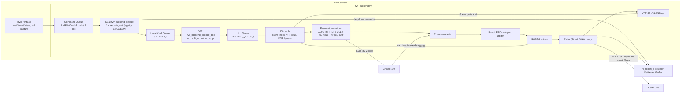
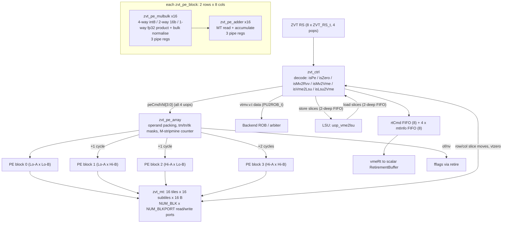

# 5. Vector Backend & Matrix Engine

This chapter covers the SystemVerilog RISC-V Vector (RVV) backend and the experimental
matrix engine (VME, also called Zvt) under `hdl/verilog/rvv/`. The Chisel side of the
boundary (`RvvCore.scala`, the shim and the scalar dispatch path into the vector unit) is in
[Vector frontend](04-floating-point-and-vector-frontend.md). Related chapters:
[01 Top level](01-top-level-and-configuration.md), [02 Scalar core](02-scalar-core.md),
[03 LSU and memory](03-memory-subsystem.md), [06 SoC](06-soc-interconnect-and-peripherals.md), [07 Software](07-software-toolchain-and-verification.md).

All file paths below are relative to `hdl/verilog/rvv/` unless they start with `hdl/`,
`tests/`, `doc/` or `fpga`. Citations use the form `path:line`. Every number was checked
against the RTL at commit `18815824`. When a value depends on a compile-time define, the
default build (`VLEN_128`, `ZVE32F_ON`, plus `ZVT_ON` for VME builds) is given and the formula
is shown.

**Contents**

1. [Source layout](#51-source-layout)
2. [Compile-time configuration](#52-compile-time-configuration)
3. [Top-level structure and hierarchy](#53-top-level-structure-and-hierarchy)
4. [Front of the pipeline: CQ, DE1, LCQ, DE2, UQ](#54-front-of-the-pipeline-cq-de1-lcq-de2-uq)
5. [Dispatch, hazards and operand bypass](#55-dispatch-hazards-and-operand-bypass)
6. [Reservation stations](#56-reservation-stations)
7. [Functional units](#57-functional-units)
8. [Result arbitration, ROB and retirement](#58-result-arbitration-rob-and-retirement)
9. [Vector register file](#59-vector-register-file)
10. [Traps, flush and precise exceptions](#510-traps-flush-and-precise-exceptions)
11. [Vector load/store interaction with the core LSU](#511-vector-loadstore-interaction-with-the-core-lsu)
12. [Supported vtype, SEW/LMUL and unsupported instructions](#512-supported-vtype-sewlmul-and-unsupported-instructions)
13. [Matrix engine (VME / Zvt)](#513-matrix-engine-vme--zvt)
14. [Verification collateral](#514-verification-collateral)
15. [Notes on existing docs and code anomalies](#515-notes-on-existing-docs-and-code-anomalies)

---

## 5.1 Source layout

| Directory / file | Contents |
|---|---|
| `design/RvvCore.sv` | SV top used by the Chisel shim. It instantiates `RvvFrontEnd` and `rvv_backend` (`design/RvvCore.sv:15`, `:132`, `:296`). |
| `design/RvvFrontEnd.sv` | Command formation, `vset*`/`mset*` config-state tracking, scalar operand capture. Covered mainly in chapter 04. This chapter only describes its VME `mset*` handling. |
| `design/rvv_backend*.sv` | The backend: queues, decoder, dispatch, execution units, ROB, retire, VRF (about 30 modules). |
| `design/Zvt/*.sv` | Matrix engine: `zvt` top, `zvt_ctrl`, tile storage `zvt_mt`/`zvt_mt_reg`, PE array/blocks, mul-bulk and adder lanes, FP helper datapaths. |
| `inc/*.svh` | `rvv_backend_define.svh` (all global defines), `rvv_backend.svh` (types/structs), `rvv_backend_opcode.svh` (funct3/funct6 encodings), plus per-unit headers and `rvv_backend_sva.svh` (assertion macros). |
| `common/*.sv` | Generic building blocks: `multi_fifo` (M-push/N-pop FIFO used for every queue/RS), `dff`/`edff`/`cdffr`, `barrel_shifter`, `intdivider`, `arb_round_robin`, compressors, `clz`. |
| `sve/` | UVM testbenches for the backend (`rvv_backend_tb`) and the FIFO (`rvv_fifo_tb`). |
| `com/` | `regress` Perl regression runner and `check_test.pl`. |
| `rvv_vrf_reg.sv` | Stale legacy VRF model. It is not used (see §5.15). |
| `Makefile` | Builds only the `Aligner`/`MultiFifo` VCS unit tests (`Makefile:1-15`). |

The FPnew floating-point IP (`fpnew_fma_multi`, `fpnew_noncomp`, `fpnew_cast_multi`,
`fpnew_divsqrt_th_64_multi`, `fpnew_pkg`) is listed under `design/FPnew/...` in
`design/BUILD:21-50`, but that directory is not checked in. The sources come from
`third_party/cvfpu` (and `common_cells`/`fpu_div_sqrt_mvp`).

## 5.2 Compile-time configuration

### 5.2.1 Feature defines

| Define | Effect | Where it is set |
|---|---|---|
| `VLEN_128` / `_256` / `_512` / `_1024` | Selects `VLEN`. If none is set, VLEN falls back to 128 and prints an error (`inc/rvv_backend_define.svh:5-16`). | `+define+VLEN_${p.rvvVlen}` (`hdl/chisel/src/coralnpu/Core.scala:284`), `-DVLEN_128` (`hdl/chisel/src/coralnpu/flags.bzl:47`). `rvvVlen` is fixed at 128 (`hdl/chisel/src/coralnpu/Parameters.scala:100`). |
| `ZVE32F_ON` | Enables FP32 vector (FALU/FDIV/FRDT units, `OPF*` decode, FRF writeback) (`inc/rvv_backend_define.svh:101-111`). | When `enableFloat` is set (`Core.scala:286-288`), and in `flags.bzl:48`. |
| `ZVFBFWMA_ON` | Enables `vfwmaccbf16`, `vfwcvtbf16`, `vfncvtbf16` (`inc/rvv_backend_opcode.svh:195-202`). | Generated config when `p.enableVectorBf16` is set (`hdl/chisel/src/coralnpu/rvv/RvvCore.scala:669-673`). |
| `ZVT_ON` | Instantiates the VME, `ZVT_RS`, tile ld/st, `mset*`, and widens `RVVConfigState` (`inc/rvv_backend_define.svh:113-117,194-220`; `inc/rvv_backend.svh:82-91`). | `+define+ZVT_ON` when `p.enableVme` is set (`Core.scala:290-292`), and `VME_CORE_MINI_AXI_VOPTS` (`flags.bzl:65-68`). |
| `ZVTBF16FMM_ON` | Adds the BF16→FP32 matrix multiply (SEW16, mtwiden=2, altfmt=1) (`design/rvv_backend_decode_unit_ari.sv:3047-3054`, `design/Zvt/zvt_pe_array.sv:279-285`). | `flags.bzl:67`, `tests/cocotb/BUILD:119`, `tests/uvm/BUILD:172`. The FPGA run-054 build turned it off (`fpga.md:35`). |
| `ZVTI16I32MM_ON` | Adds the INT16→INT32 matrix multiply (SEW16, mtwiden=2) and an INT16 mul-bulk lane format (`design/rvv_backend_decode_unit_ari.sv:2486-2493`, `design/Zvt/zvt_pe_block.sv:110-114`). | No build in the repo sets it. Off in the FPGA build (`fpga.md:35`). |
| `ZVT_MAXCOMPUTING` | Makes the PE array fully parallel (`COMPRATIO=1/4`, `PROCESS_DELAY=4` independent of TE) (`inc/rvv_backend_define.svh:206-212`). | Not set anywhere. |
| `DISPATCH3` / (else = DISPATCH2) | Sets the dispatch width, VRF read ports and RS depths (§5.2.2) (`inc/rvv_backend_define.svh:39-86`). | `GenerateBackendConfig` writes `` `define DISPATCH3`` into `rvv_backend_config.svh` (`RvvCore.scala:657-683,783`). The FPGA run-054 build used DISPATCH2 (`fpga.md:36`). |
| `ARBITER_ON` | Inserts per-unit 2-deep result FIFOs and a 4-port result arbiter in front of the ROB (`design/rvv_backend.sv:1149-1211`). Without it, every unit has its own ROB write port. | Generated config (`RvvCore.scala:678-679`). |
| `UNMK_USCS_LOAD_NOHANDSHAKE` | Unmasked unit-stride and constant-stride loads are not pushed into the LSU RS. Only ROB/map-info entries are created (`design/rvv_backend_decode_unit_lsu_de2.sv:768-776`). | Generated config (`RvvCore.scala:675-676`). |
| `PRECISE_RVVTRAP` | Changes trap handling to inject a trap marker through the LSU result path (§5.10) (`design/rvv_backend.sv:418-426,893-932`). | Not set anywhere. |
| `RVVCHECK_VSTART_VL` | Adds `vl!=0` and `vstart<vl` to decoder legality (`design/rvv_backend_decode_unit_ari.sv:3797-3799`). | Not set anywhere. |
| `AGNOSTIC_ONE` | Writes 1s to agnostic bytes in the dispatch bypass (`design/rvv_backend_dispatch.sv:249-255`). | Not set. It would not compile (see §5.15). |
| `RTBUF_DEPTH` | Overrides `ROB_TAG_WIDTH` (default 4, which matches the scalar retirement buffer size of 16) (`inc/rvv_backend_define.svh:129-134`). | Not set. |
| `TB_SUPPORT` | Adds PCs to every struct and implies `RVVI_ON` (`inc/rvv_backend_define.svh:26-30`). | It is also set in the production Verilator flags (`flags.bzl:46`, `Core.scala:285`). |
| `RVVI_ON` | Exports the full VRF and VME tile data for RVVI lockstep tracing (`inc/rvv_backend.svh:762-807`, `design/rvv_backend.sv:381-384`). | Implied by `TB_SUPPORT`. |
| `ASSERT_ON` | Enables SVA in the RTL (`inc/rvv_backend_sva.svh:7-10`). | Testbenches. |
| "Matrix RS output reg" | `fpga.md:36` lists "matrix RS output reg = 1" for run 054. **There is no matching define or parameter in this repo.** The `ZVT_RS` is a plain `multi_fifo` (`design/rvv_backend.sv:777-807`). The knob must live in the FPGA build scripts (`rebuild/input/build_settings.tcl` in S3), which are not checked in. | n/a |

### 5.2.2 Sizing defines (`inc/rvv_backend_define.svh`)

| Define | DISPATCH3 | DISPATCH2 | Meaning / line |
|---|---|---|---|
| `ISSUE_LANE` / `INST_LANE` | 4 | 4 | Scalar issue lanes into the CQ (`:33-34`) |
| `NUM_DE_INST` | 2 | 2 | Instructions decoded per cycle (`:41`, `:65`) |
| `NUM_DE_UOP` | 6 | 4 | Uops written to the UQ per cycle (`:43`, `:67`) |
| `NUM_DP_UOP` | 3 | 2 | Uops dispatched per cycle (`:45`, `:69`) |
| `NUM_DP_VRF` | 6 | 4 | VRF read ports used by dispatch (`:47`, `:71`) |
| `CQ_DEPTH` | 8 | 8 | Command queue (`:50`, `:74`) |
| `LCQ_DEPTH` | 8 | 8 | Legal command queue (`:51`, `:75`) |
| `UQ_DEPTH` | 16 | 16 | Uop queue (`:52`, `:76`) |
| `ALU_RS_DEPTH` | 8 | 4 | (`:53`, `:77`) |
| `PMTRDT_RS_DEPTH` | 4 | 8 | (`:54`, `:78`) |
| `MUL_RS_DEPTH` | 8 | 4 | (`:55`, `:79`) |
| `DIV_RS_DEPTH` | 4 | 4 | (`:56`, `:80`) |
| `FALU_RS_DEPTH` | 8 | 4 | (`:57`, `:81`) |
| `FRDT_RS_DEPTH` | 4 | 4 | Defined but not used. FP reductions share the PMTRDT RS (`:58`, `:82`) |
| `LSU_RS_DEPTH` | 4 | 4 | (`:59`, `:83`) |
| `LSUMAP_DEPTH` | 8 | 8 | LSU map-info FIFO (`:60`, `:84`) |
| `ROB_DEPTH` | 16 | 16 | (`:61`, `:85`) |

| Define | Value (VLEN=128) | Line |
|---|---|---|
| `VLEN`, `VLENB`, `VLENH`, `VLENW` | 128, 16, 8, 4 | `:5-24` |
| `NUM_VRF` | 32 | `:89` |
| `NUM_LSU`, `NUM_ALU`, `NUM_MUL`, `NUM_PMTRDT`, `NUM_DIV` | 2, 2, 2, 1, 1 | `:95-99` |
| `NUM_FALU`, `NUM_FRDT`, `NUM_FDIV`, `NUM_FSUB` (ZVE32F) | 2, 1, 1, 4 (all 0 without ZVE32F) | `:101-111` |
| `NUM_VME` | 1 with ZVT_ON, else 0 | `:113-117` |
| `NUM_PU` | LSU+VME+ALU+MUL+PMTRDT+DIV+FALU = 11 (VME build) | `:120` |
| `NUM_PU_NOPINGPONG` | LSU+VME = 3 | `:119` |
| `NUM_SMPORT` (ROB write ports) | 4 with `ARBITER_ON`, else `NUM_PU` | `:122-126` |
| `ROB_TAG_WIDTH` | 4 | `:130-134` |
| `NUM_RT_UOP` | 4 uops retired per cycle | `:136` |
| `XLEN`, `FLEN`, `EMUL_MAX` | 32, 32, 8 | `:138-140` |
| `UOP_NUM_ALU` / `UOP_NUM_LSU` | 8 / 32 uops per instruction at most | `:157`, `:161` |
| `VLMAX_MAX`, `VSTART_WIDTH`, `VL_WIDTH` | VLEN, 7, 8 | `:169-171` |

VME sizing (`ZVT_ON`, `inc/rvv_backend_define.svh:195-220`). Note that these macros use
plain integer arithmetic, evaluated left to right:

| Define | Formula | VLEN=128 |
|---|---|---|
| `TE` (tile edge, elements) | `VLEN/8` | 16 |
| `NUM_MT` (tile registers) | constant | 16 |
| `SUBTILE_SIZE` (bytes) | constant | 16 (a 4×4-byte block) |
| `NUM_BLK` (PE blocks) | constant | 4 |
| `COMPRATIO` | `4/TE` (or `1/4` with MAXCOMPUTING) | 1/4 |
| `PROCESS_DELAY` | `TE/4` (or 4) | 4 cycles |
| `ZVT_LMUL` (uops consumed at once) | `32*TE/VLEN` | 4 |
| `ZVT_RS_DEPTH` | `ZVT_LMUL*2` | 8 |
| `NUM_PE` | `TE*TE*COMPRATIO` | 64 |
| `NUM_SUBTILE` (per tile) | `TE*TE/16` | 16 |
| `NUM_BLKPORT` (subtile ports per block) | `ceil(TE/4*COMPRATIO)*TE/4` | 4 |

The Chisel side mirrors `TE` as `vmeTe = rvvVlen / vmeTeRatio` with `vmeTeRatio = 8`
(`hdl/chisel/src/coralnpu/Parameters.scala:108-110`).

## 5.3 Top-level structure and hierarchy

`RvvCore` (`design/RvvCore.sv:15`) is the SV top seen by the Chisel `RvvCoreWrapper`
blackbox. It takes up to `N=4` compressed instructions per cycle together with their scalar
operands (`:34-43`). `RvvFrontEnd` turns them into `RVVCmd` records, each carrying a snapshot
of `RVVConfigState` (`inc/rvv_backend.svh:113-122`). The backend receives these commands, and
the frontend is throttled by `queue_capacity = min(CQ free, 2N)` (`design/RvvCore.sv:162-170`).



Module hierarchy with the default VME build (instance names from the RTL):

```
RvvCore                                   design/RvvCore.sv
├─ frontend   : RvvFrontEnd               design/RvvFrontEnd.sv
└─ backend    : rvv_backend               design/rvv_backend.sv:9
   ├─ u_command_queue        : multi_fifo (RVVCmd, 4→2, depth 8)           :388
   ├─ u_decode_de1           : rvv_backend_decode                          :432
   │   └─ DECODE_UNIT[0..1]  : rvv_backend_decode_unit
   │        ├─ u_lsu_decode  : rvv_backend_decode_unit_lsu
   │        └─ u_ari_decode  : rvv_backend_decode_unit_ari
   ├─ u_legal_command_queue  : multi_fifo (LCMD_t, 2→2, depth 8)           :443
   ├─ u_decode_de2           : rvv_backend_decode_de2                      :476
   │   ├─ u_decode_unit*_de2 : rvv_backend_decode_unit_de2 (×2)
   │   │    ├─ rvv_backend_decode_unit_lsu_de2
   │   │    └─ rvv_backend_decode_unit_ari_de2
   │   └─ u_decode_ctrl      : rvv_backend_decode_ctrl
   ├─ u_uop_queue            : multi_fifo (UOP_QUEUE_t, 6→3, depth 16)     :490
   ├─ u_dispatch             : rvv_backend_dispatch                        :538
   │   ├─ raw_uop_rob / raw_uop_uop / structure_hazard / operand / bypass / ctrl / opr_byte_type
   ├─ u_alu_rs, u_pmtrdt_rs, u_mul_rs, u_div_rs, u_falu_rs, u_zvt_rs, u_lsu_rs, u_lsu_map_info  :599-891
   ├─ u_lsu_res              : multi_fifo (UOP_LSU_t, depth 4)             :934
   ├─ u_alu                  : rvv_backend_alu → alu_unit ×2 (addsub, shift, mask, other, execution_p1)  :966
   ├─ u_pmtrdt               : rvv_backend_pmtrdt → pmtrdt_unit (reduction, freduction, permutation)   :983
   ├─ u_mulmac               : rvv_backend_mulmac → mac_unit ×2 (mul_unit_mul8)  :1005
   ├─ u_div                  : rvv_backend_div → div_unit (intdivider), fdiv_unit (fpnew divsqrt)  :1020
   ├─ u_falu                 : rvv_backend_falu → falu_unit ×2 (fpnew fma/noncomp/cast, sqrt7_rec7)  :1039
   ├─ vme                    : zvt (ZVT_ON)                                :1059
   ├─ u_lsu_remap            : rvv_backend_lsu_remap                       :1089
   ├─ gen_res_ff[*].u_res_ff : multi_fifo depth 2 (ARBITER_ON)             :1150
   ├─ u_arb                  : rvv_backend_arb (2 × arb_slice)             :1194
   ├─ u_rob                  : rvv_backend_rob                             :1214
   ├─ u_retire               : rvv_backend_retire (retire_waw ×3)          :1252
   └─ u_vrf                  : rvv_backend_vrf → rvv_backend_vrf_reg       :1309
```

The backend is idle when CQ, LCQ, UQ and ROB are empty and, with VME, the ZVT RS is empty and
`zvtBusy` is low (`design/rvv_backend.sv:1338-1342`). `RvvCore` also requires that no frontend
command is valid (`design/RvvCore.sv:295`).

## 5.4 Front of the pipeline: CQ, DE1, LCQ, DE2, UQ

All queues are `multi_fifo` instances with M push ports and N pop ports. The consumer sees
`valid = ~almost_empty[i]`, where `almost_empty[i]` means "fewer than i+1 entries". The
`CHAOS_PUSH` option allows non-contiguous push vectors.

| Stage | Module | Width | Function |
|---|---|---|---|
| **CQ** | `u_command_queue` | 4 push, 2 pop, depth 8 | Holds `RVVCmd` (opcode class LOAD/STORE/RVV, bits[31:7], rs1 value, config snapshot, ROB tag). It is cleared on `trap_flush_rvv` (`design/rvv_backend.sv:388-416`). DE1 pops the first one or two commands only when the LCQ is not almost-full (`:429-430`). |
| **DE1** | `rvv_backend_decode` | 2 instructions | Each `decode_unit` routes to the LSU or arithmetic decoder by opcode (`design/rvv_backend_decode_unit.sv:43-80`). It checks legality (vill, register-group alignment for EMUL, EEW/EMUL validity, overlap rules, `frm<5`, optional vstart/vl) (`design/rvv_backend_decode_unit_ari.sv:3789-3800`, `:3877-3880`, `:4065`) and computes EEW/EMUL per operand, `uop_index_max`, the effective vstart (`uop_vstart`), the effective vl (`evl`, e.g. for `vmv<nr>r`, `vmv.s.x`), and `force_vma/vta_agnostic` (`:4073-4129`). |
| **Illegal handling** | `rvv_backend_decode` | — | Instructions that fail decode are dropped. A dummy "no-write" retire record (`de2rt_*`) goes straight to the scalar retirement buffer (`design/rvv_backend_decode.sv:52-74`). The backend does **not** raise an illegal-instruction trap. The comment states that the scalar core traps undecodable instructions itself (`:47-51`). |
| **LCQ** | `u_legal_command_queue` | 2→2, depth 8 | Holds `LCMD_t` (`inc/rvv_backend.svh:151-169`) (`design/rvv_backend.sv:443-471`). |
| **DE2** | `rvv_backend_decode_de2` | up to `NUM_DE_UOP` uops | Two `decode_unit_de2` instances split commands into uops. Unit 0 resumes long instructions using `uop_index_remain` from `decode_ctrl` (`design/rvv_backend_decode_de2.sv:53-86`). Each uop gets an execution unit, a `UOP_CLASS_e` (which of vd/vs2/vs1 are read), first/last flags, `pshrob_valid` and `pshlsu_valid` (`design/rvv_backend_decode_unit_ari_de2.sv:234-520`, `:2321-2340`). `decode_ctrl` pushes only when the UQ has enough free slots (`design/rvv_backend_decode_ctrl.sv:6`). |
| **UQ** | `u_uop_queue` | 6→3 (D3) / 4→2 (D2), depth 16 | `UOP_QUEUE_t` (`inc/rvv_backend.svh:258-303`). Assertions require in-order (prefix) push and pop patterns (`design/rvv_backend.sv:521-535`). |

Uop splitting: an ALU-class instruction becomes at most 8 uops (LMUL8, one per register of the
group). An LSU instruction becomes at most 32 (EMUL × NF segment fields)
(`inc/rvv_backend_define.svh:156-165`). Compares and reductions push only their *last* uop into
the ROB (`pshrob_valid = last_uop_valid`, `design/rvv_backend_decode_unit_ari_de2.sv:2333-2338`),
because they produce a single destination register.

Execution-unit assignment in DE2 (`design/rvv_backend_decode_unit_ari_de2.sv:234-518`):

| `EXE_UNIT_e` | Instructions |
|---|---|
| `VEU_ALU` | vadd/vsub/vrsub/vadc/vsbc, logic, shifts, narrowing shifts, min/max, vmerge/vmv, saturating add/sub, vssrl/vssra, vnclip(u), widening add/sub (vwadd*, vwsub*, .w forms), vzext/vsext, averaging add/sub, mask-logical (vmand…vmxnor), vmv.x.s, vfirst, vmsbf/vmsif/vmsof/vid, vmv.s.x, vmv<nr>r (OPIVI vsmul slot), vfmerge/vfmv, vfmv.f.s/vfmv.s.f |
| `VEU_CMP` (ALU unit 0 only) | vmadc, vmsbc, vmseq…vmsgt |
| `VEU_MUL` / `VEU_MAC` | vmul, vmulh/hu/hsu, vwmul/u/su, vsmul / vmacc, vnmsac, vmadd, vnmsub, vwmacc/u/su/us |
| `VEU_DIV` | vdivu, vdiv, vremu, vrem |
| `VEU_RDT` | vredsum/and/or/xor/min/max(u), vwredsum(u) |
| `VEU_MISC` (PMTRDT) | vcpop.m, viota.m (`:375`, `:388`) |
| `VEU_PMT` | vslideup/down, vslide1up/down, vrgather, vrgatherei16, vcompress, vfslide1up/down |
| `VEU_FMA` | vfadd/sub/rsub/mul, all 8 fused multiply-adds, vfwmaccbf16 |
| `VEU_FDIV` (DIV RS) | vfdiv, vfrdiv, vfsqrt |
| `VEU_FNCMP` / `VEU_FCMP` | vfmin/max, vfsgnj*, vfclass / vmfeq…vmfge |
| `VEU_FCVT` / `VEU_FTBL` | vfcvt.*, vfwcvt.f.x(u), vfncvt.x(u).f, bf16 converts / vfrsqrt7, vfrec7 |
| `VEU_FRDT` (PMTRDT) | vfredosum, vfredusum, vfredmax, vfredmin |
| `LSU` / `VMELSU` | vector loads/stores / VME tile loads/stores (`design/rvv_backend_decode_unit_lsu_de2.sv:195`) |
| `VME` | vtmm (VTXMMXTVV), vtzero, vtmv.v.t, vtmv.t.v |

## 5.5 Dispatch, hazards and operand bypass

`rvv_backend_dispatch` dispatches in order, up to `NUM_DP_UOP` uops per cycle. There is **no
register renaming**. Correctness comes from RAW stalls plus forwarding from the ROB:

1. **RAW against the ROB** (`design/rvv_backend_dispatch_raw_uop_rob.sv:43-81`). For each uop,
   vs1, vs2, vd-as-source (vs3, the MAC accumulator or merge) and v0 (when `vm=0`) are compared
   with every valid ROB entry whose destination is the VRF. A hit on an entry whose result is
   not yet written (`~w_valid`) sets `*_wait`. A hit on a completed entry is forwarded from the
   ROB result memory by `rvv_backend_dispatch_bypass` (`design/rvv_backend_dispatch.sv:243-278`).
2. **RAW inside the dispatch group** (`design/rvv_backend_dispatch.sv:203-220`). An earlier uop
   in the same group is modelled with `w_valid=0`. Any dependency of uop *i* on uop *j<i* in the
   same cycle therefore stalls uop *i* and everything after it.
3. **Structural hazard on VRF read ports** (`design/rvv_backend_dispatch_structure_hazard.sv:28-140`).
   With DISPATCH3 there are 6 read ports. By default ports 0-2 go to uop0 (vs1/vs2/vs3) and
   ports 3-5 to uop1. Uop2 can only dispatch if its `uop_class` operands fit into ports left
   free by uop0/uop1. Otherwise `arch_hazard.vr_limit` holds it back.
4. **Resource readiness** (`design/rvv_backend_dispatch_ctrl.sv:83-221`). `uop_ready[i]` = all
   older uops in the group ready AND no RAW wait AND a ROB slot is free AND the target RS
   accepts. LSU uops also need a free LSU map-info slot. Readiness is a prefix chain, so
   dispatch is strictly in order.

WAR and WAW are not checked at dispatch. Sources are read (or bypassed) at dispatch time, and
destinations are written to the VRF only at in-order retire, so neither hazard can occur.
Within one retire group, WAW is merged by `rvv_backend_retire_waw` (§5.8).

Dispatch also computes per-byte operand types (`BYTE_TYPE_e`: `NOT_CHANGE` for prestart,
`TAIL`, `BODY_INACTIVE`, `BODY_ACTIVE`) from vstart, vl, vm/v0 and EEW
(`design/rvv_backend_dispatch.sv:323-345`, `inc/rvv_backend.svh:306-311`). `VLMAX` per uop is
`lmul * VLENB / sew`, computed as a shift (`design/rvv_backend_dispatch.sv:162-172`). The ROB
address for each uop is the ROB write pointer plus a prefix count of `pshrob_valid` (`:350-355`).

## 5.6 Reservation stations

Every RS is a `multi_fifo` with M=`NUM_DP_UOP` push ports and N=units pop ports, cleared on
`trap_flush_rvv`. Entries hold **fully read operands** (VLEN-bit vs1/vs2/vs3 data and v0), so
units never read the VRF again. The one exception is the permutation unit, which has its own
VRF read port.

| RS | Struct (`inc/rvv_backend.svh`) | Pop ports | Depth D3/D2 | Instance |
|---|---|---|---|---|
| ALU (+CMP) | `ALU_RS_t` `:322-349` | 2 | 8 / 4 | `design/rvv_backend.sv:599-627` |
| PMTRDT (+MISC, FRDT) | `PMT_RDT_RS_t` `:413-441` | 1 | 4 / 8 | `:635-663` |
| MUL (+MAC) | `MUL_RS_t` `:393-410` | 2 | 8 / 4 | `:671-699` |
| DIV (+FDIV) | `DIV_RS_t` `:352-370` | 1 | 4 / 4 | `:707-735` |
| FALU | `FALU_RS_t` `:460-486` | 2 | 8 / 4 | `:744-772` |
| ZVT | `ZVT_RS_t` `:665-692` | `ZVT_LMUL`=4 | 8 | `:777-807`. Ready means not almost-full (`:807`). |
| LSU | `UOP_RVV2LSU_t` `:444-457` | 2 (in-order to LSU) | 4 / 4 | `:821-860` |
| LSU map-info | `LSU_MAP_INFO_t` `:506-514` | 2 | 8 / 8 | `:863-891` |

## 5.7 Functional units

All units return `PU2ROB_t` (`inc/rvv_backend.svh:492-503`): ROB entry, VLEN-bit data, a
per-byte saturation flag, and per-byte FP exception flags. Result data is always a full
destination register (or `w_data[31:0]` for scalar results).

### 5.7.1 ALU (`rvv_backend_alu`, 2 units)

* Two `rvv_backend_alu_unit` instances. Unit 0 is built with `CMP_SUPPORT=1`. Compare uops
  (`is_cmp`) are never steered to unit 1 (`design/rvv_backend_alu.sv:56-130`).
* Inside a unit, the sub-blocks `alu_unit_addsub`, `alu_unit_shift`, `alu_unit_mask` and
  `alu_unit_other` work on the RS output. Shift, mask and other results go to the ROB directly
  from that stage (p0). Add/sub and compare results are registered and finished in
  `alu_unit_execution_p1` (saturation, carry/compare packing) (`design/rvv_backend_alu_unit.sv:64-250`).
  In effect, logic/shift/move/mask ops take one stage after the RS and add/sub/compare take two.
* Fixed-point rounding uses `vxrm` from the uop. Saturation is reported per byte.

### 5.7.2 MUL/MAC (`rvv_backend_mulmac`, 2 units)

* Two `rvv_backend_mac_unit` instances handle both `VEU_MUL` and `VEU_MAC`
  (`design/rvv_backend_mulmac.sv:100-118`). They are built from `rvv_backend_mul_unit_mul8`
  8×8 multiplier tiles (`design/rvv_backend_mac_unit.sv:691`) and have a two-stage EX1/EX2 pipe
  (`:71`, `:745`).
* Supported: SEW 8/16/32 vmul/vmulh*, widening multiplies, vsmul (with rounding and saturation),
  single-width and widening multiply-add.
* `design/rvv_backend_mul_unit.sv` is **not instantiated** in the current hierarchy.

### 5.7.3 DIV (`rvv_backend_div`, 1 unit, also hosts FDIV)

* Integer: `rvv_backend_div_unit` uses `VLENB/2` 8-bit, `VLENH/2` 16-bit and 32-bit
  `intdivider` instances. Each is an iterative, data-dependent-latency divider that uses
  leading-zero counting (`design/rvv_backend_div_unit.sv:333-400`, `common/intdivider.sv`). A
  full VLEN register is processed in two halves (`uop_valid_d1` replay, `:340`).
* FP (ZVE32F): `rvv_backend_fdiv_unit` instantiates `VLENW` (4) copies of
  `fpnew_divsqrt_th_64_multi` (FP32 only, `NumPipeRegs=1`) for vfdiv/vfrdiv/vfsqrt
  (`design/rvv_backend_fdiv_unit.sv:106-130`).
* The two share one RS and one ROB port through a round-robin `arb_round_robin`
  (`design/rvv_backend_div.sv:110-131`). `rvv_backend_fdiv_wrapper.sv` is present but **not
  instantiated**.

### 5.7.4 FALU (`rvv_backend_falu`, 2 units, ZVE32F)

* Each `rvv_backend_falu_unit` has `VLENW` FP32 lanes of `fpnew_fma_multi` (BF16 source format
  is added with `ZVFBFWMA_ON`), `fpnew_noncomp` (min/max/sgnj/class/compare) and
  `fpnew_cast_multi`, plus the `rvv_backend_sqrt7_rec7` lookup tables. All are pipelined with
  `PIPEREGS=4` (`design/rvv_backend_falu_unit.sv:38-41`, `:479-575`, `:616`).
* Steering: uop0 always goes to unit 0 if possible, otherwise to unit 1, and uop1 fills the
  remaining unit (`design/rvv_backend_falu.sv:73-128`). Mask-producing compares
  (`VEU_FCMP`) are only accepted by unit 0 (`:60`, `:68`).
* Supported FP ops: see §5.4. FP exception flags are kept per byte and ORed over active bytes
  at retire.

### 5.7.5 PMTRDT: permutation, reduction, mask counting (`rvv_backend_pmtrdt`, 1 unit)

* `rvv_backend_pmtrdt_unit` contains `pmtrdt_unit_reduction` (integer reductions, vcpop, viota),
  `rvv_backend_freduction` (FP reductions on `fpnew_fma_multi`/`fpnew_noncomp`) and
  `pmtrdt_unit_permutation` (`design/rvv_backend_pmtrdt_unit.sv:118-196`).
* Reduction latency depends on VLENB: 3 cycles at 16 B, up to 6 cycles at 128 B. Permutation
  latency depends on the slide/gather offset (`design/rvv_backend_pmtrdt_unit.sv:6-13`).
* The permutation sub-unit owns a **dedicated VRF read port** (`rd_index_pmt2vrf`). With it,
  gathers and slides read arbitrary source registers of the group directly
  (`design/rvv_backend_pmtrdt_unit_permutation.sv:371`, `design/rvv_backend_vrf.sv:122`).

### 5.7.6 LSU result path and VME

These are covered in §5.11 and §5.13.

### 5.7.7 Summary

| Unit | Count | RS | Datapath width | Latency (cycles after RS) |
|---|---|---|---|---|
| ALU | 2 (unit 0 adds CMP) | ALU | VLEN | 1 (logic/shift/mask/move), 2 (add/sub/cmp) |
| MUL/MAC | 2 | MUL | VLEN via 8×8 tiles | 2 (EX1/EX2) |
| DIV (int) | 1 | DIV | VLEN/2 per pass | iterative, data dependent |
| FDIV/FSQRT | 1 (4 FP32 lanes) | DIV | 4 × FP32 | iterative (fpnew divsqrt) |
| FALU | 2 (4 FP32 lanes each) | FALU | 4 × FP32 | 4 (`PIPEREGS`) |
| PMTRDT | 1 | PMTRDT | VLEN + private VRF port | 2 (cmp/compress), 3 (reduction at VLEN=128), N (permutation) |
| LSU | 2 slots | LSU | VLEN per uop | set by the Chisel LSU |
| VME | 1 | ZVT | 4 VLEN uops per op | §5.13 |

## 5.8 Result arbitration, ROB and retirement

### 5.8.1 Arbitration (`ARBITER_ON`)

The results of all ping-pong units (every unit except LSU and VME) first go into a 2-deep FIFO
(`design/rvv_backend.sv:1150-1181`). `rvv_backend_arb` then maps the 11 requesters onto 4 ROB
write ports using two `rvv_backend_arb_slice` instances. Each slice has 2 high-priority inputs
that are always granted and a round-robin pool of non-priority inputs that fills whichever port
is free (`design/rvv_backend_arb.sv:47-160`, `:162-270`). Requester indices follow the
concatenation order in `design/rvv_backend.sv:1107-1119`:
`{FALU1,FALU0,DIV,PMTRDT,MUL1,MUL0,ALU1,ALU0,VME,LSU1,LSU0}`. With ZVT_ON, LSU0/LSU1 are the
high-priority inputs on ports 0/1, and indices 6 and 7 (MUL1, PMTRDT) are the high-priority
inputs on ports 2/3. Only ports 0/1 carry the LSU fault-only-first `ff_tail_index`
(`:154-157`). LSU and VME results are not buffered. They are told ready only when granted
(`design/rvv_backend.sv:1183-1188`).

### 5.8.2 ROB (`rvv_backend_rob`)

* 16 entries. The uop info is a `multi_fifo` with `NUM_DP_UOP` pushes and `NUM_RT_UOP`=4 pops
  (`design/rvv_backend_rob.sv:119-148`). There is a parallel valid FIFO (`:156-186`). The result
  memory `res_mem[16]` is written by entry index from the 4 SM ports (`:189-208`), and a
  `uop_done` bit tracks completion (`:221-236`).
* **All 16 entries are exported to dispatch** in program order (`uop_rob2dp`) for RAW
  detection and bypass (`:344-360`). The ROB is effectively the rename/forwarding store.
* Retire readiness is a prefix chain: entry *i* retires if it is done and all older entries in
  the group retire. A trap-flagged head can retire without being done, and no entry retires
  after a trap-flagged one (`:290-296`).
* Fault-only-first: the `ff_tail_index` from the LSU turns bytes beyond the faulting element
  into `TAIL` in the retire and bypass views (`:279-288`, `:317`, `:357`).

### 5.8.3 Retire (`rvv_backend_retire`)

* Up to 4 uops per cycle. Only bytes whose type is `BODY_ACTIVE` are written. Tail and
  inactive bytes keep their old VRF value, so agnostic behaves as undisturbed
  (`design/rvv_backend_retire.sv:144-146`).
* **WAW in one retire group**: `rvv_backend_retire_waw` merges younger writes to the same vreg
  into the youngest slot and masks the older ones (`:189-214`).
* **Scalar destinations**: XRF (vmv.x.s, vcpop, vfirst) and FRF (vfmv.f.s, FP reductions) go
  out as `RT2RVS_t` (rob_tag, index, data) (`:312-339`). `RvvCore` only connects **slot 0** of
  the 4 retire lanes to the single `async_rd` / `async_frd` port. The other lanes have ready=0,
  so at most one scalar-writing uop retires per cycle and only from the head
  (`design/RvvCore.sv:211-244`).
* `vxsat` is set if any active byte saturated (`design/rvv_backend_retire.sv:222-224`).
  `fflags` is the OR of active-byte FP flags, plus VME `of`/`nv` (`:226-250`). Both are exported
  from `RvvCore` (`design/RvvCore.sv:359-370`).
* `vcsr_valid`/`vector_csr` (the config snapshot including vstart) are produced **only when a
  trap-flagged uop retires** (`design/rvv_backend_retire.sv:218-219`).
* Retirement records for the scalar `RetirementBuffer` are `rd_rob2rt_o[NUM_RT_UOP+NUM_DE_INST]`:
  4 ROB lanes plus the 2 DE1 "dummy" lanes (`design/rvv_backend.sv:1334-1335`). A ROB record is
  emitted when the uop with `res_updating_end` retires, i.e. once per instruction
  (`design/rvv_backend_retire.sv:343-364`). This matches `rvvRetireLanes = instructionLanes+2`
  (`hdl/chisel/src/coralnpu/Parameters.scala:105`).

## 5.9 Vector register file

`rvv_backend_vrf` (`design/rvv_backend_vrf.sv:6-124`) is a flop array:
`rvv_backend_vrf_reg` holds 32 × VLEN bits as one `edff` per byte with a byte enable
(`design/rvv_backend_vrf_reg.sv:24-43`). There are no banks and no SRAM macros.

| Port | Count | Notes |
|---|---|---|
| Dispatch read | `NUM_DP_VRF` = 6 (D3) / 4 (D2) | Mux from the full array by `dp2vrf_rd_index` (`:117-119`) |
| v0 read | 1 (always register 0) | `:115` |
| Permutation read | 1 | `:122` |
| Retire write | `NUM_RT_UOP` = 4, byte strobed | Write data/enables are ORed across lanes. After the WAW merge, lanes never target the same byte (`:61-96`) |
| RVVI | full 32 × VLEN export | `RVVI_ON` (`:110-112`) |

Writes become visible the cycle after retire. Until then, consumers get the value through the
ROB bypass.

## 5.10 Traps, flush and precise exceptions

There are two trap mechanisms, selected by `PRECISE_RVVTRAP`:

**Default (no `PRECISE_RVVTRAP`, what all builds use).**
`RvvCore` drives `trap_valid_rvs2rvv = flush` (`design/RvvCore.sv:267-269`). The flush comes
from the Chisel side (scalar trap, LSU fault). The ROB turns it into `trap_flush_rvv`, held
for 2 cycles (`design/rvv_backend_rob.sv:325-336`). The flush clears every queue, RS, result
FIFO, ROB and ZVT state, and blocks CQ pushes (`design/rvv_backend.sv:418-421`). LSU uops never
carry `trap_valid` (`:893-902`), so the ROB `trap_flag` is never set, and `vcsr_valid` is
never asserted by the backend. Precise state for vector memory faults (vstart, and which
element faulted) is therefore owned by the scalar/LSU side (chapters 03/04). The backend only
supports a full flush.

**`PRECISE_RVVTRAP`.**
When the scalar side raises a trap, the backend waits until the LSU has no response in flight
and the LSU result FIFO has room. It then injects a `trap_valid` marker into LSU result slot 0
(`design/rvv_backend.sv:905-931`). `lsu_remap` marks the matching ROB entry with `trap_flag`
(`design/rvv_backend_lsu_remap.sv:83-91`). When that entry reaches the head, retire
writes out its `vector_csr` (vstart etc.) and the ROB flushes everything younger
(`design/rvv_backend_rob.sv:266-273`, `:325-338`). Older uops retire normally first, which
gives a precise boundary. While trapping, the CQ ready and capacity are forced to 0
(`design/rvv_backend.sv:422-425`).

For VME, `vme_lsuflush_vld` is an extra flush source into the ROB (`design/rvv_backend_rob.sv:326-328`).
`RvvCore` ties it to 0 (`design/RvvCore.sv:351`).

## 5.11 Vector load/store interaction with the core LSU

The backend does not generate addresses. It sends per-uop register data to the Chisel LSU and
receives load data back (address generation is covered in chapter 03).

```mermaid
sequenceDiagram
  participant DP as Dispatch
  participant RS as LSU RS (2 out)
  participant MAP as LSU map-info FIFO
  participant LSU as Chisel LSU
  participant RES as u_lsu_res FIFO
  participant RMP as lsu_remap
  participant ROB
  DP->>ROB: allocate entry (rob_entry)
  DP->>MAP: {rob_entry, is_store, vd}
  DP->>RS: UOP_RVV2LSU_t {vs2 index data, vs3 store data, v0 byte strobe}
  RS->>LSU: uop_lsu_*_rvv2lsu[0..1] (in order; slot1 only if slot0 fires)
  LSU-->>RES: load: {vd addr, VLEN data, ff_tail_index}; store: last=1
  RES->>RMP: pop with matching map-info
  RMP->>ROB: PU2ROB_t (w_valid only if addr==mapinfo.vd and load)
```

* **Outbound** (`inc/rvv_backend.svh:444-457`, `design/RvvCore.sv:176-188`). There are 2 lanes.
  Each carries the index-vector register (vs2, used for gathers/scatters), the store-data
  register (vs3) and `v0` as a `VLENB`-bit byte strobe for masked accesses. Lane 1 is valid
  only if lane 0 fires in the same cycle (`design/rvv_backend.sv:851-860`), so uops reach the
  LSU strictly in order.
* With `UNMK_USCS_LOAD_NOHANDSHAKE`, unmasked unit-stride and constant-stride **loads do not
  go through the LSU RS** at all (`pshlsu_valid=0`). The Chisel LSU generates those accesses
  from its own decode of the instruction, and the backend only creates the ROB and map-info
  entries that later match the returning data
  (`design/rvv_backend_decode_unit_lsu_de2.sv:768-776`).
* **Inbound** (`design/RvvCore.sv:191-206`). Load data comes as `{addr, VLEN data, last,
  ff_tail_index}`. A response with `last=1` is the "store done" signal (`lsu_vstore_last`).
  Responses go into a 4-entry `u_lsu_res` FIFO (`design/rvv_backend.sv:934-961`) and are paired
  in order with map-info entries by `rvv_backend_lsu_remap`. That module restores `rob_entry`
  and drops write data whose register address does not match the expected `vd`
  (`design/rvv_backend_lsu_remap.sv:49-70`).
* Supported memory modes (`inc/rvv_backend.svh:198-227`): unit-stride (regular, whole-register
  `vl<nr>r`, mask `vlm/vsm`, fault-only-first), constant-stride, indexed unordered and ordered,
  and segment variants (NF 2-8). Data EEW is 8/16/32 only (`design/rvv_backend_decode_unit_lsu.sv:84-86`).
  Store uops occupy a ROB slot but write nothing.

## 5.12 Supported vtype, SEW/LMUL and unsupported instructions

* **Profile**: Zve32x plus Zve32f (with ZVE32F_ON) and optional Zvfbfwma. `ELEN=32`, `XLEN=FLEN=32`.
* **SEW**: 8, 16, 32. `SEW64` makes vill=1 (`design/RvvFrontEnd.sv:365-390`; the default branch sets vill). The decoders have no EEW64 path (EEW64 appears only in the
  reduction ALU helper, `design/rvv_backend_pmtrdt_unit_reduction_alu.sv:46`).
* **LMUL**: 1, 2, 4, 8 and fractional values down to SEW/ELEN. Legal combinations are
  SEW8: mf4, mf2, m1-m8. SEW16: mf2, m1-m8. SEW32: m1-m8. LMUL=1/8 is always illegal and any
  fractional LMUL with SEW32 is illegal (vill). Fractional LMUL is executed as one register
  (`reduced_lmul`).
* **vstart**: supported. The decoder computes the first uop index and dispatch marks prestart
  bytes `NOT_CHANGE`. `vstart` is reset to 0 after each instruction in the frontend (`design/RvvFrontEnd.sv:168-171`).
* **Tail/mask agnostic**: allowed, but implemented as undisturbed (only `BODY_ACTIVE` bytes are
  written, §5.8.3).
* **Unsupported / absent** (no funct6 in `inc/rvv_backend_opcode.svh` or no decode path):
  all 64-bit element ops and EEW64 loads/stores. Widening/narrowing FP arithmetic: vfwadd,
  vfwsub, vfwmul, vfwmacc/vfwnmacc/vfwmsac/vfwnmsac, vfwredusum/osum. Several converts are
  missing from the `vfunary0` table (`inc/rvv_backend_opcode.svh:171-183`):
  vfwcvt.x(u).f, vfwcvt.rtz.x(u).f, vfwcvt.f.f, vfncvt.f.x(u), vfncvt.f.f and vfncvt.rod.f.f
  (the BF16 converts are the exception). The decoded converts are the single-width
  vfcvt.* (including rtz), the widening `vfwcvt.f.x(u)` and the narrowing `vfncvt.x(u).f`
  (including rtz). vfmv.v.f is decoded through `VFMERGE_VFMV`. Undecodable encodings are
  retired as no-ops by the backend (§5.4).

## 5.13 Matrix engine (VME / Zvt)

### 5.13.1 Enablement

VME requires `--enableRvv` (`hdl/chisel/src/coralnpu/Core.scala:140`). The `--enableVme=True`
generator flag (`hdl/chisel/src/coralnpu/flags.bzl:28-30`) adds `+define+ZVT_ON` to the emitted
filelist (`Core.scala:290-292`). The `vme_core_mini_*` targets compile with
`ZVT_ON` and `ZVTBF16FMM_ON` (`flags.bzl:65-68`, `hdl/chisel/src/coralnpu/BUILD:819-877`). The
cocotb `vme_test` and UVM VME flows use the same pair of defines
(`tests/cocotb/vme_test/BUILD:91-92`, `tests/uvm/BUILD:169-206`).

### 5.13.2 Architectural state

| State | Encoding / storage | Source |
|---|---|---|
| 16 tile registers `mt0..mt15` | Each tile is `TE×TE` bytes = 16 subtiles × 16 B = 256 B. Subtile = 4 rows × 4 bytes. Total 4 KiB of flops (`zvt_mt_reg`: one `edff` per byte) | `design/Zvt/zvt_mt_reg.sv:24-43`, `inc/rvv_backend_define.svh:198-217` |
| Wider elements | A 16-bit-element tile uses an aligned **pair** of mt registers and a 32-bit-element tile an aligned **group of 4** (a 16×16 int32/fp32 accumulator = 1 KiB). The decoder enforces alignment: EEW16 needs `vd[1]=0`, EEW32 needs `vd[2:1]=0` | `design/rvv_backend_decode_unit_ari.sv:3214-3221`, `design/Zvt/zvt_pe_block.sv:259-262` |
| `mtype` fields in `RVVConfigState` | `altfmt`, `mtwiden[1:0]`, `tm[13:0]`, `tk[2:0]` | `inc/rvv_backend.svh:82-91` |
| Packed `mtype` CSR view | `{8'd0, tm, 2'd0, tk, 3'd0, mtwiden}` (tk is 3 bits at [7:5]) | `hdl/chisel/src/coralnpu/rvv/RvvCore.scala:642-651` |
| `tn` | The ordinary `vl` (set by `msettn`) | `design/Zvt/zvt_ctrl.sv:175`, `design/Zvt/zvt_pe_array.sv:81` |

`mtwiden` encodes the accumulator widening: 1 = ×1, 2 = ×2, 3 = ×4. `vill` is set when
SEW·TWIDEN > ELEN (`design/RvvFrontEnd.sv:394-403`).

### 5.13.3 Configuration instructions (frontend, `design/RvvFrontEnd.sv:244-362`)

All use the `OPCFG` major encoding (bits[14:12]=111) with bit31=1, and are separated by
bits[30:25]:

| Instruction | Effect |
|---|---|
| `msetmtype rd, rs1, rs2` | `mtwiden←rs1[1:0]`, `tk←min(rs1[7:5],KMAX)`, `tm←min(rs1[23:10],16)`, SEW←rs2[5:3], `altfmt←rs2[8]`, vl←0. If mtwiden≠0, ta=ma=1 and LMUL is forced to 1/2/4 for SEW8/16/32 (`:248-298`). |
| `msettn rd, rs1` | vl←min(rs1, VLMAX), rd←vl (`:302-305`) |
| `msettm rd, rs1` | tm←min(rs1, TE) (0 if unconfigured), rd←tm (`:306-315`) |
| `msettk rd, rs1` | tk←min(rs1, KMAX), with KMAX = 4/2/1 for SEW 8/16/32 (`:316-334`) |
| `msetmtypei` | Immediate form. mtwiden←imm[9:8], SEW←imm[17:16], tm=tk=0 (`:335-358`; its vl update goes through `is_setvl`) |

Ordinary `vsetvl*` resets `altfmt/mtwiden/tk/tm` to 0 (`:198-215`, `:237-240`). Commit
`d2d0fba4` stopped dispatching `msettm/msettk` to the backend, so they only update frontend
state.

### 5.13.4 Compute and data-movement instructions

| Instruction | Encoding (in RTL) | Backend path |
|---|---|---|
| **vtmm** (matrix multiply-accumulate) | funct6 `VTXMMXTVV`=111100, OPIVV (int) or OPFVV (fp) (`inc/rvv_backend_opcode.svh:235`) | `VME` → PE array |
| **vtzero** | OPMVX `VWRXUNARY0`, vs2 field `VTZERO`=11110 (`:238`). Tile index in `vd[4:1]` | `VME` → `zvt_ctrl` zero sequencer, `PROCESS_DELAY` cycles |
| **vtmv.v.t** (tile row/col → vreg) | OPMVX `VWRXUNARY0`, vs2 `VTMVVT`=11111 | `VME`. **This is the only VME op that takes a ROB entry**, because it writes a vreg (`design/rvv_backend_decode_unit_ari_de2.sv:2326-2331`) |
| **vtmv.t.v** (vreg → tile row/col) | OPMVX funct6 `VCOMPRESS_VTMVTV` | `VME` |
| **Tile load/store** | LOAD/STORE with mew/mop = `TILE_LDST`=3'b100 (`inc/rvv_backend_opcode.svh:210`). nf field = tile EEW (000=8, 001=16, 010=32) (`design/rvv_backend_decode_unit_lsu.sv:87-89`). Requires `vm=1` and `vstart≤index` (`:3391-3393`) | `VMELSU` → ZVT RS → LSU data bridge. No ROB slot (`design/rvv_backend_decode_unit_lsu_de2.sv:737-738`) |

Moves and tile ld/st take a **tile-slice selector (TSS)** in `rs1`: `tile = rs1[30:27]`,
`pattern = rs1[24]`, `index = rs1[log2 TE-1:0]` (`design/rvv_backend_decode_unit_lsu.sv:111-113`,
`inc/rvv_backend.svh:653-657`). `pattern=0` selects row `index` and `pattern=1` selects
column `index` of the tile (`design/Zvt/zvt_ctrl.sv:236-276`). The column mode is the hardware
transpose path: a column of the tile is gathered into one vector register, or scattered from
one. Each uop moves one VLEN-bit register of elements. EEW16 slices take 2 uops and EEW32
slices take 4. Elements beyond `tn` (or before `vstart`) are byte-masked off (`:153-189`).

Supported matmul datatypes (`design/rvv_backend_decode_unit_ari.sv:2476-2495`, `:3043-3062`):

| Kind | Required vtype | Sources → accumulator | Define |
|---|---|---|---|
| INT8 | SEW8, mtwiden=3, LMUL1 | int8 × int8 → int32, K≤4 | always |
| INT16 | SEW16, mtwiden=2, LMUL2 | int16 × int16 → int32, K≤2 | `ZVTI16I32MM_ON` |
| FP32 | SEW32, mtwiden=1, altfmt=0, LMUL4 | fp32 × fp32 → fp32, K=1 | always |
| BF16 | SEW16, mtwiden=2, altfmt=1, LMUL2 | bf16 × bf16 → fp32, K≤2 | `ZVTBF16FMM_ON` |

For the integer forms, `vd[0]` selects whether **vs2 is signed** (`INTMUL` vs `UINTMUL`) and
`altfmt` selects whether **vs1 is signed** (`design/Zvt/zvt_pe_array.sv:260-265`,
`design/Zvt/zvt_pe_mulbulk.sv:208`). The destination accumulator group is `vd[4:1]`.

Semantics, from the operand packing in `design/Zvt/zvt_pe_array.sv:126-175`: vs2 and vs1 are
each a group of 4 vector registers (EMUL4, `uop_index_max=3`, `ZVT_LMUL=4`). For SEW8, byte
`i` of register `k` in each group is element `k` of a 4-deep K vector for row/column `i`. The
operation is

```
C[m][n] += Σ_{k<tk} A[m][k] · B[n][k]    m < tm (rows from vs2), n < tn=vl (cols from vs1)
```

that is, an outer-product accumulate of K-deep dot products into a TE×TE (16×16) accumulator
tile. Rows ≥ tm, columns ≥ tn and lanes k ≥ tk are masked out (`:71-124`).

### 5.13.5 Micro-architecture



* **`zvt_ctrl`** (`design/Zvt/zvt_ctrl.sv`) examines the RS head. It starts a non-PE operation
  only when the PE array is idle (`!peBusy`) and the retire-command FIFO has room
  (`:105-139`). PE commands need all four uops of the group to be valid together
  (`peCmdVld` is a prefix chain, `:142-145`). It also owns the read/write muxing of the tile
  storage between the PE array and the move/LSU/zero paths (`:616-678`).
* **`zvt_pe_array`** (`design/Zvt/zvt_pe_array.sv`) splits A (vs2) and B (vs1) into Lo/Hi
  halves of `TE/2` and feeds 4 blocks in a 2×2 systolic skew. Block 0 starts at once, blocks
  1 and 2 one cycle later and block 3 two cycles later (`:311-339`). Each block covers
  `ROWS_PER_CNT = TE/2·COMPRATIO = 2` rows × `TE/2 = 8` columns per cycle. A counter walks M in
  `PROCESS_DELAY = 4` steps when tm > 8 (`:210-217`, `:297-305`). 4 blocks × 16 PEs gives
  `NUM_PE = 64`, each a 4-way int8 dot-product (or 2-way 16-bit, or 1-way FP32).
* **Throughput at VLEN=128**: one 16×16×4 int8 tile update (1024 MACs) every 4 cycles = 256
  int8 MAC/cycle. FP32 gives 16×16×1 per 4 cycles = 64 FMA/cycle. BF16 gives 128 MAC/cycle.
* **Latency**: mul-bulk has 3 pipe registers and the adder 3 (`design/Zvt/zvt_pe_array.sv:34-35`,
  `design/Zvt/zvt_pe_block.sv:108-118`, `:295-323`). The adder reads the accumulator subtiles
  from `zvt_mt` (`zvt_pe_block.sv:255-283`), adds, and writes back. A **RAW interlock**
  (`hitRaw`) stops a new vtmm whose destination tile is still in block 0's adder pipe
  (`zvt_pe_array.sv:195-207`).
* **Floating point**: `zvt_pe_mulbulk_fp_lane` / `zvt_pe_adder_fp_lane` with the `fp_*` helpers
  (align, LZA, rounding). Only overflow (`of`) and invalid (`nv`) are reported, and they are
  ORed into `fflags` (`zvt_pe_array.sv:383-391`, `design/rvv_backend_retire.sv:229-248`). The
  rounding mode comes from the RS (`ZVT_RS_t.rndMode`).
* **Retirement**: VME ops other than vtmv.v.t retire outside the ROB. `zvt_ctrl` pushes a
  `VME_RTCMD_t` per instruction into an 8-deep FIFO. Per-block `MT_INFO_t` FIFOs collect
  completion (and, with RVVI, the written tile data). `vmeRtVld` fires when the command and
  all 4 block infos are present (`design/Zvt/zvt.sv:246-271`, `:517-571`). The Chisel
  `RetirementBuffer` consumes it (`hdl/chisel/src/coralnpu/RetirementBuffer.scala:47-52`).
* **Tile load/store bridge**: store slices are read from MT, pushed through a 2-deep FIFO and
  sent as `uop_vme2lsu` (VLEN data). Load slices arrive as `uop_lsu2vme` into a 2-deep FIFO
  and are written to MT (`design/Zvt/zvt.sv:155-209`). The Chisel LSU performs the memory
  access (chapter 03).
* **Busy**: `zvtBusy = peBusy | vmelsu FIFO busy | vmelsures FIFO busy | rtCmd FIFO busy`
  (`design/Zvt/zvt.sv:645-646`).

## 5.14 Verification collateral

* `sve/rvv_backend_tb/` is a UVM environment with RVS (scalar-side) and LSU agents, a
  behavioural model (`src/rvv_behavior_model.sv`), a scoreboard, Zve32x coverage and
  random/corner regression lists. Configurations are selected via `scfg`
  (`sve/rvv_backend_tb/Makefile:50-80`).
* `com/regress` is the Perl LSF/local regression driver.
* Production verification of the integrated core is under `tests/uvm` and `tests/cocotb`
  (including `vme_test`), with RVVI lockstep. Those are covered in chapter 07.

## 5.15 Notes on existing docs and code anomalies

Where `doc/overview.md` disagrees with the RTL, this chapter follows the RTL.

| `doc/overview.md` says | RTL says |
|---|---|
| "LMUL = 1/8, 1/4, 1/2, 1, 2, 4, 8" (`doc/overview.md:69`) | LMUL=1/8 is never legal (ELEN=32). SEW16 forbids mf4, and SEW32 forbids all fractional LMUL (`design/RvvFrontEnd.sv` vill case, `:365-390`). |
| "Vector Dispatch & RAW/WAW Renaming" (`:126`) | There is no renaming. RAW causes stalls plus ROB-to-dispatch bypass. WAW is merged at retire (§5.5, §5.8). |
| Diagram: units write the VRF, and the VRF feeds the ROB (`:142-144`) | Units write the **ROB**. The VRF is written only at retire. |
| "RS: Vector FALU & FDIV (x2)", "RS: Vector Div / Sqrt (x1)" (`:131-132`) | FDIV/FSQRT share the **DIV** RS and port (`design/rvv_backend_div.sv:86-131`). FALU has its own 2-pop RS. |
| "Vector ALUs ... `viota.m`, `vid.v`" (`:72`) | `vid` runs in the ALU, but `viota.m` and `vcpop.m` run in the **PMTRDT** reduction unit (`VEU_MISC`) (`design/rvv_backend_decode_unit_ari_de2.sv:375`, `:388`). |
| "16-entry vector ROB guarantees precise exceptions" and asynchronous writeback of "`vsetvl`" (`:77`) | Without `PRECISE_RVVTRAP` (the default everywhere), the backend only full-flushes and never sets ROB trap flags (§5.10). `vset*` rd writeback is done synchronously by the frontend (`reg_write_*`), not by the ROB. |
| "1x Vector Div ... (Non-blocking)" (`:138`) | The integer divider is iterative, and the DIV RS has one pop port. |
| VME "Hardware matrix accumulator (`zvt_acc`) and hardware matrix transpose units (`zvt_mt`)" (`:87`) | `zvt_acc.sv` is **dead code**. It is not in `design/BUILD` or `RvvCore.scala` resources and references an undefined `NUM_ACC`. `zvt_mt` is the tile storage. Accumulators are aligned groups of mt tiles, and transpose is the TSS `pattern=1` column access. |
| "16 matrix tile registers mapped across 4 sub-tile blocks" (`:84`) | The 4 blocks are **PE** blocks. Each tile has 16 subtiles of 16 B, and wide accumulators use 2 or 4 tiles. |
| "INT8/FP32/BF16 GEMM" (`:46`) | INT8 and FP32 are always present. BF16 needs `ZVTBF16FMM_ON` (on in Bazel VME builds, off in FPGA run 054). INT16 exists behind `ZVTI16I32MM_ON`, which is not mentioned in the doc. |
| "`mload`, `mstore`" (`:88`) | The RTL has no such mnemonics. Tile ld/st is the `TILE_LDST` mop (mew=1, mop=00) with the nf field as tile EEW (§5.13.4). |
| "Up to 2 cmds / cycle" (`:115`) | The CQ accepts up to 4 per cycle (`ISSUE_LANE`). DE1 decodes 2 per cycle. |

Code anomalies found while writing this chapter:

1. **Dead or unused RTL**: `rvv_vrf_reg.sv` (top level) is stale. It uses `VLENB` without a
   backtick and `edff #(.WIDTH)`/`.en`, which do not match `common/edff.sv`, and nothing
   references it. `design/rvv_backend_mul_unit.sv`, `design/rvv_backend_fdiv_wrapper.sv`,
   `design/rvv_backend_alu_unit_mask_viota.sv` (mostly commented out) and
   `design/Zvt/zvt_acc.sv` are not instantiated.
2. **`design/BUILD`/`inc/BUILD` list files that do not exist**: `design/rvv.svh`,
   `design/rvv_define.svh`, `inc/rvv_backend_config.svh`, `inc/rvv_backend_fma.svh`, and the
   whole `design/FPnew/` tree (`design/BUILD:21-50,124-126`, `inc/BUILD:19,23`).
   `rvv_backend_config.svh` is generated inline by Chisel instead (`RvvCore.scala:783`).
3. **DISPATCH default differs by flow**: the Chisel-generated config defines `DISPATCH3`
   (`RvvCore.scala:663`), but the header default (no define) is DISPATCH2
   (`inc/rvv_backend_define.svh:63`), and the FPGA run used DISPATCH2 (`fpga.md:36`).
   `GenerateBackendConfig` also leaves `ZVE32F_ON` commented out, so FP enablement relies on
   the separate `+define+ZVE32F_ON` filelist entry.
4. **`sve/rvv_backend_tb/Makefile` uses obsolete defines** (`ISSUE_3_READ_PORT_6`,
   `ISSUE_2_READ_PORT_4`, …) that the RTL no longer reads (`:59-74`). Those UVM configs all
   build the default DISPATCH2 shape.
5. **`AGNOSTIC_ONE` would not compile**: it references `vector_csr.vtype.vta/vma`, but
   `RVVConfigState` has `ta`/`ma` and no `vtype` member (`design/rvv_backend_dispatch.sv:249-251`
   vs `inc/rvv_backend.svh:68-92`).
6. **Scalar writeback is single-lane**: only retire slot 0 can write XRF/FRF
   (`design/RvvCore.sv:209-244`, TODO comments). A scalar-writing uop in slots 1-3 waits until
   it reaches slot 0.
7. **`TB_SUPPORT` (and therefore `RVVI_ON`) is defined in production Verilator flags**
   (`flags.bzl:46`, `Core.scala:285`). This adds PCs to all internal structs and exports the
   full VRF and VME tile contents.
8. **The "matrix RS output reg" FPGA knob in `fpga.md:36` has no counterpart in the repo** (§5.2.1).
9. **Arbiter indices are tuned for the non-VME layout**: with `ZVT_ON`, the VME result takes
   index 2, which shifts the high-priority slots to MUL1/PMTRDT and moves FALU0 into the odd
   round-robin pool (`design/rvv_backend_arb.sv:47-160`). This works, but the priorities are
   probably not intended.
10. `FRDT_RS_DEPTH`, `NUM_FRDT`, `NUM_FDIV` and `NUM_FSUB` are defined but not used to size any
    instance.
