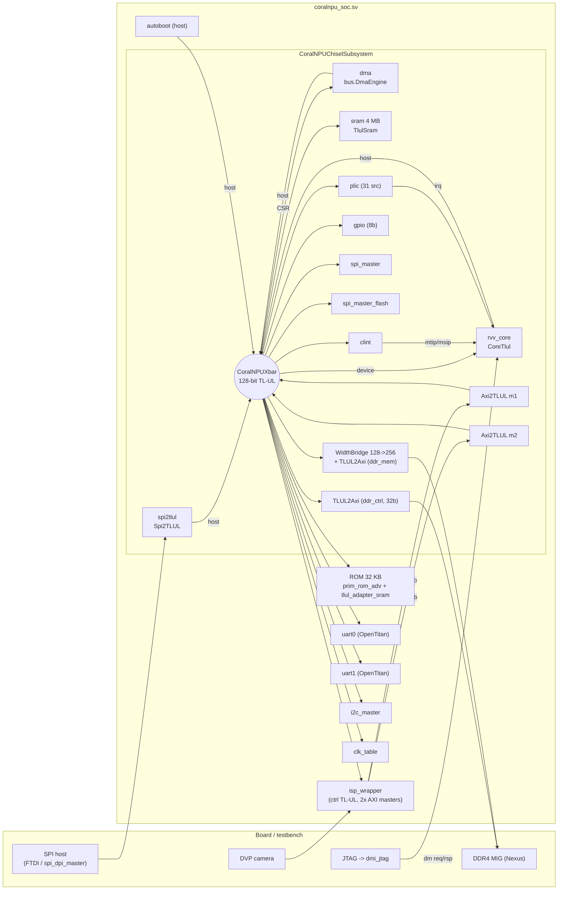
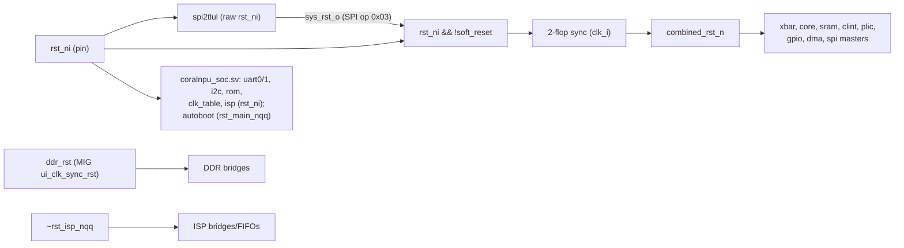
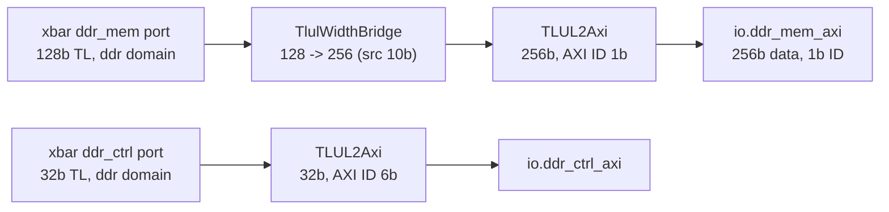
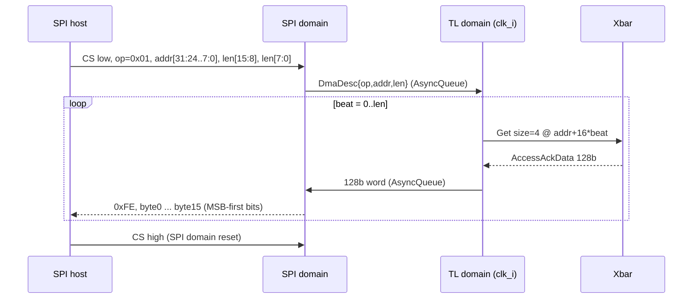
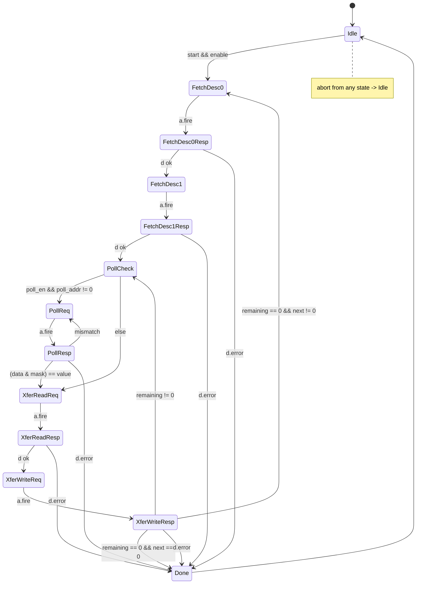
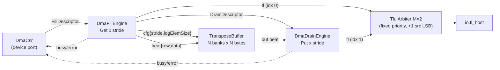
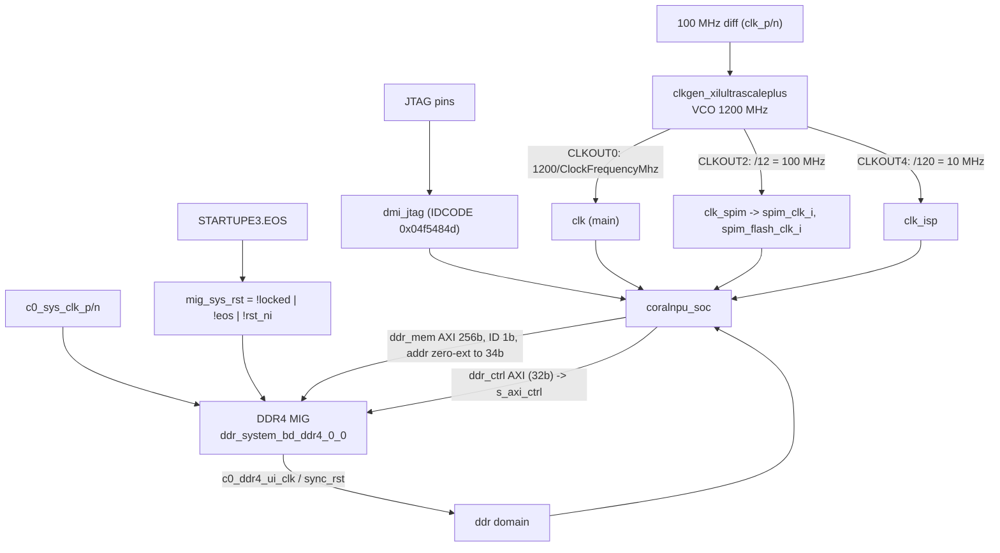

# 6. SoC Interconnect, Peripherals & DMA

This chapter covers everything around the CoralNPU core at SoC level: the
Chisel subsystem generator, the TileLink-UL (TL-UL) crossbar and its building
blocks, the AXI<->TL-UL bridges, the interrupt controllers (CLINT/PLIC), the
Chisel peripherals (GPIO, SPI master, SPI-to-TL-UL host bridge), both DMA
engines, and how the subsystem is integrated into the FPGA tops. The core's
internal LSU/TCM/AXI bridges are in [Chapter 3](03-memory-subsystem.md). The
configuration system and memory-region definitions are in
[Chapter 1](01-top-level-and-configuration.md). Software drivers and the
verification flow are in [Chapter 7](07-software-toolchain-and-verification.md).

All `path:line` citations are relative to the repository root.

**Contents**

1. [SoC block diagram](#61-soc-block-diagram)
2. [Configuration sources](#62-configuration-sources)
3. [Crossbar: hosts, devices, address map](#63-crossbar-hosts-devices-address-map)
4. [Crossbar construction, clock domains and resets](#64-crossbar-construction-clock-domains-and-resets)
5. [TL-UL implementation details](#65-tl-ul-implementation-details)
6. [AXI <-> TL-UL bridges](#66-axi---tl-ul-bridges)
7. [CLINT and PLIC](#67-clint-and-plic)
8. [GPIO, SPI master, clock table](#68-gpio-spi-master-clock-table)
9. [SPI-to-TL-UL host bridge (boot/debug path)](#69-spi-to-tl-ul-host-bridge-bootdebug-path)
10. [DMA engine (bus/DmaEngine)](#610-dma-engine-busdmaengine)
11. [DMA core (dma/DmaCore)](#611-dma-core-dmadmacore)
12. [FPGA integration](#612-fpga-integration)
13. [AWS F2 build (summary)](#613-aws-f2-build-summary)
14. [Observations and caveats](#614-observations-and-caveats)
15. [Notes on existing docs](#615-notes-on-existing-docs)

---

## 6.1 SoC block diagram

The SoC is split into two layers:

- **`CoralNPUChiselSubsystem`** is a generated Chisel `RawModule`. It holds
  the crossbar, the core (`CoreTlul`), the 4 MB SRAM, the CLINT, the PLIC, GPIO,
  two SPI masters, the bus DMA engine, the SPI-to-TL-UL bridge, and the DDR and
  ISP bridges.
- **`coralnpu_soc.sv`** is a SystemVerilog wrapper. It adds OpenTitan IP (2x
  UART, the ROM through `tlul_adapter_sram`), the I2C master, the clock table,
  the autoboot host, and the ISP (`isp_wrapper`). It is in turn instantiated by
  `chip_nexus.sv` (Nexus board) or `chip_verilator.sv` (simulation).

The interrupt wiring from CLINT and PLIC to the core is hard-coded in the
subsystem: `clint.io.mtip -> rvv_core.io.timer_irq`,
`clint.io.msip -> rvv_core.io.software_irq`, `plic.io.irq -> rvv_core.io.irq`
(`hdl/chisel/src/soc/CoralNPUChiselSubsystem.scala:344-357`).

---

## 6.2 Configuration sources

Two Scala objects are the source of truth:

| Object | File | Role |
|---|---|---|
| `CrossbarConfig` | `hdl/chisel/src/soc/CrossbarConfig.scala:75-213` | Hosts, devices, address ranges, clock domains, data widths, host->device connectivity |
| `SoCChiselConfig` | `hdl/chisel/src/soc/SoCChiselConfig.scala:128-270` | Which Chisel modules to instantiate, their parameters, which xbar ports they bind to, and which non-TL pins they export |

`CoralNPUChiselSubsystem` reads both. It instantiates each module through a
`match` on its parameter type (`CoralNPUChiselSubsystem.scala:190-252`) and
wires ports by hierarchical name lookup (`populatePorts`, `:144-157`, `:297-319`).

Any xbar host or device that no Chisel module claims becomes an **external** TL
port on the subsystem boundary (`io.external_hosts` / `io.external_devices`,
`:46-60`). Two exceptions are handled specially:

- `ddr_ctrl` and `ddr_mem` are converted to AXI inside the subsystem (`:42`).
- `ispyocto_m1` and `ispyocto_m2` enter as AXI and are converted inside (`:44`).

`ispyocto_ctrl` is exported as a dedicated TL port (`io.ispyocto_ctrl`, `:87-89`).

Bus parameters set by the emitter (`CoralNPUChiselSubsystem.scala:517-523`):

| Side | Data width | Address | Source ID bits |
|---|---|---|---|
| Every xbar host port | per `HostConfig.width` | `xlen` (32) | 6 |
| Every xbar device port | per `DeviceConfig.width` | `xlen` | 10 |
| Xbar internal common bus | 128 | max host addr width | 8 (`CoralNPUXbar.scala:106-114`) |

Emitted variants (`hdl/chisel/src/soc/BUILD:99-224`):

- `CoralNPUChiselSubsystem` (default: 8 KB ITCM / 32 KB DTCM)
- `...64` (xlen=64)
- `...Highmem` (1 MB / 1 MB, `hdl/chisel/src/coralnpu/Parameters.scala:59-62`)
- `..._ITCM512KB_DTCM512KB`
- `...TestHarness` versions of these, which add the `test_host_32` host

---

## 6.3 Crossbar: hosts, devices, address map

### Hosts (masters)

| # | Host | Width | Clock domain | Source in SoC | Notes |
|---|---|---|---|---|---|
| 0 | `coralnpu_core` | 128 | main | `CoreTlul.io.tl_host` | Shared IBus/DBus. AXI ID 1 is tagged as an instruction fetch (`Axi2TLUL.scala:45-47`) |
| 1 | `spi2tlul` | 128 | main | `Spi2TLUL.io.tl` | External SPI host for boot/debug |
| 2 | `dma` | 128 | main | `DmaEngine.io.tl_host` | |
| 3 | `ispyocto_m1` | 64 | `isp_axi_clk` | ISP AXI M1 via `Axi2TLUL` | ISP main path |
| 4 | `ispyocto_m2` | 64 | `isp_axi_clk` | ISP AXI M2 via `Axi2TLUL` | ISP self path. Write-only in practice: AR is tied off in `coralnpu_soc.sv:812-829` |
| 5 | `autoboot` | 32 | main | `autoboot.sv` (external port) | Tied to 0 when `EnableAutoboot=0` |
| 6 | `test_host_32` | 32 | `test` | external | Test harness only |

Source: `CrossbarConfig.scala:77-91`. The host index also sets M:1 arbitration
priority, because the chisel `Arbiter` is fixed-priority with lower index
winning (see 6.5.5).

### Address map

Default configuration (8 KB ITCM / 32 KB DTCM). Source:
`CrossbarConfig.scala:93-146`.

| Device | Base | End (incl.) | Size | Dev width | Clock domain | Implemented by |
|---|---|---|---|---|---|---|
| `coralnpu_device` - ITCM | `0x0000_0000` | `0x0000_1FFF` | 8 KB | 128 | main | `CoreTlul.io.tl_device` (Ch. 3) |
| `coralnpu_device` - DTCM | `0x0001_0000` | `0x0001_7FFF` | 32 KB | 128 | main | " |
| `coralnpu_device` - CSR | `0x0003_0000` | `0x0003_0FFF` | 4 KB | 128 | main | " (reset/clock-gate/PC/status CSRs, Ch. 3) |
| `clint` | `0x0200_0000` | `0x0200_FFFF` | 64 KB | 32 | main | `bus.Clint` |
| `plic` | `0x0C00_0000` | `0x0FFF_FFFF` | 64 MB | 32 | main | `bus.Plic` |
| `rom` | `0x1000_0000` | `0x1000_7FFF` | 32 KB | 32 | main | `prim_rom_adv` 8192x32 (`coralnpu_soc.sv:294-338`) |
| `sram` | `0x2000_0000` | `0x203F_FFFF` | 4 MB | 128 | main | `soc.TlulSram` |
| `uart0` | `0x4000_0000` | `0x4000_0FFF` | 4 KB | 32 | main | OpenTitan `uart` |
| `clk_table` | `0x4000_1000` | `0x4000_1FFF` | 4 KB | 32 | main | `clk_table.sv` |
| `uart1` | `0x4001_0000` | `0x4001_0FFF` | 4 KB | 32 | main | OpenTitan `uart` |
| `spi_master` | `0x4002_0000` | `0x4002_0FFF` | 4 KB | 32 | main (+`spim_clk`) | `bus.SpiMaster` |
| `gpio` | `0x4003_0000` | `0x4003_0FFF` | 4 KB | 32 | main | `bus.GPIO` |
| `i2c_master` | `0x4004_0000` | `0x4004_0FFF` | 4 KB | 32 | main | `fpga/ip/i2c_master` |
| `dma` | `0x4005_0000` | `0x4005_0FFF` | 4 KB | 32 | main | `bus.DmaEngine` (CSR port) |
| `spi_master_flash` | `0x4007_0000` | `0x4007_0FFF` | 4 KB | 32 | main (+`spim_flash_clk`) | `bus.SpiMaster` |
| `ispyocto_ctrl` | `0x5000_0000` | `0x500F_FFFF` | 1 MB | 32 | `isp_axi_clk` | `isp_wrapper` (TL->AHB-Lite inside) |
| `ddr_ctrl` | `0x7000_0000` | `0x7000_0FFF` | 4 KB | 32 | `ddr` | `TLUL2Axi` -> MIG AXI-Lite ctrl |
| `ddr_mem` | `0x8000_0000` | `0xFFFF_FFFF` | 2 GB | 128 | `ddr` | `TlulWidthBridge` 128->256 + `TLUL2Axi` -> MIG |

For any non-default TCM size (`CrossbarConfig.scala:104-111`), the
`coralnpu_device` ranges move:

- ITCM: `0x0000_0000`, size = `itcmSize`
- DTCM: `0x0010_0000`, size = `dtcmSize`
- CSR: `0x0020_0000`, 4 KB

`coralnpu_soc.sv:198` mirrors this choice when it picks the autoboot
`CsrBaseAddr` (`0x30000` vs `0x200000`). `CrossbarConfigValidator`
(`CrossbarConfig.scala:220-282`) checks for overlaps, but only on the default
configuration. An ITCM larger than 1 MB would overlap the DTCM in the custom
layout and would not be caught.

Any address that misses every range of a host's allowed devices goes to the
socket's internal error responder (`CoralNPUXbar.scala:262-277`).

### Connectivity matrix

Source: `CrossbarConfig.scala:149-212`. `x` means the host can reach the device.

| Device \ Host | core | spi2tlul | dma | isp_m1 | isp_m2 | autoboot | test_host_32 | fan-in (no TH) |
|---|---|---|---|---|---|---|---|---|
| coralnpu_device | x | x | x | x | x | x | x | 6 |
| sram | x | x | x | x | x | | x | 5 |
| ddr_mem | x | x | x | x | x | | x | 5 |
| ddr_ctrl | x | x | x | | | | x | 3 |
| rom | x | | x | | | | x | 2 |
| uart0 | x | | x | | | | x | 2 |
| uart1 | x | | x | | | | | 2 |
| clk_table, spi_master, gpio, i2c_master, spi_master_flash, clint, plic, ispyocto_ctrl | x | | x | | | | x | 2 |
| dma (CSR) | x | | | | | | x | 1 |

Points to note:

- The SPI host can reach only the TCMs/CSRs, SRAM and DDR. It cannot reach the ROM or any peripheral.
- The DMA cannot program itself (there is no `dma -> dma` connection).
- `test_host_32` has no route to `uart1`.

---

## 6.4 Crossbar construction, clock domains and resets

### 6.4.1 Generator pipeline

`CoralNPUXbar` (`hdl/chisel/src/soc/CoralNPUXbar.scala:67-309`) turns every
port into a **standard interface**: main clock domain, 128-bit data, 8-bit
source. All routing then happens on that standard bus.

```mermaid
flowchart LR
  subgraph HostPath["Per host (CoralNPUXbar.scala:125-167)"]
    H0["io.hosts(h)<br/>native width/domain"] --> H1["PortIntegrity.wrapHost<br/>gen A-intg, check D-intg<br/>(host domain)"]
    H1 --> H2{"domain != main?"}
    H2 -- yes --> H3["TlulFifoAsync<br/>req/rsp depth 4"]
    H2 -- no --> H4
    H3 --> H4{"width < 128?"}
    H4 -- yes --> H5["TlulWidthBridge<br/>narrow -> 128"]
    H4 -- no --> H6
    H5 --> H6["TlulSocket1N<br/>N = #allowed devices (+err)"]
  end
  subgraph DevPath["Per device (CoralNPUXbar.scala:173-236)"]
    D0["TlulSocketM1<br/>(only if fan-in > 1)"] --> D1["standardized iface<br/>128b, main"]
    D1 --> D2{"domain != main?"}
    D2 -- yes --> D3["TlulFifoAsync (128b)"]
    D2 -- no --> D4
    D3 --> D4{"width != 128?"}
    D4 -- yes --> D5["TlulWidthBridge<br/>128 -> dev width<br/>(device domain)"]
    D4 -- no --> D6
    D5 --> D6["PortIntegrity.wrapDevice<br/>check A-intg, gen D-intg"]
    D6 --> D7["io.devices(d)"]
  end
  H6 -- "dev_select (addr decode)" --> D0
```

- **Address decode** is a purely combinational `MuxCase` over the host's
  allowed devices. It produces `dev_select_i` in the same cycle as `a_valid`
  (`CoralNPUXbar.scala:258-278`). Index `N` selects the error responder.
- **Fan-in 1** devices (only the `dma` CSR port in the default config) skip the M:1 socket (`:295-301`).
- **Width bridges per port** (from the tables above):
  - 128->32 on every 32-bit device: `rom`, both UARTs, `clk_table`, both SPI
    masters, `gpio`, `clint`, `plic`, `i2c_master`, `dma`, `ispyocto_ctrl`,
    `ddr_ctrl`.
  - 32->128 for `autoboot`/`test_host_32`.
  - 64->128 for the ISP hosts.

### 6.4.2 Clock domains and crossings

| Domain | Clock source (Nexus) | What runs in it | Crossing to main |
|---|---|---|---|
| main (`clk_i`) | MMCM CLKOUT0, `1200/ClockFrequencyMhz` MHz (default 50) | Xbar, core, SRAM, CLINT/PLIC/GPIO/DMA, bus sides of SPI masters, ROM, UARTs, I2C, clk_table, autoboot | - |
| `isp_axi_clk` | MMCM CLKOUT4, 10 MHz | ISP AXI masters + their `Axi2TLUL`, host-side integrity; ISP control slave | `TlulFifoAsync` in xbar (host side at 64b, device side at 128b) |
| `ddr` | MIG `c0_ddr4_ui_clk` | `ddr_ctrl`/`ddr_mem` width bridges, integrity wrappers, `TLUL2Axi` | `TlulFifoAsync` in xbar (`CoralNPUChiselSubsystem.scala:360-423`) |
| SPI host clock (`spi_clk`) | external pin | `Spi2TLULV2_SpiDomain` | 3 rocket-chip `AsyncQueue`s (`Spi2TLULV2.scala:548-564`) |
| `spim_clk_i` / `spim_flash_clk_i` | MMCM CLKOUT2, 100 MHz | `SpiMasterCtrl` (whole controller) | `TlulFifoAsync` inside `SpiMaster` (`SpiMaster.scala:333-349`) |
| `test` | testbench | `test_host_32` | `TlulFifoAsync` |

`TlulFifoAsync` is a pair of rocket-chip `AsyncQueue`s, one for A and one for D,
each with a default depth of 4 (`hdl/chisel/src/bus/TlulFifoAsync.scala:6-42`).
The subsystem exposes one `ClockResetBundle` per non-main domain
(`io.async_ports_hosts` / `io.async_ports_devices`, built from the distinct
`clockDomain` strings, `CoralNPUChiselSubsystem.scala:27-32`).

### 6.4.3 Reset structure

- `spi2tlul` is built first and keeps the raw hardware reset. Its `sys_rst_o`
  output is ANDed into a 2-flop synchronized `combined_rst_n`
  (`CoralNPUChiselSubsystem.scala:159-187`).
- `combined_rst_n` drives the xbar and every other Chisel module
  (`:283-294`). The SPI soft reset therefore resets the whole Chisel subsystem
  but leaves the SPI bridge alone.
- The SystemVerilog peripherals in `coralnpu_soc.sv` use `rst_ni` directly
  (`:213-284`), so the soft reset does **not** reset them. The same applies to
  the ISP and DDR domains.

---

## 6.5 TL-UL implementation details

### 6.5.1 Channel fields

Source: `hdl/chisel/src/bus/TileLinkUL.scala:20-152` and
`hdl/chisel/src/bus/TLULParameters.scala:19-40`. Widths derive from
`TLULParameters(dataBits, addrBits, idBits, sinkBits=1)`:

- `w = dataBits/8`
- `z = log2(w)`
- `o = idBits`
- `i = sinkBits`

| Channel | Field | Width | Notes |
|---|---|---|---|
| A | `opcode` | 3 | `PutFullData=0`, `PutPartialData=1`, `Get=4` |
| A | `param` | 3 | always 0 |
| A | `size` | z | log2(bytes) |
| A | `source` | o | widened/narrowed by sockets and bridges |
| A | `address` | a | byte address |
| A | `mask` | w | byte enables |
| A | `data` | 8w | |
| A | `user.rsvd` | 5 | `OpenTitanTileLink_A_User` |
| A | `user.instr_type` | 4 | MuBi4 (True = instruction fetch) |
| A | `user.cmd_intg` | 7 | SECDED over command |
| A | `user.data_intg` | 7 | SECDED over data |
| D | `opcode` | 3 | `AccessAck=0`, `AccessAckData=1` |
| D | `param`, `size`, `source` | 3, z, o | |
| D | `sink` | 1 | always 0 |
| D | `data` | 8w | |
| D | `error` | 1 | |
| D | `user.rsp_intg`, `user.data_intg` | 7, 7 | |

Bundles come in two flavours:

- `OpenTitanTileLink.*` carries the integrity user bits. The xbar and all SoC
  peripherals use it.
- `TLULHost2Device[NoUser, NoUser]` carries no user bits. It is used by the
  banked TCM local crossbar (`TlulLocalXbar`/`TlulRouter`, Ch. 3) and by
  `dma.DmaCore`.

`extendSource`/`shrinkSource` append or strip **LSBs** of `source`
(`TileLinkUL.scala:64-103`). This is how routing information is carried for
the return path.

### 6.5.2 Integrity (OpenTitan-compatible SECDED)

`hdl/chisel/src/bus/TlulIntegrity.scala` re-implements OpenTitan's `prim_secded_inv` encoders.

- **Command integrity** (`RequestIntegrityGen`, `:133-175`): 7-bit inverted SECDED over
  `{instr_type, address, opcode, mask[15:0]}`, zero-padded to 57 bits (64_57 code). If
  that payload is wider than 57 bits (e.g. xlen=64), it uses a 128-bit folded code (`:147-165`).
- **Data integrity**:
  - 32-bit data uses the 39_32 code.
  - 64-, 128- and 256-bit data use a **folded** scheme: the 7-bit ECCs of each 32-bit
    chunk are XORed (`SecdedEncoder`, `:71-118`). This is a CoralNPU extension. Stock
    OpenTitan only defines 32-bit data integrity.
- **Response integrity** (`ResponseIntegrityGen`, `:223-254`): SECDED over `{opcode, size, error}` plus data ECC.
- **Where it is applied** (`PortIntegrity`, `:293-341`):
  - The xbar generates A-integrity at every host ingress and D-integrity at every device
    ingress.
  - It *checks* D at host egress and A at device egress. Hosts and devices can therefore
    produce and consume "clean" TL-UL with zeroed user bits. This is how `clk_table.sv`
    (`:58-69`) and the Chisel peripherals leave `d_user` at 0.
- **Checks are informational only.** Every `fault` output is `dontTouch`ed and left
  unconnected (`:315`, `:332`). No integrity error is reported or acted on anywhere in the
  subsystem.
- **External integrity checkers.** Some OpenTitan devices do check integrity: the ROM's
  `tlul_adapter_sram` has `CmdIntgCheck=1` (`coralnpu_soc.sv:294-300`). This is why the
  xbar must regenerate integrity after every width conversion.
- **Width bridges** also regenerate integrity on both sides, because they reshape data
  (`TlulWidthBridge.scala:72-76`, `:199`, `:270`, `:305`).
- **`autoboot.sv`** computes its own integrity in SystemVerilog (`autoboot.sv:29-52`,
  `:130-153`).

### 6.5.3 Width conversion (`TlulWidthBridge`)

Source: `hdl/chisel/src/bus/TlulWidthBridge.scala:21-338`.

**Wide -> narrow** (e.g. 128 -> 32, `:43-243`):

- **Request splitting.**
  - A request with `size > log2(narrowBytes)` is split into `ratio` narrow beats.
  - A smaller request becomes one beat at lane `host_beat_idx`.
  - Each beat gets `source = {host_source, beat_idx}`. The `require` at `:188-191`
    enforces `device_p.o >= host_p.o + log2(ratio)`; 8 + 2 <= 10 holds here.
  - For writes, the opcode is downgraded to `PutPartialData` for any beat that does not
    have a full mask.
  - For reads, the mask is synthesized from `size` and the address offset.
  - Beats are enqueued all at once into a `FifoX` of depth `2*ratio+1`.
- **Response reassembly.**
  - D beats are collected per host source in a scoreboard (`beats_received`, `d_data_reg`).
  - The bridge always accepts D (`tl_d.d.ready := true`).
  - The wide response is released when the count of received beats matches the
    `req_info_q` head (depth 8).
  - **Completion is therefore in request order** across all sources.

**Narrow -> wide** (e.g. 32/64 -> 128, `:247-330`):

- A single request passes through unchanged in count.
- `mask`/`data` are shifted into the correct byte lane using the address bits that are new
  to this bridge.
- `PutFullData` becomes `PutPartialData`, because the narrow write is partial on the wide
  bus.
- The address LSBs are remembered per source ID (`addr_lsb_regs`) to shift response data
  back.

**Equal widths:** straight connection (`:335-337`).

### 6.5.4 ID remapping (`TlulIdRemapper`)

Source: `hdl/chisel/src/bus/TlulIdRemapper.scala:20-75`.

`TLUL2Axi` uses this block when the TL source is wider than the AXI ID
(`TLUL2Axi.scala:50-78`).

- The output ID is the source truncated to `axiIdBits` LSBs.
- An `outstanding_reg` bitmap allows **one outstanding transaction per truncated ID**.
  A new request on a busy lane stalls.
- The original source is saved per lane and restored on D.
- 2-entry queues sit on both A and D.

Effective outstanding limits:

| Bridge | AXI ID width | Effective outstanding |
|---|---|---|
| `ddr_mem` | 1 bit | 2 |
| `ddr_ctrl` | 6 bits | up to 64 |

### 6.5.5 Sockets, arbitration and ordering

**`TlulSocket1N`** (`hdl/chisel/src/bus/TlulSocket1N.scala:32-109`):

- Steering is combinational. `a.valid` goes only to the selected output. The other outputs
  see the same bits but with zeroed integrity user fields (`:64-75`).
- Host `a.ready` comes from the selected output (`:85-90`).
- D responses from all N outputs, plus the error responder, are merged with a chisel
  `Arbiter`, which is **fixed priority, lowest index first** (`:93-108`).
- The constructor parameters `HReqPass`/`HReqDepth`/... are accepted but **not used**.
  There are no pipeline FIFOs in the socket.

**`TlulSocketM1`** (`hdl/chisel/src/bus/TlulSocketM1.scala:6-57`):

- A fixed-priority `Arbiter` picks a host. Its index (host order in `CrossbarConfig`) is
  appended as the source LSBs.
- D is steered combinationally by those LSBs.
- **`coralnpu_core` therefore always wins over `spi2tlul`, `dma`, ISP, etc.** A busy core
  can starve lower-priority hosts.

**`TlulErrorResponder`** (`TlulSocket1N.scala:9-30`):

- Always ready.
- Returns `AccessAck` with `error=1` and data 0 one cycle after `a.fire`. It does this even
  for `Get`.

**Ordering rules:**

- No socket tracks outstanding requests.
- Responses to one host can return **out of order across devices**. Hosts tell them apart
  by source ID.
- Each device returns in order, and every Chisel peripheral handles at most one transaction
  at a time (`tl_a.ready := !tl_d_valid`).

**`TlulFifoSync`** (`hdl/chisel/src/bus/TlulFifoSync.scala:6-92`) is an OpenTitan-style
sync FIFO with spare side-band bits. It zeroes D data unless the opcode is `AccessAckData`.
It is not instantiated by the SoC xbar.

**`TlulArbiter` / `TlulRouter` / `TlulLocalXbar`** are the `NoUser` building blocks of the
banked-TCM crossbar (Ch. 3) and of `DmaCore`:

- `TlulRouter` adds a `RawTlulErrorResponder` output (`hdl/chisel/src/bus/TlulRouter.scala:21-54`).
- `TlulArbiter` is M:1 with source augmentation (`TlulArbiter.scala:21-66`).
- `TlulLocalXbar` is a router per host plus an arbiter per bank (`TlulLocalXbar.scala:23-57`).

### 6.5.6 TL-UL SRAM

`TlulSram` (`hdl/chisel/src/soc/TlulSram.scala:23-45`) wraps `TlulToSram` and
`Sram_Nx128`:

- The 4 MB SRAM has 262,144 entries of 128 bits.
- Indexing uses `address >> 4`, truncated to 18 bits. The base address is not subtracted;
  aliasing outside the decoded range is prevented by the xbar.
- `TlulToSram` (`hdl/chisel/src/bus/TlulToSram.scala:30-95`):
  - Has a 1-cycle read latency.
  - Uses a 1-entry flow/pipe skid buffer.
  - Accepts a new request only when the previous response can drain, giving one in flight.
  - Writes honour the byte mask.
  - Never sets `error`.

`RawTlulSram` (`RawTlulSram.scala:22-43`) is the `NoUser` twin used for TCM banks.

---

## 6.6 AXI <-> TL-UL bridges

| Bridge | File | Direction | Bursts | User bits | Used by |
|---|---|---|---|---|---|
| `Axi2TLUL` | `hdl/chisel/src/bus/Axi2TLUL.scala:33-255` | AXI master -> TL host | Unrolled (FIXED / INCR) | OpenTitan | `CoreTlul` host port, ISP M1/M2 |
| `TLUL2Axi` | `hdl/chisel/src/bus/TLUL2Axi.scala:34-183` | TL device -> AXI slave | Single-beat only (`len=0`, INCR) | OpenTitan | `CoreTlul` device port, `ddr_ctrl`, `ddr_mem` |
| `AxiRead2TLUL` | `hdl/chisel/src/bus/AxiRead2TLUL.scala:29-94` | AXI R -> TL `Get` | Unrolled via `AxiAddressGenerator` | NoUser | `CoreTlulCSR` (Ch. 3) |
| `AxiWrite2TLUL` | `hdl/chisel/src/bus/AxiWrite2TLUL.scala:34-118` | AXI W -> TL `Put` | Unrolled via `AxiAddressGenerator` | NoUser | `CoreTlulCSR` (Ch. 3) |

### `Axi2TLUL`

- **Read path.** AR, AW and W each pass through a 2-entry queue. A burst unroller produces
  one TL `Get` per beat. The address increments by `1<<size` unless the burst is `FIXED`
  (`:53-105`). `WRAP` is treated as `INCR`, because no wrap logic exists.
- **Write path.**
  - Writes join AW and W.
  - The opcode is `PutFullData` only when `strb` matches the full naturally aligned size;
    otherwise it is `PutPartialData` (`:134-142`).
- **Per-ID tracking.** A new burst with an ID that already has an active burst stalls until
  it finishes (`r_burst_active`/`w_burst_active`, `:70-73`, `:124-128`).
- **Read/write arbitration.** A locking round-robin `CoralNPURRArbiter` picks between reads
  and writes. The in-code comment says "Reads are given higher priority" (`:179-182`).
- **Responses.**
  - Read data beats map 1:1 to R. `rlast` is set when that ID's beat counter reaches 0.
  - Writes emit a single B after the last beat's ack. B is `SLVERR` if any beat errored
    (`w_err_accum`, `:195-203`).
- **Instruction tagging.** `instr_type = MuBi4.True` only when AXI ID == 1. In the ISP
  bridges the subsystem overrides this to `False` (`CoralNPUChiselSubsystem.scala:452`, `:472`).

### `TLUL2Axi`

- **Queues.** The TL A input goes through a 2-entry queue and an optional ID remapper.
  - A `Put` drives AW (1-entry queue) and W (1-entry queue, `last=1`) together.
  - A `Get` drives AR directly.
- **Response order.** Separate `read_tx_info_q`/`write_tx_info_q` queues (2 entries each)
  hold the request size used for D (`:83-145`).
- **Response mapping.**
  - R becomes `AccessAckData` and B becomes `AccessAck`.
  - `error = (resp != OKAY)`.
  - A round-robin arbiter merges the two (`:148-181`).
- **Response size quirk.** When `axiDataBits == 256`, the D `size` is forced to 5
  regardless of the request size (`:142`, `:145`).
- **Fixed AXI fields.** `prot`, `lock`, `cache`, `qos` and `region` are all driven 0.

### DDR path detail

Source: `CoralNPUChiselSubsystem.scala:359-423`.

### ISP path

The ISP's 64-bit AXI masters (4-bit IDs) enter through `Axi2TLUL` clocked by
`isp_axi_clk` (`CoralNPUChiselSubsystem.scala:432-473`). In the xbar they then
cross to main and are widened to 128 bits.

---

## 6.7 CLINT and PLIC

### CLINT (`bus.Clint`, base `0x0200_0000`)

Source: `hdl/chisel/src/bus/Clint.scala:20-128`. It uses SiFive-compatible offsets and
decodes 16 bits of offset (`address[15:0]`).

| Offset | Name | Access | Reset | Description |
|---|---|---|---|---|
| `0x0000` | `MSIP` | RW | 0 | Bit 0 drives `msip` -> core `software_irq` |
| `0x4000` | `MTIMECMP_LO` | RW | `0xFFFF_FFFF` | |
| `0x4004` | `MTIMECMP_HI` | RW | `0xFFFF_FFFF` | |
| `0xBFF8` | `MTIME_LO` | RW | 0 | Increments every `clk_i` cycle |
| `0xBFFC` | `MTIME_HI` | RW | 0 | |

Behaviour:

- `mtip = (mtime >= mtimecmp)` is combinational and drives core `timer_irq`.
- `mtime` does not increment in a cycle in which `mtime` or `mtimecmp` is written
  (`:73-80`).
- The timebase is the main clock. Its frequency is readable from `clk_table` offset `0x4`.
- Unknown offsets read 0 and never return `error`.
- One transaction is in flight at a time.

### PLIC (`bus.Plic`, base `0x0C00_0000`)

Source: `hdl/chisel/src/bus/Plic.scala:20-188`. The SoC instantiates it with 31 sources and
3-bit priority (`SoCChiselConfig.scala:253-261`). It has a single context (hart 0, M-mode)
and decodes `address[23:0]`, so the 64 MB window aliases every 16 MB.

| Offset | Name | Access | Description |
|---|---|---|---|
| `0x000004 + 4*(i-1)` | `PRIORITY[i]`, i=1..31 | RW | Bits `[2:0]`. Priority 0 = never interrupts. `PRIORITY[0]` is read-only 0 |
| `0x001000` | `PENDING` | RO | Bit i = source i pending (bit 0 always 0) |
| `0x001080` | `LE` | RW | **CoralNPU-specific** gateway mode per source: 0 = level, 1 = rising edge. Bit 0 forced 0 |
| `0x002000` | `ENABLE` | RW | Context-0 enable bits 1..31 |
| `0x200000` | `THRESHOLD` | RW | Bits `[2:0]` |
| `0x200004` | `CLAIM` / `COMPLETE` | RW | Read = claim: returns highest-priority pending and enabled ID and clears its pending bit. Write ID = complete |

Gateway and claim semantics (`:89-142`):

- **Source numbering.** PLIC source `i` is `io.srcs(i-1)`, the subsystem port `ext_intrs[i-1]`.
- **Sampling.** Sources are sampled once into `src_q`. They are **not** synchronized, so
  asynchronous sources must be synchronized by the integrator.
- **Edge mode.** Pending is set on `s && !src_q` (a rising edge).
- **Level mode.** Pending is set while the source is high and no claim is outstanding.
  `waiting_for_complete[i]` is set on claim and cleared on a matching complete.
- **Arbitration.** On equal priority the lower ID wins (strict `>` in the fold, `:74-79`).
- **IRQ output.** `irq = max_priority > threshold`. A read of `CLAIM` returns the max ID
  even when it is at or below the threshold.
- **Error behaviour.** Unknown offsets read 0. No access returns `error`.

**Interrupt sources in the shipped SoC:** none. `coralnpu_soc.sv:661` ties
`io_external_ports_ext_intrs` to `31'b0`. The UART interrupts (`uart_sideband_o`),
the ISP's `intr_mi`/`intr_isp` (`coralnpu_soc.sv:382`, `:494-495`), I2C and both
DMA engines are **not** routed to the PLIC.

---

## 6.8 GPIO, SPI master, clock table

### GPIO (`bus.GPIO`, base `0x4003_0000`, width 8)

Source: `hdl/chisel/src/bus/GPIO.scala:24-107`.

| Offset | Name | Access | Description |
|---|---|---|---|
| `0x00` | `DATA_IN` | RO | Samples `gpio_i` (no synchronizer). A write returns `error` |
| `0x04` | `DATA_OUT` | RW | Drives `gpio_o` |
| `0x08` | `OUT_EN` | RW | Drives `gpio_en_o` (1 = output) |

Any other offset returns `error`.

Board usage:

- **Nexus.** Only `gpio[3:0]` reach pins, through `IOBUF`s (`chip_nexus.sv:141-152`).
  `gpio_o[4]` is reused as the SPI-flash reset `spim_flash_rst_no` (`coralnpu_soc.sv:165`).
- **Verilator top.**
  - `gpio_o[0]` and `gpio_o[1]` are the display's D/C and reset (`chip_verilator.sv:46-56`).
  - `gpio_o[4]` drives the flash reset (`chip_verilator.sv:210-222`).

### SPI master (`bus.SpiMaster`, `0x4002_0000` and `0x4007_0000`)

Source: `hdl/chisel/src/bus/SpiMaster.scala:34-350`.

**Structure.**

- `SpiMaster` is a `RawModule`.
- A `TlulFifoAsync` carries the bus from `clk_i` into the SPI clock domain (`spi_clk_i`).
- The whole `SpiMasterCtrl` runs on `spi_clk_i`, with a 2-flop-synchronized reset
  (`:333-349`).
- On Nexus, both instances use the 100 MHz `clk_spim`. On Verilator they use `clk_i`.

| Offset | Name | Access | Bits |
|---|---|---|---|
| `0x00` | `STATUS` | RO | `[0]` TX FIFO full, `[1]` RX FIFO empty, `[2]` busy (FSM not idle **or** TX FIFO non-empty) |
| `0x04` | `CONTROL` | RW | `[0]` enable, `[1]` CPOL, `[2]` CPHA, `[3]` HDRX (half-duplex read: auto-send `0x00` while RX has space), `[4]` HDTX (half-duplex write: discard RX), `[15:8]` DIV |
| `0x08` | `TXDATA` | WO | `[7:0]` pushed into a 4-deep TX FIFO. A full FIFO back-pressures `a_ready`. A read returns `error` |
| `0x0C` | `RXDATA` | RO | `[7:0]` popped from a 4-deep RX FIFO. **An empty FIFO back-pressures `a_ready`**. A write returns `error` |
| `0x10` | `CSID` | RW | `[0]`: in manual mode, `csb = !CSID[0]` |
| `0x14` | `CSMODE` | RW | `[0]` 1 = manual CS, 0 = auto |

**Protocol notes.**

- **Clock rate.** A `tick` fires every `DIV+1` SPI-clock cycles and is one SCLK half
  period, so `f_SCLK = f_spi_clk / (2*(DIV+1))` (`:81-90`).
- **Auto CS.** CS asserts when a byte starts. It deasserts in `sFinish` and re-asserts in
  the same cycle if another byte is queued (`:127-196`). The result is a one-`spi_clk` CS
  high pulse between back-to-back bytes. Use manual CS for multi-byte frames.
- **Bit order.** MSB first.
- **CPHA sampling.** With CPHA=0, MISO is sampled on the leading edge. With CPHA=1, it is
  sampled on the trailing edge (`:203-222`).
- **Disable.** Clearing `enable` forces idle, CS high and SCLK = CPOL.
- **Error behaviour.** Unknown offsets return `error`.

### Clock table (`clk_table.sv`, base `0x4000_1000`)

Source: `fpga/rtl/clk_table.sv:15-71`. Only `address[3:2]` is decoded, so the four words
alias across the page.

| Offset | Value |
|---|---|
| `0x0` | Magic `0x434C_4B54` ("CLKT") |
| `0x4` | `MainFreqMhz` |
| `0x8` | `IspFreqMhz` |
| `0xC` | `SpimFreqMhz` |

- The response is combinational: `d_valid = a_valid`, `a_ready = d_ready`.
- Writes are acknowledged and ignored. It never returns `error`.

### Other SystemVerilog devices (brief)

- **UART0/UART1** are stock OpenTitan `uart` (`coralnpu_soc.sv:238-284`). Their interrupt
  outputs go to `uart_sideband_o`, not to the PLIC.
- **I2C master** registers (`fpga/ip/i2c_master/i2c_master_pkg.sv:18-24`):
  - `0x00` `INTR_STATE`, `0x04` `INTR_ENABLE`, `0x08` `CTRL`
  - `0x0C` `STATUS`: `[0]` busy, `[1]` TX non-empty, `[2]` RX valid (`i2c_master.sv:128`)
  - `0x10` `FDATA`: write = data + `START`/`STOP`/`READ` in bits 8/9/10; read = pop RX
  - `0x14` `FIFO_CTRL`, `0x18` `CLK_DIV`
- **ROM:** 32 KB, read-only (`ErrOnWrite=1`). Command-integrity checking is enabled. It is
  initialized from `MemInitFile` (`coralnpu_soc.sv:286-338`).

---

## 6.9 SPI-to-TL-UL host bridge (boot/debug path)

`Spi2TLUL` (`hdl/chisel/src/bus/Spi2TLUL.scala:20-64`) wraps `Spi2TLULV2`
(`hdl/chisel/src/bus/Spi2TLULV2.scala:532-589`). Together they let an external
SPI host read and write the TCMs, SRAM and DDR, and soft-reset the SoC. The Nexus
lab tooling (`nexus_loader`, `fpga/README.md`) uses this path.

**Structure.**

- **SPI domain** (`Spi2TLULV2_SpiDomain`, `:259-442`):
  - Clocked directly by the SPI host's `spi_clk`.
  - Reset whenever **CSB is high** (`spi_rst_n = !csb`, `Spi2TLUL.scala:37`), so every
    CS-low window starts a fresh frame.
  - A bit assembler shifts MOSI MSB-first into bytes.
  - A frame parser decodes the header.
  - A MISO shifter sends bytes MSB-first.
- **TL domain** (`Spi2TLULV2_TlulDomain`, `:445-527`, main clock): a small "DMA" FSM issues
  128-bit TL transactions one at a time.
- **CDC:** three `AsyncQueue`s:
  - descriptor (depth 4)
  - write bytes (depth 16)
  - read 128-bit words (depth 4)
- `p.w == 16` is asserted, so the bridge is 128-bit only.

### Frame format

| Byte(s) | Field | Notes |
|---|---|---|
| 0 | `op` | `0x01` = read, `0x02` = write, `0x03` = soft reset. Other values: the descriptor is sent but ignored |
| 1-4 | `addr[31:0]` | Big-endian (MSB first) |
| 5-6 | `len[15:0]` | Big-endian. **Number of 16-byte beats minus 1** |
| 7.. | write data | `op=0x02` only: `(len+1)*16` bytes. Each 16 bytes form one word, little-endian (first byte -> `data[7:0]`) |

### TL behaviour

- Beat `k` targets `addr + 16*k` with `size=4`, `source=0`.
- Writes use `PutFullData` with `mask=0xFFFF`.
- Exactly one request is outstanding at a time (`:494-506`).
- `addr` should be 16-byte aligned.
- The `error` bit of the response is **ignored**.

### Read response on MISO

1. MISO idles at `0x00` (`:422-427`).
2. When each 128-bit word arrives, the bridge sends a sync byte **`0xFE`** and then the 16
   data bytes, LSB byte first (`:375-414`).
3. The host clocks until it sees `0xFE`, then reads 16 bytes, and repeats for each beat.

### Soft reset

- Opcode `0x03` holds `sys_rst_o` high for as long as CS stays low (`sReset`, `:372`).
- `sys_rst_o` is synchronized with 2 flops into `clk_i` (`:585-588`).
- It then resets the Chisel subsystem except the bridge (6.4.3).

---

## 6.10 DMA engine (`bus/DmaEngine`)

This is the DMA that is actually instantiated in the SoC (`SoCChiselConfig.scala:225-232`).

- Host port: 128-bit TL (xbar host `dma`).
- CSR port: 32-bit TL (xbar device `dma`, `0x4005_0000`).
- Source: `hdl/chisel/src/bus/DmaEngine.scala:21-463`.

### CSR map

| Offset | Name | Access | Bits |
|---|---|---|---|
| `0x00` | `CTRL` | RW | `[0]` enable (RW). `[1]` start (write 1, self-clearing; reads 0). `[2]` abort (write 1, self-clearing; reads 0) |
| `0x04` | `STATUS` | RO | `[0]` busy, `[1]` done, `[2]` error, `[3]` 0, `[7:4]` error_code |
| `0x08` | `DESC_ADDR` | RW | Address of the first descriptor |
| `0x0C` | `CUR_DESC` | RO | Address of the descriptor in flight (`xfer.desc_addr`) |
| `0x10` | `XFER_REMAIN` | RO | `[23:0]` bytes remaining in the current descriptor |

- Writes to RO registers and any unknown offset return `error` (`:336`, `:353`).
- `CTRL = 0x3` (enable and start in one store) starts the engine from idle (`:147`, `:209-213`).
- A start request with `enable=0` is dropped.

**Error codes** (`:249-261`):

| Code | Meaning |
|---|---|
| 1 | Descriptor fetch error |
| 2 | Poll read error |
| 3 | Data read error |
| 4 | Data write error |
| 5 | Abort |

- On a TL error the FSM goes to `sDone`, which sets `done=1, busy=0`.
- **Abort** sets `busy=0, done=0, error=1, code=5` (`:227-233`).
- Starting again clears all status bits (`:235-242`).

### Descriptor (32 bytes, fetched as two 128-bit `Get`s at `desc` and `desc+16`)

Source: `DmaDescriptorPart0/Part1`, `:85-102`. Chisel bundles are MSB-first, so the little-endian layout is:

| Byte offset | Bits | Field |
|---|---|---|
| `0x00` | `[31:0]` | `src_addr` |
| `0x04` | `[31:0]` | `dst_addr` |
| `0x08` | `[23:0]` | `xfer_len` (bytes) |
| `0x08` | `[26:24]` | `xfer_width` = log2(beat bytes), 0..4 |
| `0x08` | `[27]` / `[28]` / `[29]` | `src_fixed` / `dst_fixed` / `poll_en` |
| `0x08` | `[31:30]` | reserved |
| `0x0C` | `[31:0]` | `next_desc` (0 = end of chain) |
| `0x10` | `[31:0]` | `poll_addr` (polling is skipped if 0) |
| `0x14` | `[31:0]` | `poll_mask` |
| `0x18` | `[31:0]` | `poll_value` |
| `0x1C` | `[31:0]` | unused |

The hardware needs 16-byte alignment, because each fetch is a `size=4`, full-mask
`Get`. The docs ask for 32-byte alignment, which is safe.

### FSM

Source: `DmaEngine.scala:164-197`.

**Datapath**

- **Beat requests.** Each beat is a `Get` of `size = xfer_width` at `src`. The mask is
  `sizeMask << src[3:0]`. The read data is right-shifted by `src[3:0]` bytes into
  `data_buf` (`:314-319`).
- **Write side.** Each write is a `PutFullData` of the same size, with data shifted left by
  `dst[3:0]` (`:383-423`).
- **Address update.** Addresses advance by `1 << xfer_width` unless the corresponding
  `*_fixed` flag is set.
- **Polling.** The poll is a 4-byte `Get` at `poll_addr`. It runs **before every beat**.
- **Queues.** `source = 0` throughout, with exactly one outstanding transaction. 1-entry
  queues sit on host A/D and device A/D (`:430-462`).

**Modes.** The engine has a single dimension (1D) only.

- mem->mem: both addresses increment.
- mem->periph: `dst_fixed`.
- periph->mem: `src_fixed`.
- Descriptor chaining.

There is **no 2D/strided mode** and **no interrupt output**. Software polls `STATUS`.

**Constraints that come from the code**

- `xfer_len` must be a non-zero multiple of `1 << xfer_width`. The termination test is
  `new_remaining === 0` (`:153`, `:193`), so other values wrap the 24-bit counter.
- A beat must not cross a 16-byte boundary. Mask and data are shifted within one 128-bit word.
- No integrity logic sits inside the engine; the xbar `PortIntegrity` supplies it.

---

## 6.11 DMA core (`dma/DmaCore`)

`hdl/chisel/src/dma/` holds a second, newer DMA. It is built as a standalone
Chisel library with cocotb models (`hdl/chisel/src/dma/BUILD:28-79`). It is
**not instantiated in the SoC**: no `SoCChiselConfig` entry exists, and nothing
outside `dma/` references it.

| Property | Value |
|---|---|
| Ports | `NoUser` TL-UL (no integrity). The CSR device port and host port are at the full bus width `p`. The host port has +1 source bit |
| Default emit width | 256-bit (`DmaCore.scala:73-80`). Tests also use 128 |
| Status outputs | `busy`, `error` wires. No interrupt |

### Block diagram

Source: `DmaCore.scala:22-66`.

### CSR map (`DmaCsr`)

Source: `hdl/chisel/src/dma/DmaCsr.scala:26-268`. Only `address[11:0]` is decoded.

| Offset | Name | Access | Bits |
|---|---|---|---|
| `0x00` | `CTRL` | RW | `[0]` enable. `[1]` start (one-shot; uses the write data, so `0x3` arms and fires). `[2]` abort is **reserved / not implemented**. Reads return `enable` only |
| `0x04` | `STATUS` | RO | `[0]` busy (running), `[1]` done, `[2]` error (any), `[3]` align_err, `[4]` cfg_err |
| `0x08` | `SRC_ADDR` | RW | Frozen while running |
| `0x0C` | `DST_ADDR` | RW | Frozen while running |
| `0x10` | `LEN_FLAGS` | RW | Same layout as the `DmaEngine` descriptor word at `0x08` (`DmaLenFlags`, `DmaDescriptors.scala:62-69`). Frozen while running |

Access rules:

- A read returns every register that shares the aligned bus beat, each in its own 32-bit
  lane (`:218-230`).
- Writes to `STATUS` are silently ignored.
- Unknown offsets return `error`.

Start-time checks (`:120-127`):

| Error | Raised when |
|---|---|
| `align_err` | `src` or `dst` is not bus-width aligned |
| `cfg_err` | `xfer_width != log2(bus bytes)`, or any of `src_fixed`/`dst_fixed`/`poll_en` is set, or `len == 0` |

### Operation (1D memcopy)

1. **Chunking** (`:112-165`). The CSR sets `totalBeats = ceil(len / N)` and
   `tailMask = (1 << (len mod N)) - 1`. It then emits fill descriptors of up to
   `stride = min(remaining, N)` beats, where N is the bus width in bytes (16 or 32).
   The tail mask applies only to the final beat of the final chunk.
2. **Fill** (`hdl/chisel/src/dma/DmaFillEngine.scala:22-126`).
   - It configures the buffer, then issues `stride` back-to-back full-width `Get`s with
     `source = beat index`. **Up to N Gets are outstanding**, unlike `DmaEngine`.
   - Responses may return in any order. Each one is written into buffer row `source`.
   - Once all responses have arrived, it hands a `DrainDescriptor` to the drain engine.
3. **Drain** (`hdl/chisel/src/dma/DmaDrainEngine.scala:22-107`).
   - It issues `stride` in-order `Put`s at `dst + 16*k` (or `32*k`) with `source = k`.
   - The last beat uses `PutPartialData` with the tail mask when the length is not a whole
     number of beats.
   - Acks are counted. Errors are sticky.
4. **Serialisation.** A new fill starts only when the buffer is idle (`descriptor.ready =
   idle && cfg.ready`). Fill and drain of consecutive chunks are therefore serialised. The
   code leaves hooks for a future ping-pong buffer (`DmaCore.scala:58-65`).
5. **Done.** `done` is set when every chunk has been issued and both engines are idle
   (`DmaCsr.scala:170`).

### TransposeBuffer

Source: `hdl/chisel/src/dma/TransposeBuffer.scala:32-261`.

- **Storage.** N byte-banks x N rows of registers.
- **Write path.** On fill, each incoming row is written with an XOR-swizzled bank mapping:
  `gammaInv` on the column index XOR a row-dependent offset (`:130-178`).
- **Read path.**
  - On drain, beat `p` gathers elements `e(k) = s*k + p` for lanes `k < G = N >> E` of the
    linearized buffer. `s` is the configured stride and `2^E` the element size.
  - The swizzle makes the gather bank-conflict-free (`:184-260`).
  - The result is a **strided element gather (transpose)** of an `s`-row tile.
- **Not reachable from software.** `DmaCsr` always programs `logElemSize = gMax`
  (`DmaCsr.scala:144`). That means `elemSize == N` and `G = 1`, so the buffer acts as a
  pass-through (memcopy). No CSR exposes element size or stride. **There is no
  user-visible 2D or transpose mode yet.**

---

## 6.12 FPGA integration

### 6.12.1 `coralnpu_soc.sv` (shared SoC wrapper)

Source: `fpga/rtl/coralnpu_soc.sv:15-913`.

**Parameters** (`:15-24`):

| Parameter | Default |
|---|---|
| `ClockFrequencyMhz` | 50 |
| `IspClockFrequencyMhz` | 10 |
| `SpimClockFrequencyMhz` | 100 |
| `EnableAutoboot` | 0 |
| `ItcmSizeKBytes` | 8 |
| `DtcmSizeKBytes` | 32 |
| `MemInitFile` | ROM image |

**Instantiation.** The wrapper instantiates `CoralNPUChiselSubsystem` (`:523`). The
subsystem flavour is chosen at FuseSoC level from `fpga/ip/coralnpu_chisel_subsystem_{default,highmem}`.
The wrapper then binds the external device ports:

| Port | Bound to |
|---|---|
| `rom` | `tlul_adapter_sram` + `prim_rom_adv` |
| `uart0`, `uart1` | OpenTitan `uart` |
| `i2c_master` | `i2c_master_top` |
| `clk_table` | `clk_table` |
| `ispyocto_ctrl` | `isp_wrapper.tl_i` (ISP domain) |
| external host `autoboot` | `autoboot` |

**ISP** (`isp_wrapper`, `fpga/ip/ispyocto/rtl/isp_wrapper.sv:16`):

- Inputs: an 8-bit DVP sensor bus (`ISP_DVP_D[7:0]`, `PCLK`, `HSYNC`, `VSYNC`).
- A TL-UL control slave, bridged internally to AHB-Lite (`tlul2ahblite.v`).
- Two 64-bit AXI3-style masters (4-bit IDs and `wid`). M2's read channel is unused and tied off.
- The ISP core and AXI all run on `clk_isp_i`. `CAM_TRIG` is tied low.

**Resets.** Two-flop reset synchronizers derive `rst_main_nqq` (for autoboot) and
`rst_isp_nqq` (for the ISP async ports) (`:501-521`).

**Tie-offs.** `ext_intrs` is tied to 0 (`:661`) and `te` is tied to 0.

**`autoboot.sv`** (`fpga/rtl/autoboot.sv:15-156`):

- A tiny TL host FSM:
  `Idle -> WriteClkGate (CSR[0x0]=1) -> WaitAck -> WriteReset (CSR[0x0]=0) -> WaitAck -> Done`.
- It targets `CsrBaseAddr` (`0x30000` or `0x200000`).
- It releases the core's clock gate and then its reset without any external host. Use it
  together with `boot_addr_i`, e.g. `0x1000_0000` for ROM boot (`chip_nexus.core:65-69`).
- It ignores response errors.
- The core CSR semantics are in Ch. 3.

### 6.12.2 `chip_nexus.sv` (Nexus board)

Source: `fpga/rtl/chip_nexus.sv:15-517`. FPGA part `xcvu13p-fhga2104-2-e` (`fpga/chip_nexus.core:139-142`).

**Clock generation** (`fpga/rtl/clkgen_xilultrascaleplus.sv:51-158`):

- MMCM with `CLKFBOUT_MULT_F=12` from a 10 ns input.
- `CLKOUT0_DIVIDE_F = 1200/ClockFrequencyMhz`, rounded to a 1/8 step. At the default 50 MHz this is 24.
- The SPIM clock is 100 MHz and the ISP clock is 10 MHz.
- `rst_no = locked & rst_ni & srst_ni`.
- The MMCM itself is never reset (`:117-119`).

**DDR** (`chip_nexus.sv:252-348`, `:514-515`):

- `ddr_mem` goes to the MIG's 256-bit AXI slave. The address is zero-extended from 32 to 34
  bits **without rebasing**, so the SoC address `0x8000_0000+` reaches the MIG as-is.
- `ddr_ctrl` goes to the MIG AXI-Lite control port (`s_axi_ctrl`).
- `ddr_cal_complete_o` exports calibration status.
- Access before calibration stalls the async FIFO/`TLUL2Axi` (see `fpga/README.md`).

**Pins.**

- `gpio[3:0]`: `IOBUF`.
- I2C `scl`/`sda`: open-drain `IOBUF`s.
- 2x UART TX/RX.
- SPI target (to `Spi2TLUL`).
- SPI master and SPI-flash master.
- DVP camera.
- JTAG.

**Floorplanning.** Placement hooks constrain the ISP and DDR (`pblock_u_isp.tcl`,
`pblock_u_ddr.tcl`, `chip_nexus.core:30-41`).

### 6.12.3 `chip_verilator.sv` (simulation top)

Source: `fpga/rtl/chip_verilator.sv:15-370`.

| SoC port | Model |
|---|---|
| SPI target (`Spi2TLUL`) | `spi_dpi_master` (host loader from C++) |
| `spi_master` + `gpio_o[0]` (D/C) + `gpio_o[1]` (reset) | `display_dpi` |
| `spi_master_flash` + `gpio_o[4]` (reset) | `s25fl512s_dpi` (S25FL512S flash) |
| GPIO | `gpio_dpi` |
| UART0/1 | `uartdpi` x2 |
| JTAG | `jtagdpi` -> `dmi_jtag` |
| I2C | `hm01b0_model` (camera register model), pull-ups on the shared bus |
| DVP | `cam_signal_generator` streaming `grey_bars_320x240.raw` |

Clocks in this top:

- `clk_isp` is `clk_i / 5` with 50 % duty, built from posedge and negedge flops (`:169-191`).
- Both SPI-master clocks equal `clk_i`.
- **DDR is not modelled.** `ddr_clk_i = 0` and every AXI ready/valid is tied low
  (`:280-342`). Any access to `0x7000_0000` or `0x8000_0000+` enqueues into an async FIFO
  whose far side never clocks, and the access hangs.

### 6.12.4 FuseSoC cores and IP

| Core file | Contents |
|---|---|
| `fpga/coralnpu_soc.core` | `coralnpu_soc.sv`, `clk_table.sv`, `autoboot.sv`. Depends on `coralnpu_tlul` (32/128-bit `tl_*` packages, `fpga/ip/coralnpu_tlul/`), `i2c_master`, `ispyocto`. Targets: `sim` (Verilator, FST trace), `synth` (Vivado) |
| `fpga/chip_nexus.core` | Nexus top, clkgen, riscv-dbg, `xilinx:virtual:ddr4_0`, pin XDC, Vivado hooks |
| `fpga/chip_verilator.core` | Verilator top and the DPI models |

`fpga/ip/` also contains:

- `ddr4_stub`, a stub of `ddr_system_bd_ddr4_0_0`
- the DPI models listed in 6.12.3
- the `ispyocto` ISP RTL, DV and lint

---

## 6.13 AWS F2 build (summary)

`fpga.md` records an F2 FPGA image built from this repository at commit
`382b5c12`. Only architecture-relevant facts are listed here. The F2 shell
wrapper (`cl_coralnpu.sv`, derived from the AWS `cl_dram_hbm_dma` example) is
**not part of this repository**.

| Item | Value (per `fpga.md`) |
|---|---|
| Device / tools | `xcvu47p-fsvh2892-2-e`, Vivado 2025.2, AWS HDK 2.3.0 small shell |
| Clocks | Core 25 MHz, shell/main 250 MHz, HBM AXI 300 MHz |
| Features | Matrix/VME, DDR and HBM enabled. Scalar/vector FP retained. Matrix BF16/INT16 disabled. DISPATCH2. Matrix pblocks across two SLRs |
| Host access | PCIe BAR0 (OCL) for TCM/CSR, BAR4 (PCIS) for DDR/HBM. No Spi2TLUL/JTAG path is described |
| Boot contract | The host loads the TCMs, then uses reset/start-PC CSRs at `0x30000`/`0x30004` (same CSR block as `coralnpu_device`, Ch. 3) |
| DDR | MicroBlaze calibration firmware embedded in the bitstream |

---

## 6.14 Observations and caveats

These come from reading the generator code. None is verified against
emitted RTL, because no generated `.sv` is checked in.

1. **Source-ID truncation.** Host ports carry 6-bit source IDs and the internal
   bus has 8. An M:1 socket with fan-in 5-8 appends 3 LSBs (`TlulSocketM1.scala:20-33`).
   That output is then assigned to an 8-bit standardized interface, which truncates the
   MSBs (`CoralNPUXbar.scala:176`, `:297-307`).
   - For `sram`, `ddr_mem` and `coralnpu_device`, host source bit 5 would be lost.
   - `CoreTlul.tl_device` is only 6 bits (`CoreTlul.scala:29`), so host bits 3 and above
     would be lost on TCM accesses.
   - `coralnpu_soc.sv:702` and `:715` also keep only `[5:0]` of the ISP control source.
   - The current hosts use small IDs (DMA/SPI/autoboot use 0, and the core uses low AXI IDs).
     ISP masters with AXI ID >= 8 that write to TCM look at risk.
2. **Error responder drops responses under contention.** `TlulErrorResponder`'s D register
   is overwritten every cycle and ignores `d.ready` (`TlulSocket1N.scala:16-29`). It is also
   the lowest-priority input of the D arbiter. If another device responds in the same cycle,
   the error response can be lost and the host would hang. It also answers a `Get` with
   `AccessAck` rather than `AccessAckData`.
3. **Blocking SPI `RXDATA`.** Reading `RXDATA` while the RX FIFO is empty holds `a_ready`
   low (`SpiMaster.scala:244-248`). This stalls the requesting host's whole TL port. Poll
   `STATUS[1]` first.
4. **Integrity faults go nowhere** (6.5.2). Bus corruption is not detected at system level.
5. **DDR `TLUL2Axi` response size.** It forces D `size=5` (`TLUL2Axi.scala:142`, `:145`).
   That does not match the request size of 128-bit (or smaller) requests, which the TL-UL
   spec requires.
6. **DmaEngine abort does not drain in-flight transactions.** A response still in the
   1-entry host D queue could be consumed by the next run's descriptor fetch
   (`DmaEngine.scala:164-167`, `:433`).
7. **No interrupt wiring.** The PLIC's 31 sources are tied off in `coralnpu_soc.sv`, so
   peripherals can only be polled.
8. **Soft reset is partial.** Only the Chisel subsystem is reset.

---

## 6.15 Notes on existing docs

Where `doc/` (and `fpga/README.md`) disagree with the code, this chapter
follows the code.

| Doc | Statement | Code reality |
|---|---|---|
| `doc/sw/dma.md:184` | "After abort, STATUS will show `done=1, error=1, error_code=5`" | Abort sets `busy=0, done=0, error=1, code=5` (`DmaEngine.scala:227-233`) |
| `doc/peripherals/dma.md:99-104`, `doc/sw/dma.md:166-169` | SPI STATUS "bit 2 = TX Full" (`poll_mask=0x4`) | Bit 0 = TX full, bit 1 = RX empty, bit 2 = busy (`SpiMaster.scala:277-282`). The in-code comment at `:276` has the same error. The example still works but waits for the FIFO to drain completely; use mask `0x1` for "not full" |
| `doc/peripherals/dma.md:113-119`, `doc/sw/dma.md:137` | I2C RXDATA at `0x40040008`, STATUS at `0x40040000` bit 1 = RX available | `0x08` is `CTRL` and `0x00` is `INTR_STATE`. RX data is `FDATA` (`0x10`) and RX-valid is `STATUS` (`0x0C`) bit 2 (`fpga/ip/i2c_master/i2c_master_pkg.sv:18-24`, `i2c_master.sv:128`) |
| `doc/peripherals/dma.md:216-219` | DMA host connectivity list | Code also connects `spi_master_flash`, `clint`, `plic`, `ispyocto_ctrl`, `clk_table` (`CrossbarConfig.scala:170-186`) |
| `doc/peripherals/dma.md:241-247`, `:259-260` | `DmaEngine(hostParams: Parameters, ...)`; engine uses `RequestIntegrityGen`/`ResponseIntegrityGen` | Takes `TLULParameters` (`DmaEngine.scala:21`). No integrity inside; the xbar `PortIntegrity` provides it |
| `doc/peripherals/dma.md:176`, `doc/sw/dma.md:186-192` | Constraints | Missing: `xfer_len` must be a non-zero multiple of the beat size, and beats must not cross a 16 B boundary. HW alignment for descriptors is 16 B (32 B in the docs is conservative). `doc/sw/dma.md:43` lists widths only up to 4 B; HW accepts up to 16 B |
| `doc/` (none) | - | `dma/DmaCore` (fill/drain/transpose DMA) is undocumented and not integrated (6.11) |
| `doc/integration_guide.md:153-161`, `:169` | CSR range "0x30000 - TBD"; example places CoralNPU at `0x70000000` | That guide describes the standalone AXI core. In this SoC the core CSR window is 4 KB at `0x30000` (default) or `0x200000` (custom TCM sizes), and `0x7000_0000` is `ddr_ctrl` |
| `fpga/README.md` (Hard vs. Soft Reset table) | Soft reset: "SoC Registers ... Reset to defaults immediately" | Only modules on `combined_rst_n` are reset (xbar, core, SRAM, CLINT, PLIC, GPIO, DMA, SPI masters). UARTs, I2C, ROM adapter, clk_table, ISP, autoboot and the DDR-side bridges keep `rst_ni` or their own domain resets (`coralnpu_soc.sv:213-284`, `:501-521`; `CoralNPUChiselSubsystem.scala:288-293`) |
| `hdl/chisel/src/bus/Axi2TLUL.scala:27-28` (code comment) | "handles single-beat AXI transactions (len=0)" | The module unrolls FIXED/INCR bursts (`:53-177`) |
