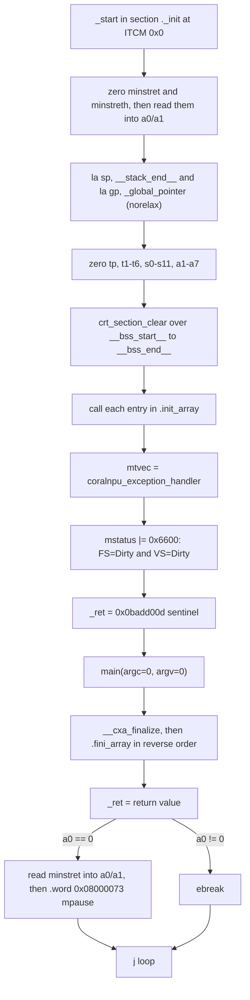
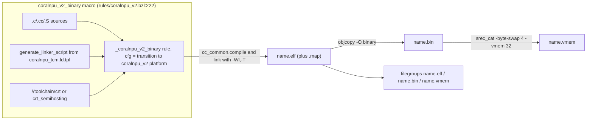
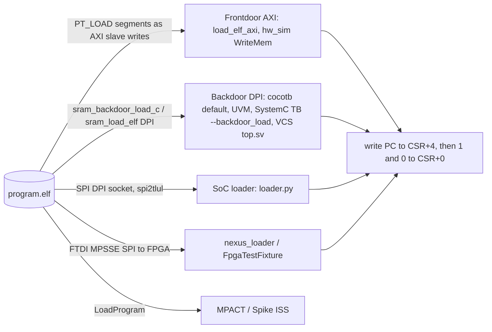
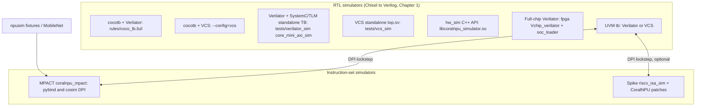
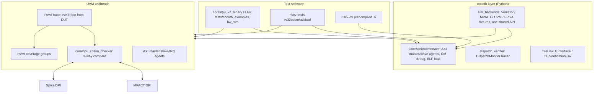
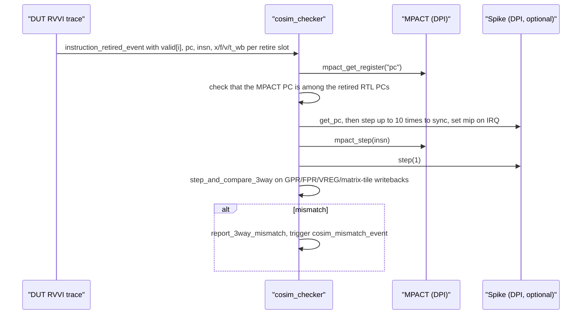
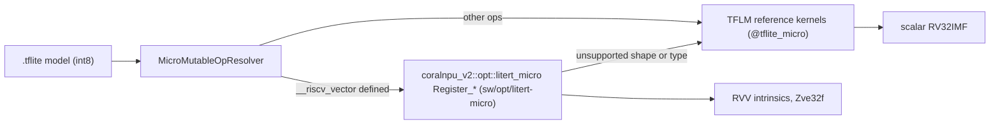

# 7. Software, Toolchain, Simulation & Verification

This chapter covers everything around the RTL: the cross toolchain and C runtime, Bazel rules and platforms, how programs get loaded and signal that they are done, the simulator families, the verification stack (cocotb, UVM with ISS lockstep co-simulation, riscv-tests/riscv-dv), and the ML software path (TFLite Micro with RVV-optimized kernels). Other chapters cover hardware details: Chapter 1 (top-level and configuration), Chapter 2 (scalar core), Chapter 3 (memory system), Chapter 4 (FPU and RVV frontend), Chapter 5 (vector backend and VME), Chapter 6 (SoC and peripherals). This chapter links to them and does not repeat them.

All statements are checked against the source tree. Citations use `path:line`.

**Contents**

- [7.1 Toolchain](#71-toolchain)
- [7.2 Linker script and memory layout](#72-linker-script-and-memory-layout)
- [7.3 C runtime: startup, termination, stdio](#73-c-runtime-startup-termination-stdio)
- [7.4 Bazel rules, platforms and transitions](#74-bazel-rules-platforms-and-transitions)
- [7.5 Program loading models](#75-program-loading-models)
- [7.6 Simulator families](#76-simulator-families)
- [7.7 Verification architecture](#77-verification-architecture)
- [7.8 ML software path](#78-ml-software-path)
- [7.9 FreeRTOS port](#79-freertos-port)
- [7.10 Third-party dependencies](#710-third-party-dependencies)
- [7.11 Notes on existing docs](#711-notes-on-existing-docs)

---

## 7.1 Toolchain

### 7.1.1 Provenance

The target toolchain is a prebuilt tarball, `toolchain_coralnpu_v2-2026-06-29.tar.xz`, fetched from GCS as the external repo `@toolchain_coralnpu_v2` (`rules/repo_defs.bzl:25-42`). It is produced by `toolchain/build_scripts/coralnpu_v2_toolchain_build.sh`, which runs inside a Rocky Linux container (`toolchain/build_scripts/README.md`):

| Component | Source / version | Reference |
|---|---|---|
| GCC + binutils + newlib + GDB | `riscv-gnu-toolchain` tag `2026.06.06` (GCC 16.1.0) | `coralnpu_v2_toolchain_build.sh:36-53`, `cc_toolchain_config.bzl:419` |
| Multilibs | `rv32imf_zicsr_zifencei_zbb-ilp32` and `rv64imf_zicsr_zifencei_zbb-lp64`, `--with-cmodel=medany` | `coralnpu_v2_toolchain_build.sh:46-51` |
| LLVM/Clang + compiler-rt | `llvmorg-20.1.0`, RISCV target only | `coralnpu_v2_toolchain_build.sh:56-105` |
| libgloss-htif | `ucb-bar/libgloss-htif` @ `39234a16`, crt0 patched to enable `zicsr` | `coralnpu_v2_toolchain_build.sh:121-130` |

The newlib multilib is built **without** vector extensions. Vector code comes only from user and kernel sources compiled with the full `-march` (below).

### 7.1.2 Bazel C++ toolchain

`toolchain/cc_toolchain_config.bzl` defines `coralnpu_v2_cc_toolchain_config`. It is instantiated twice: once plain and once with `semihosting = True` (`toolchain/BUILD.bazel:48-56`). Both are registered in `MODULE.bazel:78-82`, together with a host Clang toolchain (`//toolchain/host_clang`).

- **Driver wrappers.** Every tool path (`gcc`, `ld`, `ar`, `objcopy`, ...) points to `toolchain/wrappers/driver.sh` through a symlink. The wrapper finds the bzlmod repo directory `external/*toolchain_coralnpu_v2`, picks the `riscv64-unknown-elf-` prefix if it exists (falling back to `riscv32-`), and runs `${PREFIX}-${PROG}` (`toolchain/wrappers/driver.sh:20-68`). It also removes `-lpthread`/`-pthread`, which abseil and TFLM inject even though the newlib cross build has no pthreads (`driver.sh:34-46`).
- **The compiler is GCC.** The config sets `compiler = "clang"` (`cc_toolchain_config.bzl:395`), but Bazel's built-in compile and link actions run the `gcc` tool path, which resolves to `riscv64-unknown-elf-gcc` 16.1.0. Clang 20's builtin headers are still added to the include path (`cc_toolchain_config.bzl:153-154`). `nm`, `gcov` and `strip` map to `/bin/false` (`:72-90`).
- **Host constraints.** Both target toolchains are `exec_compatible_with` `x86_64` + `linux` only (`toolchain/BUILD.bazel:88-114`). You cannot build target binaries natively on macOS or arm64 hosts.
- **GDB.** `//toolchain:gdb` wraps `riscv{64,32}-unknown-elf-gdb` and symlinks a host `libmpfr.so` as `libmpfr.so.4` so the prebuilt GDB loads (`toolchain/wrappers/gdb`).

### 7.1.3 Flags actually used

| Feature | Flags | Where |
|---|---|---|
| `sys_spec` (always on) | `-march=rv32imf_zve32f_zicsr_zifencei_zbb_zfbfmin_zvfbfmin_zvfbfwma -mabi=ilp32 -mcmodel=medany -nostdlib` | `cc_toolchain_config.bzl:164-178` |
| RV64 variant (`is_rv64`, default False) | `rv64imf_zve32f_...` / `-mabi=lp64` | `:164-165`, `:420` |
| Link, non-semihosting | `--specs=nano.specs -Wl,--start-group -lstdc++ -lm -lc -lgcc -Wl,--end-group -nostartfiles` | `:180-196` |
| Link, semihosting | `--specs=htif_nano.specs -lsemihost` + the same group (no `-nostartfiles`) | `:198-216` |
| `warnings` | `-Wall -Werror` | `:113-129` |
| `baseline_compilation_flags` | `-fno-rtti -fno-exceptions` (C++), `-Wl,--gc-sections` | `:238-269` |
| `opt` | `-O3 -ffunction-sections -fdata-sections`, implies `-DNDEBUG` (the source comment says `-Os` would be preferable, but GCC handles it poorly) | `:288-311` |
| `dbg` | `-g3 -Og` | `:313-332` |
| `fastbuild` (Bazel default) | `-g3 -O1`, implies `-DNDEBUG` | `:334-354` |
| `generate_linker_map` | `-Wl,-Map,<out>.map` | `:371-384` |
| `printf_float` (off by default) | `-u _printf_float` (newlib-nano drops `%f` support otherwise) | `:93-111` |

Notes:

- **Soft-float ABI with hardware F.** `-mabi=ilp32` together with `F` in `-march` means floating-point arguments and return values go in integer registers, while the code inside functions still uses F instructions. Hand-written assembly and any FFI must follow ILP32, not ILP32F.
- **Vector is Zve32f.** VLEN is not set in `-march`. The Spike reference model uses `zvl128b` (`sw/coralnpu_sim/spike_simulator.h:33-34`), and the VCS models define `VLEN_128` (`tests/vcs_sim/BUILD`). See Chapter 4.
- **BF16** extensions (`zfbfmin`, `zvfbfmin`, `zvfbfwma`) are enabled in the compiler. Spike additionally enables `zvfbfa`, which is not in the compiler `-march` (`spike_simulator.h:34`).
- **riscv-tests uses a different `-march`:** `rv32imf_zve32x_zicsr_zifencei_zbb` (`third_party/riscv-tests/BUILD.bazel:21-25`).

### 7.1.4 Host toolchain

`//toolchain/host_clang` is a local Clang toolchain (`-std=c++17`, `-fuse-ld=lld`) used for simulators and Python extensions (`toolchain/host_clang/BUILD:32-95`). The MPACT pybind module and the cosim library are forced onto it through the `mpact_binary` transition (§7.4.3). `.bazelrc` also sets `CC=clang` for host builds.

---

## 7.2 Linker script and memory layout

### 7.2.1 Template and generation

There is one template, `toolchain/coralnpu_tcm.ld.tpl`. The `generate_linker_script` rule (`rules/linker.bzl:17-76`) fills in its placeholders:

| Placeholder | Rule logic | Default |
|---|---|---|
| `@@ITCM_LENGTH@@` | `itcm_size_kbytes` | 8 |
| `@@DTCM_LENGTH@@` | `dtcm_size_kbytes` | 32 |
| `@@DTCM_ORIGIN@@` | `0x00010000` when ITCM=8K and DTCM=32K, otherwise `0x00100000` ("highmem") | `linker.bzl:24-30` |
| `@@STACK_SIZE@@` | `stack_size_bytes` | **128 bytes** (`linker.bzl:32-33`) |
| `@@HEAP_LOCATION@@` | `"DTCM"`, `"EXTMEM"` or `"DDR"` | DTCM |
| `@@HEAP_SIZE_SPEC@@` / `@@STACK_START_SPEC@@` | If the heap is in DTCM with no size (or `"MAX"`), it takes all DTCM up to the stack. Otherwise the heap is a fixed size (default 1K) and the stack is pinned to the top of DTCM. | `linker.bzl:38-47` |

These DTCM origins match the hardware maps `MemoryRegions.default` and `MemoryRegions.highmem` (`hdl/chisel/src/coralnpu/Parameters.scala:43-56`). Chapter 3 covers the TCMs themselves.

`coralnpu_v2_binary` generates a per-target script named `<name>[_ITCM..KB_DTCM..KB_STACK.._HEAP..].ld` (`rules/coralnpu_v2.bzl:271-306`). Two shared scripts also exist: `//toolchain:coralnpu_tcm_ld` (8K/32K) and `coralnpu_tcm_highmem_ld` (1M/1M) (`toolchain/BUILD.bazel:24-38`).

### 7.2.2 Memory regions

| Region | Attr | Origin | Length | Notes |
|---|---|---|---|---|
| `ITCM` | rx | `0x00000000` | 8 KiB (default) / up to 1 MiB | Code, rodata, init/fini arrays |
| `DTCM` | rw | `0x00010000` or `0x00100000` | 32 KiB / up to 1 MiB | data, bss, TLS, `.htif`, heap, stack |
| `EXTMEM` | rw | `0x20000000` | 4096 KiB | `.extdata`/`.extbss` (big buffers, tensor arenas) |
| `DDR` | rw | `0x80000000` | 2048 MiB | `.ddr_data`/`.ddr_bss`; optional heap |

(`toolchain/coralnpu_tcm.ld.tpl:5-10`)

### 7.2.3 Sections (in placement order)

| Section | Region | Contents / symbols | Line |
|---|---|---|---|
| `.text` | ITCM | `._init` (the `_start` section) is placed **first**, then `.text*` | `tpl:22-27` |
| `.init.array` / `.fini.array` | ITCM | `__init_array_start__/end__`, `__fini_array_start__/end__` | `:29-46` |
| `.rodata` | ITCM | `.srodata`, `.rodata`, `.data.rel.ro` | `:48-56` |
| `.tdata` / `.tbss` | DTCM | Static TLS template | `:58-75` |
| `.htif` | DTCM | `tohost`/`fromhost`/`*_ready` (semihosting CRT) | `:77-79` |
| `.data` | DTCM | `__global_pointer$ = start + 0x800`, `.sdata`, `.data`, then a 4-byte **`_ret`** slot for main's return value | `:81-107` |
| `.bss` | DTCM | `__bss_start__/__bss_end__` (zeroed by the CRT) | `:109-118` |
| `.noinit` | DTCM (NOLOAD) | Values the host writes before boot, e.g. `model_size` | `:120-123` |
| `.extdata` / `.extbss` | EXTMEM | Large buffers. `.extbss` is NOLOAD and is **not** zeroed by the CRT. | `:125-139` |
| `.ddr_data` / `.ddr_bss` | DDR | Also collects `.cnidoom.wad` / `.cnidoom.weights` | `:141-156` |
| `.heap` | `@@HEAP_LOCATION@@` | `__heap_start__/__heap_end__` used by `_sbrk` | `:158-164` |
| `.stack` | DTCM | `__stack_start__` .. `__stack_end__` (initial `sp`) | `:166-172` |

`.data` is a loadable output section placed directly at its DTCM VMA, with no LMA/VMA split and no copy loop. The loader (frontdoor, backdoor or ISS) is expected to write DTCM contents straight from the ELF's `PT_LOAD` segments. `crt.S` provides `crt_section_copy` (`toolchain/crt/crt.S:101-152`), but `_start` never calls it.

---

## 7.3 C runtime: startup, termination, stdio

### 7.3.1 CRT libraries

`toolchain/crt/BUILD` provides two `alwayslink` libraries. `coralnpu_v2_binary` picks one automatically, or uses a `crt = ` override (`rules/coralnpu_v2.bzl:262-269`):

| Library | Sources | Used when |
|---|---|---|
| `//toolchain/crt:crt` | `coralnpu_start.S`, `crt.S`, `coralnpu_exceptions.cc`, `coralnpu_gloss.cc`, `cxx_guards.cc`; `-DSKIP_HTIF_SYMBOLS` | default (`semihosting = False`) |
| `//toolchain/crt:crt_semihosting` | `coralnpu_start.S`, `crt.S`, `coralnpu_exceptions.cc`, `coralnpu_htif_gloss.cc` (no `cxx_guards.cc`) | `semihosting = True` |

### 7.3.2 `_start` sequence (`toolchain/crt/coralnpu_start.S`)

Line references: counters `:32-35`, sp/gp `:39-42`, register clear `:44-69`, bss `:71-74`, ctors `:76-85`, mtvec `:91-92`, FS/VS dirty `:94-96`, sentinel `:98-104`, main `:109-114`, dtors `:116-129`, exit path `:131-146`.

- `_start` is declared **`.global` and `.weak`** (`coralnpu_start.S:28-29`). Any strong `_start` replaces it. In semihosting links, the specs do not pass `-nostartfiles` (`cc_toolchain_config.bzl:198-214`), so the libgloss-htif `crt0.o` named in `htif_nano.specs` is also linked. This is inferred: if that crt0 defines a strong `_start`, it wins, and the program exits through libgloss's `exit()`→`_exit()` (HTIF `tohost`) rather than through `mpause`. The linker `.map` file is the way to confirm which `_start` is used for a given binary.
- The default trap handler `coralnpu_exception_handler` is weak and only runs `ebreak` (`toolchain/crt/coralnpu_exceptions.cc:15-19`). FreeRTOS and the exception tests install their own `mtvec`.
- Setting FS/VS to Dirty up front means FP and vector instructions do not trap on context-status checks. See Chapters 2 and 4 for `mstatus` semantics.

### 7.3.3 How a program signals completion

`mpause` is a custom SYSTEM encoding, `0x08000073`. The BRU decodes it and asserts **halt only**. `ebreak` is treated as a *usage fault*, which asserts **fault and halt** (`hdl/chisel/src/coralnpu/scalar/Bru.scala:250-302`). Chapter 2 covers the exception and halt microarchitecture.

| Event in software | Mechanism | Core pins | What harnesses check |
|---|---|---|---|
| `return 0` from main | `_ret=0`, `mpause` | `io_halted=1`, `io_fault=0` | cocotb `wait_for_halted` plus `io_fault==0`; UVM "Test ended on DUT halt" |
| `return n != 0` | `_ret=n`, `ebreak` | `io_fault=1` (and halted) | cocotb `wait_for_fault`; UVM fault branch |
| `exit()`/`abort()` (non-semihosting) | `_exit` → `ebreak` (`coralnpu_gloss.cc:108-117`) | fault | Same as above |
| `exit(s)` (semihosting) | `tohost = (s<<1)\|1`, `tohost_ready=1`, then loop on `wfi` (`coralnpu_htif_gloss.cc:112-124`) | `io_wfi` | SystemC TB `tohost_reader_thread`; UVM `+TOHOST_ADDR` monitor; cocotb `wait_for_halted_semihost` |
| Explicit `wfi` | — | `io_wfi=1` | `hw_sim` `WaitForTermination` and VCS `top.sv` both treat `halted \|\| wfi` as done |
| Unhandled trap | default handler → `ebreak` | fault | — |
| SoC tests (`coralnpu_v2_sim_test`) | Program prints `PASS`/`FAIL` on UART1 | — | Regex on `uart1.log` / stdout (`utils/coralnpu_soc_loader/sim_test_runner.py:44-45`) |

The `_ret` word in DTCM holds main's return value, initialised to the sentinel `0x0badd00d`, so a host can tell a clean return apart from a stray `ebreak` (`coralnpu_tcm.ld.tpl:97-103`).

### 7.3.4 stdout / printf

What `printf` does depends on the CRT:

- **Default CRT (`coralnpu_gloss.cc`).** `_write` accepts only fd 1 and 2 and copies bytes into a static 256-byte line buffer (`LOG_MAX_SZ`). It never sends them anywhere (`toolchain/crt/coralnpu_gloss.cc:64-104`). In other words, `printf` output is **discarded** on bare-metal non-semihosting builds. `_read` fails, `_sbrk` grows between `__heap_start__` and `__heap_end__` (`:124-137`), and `operator new/delete` map to `malloc/free` (`:139-144`).
- **Semihosting CRT (`coralnpu_htif_gloss.cc`).** It implements HTIF syscalls. A 64-bit packet `[n, a0..a5]` is built on the stack, its address is written to `tohost`, then `tohost_ready=1` is written (for MPACT), and the code polls `fromhost`/`fromhost_ready` (`coralnpu_htif_gloss.cc:30-64`). It supports `openat`, `read`, `write`, `close` and `lseek`, translating newlib open flags to Linux flags (`:66-99`). The host side is either MPACT (`semihost_htif` option, `sw/coralnpu_sim/coralnpu_v2_sim_pybind.cc:224-236`) or the Verilator SystemC TB. The TB services syscalls 56/57/62/63/64/67/68, writes fd 1/2 to `std::cout`, and performs real host file I/O for other fds (`tests/verilator_sim/coralnpu/core_mini_axi_tb.cc:463-680`, stdout at `:644-646`). End-to-end test: `//tests/verilator_sim:htif_semihosting_test`.
- **SoC / FPGA programs** write to the UART MMIO directly. Examples are `fpga/sw/uart.c` (UART1 at `0x40010000`, `fpga/sw/uart.h:14-15`) and the FreeRTOS demo's `UART1_PUT` (`tests/cocotb/freertos_app/freertos_app.cc:20-21`). Chapter 6 describes the UART.
- **TFLM logging** in `tflite_runner` uses `-Wl,--wrap=DebugLog` to redirect `MicroPrintf` into an 8 KiB ring in EXTMEM (`debug_log_buffer`/`debug_log_ptr`) that the host reads back (`sw/utils/tflite_runner/tflite_runner.cc:50-66`, `sw/utils/tflite_runner/BUILD:44`).

---

## 7.4 Bazel rules, platforms and transitions

### 7.4.1 Platforms

| Label | Constraints | Selects |
|---|---|---|
| `//platforms:coralnpu_v2` | `//platforms/cpu:coralnpu_v2` + `@platforms//os:none` | `cc_coralnpu_v2_toolchain` |
| `//platforms:coralnpu_v2_semihosting` | `cpu:coralnpu_v2` + `//platforms/os:semihosting` | `cc_coralnpu_v2_semihosting_toolchain` |
| `//toolchain/host_clang:host_clang_platform` | host + `:clang_compiler` | `host_clang_toolchain_def` |

(`platforms/BUILD.bazel`, `platforms/cpu/BUILD`, `platforms/os/BUILD`, `toolchain/BUILD.bazel:88-114`, `toolchain/host_clang/BUILD:112-133`)

Target-only libraries use `target_compatible_with = ["//platforms/cpu:coralnpu_v2"]`, as `sw/opt/litert-micro/BUILD` does. Code that has both host and target builds uses `select({"//platforms/cpu:coralnpu_v2": ...})` (`sw/utils/tflite_runner/BUILD:18-32`).

### 7.4.2 `coralnpu_v2_binary`

- **Transition.** `_coralnpu_v2_transition` sets `//command_line_option:platforms` to the plain or semihosting platform, depending on the `semihosting` attribute (`rules/coralnpu_v2.bzl:25-60`). As a result, a host target (cocotb test, py_binary) can list a `.elf` in `data` and get it cross-compiled with no command-line flags.
- **Compile and link.** `cc_common.compile`/`link` with `-Wl,-T,<script>` (`:103-126`). Then `objcopy -O binary` (`:128-142`) and, if `enable_vmem` is set (the default), `srec_cat ... -vmem <word_size>` from `@srecord` (`:144-181`).
- **Macro parameters:** `semihosting`, `itcm_size_kbytes`, `dtcm_size_kbytes`, `stack_size_bytes`, `heap_size`, `heap_location`, `word_size`, `enable_vmem`, `crt`, `linker_script` (`:222-254`).
- **`collect_coralnpu_elfs()`** is called at the end of most test BUILD files. For every `_coralnpu_v2_binary` in the package that uses the default per-target linker script and is not in `DENYLIST`, it generates `verilator_uvm_regression_<name>` and `vcs_uvm_regression_<name>` (`:361-392`). `collect_coralnpu_riscv_tests()` does the same for riscv-tests (`:394-425`). Denylist, spike-denylist and per-test timeouts live in `rules/uvm_denylist.bzl`.

### 7.4.3 Other rules

| Rule / macro | File | Purpose |
|---|---|---|
| `coralnpu_v2_sim_test` | `rules/coralnpu_v2_sim_test.bzl:101-151` | Builds a binary and runs it on the full-SoC Verilator model through `//utils/coralnpu_soc_loader:sim_test_runner[_highmem]`. `loader = "backdoor"` (default) or `"spi"`. Pass/fail comes from UART text. |
| `mpact_binary` | `rules/mpact.bzl` | Transitions its `dep` to `host_clang_platform` with `-I.`. Used for the MPACT pybind `.so` and the cosim lib. |
| `verilator_cocotb_model`, `cocotb_test_suite`, `vcs_cocotb_test`, `vcs_simulation_split_test` | `rules/coco_tb.bzl` | cocotb flows (see §7.7.1). Links `hdl/verilog/sram_backdoor.cc` into toplevels listed in `SRAM_BACKDOOR_TOPLEVELS` (`rules/sram_backdoor.bzl`, `coco_tb.bzl:1569-1577`). |
| `verilator_model`, `verilator_batch_uvm_test` | `rules/verilator.bzl` | UVM model and batch regression (`run_spike` flag at `:541-581`) |
| `vcs_binary`, `vcs_model`, `vcs_testbench_test`, `vcs_batch_uvm_test` | `rules/vcs.bzl` | VCS flows. Tagged `vcs` and filtered out unless `--config=vcs` (`.bazelrc` `--build_tag_filters=-vcs,...`). |
| `--//rules:uvm_run_spike_cosim` | `rules/BUILD:42-47` | Build flag that enables Spike as the third model in UVM regressions. Default `False`. |

---

## 7.5 Program loading models

All host-driven boot flows end the same way. The host writes the entry PC to `CSR_BASE+4`, writes `1` to `CSR_BASE+0` (release clock gate), then writes `0` (release reset). `CSR_BASE` is `0x30000` in the default map and `0x200000` in highmem (`Parameters.scala:43-56`). Chapter 1 describes the CSR block. Implementations: `coralnpu_test_utils/core_mini_axi_interface.py:1105-1113`, `hw_sim/core_mini_axi_simulator.cc:91-95`, `utils/coralnpu_soc_loader/loader.py:151-173`, `sw/utils/nexus_loader/main.cc:60,364-365`.

| Model | How bytes get in | Speed | Code |
|---|---|---|---|
| **Frontdoor AXI** | Each `PT_LOAD` segment becomes AXI-slave write bursts into the core's ITCM/DTCM. Segments inside the TB's EXTMEM model (`0x20000000+`) go directly into a numpy array. | Slow (cycle-accurate bus) | `core_mini_axi_interface.py:1020-1035`; forced with `COCOTB_USE_FRONTDOOR=1` (`:1012-1013`) |
| **Backdoor DPI** | `hdl/verilog/sram_backdoor.cc` keeps a registry of Chisel SRAM instances (`sram_init` DPI, keyed by global byte address). `sram_backdoor_load_c(addr, data, len)` and `sram_load_elf(file)` write straight into them. Python finds the symbol in-process with `ctypes.CDLL(None)`, which needs `-rdynamic`. Also available: `sram_backdoor_apply_patch` and `sram_backdoor_dump_memory` (used by UVM). | Instant | `hdl/verilog/sram_backdoor.h:23-51`, `coralnpu_test_utils/backdoor.py:19-57`, `core_mini_axi_interface.py:1037-1062` (now the **default** in cocotb `load_elf`, `:1005-1018`) |
| **SoC loader** | The full-chip Verilator binary `Vchip_verilator[_highmem]` opens a SPI DPI server (`SPI_DPI_PORT`). `loader.py` streams 16-byte lines over SPI→TL-UL. In `--csr_only` mode the simulator has already backdoor-loaded the ELF (`--load_elf=`) and the loader only does the kick sequence. | Medium / instant | `utils/coralnpu_soc_loader/loader.py:95-173`, `sim_test_runner.py:137-300` |
| **Nexus loader (FPGA)** | Host C++ tool. Uses libftdi MPSSE (FTDI `0403:6011`, interface A) to drive SPI into the FPGA's spi2tlul bridge. It can load an ELF or raw data, read and write words/lines, set the entry point, start the core, and poll for halt or a status buffer. `--highmem` selects CSR base `0x200000`. | HW | `sw/utils/nexus_loader/main.cc:37-68,353-480` |
| **ISS** | MPACT `LoadProgram(elf, entry)`; Spike `LoadProgram` / `spike_load_program` DPI | n/a | §7.6 |

---

## 7.6 Simulator families

| Family | Entry target(s) | DUT / model | Loading | Termination | Use it for |
|---|---|---|---|---|---|
| cocotb + Verilator | `//tests/cocotb:*` suites; models `core_mini_axi_model`, `rvv_core_mini_axi_model`, `rvv_core_mini_highmem_axi_model`, `rvv_core_mini_itcm512kb_dtcm512kb_axi_model`, `vme_core_mini_axi_model` (`tests/cocotb/BUILD:68-127`) | `CoreMiniAxi`, `RvvCoreMiniAxi`, `VmeCoreMiniAxi`, ... | Backdoor (default) or AXI | `io_halted` / `io_fault` / `tohost` polling | Default unit and integration verification. Python stimulus with full signal access. |
| cocotb + VCS | `cocotb_test_suite(..., simulators=["verilator","vcs"])`, `vcs_simulation_split_test` | same | same | same | Sign-off parity, coverage (`vcs_coverage.sh`), gate-level / power (split flow) |
| Verilator SystemC TB | `//tests/verilator_sim:{,rvv_}core_mini{,_highmem,_itcm512kb_dtcm512kb,_verification}_axi_sim` (`tests/verilator_sim/BUILD`) | Same toplevels, wrapped in SystemC with TLM AXI bridges (`@libsystemctlm_soc`, `tests/systemc/Xbar.h`) | `--binary=`, `--backdoor_load` | halted/fault/wfi callbacks + HTIF `tohost` | Fast standalone runs, HTIF semihosting (printf/file I/O), `--instr_trace`, `--trace` VCD |
| VCS standalone | `//tests/vcs_sim:*_sim` (`vcs_binary`, `+define+DUT_MODULE=...`) | same | `+binary=` → `sram_load_elf` | `halted \|\| wfi` → `$finish`; `fault` → error; `+cycles=` limit (`tests/vcs_sim/top.sv:234-293`) | Quick VCS smoke (`simulators_smoke_test.sh`) |
| hw_sim C++ API | `//hw_sim:libcoralnpu_simulator{,_rvv,_vme}.so` (`hw_sim/BUILD:132-152`) | `CoreMiniAxi` / `RvvCoreMiniAxi` / `VmeCoreMiniAxi` via `-DENABLE_RVV/VME` | `WriteMem` (AXI slave) | `WaitForTermination`: `io_halted \|\| io_wfi` | Embedding the cycle model in an external host program (§7.6.1) |
| Full-chip SoC | `coralnpu_v2_sim_test`, `//utils/coralnpu_soc_loader:run_simulation`, `run_isp_cam_sim` | FPGA chip top (`Vchip_verilator`) with peripherals (Chapter 6) | backdoor `--load_elf` or SPI | UART regex | Peripheral and driver tests (DMA, clk, ISP camera, SPI loader) |
| UVM | `//tests/uvm:uvm_sim_verilator`, `uvm_sim_vcs`, `uvm_vme_sim_*` | `RvvCoreMiniVerificationAxi` (default `DUT_MODULE`) | `sram_load_elf` + optional patch | tohost / halted / fault / timeout | ISA-level lockstep checking against MPACT (+Spike), regression of every ELF |
| MPACT ISS | `//sw/coralnpu_sim:coralnpu_v2_sim` (pybind), `coralnpu_v2_sim_utils_lib` | Functional model from `google-coral/coralnpu-mpact` | `LoadProgram` | `exit_on_ebreak`, HTIF exit | Fast software bring-up, ML model runs (npusim), golden reference |
| Spike | `//sw/coralnpu_sim:spike_simulator`, `spike_cosim_dpi` | `riscv-isa-sim` @ `93a10ae` + 8 Coral patches | `LoadProgram` | halt on ebreak/mpause | Second, independent reference in cosim |

### 7.6.1 `hw_sim` API and the "mailbox"

`hw_sim/coralnpu_simulator.h` defines a small abstract interface: `ReadMem`, `WriteMem`, `ReadMailbox`, `WriteMailbox`, `Run(start_addr)`, `WaitForTermination(timeout)`, `GetCycleCount`. It also has an optional per-N-cycle callback (`CoralNPUSimulatorOptions`). The factory is `coralnpu_simulator_verilator_create()`.

`CoreMiniAxiSimulator` (`hw_sim/core_mini_axi_simulator.cc`) wraps the Verilated core through `CoreMiniAxiWrapper` (`hw_sim/core_mini_axi_wrapper.h`), which drives the AXI slave and master ports with the drivers in `hw_primitives.h`:

- It models 1 GiB of DDR at `0x80000000-0xBFFFFFFF` in host memory (`core_mini_axi_simulator.cc:26,57`).
- **The mailbox is a testbench-side construct, not RTL.** `CoralNPUMailbox` is four 32-bit words (`hw_sim/mailbox.h`). Any AXI master read or write from the core that does **not** hit DDR is served from the 16-byte mailbox (`core_mini_axi_simulator.cc:103-174`). For example, `mailbox_example.cc` writes `0xDEADBEEF` to `0x20000000` (EXTMEM) and the host reads it back with `ReadMailbox()` (`hw_sim/mailbox_example.cc`, `core_mini_axi_simulator_example.cc:58-68`).

### 7.6.2 MPACT ISS bindings

`coralnpu_v2_sim_pybind` (`sw/coralnpu_sim/coralnpu_v2_sim_pybind.cc:204-262`) exposes:

- `CoralNPUSimulatorOptions`: ITCM start/length, `initial_misa_value`, `memory_regions`, `exit_on_ebreak`, `semihost_htif`.
- `CoralNPUSimulatorPy`: `LoadProgram`, `Run`, `Wait`, `Halt`, `Step`, `Set/ClearSwBreakpoint`, `GetCycleCount`, `Read/WriteMemory`, `WriteWord`, `WritePtr`, `Read/WriteRegister`.

`CoralNPUV2Simulator` (`sw/coralnpu_sim/coralnpu_v2_sim_utils.py:20-148`) pre-configures the highmem map (ITCM 1 MiB RWX, DTCM `0x100000`/1 MiB, EXTMEM 4 MiB, DDR `0x80000000`/128 MiB) with `misa = 0x40801120` (RV32 + I, M, F, X). The upstream MPACT repo is patched for direct-mode `mtvec`, include fixes and matrix-tile DPI accessors (`rules/repo_defs.bzl:98-112`). Separately, the `mpact-riscv` patches fix `mepc` masking, `mstatus.VS`, vector CSRs, `vstart` traps and widening reductions (`third_party/patches/`).

### 7.6.3 Spike

`SpikeSimulator` (`sw/coralnpu_sim/spike_simulator.{h,cc}`) wraps `riscv_isa_sim` in-process. Default ISA: `rv32imf_zve32f_zvl128b_zicsr_zifencei_zbb_zicclsm_zfbfmin_zvfbfmin_zvfbfwma_zvfbfa_xdummy`, priv `m`, misaligned accesses allowed (`spike_simulator.h:31-37`). `spike_cosim_dpi.{h,cc}` turns it into `spike_init/load_program/step/get_register/set_register/get_vector_register/apply_memory_patch/fini` DPI functions for UVM.

Spike patches (`rules/repo_defs.bzl:553-573`, `third_party/spike/`):

1. add `mpause`
2. Coral deviations
3. dump GPRs on EBREAK
4. custom CoralNPU CSRs, `mvendorid`/`marchid`
5. force logging in `vcompress`
6. read-only `misa`
7. and 8. build fixes

### 7.6.4 Choosing a simulator

- **Developing software or a kernel, need speed:** MPACT through `MpactNpuSimTestFixture` or `CoralNPUV2Simulator`. Use semihosting for printf.
- **Need cycle counts or RTL behaviour from Python:** cocotb + Verilator with `VerilatorTestFixture`/`CoreMiniAxiInterface`.
- **Need host printf / file I/O against RTL:** Verilator SystemC TB with a `semihosting = True` binary.
- **Need ISA conformance of the RTL on arbitrary programs:** the UVM regression (MPACT lockstep, plus Spike with `--//rules:uvm_run_spike_cosim=true`).
- **Peripheral or SoC integration:** `coralnpu_v2_sim_test` on the full-chip model.
- **Embedding the core in another simulator:** `libcoralnpu_simulator*.so`.
- **Sign-off, coverage, gate-level:** VCS flows (`--config=vcs`).

---

## 7.7 Verification architecture

### 7.7.1 cocotb

**Infrastructure.** `rules/coco_tb.bzl` provides `verilator_cocotb_model` (builds the Verilated model with `-rdynamic` and the DPI sources) and `cocotb_test_suite(name, testcases, simulators=["verilator"], ...)` (`coco_tb.bzl:1440`). The suite expands to one Bazel test per testcase per simulator. Testcase lists sit between `# BEGIN_TESTCASES_FOR_<suite>` / `# END_...` markers and are kept in sync by `utils/update_cocotb_tests.py` / `update_all_cocotb_tests.py`. VCS has a regular flow and a split compile/run flow. Their signatures are kept identical by a load-time smoke target and the AST checker `utils/check_macro_signatures.py`, wired into `PREUPLOAD.cfg` (`tests/cocotb/README.md`).

**`CoreMiniAxiInterface`** (`coralnpu_test_utils/core_mini_axi_interface.py`) is the main harness. It provides:

- AXI slave write/read agents into the DUT (`:281-454`).
- An AXI master responder backed by a numpy "external memory" at `0x20000000` (`:454-541`).
- Reset and clock.
- Debug-module accessors (`dm_read/write`, halt/resume, abstract register and memory access, `:581-768`), which also back the pyOCD GDB server in `core_mini_axi_pyocd_gdbserver.py`.
- `load_elf`, `execute_from`, `wait_for_halted`, `wait_for_fault`, `wait_for_wfi`, `raise_irq`, `wait_for_halted_semihost`. The last one polls `tohost` (`:1005-1164`).
- `COCOTB_TIMEOUT_CYCLES` overrides timeouts (`:1115-1121`).

**Backend-neutral fixtures** (`coralnpu_test_utils/sim_backends/`). `VerilatorTestFixture`, `MpactNpuSimTestFixture`, `UvmTestFixture` and `FpgaTestFixture` share one API: `Create`, `load_elf_and_lookup_symbols`, `write`/`write_word`/`write_ptr` by symbol name, `read`/`read_word`, `run_to_halt`, `get_cycle_count`. The same test logic can run on RTL, the ISS, UVM batch with cosim (it stages writes as a memory-patch file and reads back from a post-halt memory dump, `uvm_test_fixture.py:132-275`), or real FPGA hardware. `common_utils.py` handles ELF symbol parsing and auto-probes `tohost`, `cycle_count` and similar symbols (`common_utils.py:24-32`).

**Key suites** (`tests/cocotb/BUILD`):

| Suite / target | Toplevel(s) | Highlights |
|---|---|---|
| `core_mini_axi_sim_cocotb`, `rvv_core_mini_axi_sim_cocotb` (`:128-243`) | `CoreMiniAxi`, `RvvCoreMiniAxi`; Verilator + VCS | AXI read/write stress, WFI in all 4 dispatch slots, slow BREADY, write alignment, burst/wrap types, **riscv-tests**, **riscv-dv**, CSR, exceptions, float hazards, FRM/FCSR, retire-buffer-full illegal instruction, backdoor load, `minstret`/`misa`, `fence.i` |
| `core_mini_axi_debug_cocotb` (`:245-467`) | `CoreMiniAxi`, `RvvCoreMiniAxi` | Debug module: halt/resume, single-step, breakpoints/triggers, abstract register access, `ndmreset`, gdbserver |
| `rvv_assembly_cocotb_test`, `rvv_load_store_test`, `rvv_arithmetic_cocotb_test`, `rvv_ml_ops_cocotb_test` (`:469-942`) | `RvvCoreMiniAxi` (+ VME for load/store) | RVV ISA coverage via templated kernels (`tests/cocotb/rvv/arithmetics/*.bzl`), vstart/vill/vl=0 edge cases, int8/float/bf16 matmul, Gemma kernels |
| `rvv_highmem_tests`, `rvv_itcm512kb_dtcm512kb_tests` (`:529-593`) | Highmem / 512K variants | Large-memory programs |
| `isa_cycle_bench_test` (`:944`) | — | Per-instruction cycle benchmarking |
| Single-binary tests (`:596-795`) | — | Timer, software interrupt, PLIC, debug trigger, `mcycle`, stress, FP store, vector store fault, ... |
| `tests/cocotb/tlul/*`, `dma/*` | TL-UL fabric, subsystem harness | TL-UL sockets/FIFOs/integrity, xbar, banked DTCM, SECDED, GPIO/SPI/DMA integration, **FreeRTOS** (`test_freertos.py`) |
| `tests/cocotb/vme_test` | `VmeCoreMiniAxi` | VME decode, load/store, matmul, transpose, `mstatus.MS` (Chapter 5) |
| `tests/cocotb/tutorial/*` | `CoreMiniAxi` / `RvvCoreMiniAxi` | Tutorial program, float hello world, TFLM kernel tests (conv2d, depthwise, FC, logistic, pooling, partial MobileNet) |

**`dispatch_verifier`.** Despite the name, `coralnpu_test_utils/dispatch_verifier/` is a **tracer, not a checker**. `DispatchMonitor` samples `dut.core.score.dispatch.io_inst_{0..3}` every cycle. It disassembles scalar, float and RVV instructions (`disasm.py`), tags each with its functional unit (ALU/BRU/MLU/DVU/LSU/CSR/FLOAT/RVV), writes `dispatch.log`, keeps `monitor.history`, supports an `on_dispatch` callback, and drives a live ANSI UI (`terminal_ui.py`; disable with `DISPATCH_UI=0`) (`monitor.py:14-90`). For VPI visibility, `coralnpu_test_utils/dispatch.vlt.tpl` marks only `DispatchV2`'s `io_*` ports public. Chapter 2 covers the 4-lane dispatch.

### 7.7.2 riscv-tests and riscv-dv

- **riscv-tests** at commit `fd4e6cd` are built with `rules_foreign_cc` `configure_make` using the CoralNPU toolchain wrappers. Suites: `rv32ui`, `rv32um`, `rv32uzbb`, `rv32uf`, physical (`-p-`) and virtual (`-v-`) envs (`third_party/riscv-tests/BUILD.bazel:21-80`). A shadowed env replaces `RVTEST_PASS` with `mpause` (`.word 0x08000073`) and `RVTEST_FAIL` with `ebreak` (`third_party/riscv-tests/env/p/riscv_test.h:37-38`), and links with `//toolchain:coralnpu_tcm.ld`. cocotb runs every non-`.dump` binary, skips `fence_i`, and asserts `halted && !fault` (`tests/cocotb/core_mini_axi_sim.py:202-232`). The UVM regression includes them through `collect_coralnpu_riscv_tests`.
- **riscv-dv**: eight **precompiled** objects are checked in (`tests/cocotb/riscv-dv/*.o`: arithmetic, FP arithmetic/random, jump stress, loop, no-fence, random instruction, unaligned load/store). They finish through `tohost` (`core_mini_axi_sim.py:236-252`). The generator is not part of the build.

### 7.7.3 UVM testbench with lockstep co-simulation

**Structure** (`tests/uvm/`):

- `tb/coralnpu_tb_top.sv` instantiates `DUT_MODULE`, default `RvvCoreMiniVerificationAxi` (`:182-186`); the VME variant is `VmeCoreMiniVerificationAxi`. It binds AXI master/slave/IRQ interfaces and takes the RVVI trace interface from `u_dut.core.score.rvvi.rvviTraceBlackBox.rvvi` (`:437`).
- `env/coralnpu_env_pkg.sv` builds the environment.
- `tests/coralnpu_test_pkg.sv` holds the base and regression tests.
- `common/` holds the AXI agents, IRQ agent, `rvvi_agent/` (an RVVI monitor plus per-extension covergroups `Cvgrp_RV32_{I,M,F,Zbb,Zicsr,Zifencei}`) and `cosim/` (checker and DPI imports).

Chapter 1 explains the `*VerificationAxi` toplevels that expose RVVI.

**Test flow** (`coralnpu_base_test`, `tests/coralnpu_test_pkg.sv:154-440`):

1. Plusargs: `+TEST_ELF`, `+ENTRY_POINT`, `+TEST_TIMEOUT` (default 20 ms sim time), `+MISA_VALUE`, `+MEM_PATCH`, `+MEM_DUMP`, `+SPIKE_LOG`, `+TOHOST_ADDR`.
2. `sram_load_elf(test_elf)` backdoor, then optional `sram_backdoor_apply_patch` (`:284-296`). A kickoff sequence writes the PC and reset CSRs over AXI.
3. The test waits on the first of these: a `tohost` write seen on the DUT's DBUS/EBUS at `+TOHOST_ADDR` (`tb_top:359-420`), `halted || fault`, or a timeout (`:303-331`).
4. Verdict: `tohost` value `0` means pass, otherwise `status = data[31:1]`. A clean halt passes if there are no UVM errors. **A fault with no cosim mismatch is also reported as PASS** ("consistent behavior"), because both models agreed on the trap. A fault with a mismatch fails (`:362-400`). It optionally dumps memory with `sram_backdoor_dump_memory`.
5. `coralnpu_regression_test` (`:441`) runs a `+REGRESSION_LIST=` of ELFs in one simulator process. `verilator_batch_uvm_test` / `vcs_batch_uvm_test` generate that list with per-ELF timeout and spike-enable columns (`rules/verilator.bzl:541-581`).

**Lockstep checker** (`common/cosim/coralnpu_cosim_checker_pkg.sv`):

- Retired instructions are collected per retire slot from `rvvi_vif` (`:258-276`) and coalesced into one 3-way evaluation (`:282-400`).
- **Non-determinism handling:** reads of `mcycle`/`minstret`/`cycle`/`time` (`is_varying_csr_read`, `:90-108`) mark the destination GPR "dirty". Dirtiness propagates through dependent instructions and sp-relative stack spills (`update_dirty_registers`, `:111-220`). Dirty values are copied from RTL into Spike (`set_register`) instead of being compared.
- MPACT is enabled by default but **disabled automatically when `+MEM_PATCH` is used**, since it has no runtime patch API (`:457-476`). Spike is disabled unless `+SPIKE_LOG` / `--//rules:uvm_run_spike_cosim=true` is set, and individual tests can opt out through `SPIKE_DENYLIST` (`rules/verilator.bzl:560-563`).
- DPI surfaces: `coralnpu_cosim_dpi_if.sv` (`mpact_init/config/load_program/reset/step/is_halted/get_register/get_vector_register/get_matrix_tile*/fini`) and `coralnpu_spike_cosim_dpi_if.sv`. The MPACT side is `@coralnpu_mpact//sim/cosim:coralnpu_cosim_lib`, built with host clang (`tests/uvm/BUILD:86-103`).

**Simulators.** Verilator uses chipsalliance `uvm-verilator` tag `uvm-2020-3.2` (`rules/repo_defs.bzl:447-451`). VCS uses `-ntb_opts uvm-1.2` (`tests/uvm/BUILD:135-150`). Runners: `bazel test --test_tag_filters=verilator-uvm-regression //...`, the VCS equivalent with `--config=vcs`, or `utils/run_uvm_regression.py` / `uvm_batch_runner.py` / `compare_uvm_results.py`.

### 7.7.4 Other test assets

- `tests/verilator_sim/coralnpu/*_tb.cc`: SystemC unit TBs for `l1icache`, `l1dcache`, `dbus2axi`, non-INCR bursts and backdoor load (Chapter 3).
- `coralnpu_test_utils/secded_golden.py`, `TlulVerificationEnv.py`, `axi_slave.py`: golden models and agents for the fabric tests in Chapter 6.
- FPGA scripts: `run_binary.py`, `run_sram_test.py`, `run_ddr_test.py`, `run_matmul_test.py`, `run_float_matmul_fpga.py`, `run_tflite_profile.py`.

---

## 7.8 ML software path

### 7.8.1 TFLite Micro integration

`@tflite_micro` is pinned at commit `b75c6ff` with two patches (`rules/repo_defs.bzl:303-314`):

- `Tflite-Micro-CoralNPU-integration.patch` removes pthread defaults from gemmlowp and ruy, and adjusts example/tools BUILD files.
- `0001-Remove-xtensa-and-hifi-kernels.patch`.

The `-lpthread` stripping in the driver wrapper handles the rest.

### 7.8.2 RVV-optimized kernels (`sw/opt/`)

- `sw/opt/rvv_opt.h`: `coralnpu_v2::opt::Memcpy`/`Memset` with `e8m8` strip-mining (`vsetvl_e8m8`, `vle8`/`vse8`).
- `sw/opt/litert-micro/` (namespace `coralnpu_v2::opt::litert_micro`). Each `Register_X()` takes the stock TFLM registration and **replaces only `invoke`**. The optimized path handles int8 x int8. Any other type falls back to `tflite::Register_X().invoke` (`fully_connected.cc:94-124`, `conv.cc:1248-1278`).

| Kernel | Optimization notes |
|---|---|
| `conv` (`conv.cc`, ~1.4 kLOC) | Shape-specialized 4x4 paths: `Conv_4x4_OCVectorized`, `Conv2D_4x4` (LMUL=4 over output channels, input pre-padded to make the inner loop branchless), `Conv_4_4_16`, `Conv_4_4_16_StrideN` (16 filter taps pinned to `v1..v16`), `Conv_4_4_48_Stride1`. Weights are repacked at Prepare time. Other shapes fall back to `reference_integer_ops::ConvPerChannel` and log `"Fallback kernel: fh=.. fw=.."` (`conv.cc:1161-1246`). |
| `depthwise_conv` | Vectorized over channels with `depth_multiplier`-strided loads |
| `fully_connected` | `m4` int32 accumulators, offset-add, MAC, vector reduction |
| `pooling` | Vectorized MaxPool with clamping. AveragePool uses the reference kernel. |
| `logistic` | int8 logistic |
| `accumulator_util.h` / `memory_util.h` | Shared requantization (`PostprocessAcc`, per-channel shift prep with `e32m8`, `vnclip`) and buffer helpers |

Unit tests are in `sw/opt/litert-micro/test/` (conv, max-pool) and `tests/cocotb/tutorial/tfmicro/*` (cocotb and npusim variants per kernel). Chapters 4 and 5 describe how these RVV sequences run in hardware.

### 7.8.3 Runners

| Runner | Target | Memory plan | Host interface |
|---|---|---|---|
| Generic profiler | `//sw/utils/tflite_runner:tflite_runner` (1M/1M TCM, 128 KiB stack) | `model_buffer[512K]` in `.extdata`, `tensor_arena[3570K]` and the log in `.extbss`, `model_size` in `.noinit` (`tflite_runner.cc:38-50`) | Host writes the model and `model_size`, then reads `init_status`, `invoke_status`, `cycle_count` (measured with `mcycle`, `sw/utils/utils.h`) and the log. Driven over FTDI SPI by `coralnpu_test_utils/run_tflite_profile.py`, which also summarizes "Fallback kernel" lines. |
| MobileNet v1 0.25/224 int8 | `//tests/npusim_examples:run_full_mobilenet_v1_binary` (**semihosting**, 1M/1M) | `tensor_arena[4 MiB]` in `.extdata` (all of EXTMEM), `inference_input[150528]`/`inference_output[5]` in `.data` (`run_full_mobilenet_v1.cc:52-60`) | `npusim_run_mobilenet.py` uses `MpactNpuSimTestFixture`: random input → `run_to_halt` → top-1 index and `inference_status` |

Run with `bazel run //tests/npusim_examples:npusim_run_mobilenet`.

---

## 7.9 FreeRTOS port

- Kernel: FreeRTOS-Kernel **V11.1.0** (`rules/repo_defs.bzl:458-466`). Built from `portable/GCC/RISC-V` with `heap_4` (`third_party/freertos/freertos.BUILD`).
- Configuration goes through `label_flag //third_party/freertos:config`, default `coralnpu_default_config` (`third_party/freertos/BUILD.bazel`):
  - `FreeRTOSConfig.h`: CLINT `MTIME` at `0x0200BFF8` and `MTIMECMP` at `0x02004000`, `configCPU_CLOCK_HZ = 1 MHz` (simulated), 1 kHz tick, preemption, 5 priorities, 32 KiB heap, stack-overflow check 2, malloc-failed hook, timers off, ISR stack of 256 words.
  - `freertos_risc_v_chip_specific_extensions.h`: `portasmHAS_MTIME 1` and no additional context. This means **vector and FP registers are not saved across task switches** by the port.
- Demo: `//tests/cocotb/freertos_app:freertos_app` (1M/1M). It installs `freertos_risc_v_trap_handler` in `mtvec`, creates two tasks that print `'1'`/`'2'` to UART1 with `vTaskDelay`, and starts the scheduler (`freertos_app.cc:69-90`). `tests/cocotb/tlul/test_freertos.py` runs it on the subsystem harness with a TL-UL UART1 responder. Chapter 6 covers the CLINT and UART.

---

## 7.10 Third-party dependencies

| Repo | Pin | Purpose |
|---|---|---|
| `toolchain_coralnpu_v2` | tarball 2026-06-29 | GCC 16.1 / Clang 20 / newlib / libgloss-htif cross toolchain |
| `coralnpu_mpact` (+ `com_google_mpact-riscv`, `mpact-sim`) | `7670ee4` / `e4f1e9c` / `9c43949` | CoralNPU ISS: pybind (`npusim`) and UVM cosim library |
| `riscv_isa_sim` (Spike) | `93a10ae` + 8 patches | Second reference ISS for cosim |
| `RVVI` | `5786f0d` (≈ tag 20240403.0) + 2 patches, including a matrix-tile trace interface | `rvviTrace` interface used by the DUT trace and the UVM monitor |
| `uvm` (uvm-verilator) | `uvm-2020-3.2` | UVM library for Verilator |
| `verilator` | v5.052 (built from source with flex/bison/m4) | RTL simulator |
| `accellera_systemc` 2.3.4, `libsystemctlm_soc` | — | SystemC kernel and TLM AXI bridges for `tests/verilator_sim` |
| `tflite_micro` (+ flatbuffers 23.5.26, gemmlowp, ruy, kissfft) | `b75c6ff` | TFLM runtime and reference kernels |
| `freertos` | V11.1.0 | RTOS kernel |
| `riscv-tests` | `fd4e6cd` | ISA compliance-style tests |
| `srecord` 1.65 | — | `srec_cat` for `.vmem` |
| `cvfpu`, `fpu_div_sqrt_mvp`, `common_cells` | pinned SHAs + patches | FPU RTL (Chapter 4) |
| `chipsalliance_rocket_chip`, `diplomacy`, `llvm_firtool` 1.114.0, Chisel 7.0.0-RC1 (Maven) | — | HDL generation (Chapter 1) |
| `lowrisc_opentitan_gh` | `0e3cf62` | OpenTitan IP and Python deps for SoC peripherals (Chapter 6) |
| `ispyocto`, `waveshare_display` | — | FPGA camera ISP and LCD driver (Chapter 6) |
| `cocotb`, `pyelftools`, `numpy`, `pyocd`, `pyftdi`, ... (`coralnpu_pip_deps_*`) | `MODULE.bazel:95-188` | Python test infrastructure |
| `elfio`, `antlr4`, `linenoise`, `pybind11_abseil` | — | MPACT build dependencies |

---

## 7.11 Notes on existing docs

In each case below the code was followed and the existing documentation is noted as stale or inconsistent:

1. **`doc/tutorials/npusim_mobilenet_tutorial.md`** shows the script calling `CoralNPUV2Simulator` directly (`get_elf_entry_and_symbol`, `write_memory`, `run()`/`wait()`). `tests/npusim_examples/npusim_run_mobilenet.py` now goes through `MpactNpuSimTestFixture` (`load_elf_and_lookup_symbols`, `write`, `run_to_halt`, `read`). The doc also says the device code uses `memcpy`, but it uses the RVV `coralnpu_v2::opt::Memcpy`. The doc's "4MB" arena is correct. The source comment `// 3MB` at `run_full_mobilenet_v1.cc:53` is wrong.
2. **`doc/tutorials/writing_coralnpu_programs.md`** says "The core will halt when returning from `main`". That is true for `return 0` (`mpause`). A non-zero return executes `ebreak`, which also raises `io_fault`. The tutorial does not mention that `load_elf` now defaults to the **backdoor** DPI path, which requires a model built with `sram_backdoor`/`-rdynamic` (`COCOTB_USE_FRONTDOOR=1` restores AXI loading). The prerequisites still link the OpenSecura getting-started guide.
3. **`tests/uvm/README.md`** has several stale parts:
   - It says the testbench is "configured to run with Synopsys VCS" with UVM 1.2. A Verilator model (`uvm_sim_verilator`, UVM 2020 from uvm-verilator) is built and is the default regression.
   - It requires a `CORALNPU_MPACT` env var, but MPACT comes from Bazel (`@coralnpu_mpact`).
   - It refers to a `bin/` directory and a `Makefile` that do not exist.
   - Its directory tree omits `common/cosim/` and `common/rvvi_agent/`.
   - Example targets/tags (`//tests/cocotb:uvm_regression_nop_test`, `vcs_uvm_regression_nop_test`, tag `uvm-regression`) do not match the generated names `verilator_uvm_regression_<name>` / `vcs_uvm_regression_<name>` and tags `verilator-uvm-regression` / `vcs-uvm-regression` (`rules/coralnpu_v2.bzl:375-391`).
   - Its overview says completion is checked only via `halted`/`fault`. The code also checks `tohost`, does MPACT/Spike lockstep, and treats a fault with no cosim mismatch as a pass.
4. **`doc/simulation.md`** only covers VCS setup and `vcs_testbench_test`. The rule does exist (`rules/vcs.bzl:79`), but the doc omits Verilator, cocotb, UVM, MPACT and Spike entirely.
5. **`rules/coralnpu_v2.bzl:239`** (docstring) says the macro uses "libgloss-htif". The default (non-semihosting) build uses `//toolchain/crt` with `-nostartfiles` and no libgloss-htif. Only `semihosting = True` pulls in `htif_nano.specs`.
6. **`cc_toolchain_config.bzl:395`** declares `compiler = "clang"`, but compilation goes through the `gcc` tool path (GCC 16.1.0).
7. **Code-level inconsistency, `utils/coralnpu_soc_loader/loader.py:151-160`:** for non-default TCM sizes it computes the CSR base as `(itcm_kb + dtcm_kb) * 1024`. That equals the true highmem CSR base `0x200000` only for 1M/1M. For example, 512K/512K gives `0x100000`, which is the DTCM base (`Parameters.scala:49-55`). The runners only use 8K/32K or 1M/1M, so this does not currently cause failures.
8. **`hw_sim` "mailbox"** is a 16-byte testbench model that answers every non-DDR AXI master access (`core_mini_axi_simulator.cc:103-174`). It is not a hardware mailbox block. See Chapter 6 for actual SoC peripherals.
9. **Default printf is a no-op:** `coralnpu_gloss.cc` `_write` line-buffers and drops output. Docs that imply `printf` works out of the box only hold for `semihosting = True` binaries (or UART-based SoC programs).
