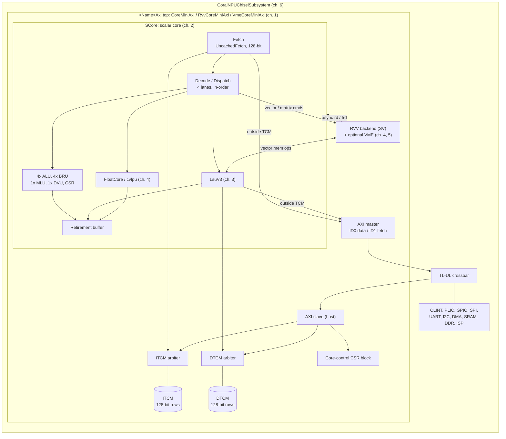

# CoralNPU Architecture Reference

This directory is a detailed, code-verified architecture reference for
**CoralNPU**, a RISC-V (RV32) processor with an optional RVV 1.0 vector backend
and an experimental matrix engine (VME / Zvt), plus its SoC, software stack and
verification infrastructure.

Every chapter was written by reading the RTL and build files in this repository
(snapshot: `main` @ `18815824`, 2026-10-14) and cites sources as `path:line`.
Where the older material under [`doc/`](../doc) disagrees with the code, the
chapters follow the code and record the difference in a *Notes on existing
docs* section. Latency and throughput numbers are derived from register stages
in the RTL, not measured in simulation, unless a chapter says otherwise.

---

## Chapters

| # | Chapter | What it covers |
|---|---|---|
| 1 | [Top-Level Architecture & Configuration](01-top-level-and-configuration.md) | Module hierarchy, `Parameters` feature flags, generator & Bazel variants (sim vs prod, highmem), top-level ports, core-control CSR block, clock gating / reset sync, memory map, boot flow |
| 2 | [Scalar Core Pipeline](02-scalar-core.md) | Fetch (uncached fetch, reorder buffer, branch prediction), decode & exact ISA coverage, 4-lane dispatch rules & scoreboard, regfile, ALU/BRU/MLU/DVU, CSR file, traps & FaultManager, WFI/halt, debug module, retirement buffer & RVVI |
| 3 | [Load/Store Unit & Memory Subsystem](03-memory-subsystem.md) | `LsuV3` microarchitecture, vector/tile memory ops, fences & faults, IBus/DBus/EBus, TCM organization & SRAM macros, internal fabric & AXI slave, AXI master bridges, latency table |
| 4 | [Floating Point & Vector Frontend](04-floating-point-and-vector-frontend.md) | `FloatCore` (cvfpu) ops, rounding/fflags, NaN boxing, BF16, FP regfile; RVV decode/dispatch from the scalar core, vector CSRs, operand & writeback paths, full Chisel↔SV boundary signal table |
| 5 | [Vector Backend & Matrix Engine](05-vector-backend-and-matrix-engine.md) | SystemVerilog RVV backend: command queue, 2-stage decode, uop queue, dispatch, reservation stations, functional units, VRF, ROB/retire, traps, LSU interaction; VME tiles, config instructions, PE array, datatypes, compile-time defines |
| 6 | [SoC Interconnect, Peripherals & DMA](06-soc-interconnect-and-peripherals.md) | `CoralNPUChiselSubsystem`, TL-UL crossbar (hosts/devices/address map), clock domains, TL-UL integrity, AXI↔TL-UL bridges, CLINT/PLIC/GPIO/SPI, SPI-to-TL-UL boot path, both DMA engines, FPGA tops, AWS F2 build summary |
| 7 | [Software, Toolchain, Simulation & Verification](07-software-toolchain-and-verification.md) | GCC toolchain & `-march`, linker script, crt0 & program termination, printf/semihosting, Bazel rules & transitions, program loading models, simulator families, cocotb/UVM/co-sim verification, TFLite-Micro/RVV kernels, FreeRTOS |

**Suggested reading order:** 1 → 2 → 3 for the base core; 4 → 5 for vector and
matrix; 6 for SoC integration; 7 to build, run and verify software.

**Improvements:** [Gemma inference: priority architecture improvements](improvements/01-gemma-inference-priorities.md)
ranks hardware changes for TTFT and tokens/s using the F2, Verilator and ArcSim runs.

---

## System at a glance

### Configuration summary (as built)

| | `CoreMini` | `RvvCoreMini` | `VmeCoreMini` |
|---|---|---|---|
| Scalar ISA | RV32IM + Zbb, Zicsr, Zifencei, custom `mpause` | same | same |
| Floating point | F (+ Zfbfmin where enabled) | F (+ Zfbfmin where enabled) | F (+ Zfbfmin) |
| Vector | — | RVV 1.0, VLEN = 128, `Zve32x`/`Zve32f` | same |
| Matrix | — | — | Zvt: 16 tiles × 256 B, 64-PE array; INT8/FP32, BF16 and INT16 behind defines |
| Privilege | Machine + Debug | same | same |
| Default TCM | 8 KB ITCM @ `0x0`, 32 KB DTCM @ `0x1_0000`, CSR @ `0x3_0000` | same | same |
| Highmem TCM | ITCM @ `0x0`, DTCM @ `0x10_0000`, CSR @ `0x20_0000` (up to 1 MB each) | same | same |
| Bus | 128-bit AXI4 master + slave (TL-UL variant: `RvvCoreMiniTlul` only) | | |

Not supported: C, Zba, Zbs, Zicntr user counters, U/S modes. See
[ch. 2 §2.4](02-scalar-core.md#24-decode-and-supported-isa) for the exact decode table.

---

## Key corrections to `doc/`

The chapters list every discrepancy. These are the ones most likely to mislead
a reader of the older docs:

1. **TCMs are not banked.** ITCM and DTCM are each a single-ported memory with 128-bit rows. A fixed-priority arbiter sits in front of each one: core first, then the AXI slave, then the debug module. `BankedDtcm`/`BankedItcm` and the L1 caches are standalone libraries that no core instantiates. ([ch. 1](01-top-level-and-configuration.md), [ch. 3](03-memory-subsystem.md))
2. **No Zba.** The ISA has neither decoder entries nor `-march` support for it. ([ch. 2](02-scalar-core.md), [ch. 7](07-software-toolchain-and-verification.md))
3. **The FPU runs one op at a time.** `FloatCore` takes a new op only when its 1-entry queue is empty, and FP dispatch stays blocked until the op completes. It does not issue one op per cycle. ([ch. 4](04-floating-point-and-vector-frontend.md))
4. **The vector backend has no register renaming, and it does not take precise exceptions in any shipped build.** Dispatch stalls on RAW hazards and bypasses results from the ROB. The default trap mode just flushes. ([ch. 5](05-vector-backend-and-matrix-engine.md))
5. **The core can issue 2 AXI master IDs, not 1.** Data uses ID 0 and instruction fetch outside ITCM uses ID 1. ([ch. 1](01-top-level-and-configuration.md), [ch. 3](03-memory-subsystem.md))
6. **Several facts in `integration_guide.md` are wrong:**
   - Port names: the code uses `aclk/aresetn/axi_slave/axi_master` and an active-high `irq`.
   - Reset is asynchronous, with a synchronized deassert.
   - The start-PC register captures `boot_addr` at reset.
   - The CSR region is 4 KB, with a read-only mirror at `+0x100` and a debug mailbox at `+0x800`. ([ch. 1](01-top-level-and-configuration.md))
7. **The `debug.md` mailbox procedure uses the wrong addresses.** It writes to `0x31000`; the correct range is `0x30800`–`0x30814`. ([ch. 2](02-scalar-core.md))
8. **The DMA, SPI and I²C register examples in `doc/sw/dma.md` and `doc/peripherals/dma.md` are wrong.** The bit positions and register offsets don't match the RTL. ([ch. 6](06-soc-interconnect-and-peripherals.md))
9. **`tests/uvm/README.md` is out of date.** The default flow is Verilator + uvm-verilator, MPACT is fetched by Bazel, and the target and tag names have changed. ([ch. 7](07-software-toolchain-and-verification.md))

---

## Possible hardware and software issues found while documenting

These came from reading the code; none was confirmed in simulation. Each one
is explained in the chapter cited. Treat them as leads for directed tests, not
as confirmed bugs.

| Area | Observation | Ch. |
|---|---|---|
| Dispatch | Bits 11:7 of any non-store, non-branch instruction count as a destination, even `x0`. So two `nop`s can't issue in the same cycle. | 2 |
| Traps | The misaligned-target fault fires even on a not-taken branch, with `mtval = 0`. | 2 |
| Traps | Interrupts are only taken when lane 0's BRU executes a control-flow op. `ebreak` always halts with a custom mcause of 25 and ignores `dcsr.ebreakm`. | 2 |
| CSR | `misa` never sets V or B. `dcsr` writes above bit 13 land in the wrong bits. `vcsr` is not implemented. | 2, 4 |
| CSR | The CSR-side `vl` is 7 bits wide, so `csrr vl` may read 0 when `vl = 128` (e8, m8). | 4 |
| FP decode | Wrong encodings in `requires_frm()` can make the FPU hang, instead of trapping, on an invalid rounding mode. Reserved OP-FP `funct5` values with `fmt=0` run as `fadd`. | 4 |
| LSU | The ITCM-write fault reports the row address in `mtval`, not the byte address. Loads and stores to the core's own CSR range leave on the AXI master. A debug-module TCM access can be dropped when it collides with a core access. | 3 |
| Vector | Only retire lane 0 can write the scalar or FP register file. `TB_SUPPORT`/`RVVI_ON` are on in the production Verilator flags. | 5 |
| Build | The generated `.zip` `filelist.f` doesn't define `ZVTBF16FMM_ON`, so VME BF16 is silently lost. Vector FP depends on `ZVE32F_ON` coming from the filelist or Verilator flags. | 1, 4 |
| SoC | Source-ID bits may be truncated on shared devices. The error responder can drop a response that collides with another device's. All PLIC sources are tied to 0 in `coralnpu_soc.sv`. DMA abort doesn't drain in-flight transactions. | 6 |
| Software | `coralnpu_soc_loader` computes the wrong CSR base for 512K/512K layouts. FreeRTOS doesn't save FP or vector registers on a task switch. | 7 |

---

## Glossary

| Term | Meaning |
|---|---|
| TCM / ITCM / DTCM | Tightly-coupled (scratchpad) memory for instructions / data; single-cycle SRAM, no cache |
| IBus / DBus / EBus | Core-internal fetch bus, TCM data bus, and external (AXI) data bus |
| LsuV3 | Current load/store unit implementation |
| MLU / DVU / BRU | Multiply unit / divide unit / branch unit |
| FloatCore | Scalar FPU wrapper around cvfpu `fpnew_top` |
| RVV | RISC-V Vector extension 1.0 |
| CQ / UQ | Vector command queue / micro-op queue |
| RS | Reservation station |
| ROB | Reorder buffer, in the vector backend; the scalar core has a separate *retirement buffer* |
| PMTRDT | Vector permute / mask / reduction unit |
| VME / Zvt | Experimental vector-matrix extension (tile registers + PE array) |
| RVVI | RISC-V Verification Interface, used for lockstep co-simulation |
| MPACT | Google's instruction-set simulator used as the reference model |
| TL-UL | TileLink Uncached-Lite (OpenTitan-style) SoC bus |
| `mpause` | Custom instruction `0x08000073`; halts the core (successful program exit) |
